# Q1 Pricing Summary Report Query

This query reports the amount of business that was billed, shipped, and returned.

```sql
SELECT
    l_returnflag,
    l_linestatus,
    sum(l_quantity) AS sum_qty,
    sum(l_extendedprice) AS sum_base_price,
    sum(l_extendedprice * (1 - l_discount)) AS sum_disc_price,
    sum(l_extendedprice * (1 - l_discount) * (1 + l_tax)) AS sum_charge,
    avg(l_quantity) AS avg_qty,
    avg(l_extendedprice) AS avg_price,
    avg(l_discount) AS avg_disc,
    count(*) AS count_order
FROM lineitem
WHERE (l_shipdate <= date '1998-12-01' - INTERVAL 90 DAY)
GROUP BY
    l_returnflag,
    l_linestatus
ORDER BY
    l_returnflag,
    l_linestatus;
```
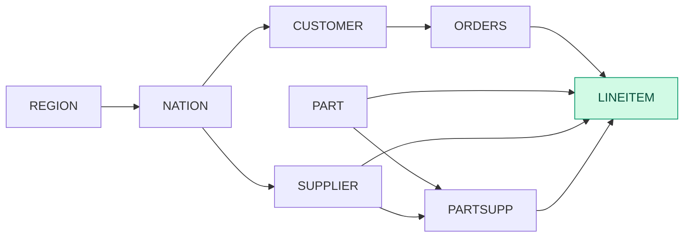

| Step | Step kind | Baseline (ms) | Best (ms) | Baseline implementation | Best implementation |
| --- | --- | --- | --- | --- | --- |
| 0 | SourceTable |  |  |  |  |
| 1 | Filter | 13.8041 | 12.4576 | fuse | nofuse |
| 2 | Project | 5.10027 | 5.10027 | nofuse | nofuse |
| 3 | Reorder | 0.00286277 | 0.00286277 |  |  |
| 4 | GroupBy | 20.5782 | 20.5782 | hash | hash |
| 5 | Sort | 0.494789 | 0.494789 | no_skf | no_skf |
|  | Total | 39.9802 | 38.6337 |  |  |

## Runtime breakdown comparison

| T4 SF1 | T4 SF10 | H200 SF10 | H200 SF30 | H200 SF100 | GH200 SF100 |
| --- | --- | --- | --- | --- | --- |
| 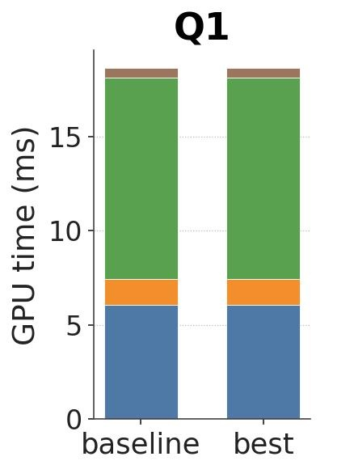 | 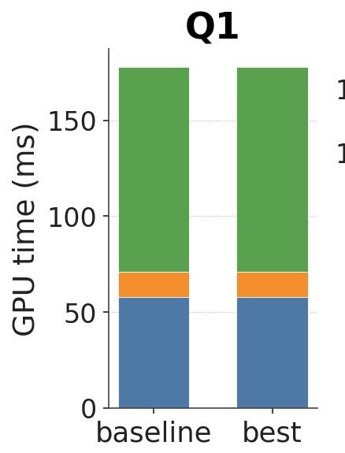 | 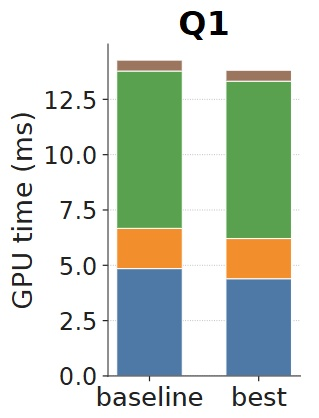 | 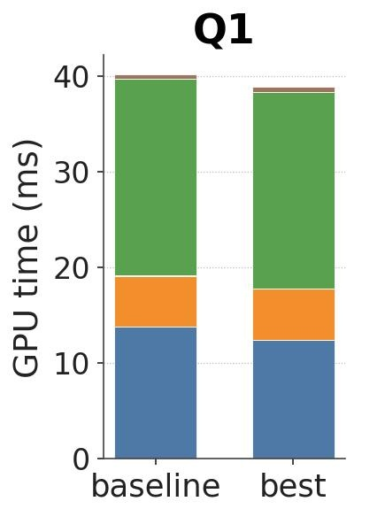 | 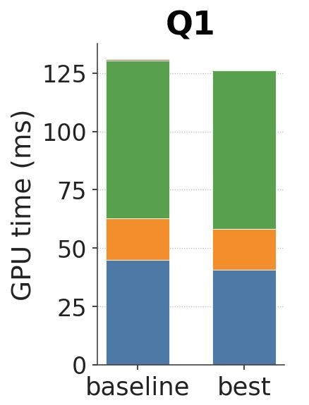 | 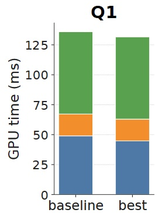 |

# Q2 Minimum Cost Supplier Query

```sql
SELECT
    s_acctbal,
    s_name,
    n_name,
    p_partkey,
    p_mfgr,
    s_address,
    s_phone,
    s_comment
FROM part, supplier, partsupp, nation, region
WHERE (p_partkey = ps_partkey)
    AND (s_suppkey = ps_suppkey)
    AND (p_size = 15)
    AND (p_type LIKE '%BRASS')
    AND (s_nationkey = n_nationkey)
    AND (n_regionkey = r_regionkey)
    AND (r_name = 'EUROPE')
    AND (ps_supplycost = (
        SELECT min(ps_supplycost)
        FROM partsupp, supplier, nation, region
        WHERE (p_partkey = ps_partkey)
            AND (s_suppkey = ps_suppkey)
            AND (s_nationkey = n_nationkey)
            AND (n_regionkey = r_regionkey)
            AND (r_name = 'EUROPE')
    ))
ORDER BY
    s_acctbal DESC,
    n_name,
    s_name,
    p_partkey
LIMIT 100;
```
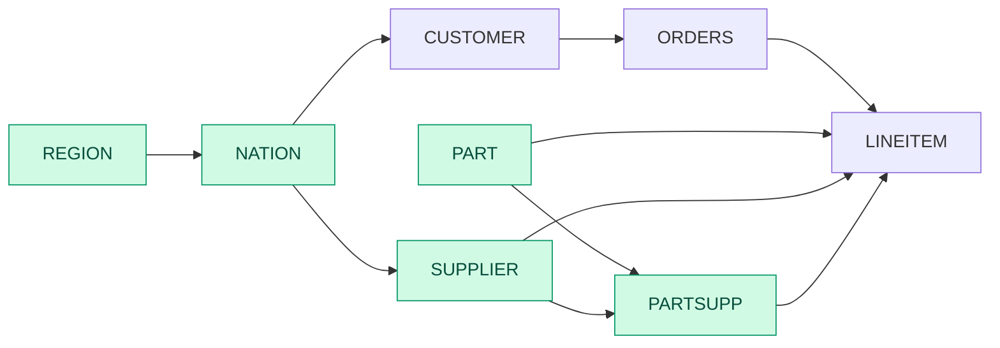

| Step | Step kind | Baseline (ms) | Best (ms) | Baseline implementation | Best implementation |
| --- | --- | --- | --- | --- | --- |
| 0 | SourceTable |  |  |  |  |
| 1 | Filter | 0.0541722 | 0.0541722 | fuse | fuse |
| 2 | SourceTable |  |  |  |  |
| 3 | EqJoin | 0.151251 | 0.124027 | hash_gfur | sort_merge_gfur |
| 4 | Reorder | 0.00500285 | 0.00500285 |  |  |
| 5 | Project | 0.0616293 | 0.0616293 | nofuse | nofuse |
| 6 | SourceTable |  |  |  |  |
| 7 | SourceTable |  |  |  |  |
| 8 | SourceTable |  |  |  |  |
| 9 | Filter | 0.381686 | 0.328879 | fuse | nofuse |
| 10 | Filter | 0.161402 | 0.161402 | fuse | fuse |
| 11 | Project | 0.0028518 | 0.0028518 | nofuse | nofuse |
| 12 | EqJoin | 2.92439 | 2.13293 | hash_gfur | partition_hash_gfur |
| 13 | Reorder | 0.00559729 | 0.00559729 |  |  |
| 14 | EqJoin | 0.601244 | 0.601244 | hash_gfur | hash_gfur |
| 15 | Reorder | 0.0126465 | 0.0126465 |  |  |
| 16 | Project | 0.450909 | 0.450909 | nofuse | nofuse |
| 17 | EqJoin | 0.513428 | 0.513428 | hash_gfur | hash_gfur |
| 18 | Reorder | 0.0149272 | 0.0149272 |  |  |
| 19 | Project | 0.401752 | 0.401752 | nofuse | nofuse |
| 20 | Reorder | 0.0209242 | 0.0209242 |  |  |
| 21 | GroupBy | 0.204087 | 0.122852 | hash | sort_gftr |
| 22 | Project | 0.00283281 | 0.00283281 | nofuse | nofuse |
| 23 | EqJoin | 0.48908 | 0.48908 | hash_gfur | hash_gfur |
| 24 | Reorder | 0.014995 | 0.014995 |  |  |
| 25 | Filter | 0.538385 | 0.538385 | fuse | fuse |
| 26 | Project | 0.00402712 | 0.00402712 | nofuse | nofuse |
| 27 | TopK | 1.41583 | 1.41583 |  |  |
|  | Total | 8.43305 | 7.48032 |  |  |

## Runtime breakdown comparison

| T4 SF1 | T4 SF10 | H200 SF10 | H200 SF30 | H200 SF100 | GH200 SF100 |
| --- | --- | --- | --- | --- | --- |
| 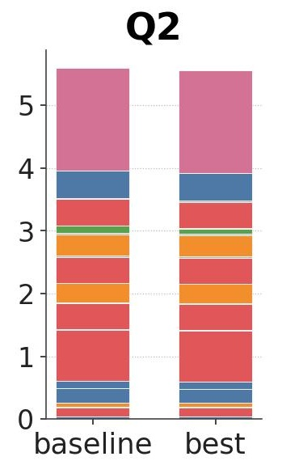 | 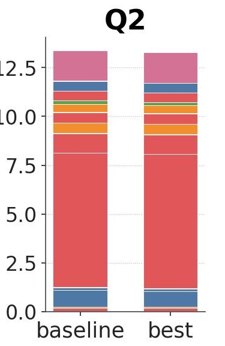 | 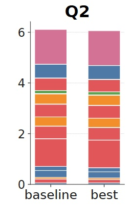 | 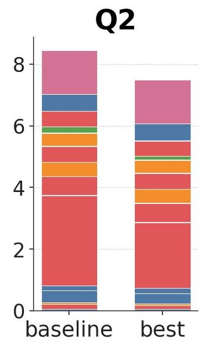 | 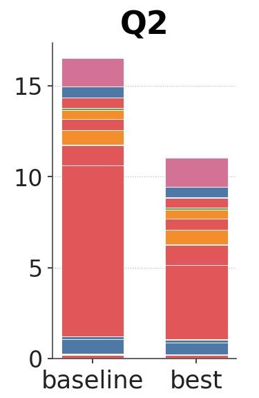 | 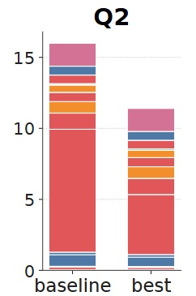 |

# Q3 Shipping Priority Query

This query retrieves the 10 unshipped orders with the highest value.

```sql
SELECT
    l_orderkey,
    sum(l_extendedprice * (1 - l_discount)) AS revenue,
    o_orderdate,
    o_shippriority
FROM customer, orders, lineitem
WHERE (c_mktsegment = 'BUILDING')
    AND (c_custkey = o_custkey)
    AND (l_orderkey = o_orderkey)
    AND (o_orderdate < date '1995-03-15')
    AND (l_shipdate > date '1995-03-15')
GROUP BY
    l_orderkey,
    o_orderdate,
    o_shippriority
ORDER BY
    revenue DESC,
    o_orderdate
LIMIT 10;
```
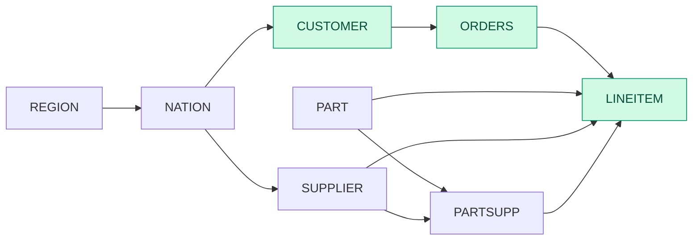

| Step | Step kind | Baseline (ms) | Best (ms) | Baseline implementation | Best implementation |
| --- | --- | --- | --- | --- | --- |
| 0 | SourceTable |  |  |  |  |
| 1 | Filter | 0.139455 | 0.139455 | fuse | fuse |
| 2 | SourceTable |  |  |  |  |
| 3 | Filter | 1.12399 | 0.783824 | fuse | nofuse |
| 4 | EqJoin | 3.50511 | 2.81195 | hash_gfur | partition_hash_gfur |
| 5 | Reorder | 0.00291927 | 0.00291927 |  |  |
| 6 | SourceTable |  |  |  |  |
| 7 | Filter | 4.19718 | 2.86116 | fuse | nofuse |
| 8 | EqJoin | 12.7767 | 4.84361 | hash_gfur | partition_hash_gfur |
| 9 | Reorder | 0.00286545 | 0.00286545 |  |  |
| 10 | Project | 0.0499564 | 0.0499564 | nofuse | nofuse |
| 11 | Reorder | 0.00292945 | 0.00292945 |  |  |
| 12 | GroupBy | 0.207052 | 0.207052 | hash | hash |
| 13 | Project | 0.00287127 | 0.00287127 | nofuse | nofuse |
| 14 | TopK | 0.677769 | 0.677769 |  |  |
|  | Total | 22.6888 | 12.3864 |  |  |

## Runtime breakdown comparison

| T4 SF1 | T4 SF10 | H200 SF10 | H200 SF30 | H200 SF100 | GH200 SF100 |
| --- | --- | --- | --- | --- | --- |
| 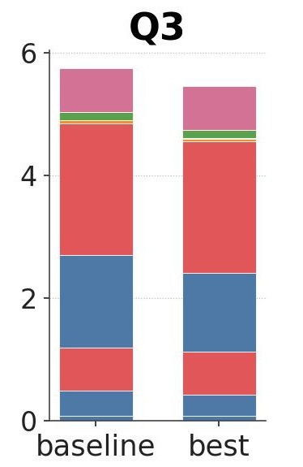 | 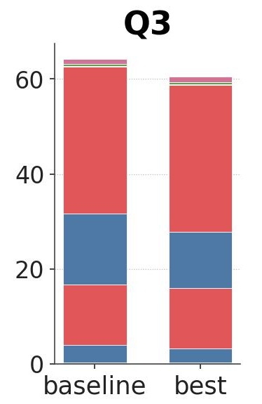 | 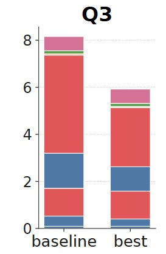 | 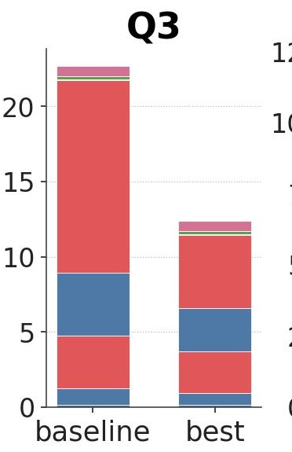 | 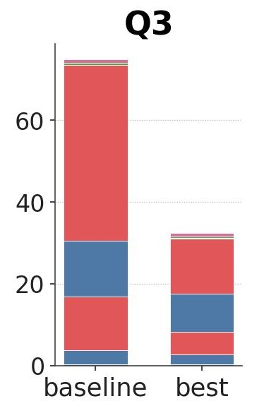 | 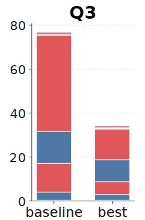 |

# Q4 Order Priority Checking Query

This query determines how well the order priority system is working and gives an assessment of customer satisfaction.

```sql
SELECT
    o_orderpriority,
    count(*) AS order_count
FROM orders
WHERE (o_orderdate >= date '1993-07-01')
    AND (o_orderdate < date '1993-07-01' + INTERVAL 3 MONTH)
    AND EXISTS (
        SELECT *
        FROM lineitem
        WHERE (l_orderkey = o_orderkey)
            AND (l_commitdate < l_receiptdate)
    )
GROUP BY o_orderpriority
ORDER BY o_orderpriority;
```
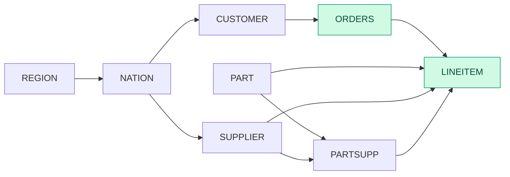

| Step | Step kind | Baseline (ms) | Best (ms) | Baseline implementation | Best implementation |
| --- | --- | --- | --- | --- | --- |
| 0 | SourceTable |  |  |  |  |
| 1 | Filter | 1.61498 | 0.996165 | fuse | nofuse |
| 2 | SourceTable |  |  |  |  |
| 3 | Filter | 2.15824 | 1.28266 | fuse | nofuse |
| 4 | SemiJoin | 7.87283 | 7.87283 |  |  |
| 5 | Reorder | 0.00627581 | 0.00627581 |  |  |
| 6 | Reorder | 0.0028579 | 0.0028579 |  |  |
| 7 | GroupBy | 0.20773 | 0.20773 | hash | hash |
| 8 | Sort | 0.132041 | 0.132041 | no_skf | no_skf |
|  | Total | 11.995 | 10.5006 |  |  |

## Runtime breakdown comparison

| T4 SF1 | T4 SF10 | H200 SF10 | H200 SF30 | H200 SF100 | GH200 SF100 |
| --- | --- | --- | --- | --- | --- |
| 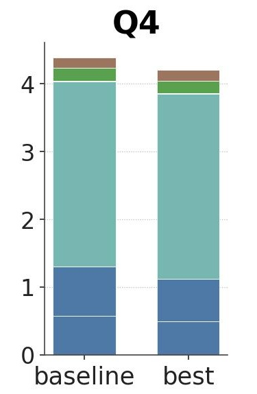 | 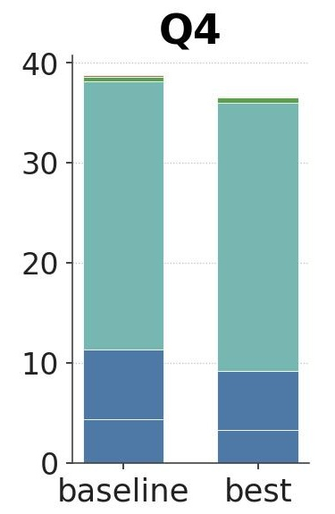 | 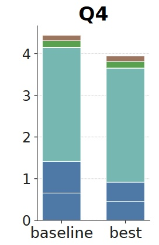 | 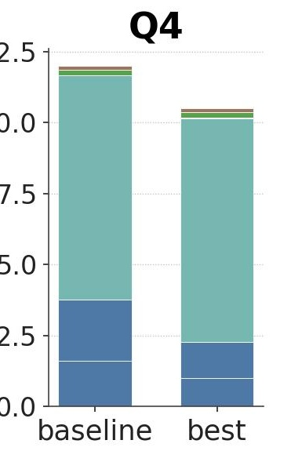 | 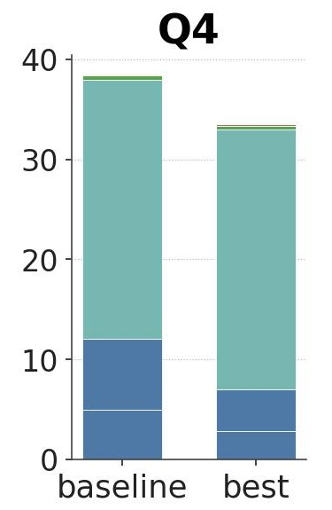 | 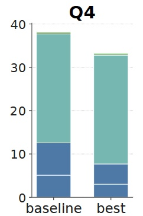 |

# Q5 Local Supplier Volume Query

This query lists the revenue volume done through local suppliers.

```sql
SELECT
    n_name,
    sum(l_extendedprice * (1 - l_discount)) AS revenue
FROM customer, orders, lineitem, supplier, nation, region
WHERE (c_custkey = o_custkey)
    AND (l_orderkey = o_orderkey)
    AND (l_suppkey = s_suppkey)
    AND (c_nationkey = s_nationkey)
    AND (s_nationkey = n_nationkey)
    AND (n_regionkey = r_regionkey)
    AND (r_name = 'ASIA')
    AND (o_orderdate >= date '1994-01-01')
    AND (o_orderdate < date '1994-01-01' + INTERVAL 1 YEAR)
GROUP BY n_name
ORDER BY revenue DESC;
```
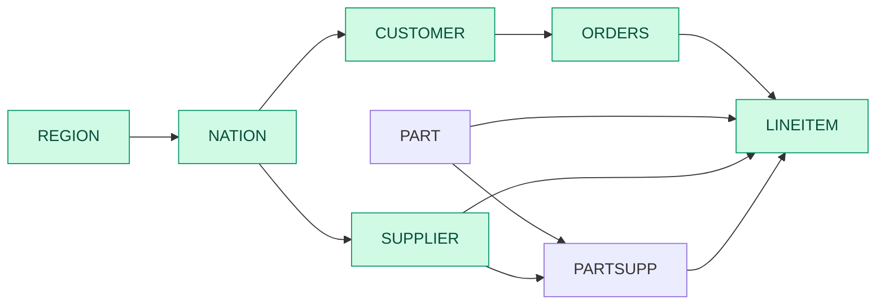

| Step | Step kind | Baseline (ms) | Best (ms) | Baseline implementation | Best implementation |
| --- | --- | --- | --- | --- | --- |
| 0 | SourceTable |  |  |  |  |
| 1 | SourceTable |  |  |  |  |
| 2 | Filter | 1.25158 | 0.632098 | fuse | nofuse |
| 3 | EqJoin | 2.02166 | 1.48944 | hash_gfur | sort_merge_gftr |
| 4 | Reorder | 0.00287262 | 0.00287262 |  |  |
| 5 | SourceTable |  |  |  |  |
| 6 | EqJoin | 26.1626 | 9.55164 | hash_gfur | partition_hash_gfur |
| 7 | Reorder | 0.00283077 | 0.00283077 |  |  |
| 8 | SourceTable |  |  |  |  |
| 9 | Filter | 0.0518474 | 0.0518474 | fuse | fuse |
| 10 | SourceTable |  |  |  |  |
| 11 | EqJoin | 0.155375 | 0.129288 | hash_gfur | sort_merge_gfur |
| 12 | Reorder | 0.00502892 | 0.00502892 |  |  |
| 13 | SourceTable |  |  |  |  |
| 14 | EqJoin | 0.200738 | 0.200738 | hash_gfur | hash_gfur |
| 15 | Reorder | 0.00514708 | 0.00514708 |  |  |
| 16 | EqJoin | 8.87425 | 6.09994 | hash_gfur | sort_merge_gfur |
| 17 | Reorder | 0.00654523 | 0.00654523 |  |  |
| 18 | Filter | 0.327966 | 0.289184 | fuse | nofuse |
| 19 | Project | 0.0271754 | 0.0271754 | nofuse | nofuse |
| 20 | Reorder | 0.00285046 | 0.00285046 |  |  |
| 21 | GroupBy | 0.130198 | 0.130198 | hash | hash |
| 22 | Sort | 0.0835668 | 0.0835668 | no_skf | no_skf |
|  | Total | 39.3122 | 18.7104 |  |  |

## Runtime breakdown comparison

| T4 SF1 | T4 SF10 | H200 SF10 | H200 SF30 | H200 SF100 | GH200 SF100 |
| --- | --- | --- | --- | --- | --- |
| 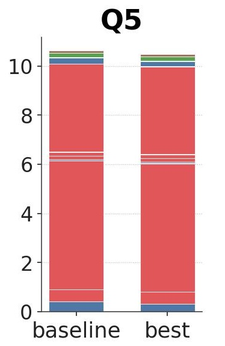 | 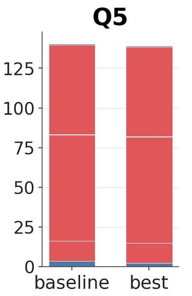 | 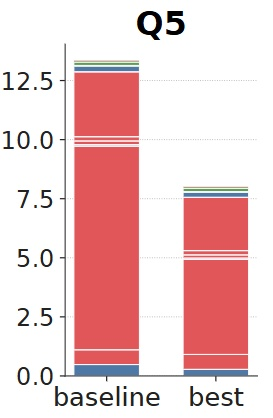 | 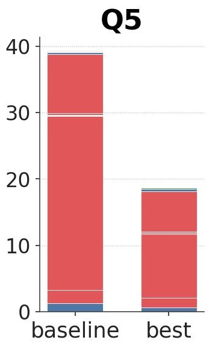 |  | 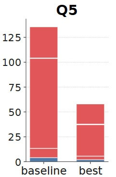 |

# Q6 Forecasting Revenue Change Query

This query quantifies the amount of revenue increase that would have resulted from eliminating certain company-wide discounts in a given percentage range in a given year. Asking this type of "what if" query can be used to look for ways to increase revenues.

```sql
SELECT
    sum(l_extendedprice * l_discount) AS revenue
FROM lineitem
WHERE (l_shipdate >= date '1994-01-01')
    AND (l_shipdate < date '1994-01-01' + INTERVAL 1 YEAR)
    AND (l_discount BETWEEN 0.06::Decimal(12,2) - 0.01::Decimal(12,2) AND 0.06::Decimal(12,2) + 0.01::Decimal(12,2))
    AND (l_quantity < 24);
```


| Step | Step kind | Baseline (ms) | Best (ms) | Baseline implementation | Best implementation |
| --- | --- | --- | --- | --- | --- |
| 0 | SourceTable |  |  |  |  |
| 1 | Filter | 10.3401 | 3.95615 | fuse | nofuse |
| 2 | Project | 0.0302673 | 0.0302673 | nofuse | nofuse |
| 3 | Reorder | 0.002832 | 0.002832 |  |  |
| 4 | ScalarAgg | 0.0386447 | 0.0386447 |  |  |
|  | Total | 10.4118 | 4.02789 |  |  |

## Runtime breakdown comparison

| T4 SF1 | T4 SF10 | H200 SF10 | H200 SF30 | H200 SF100 | GH200 SF100 |
| --- | --- | --- | --- | --- | --- |
| 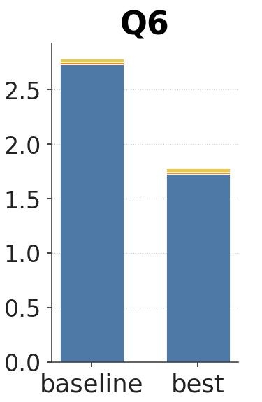 | 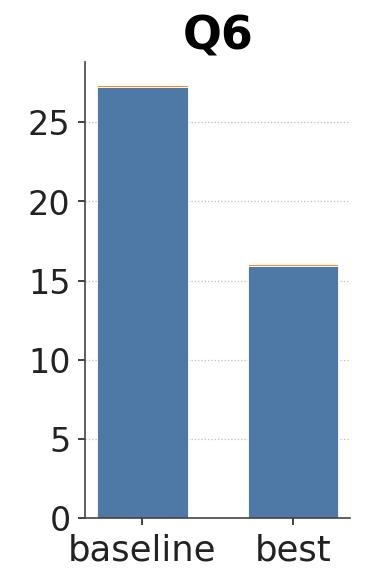 | 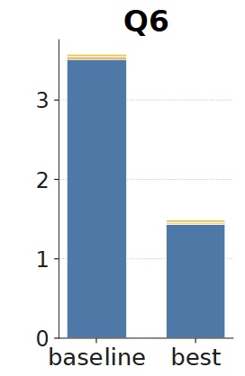 | 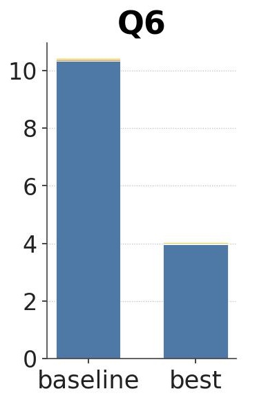 | 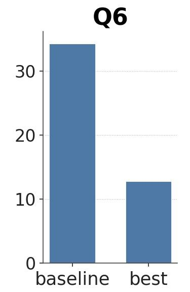 | 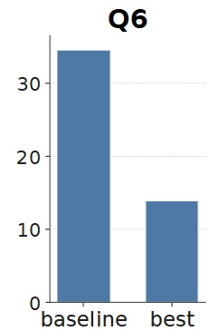 |

# Q7 Volume Shipping Query

This query determines the value of goods shipped between certain nations to help in the re-negotiation of shipping contracts.

```sql
SELECT
    supp_nation,
    cust_nation,
    l_year,
    sum(volume) AS revenue
FROM (
    SELECT
        n1.n_name AS supp_nation,
        n2.n_name AS cust_nation,
        extract(year FROM l_shipdate) AS l_year,
        l_extendedprice * (1 - l_discount) AS volume
    FROM supplier, lineitem, orders, customer, nation AS n1, nation AS n2
    WHERE (s_suppkey = l_suppkey)
        AND (o_orderkey = l_orderkey)
        AND (c_custkey = o_custkey)
        AND (s_nationkey = n1.n_nationkey)
        AND (c_nationkey = n2.n_nationkey)
        AND (
            ((n1.n_name = 'FRANCE') AND (n2.n_name = 'GERMANY'))
            OR ((n1.n_name = 'GERMANY') AND (n2.n_name = 'FRANCE'))
        )
        AND (l_shipdate BETWEEN date '1995-01-01' AND date '1996-12-31')
) AS shipping
GROUP BY
    supp_nation,
    cust_nation,
    l_year
ORDER BY
    supp_nation,
    cust_nation,
    l_year;
```
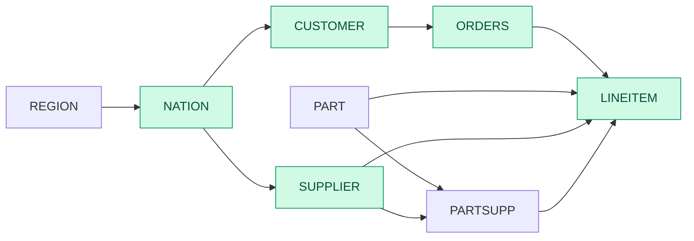

| Step | Step kind | Baseline (ms) | Best (ms) | Baseline implementation | Best implementation |
| --- | --- | --- | --- | --- | --- |
| 0 | SourceTable |  |  |  |  |
| 1 | Filter | 0.14132 | 0.14132 | fuse | fuse |
| 2 | SourceTable |  |  |  |  |
| 3 | EqJoin | 0.174787 | 0.174787 | hash_gfur | hash_gfur |
| 4 | Reorder | 0.0048368 | 0.0048368 |  |  |
| 5 | SourceTable |  |  |  |  |
| 6 | Filter | 6.68028 | 4.15327 | fuse | nofuse |
| 7 | EqJoin | 7.5634 | 4.09045 | hash_gfur | partition_hash_gfur |
| 8 | Reorder | 0.0066752 | 0.0066752 |  |  |
| 9 | SourceTable |  |  |  |  |
| 10 | EqJoin | 7.97811 | 4.17453 | hash_gfur | partition_hash_gfur |
| 11 | Reorder | 0.006416 | 0.006416 |  |  |
| 12 | SourceTable |  |  |  |  |
| 13 | Filter | 0.150875 | 0.150875 | fuse | fuse |
| 14 | SourceTable |  |  |  |  |
| 15 | EqJoin | 0.640696 | 0.409179 | hash_gfur | sort_merge_gfur |
| 16 | Reorder | 0.0049824 | 0.0049824 |  |  |
| 17 | EqJoin | 0.818173 | 0.818173 | hash_gfur | hash_gfur |
| 18 | Reorder | 0.0082976 | 0.0082976 |  |  |
| 19 | Filter | 0.38912 | 0.38912 | fuse | fuse |
| 20 | Project | 0.0381584 | 0.0381584 | nofuse | nofuse |
| 21 | Reorder | 0.0028672 | 0.0028672 |  |  |
| 22 | GroupBy | 0.233565 | 0.233565 | hash | hash |
| 23 | Sort | 0.526722 | 0.526722 | no_skf | no_skf |
|  | Total | 25.3693 | 15.3342 |  |  |

## Runtime breakdown comparison

| T4 SF1 | T4 SF10 | H200 SF10 | H200 SF30 | H200 SF100 | GH200 SF100 |
| --- | --- | --- | --- | --- | --- |
| 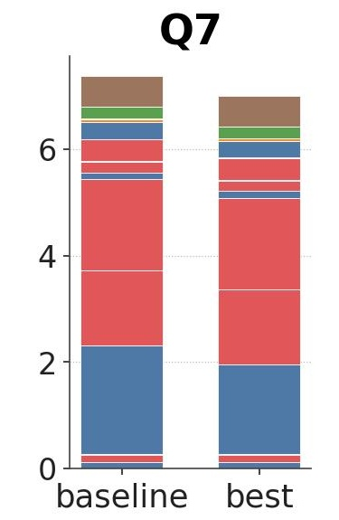 | 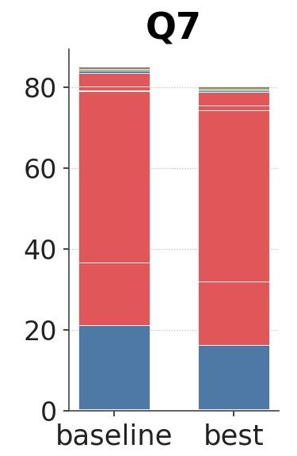 | 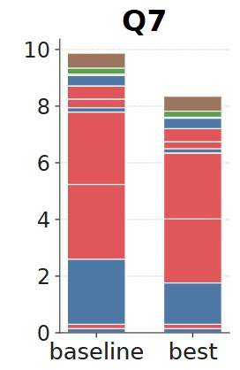 | 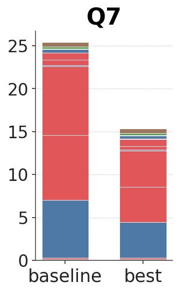 | 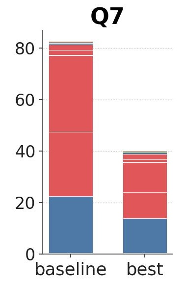 | 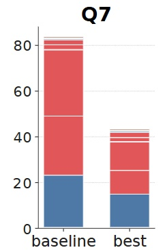 |

# Q8 National Market Share Query

This query determines how the market share of a given nation within a given region has changed over two years for a given part type.

```sql
SELECT
    o_year,
    sum(CASE
        WHEN nation = 'BRAZIL' THEN volume
        ELSE 0
    END) / sum(volume) AS mkt_share
FROM (
    SELECT
        extract(year FROM o_orderdate) AS o_year,
        l_extendedprice * (1 - l_discount) AS volume,
        n2.n_name AS nation
    FROM part, supplier, lineitem, orders, customer, nation AS n1, nation AS n2, region
    WHERE (p_partkey = l_partkey)
        AND (s_suppkey = l_suppkey)
        AND (l_orderkey = o_orderkey)
        AND (o_custkey = c_custkey)
        AND (c_nationkey = n1.n_nationkey)
        AND (n1.n_regionkey = r_regionkey)
        AND (r_name = 'AMERICA')
        AND (s_nationkey = n2.n_nationkey)
        AND (o_orderdate BETWEEN date '1995-01-01' AND date '1996-12-31')
        AND (p_type = 'ECONOMY ANODIZED STEEL')
) AS all_nations
GROUP BY o_year
ORDER BY o_year;
```
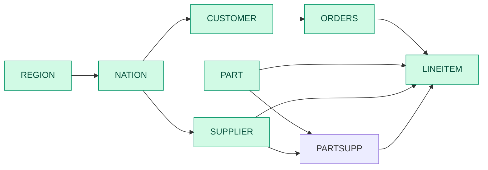

| Step | Step kind | Baseline (ms) | Best (ms) | Baseline implementation | Best implementation |
| --- | --- | --- | --- | --- | --- |
| 0 | SourceTable |  |  |  |  |
| 1 | Filter | 0.0546987 | 0.0546987 | fuse | fuse |
| 2 | SourceTable |  |  |  |  |
| 3 | EqJoin | 0.0963477 | 0.0696693 | hash_gfur | sort_merge_gftr |
| 4 | Reorder | 0.0028352 | 0.0028352 |  |  |
| 5 | SourceTable |  |  |  |  |
| 6 | EqJoin | 0.666157 | 0.345371 | hash_gfur | sort_merge_gftr |
| 7 | Reorder | 0.00281387 | 0.00281387 |  |  |
| 8 | SourceTable |  |  |  |  |
| 9 | Filter | 1.372 | 0.746891 | fuse | nofuse |
| 10 | EqJoin | 2.30751 | 1.92809 | hash_gfur | sort_merge_gfur |
| 11 | Reorder | 0.0028672 | 0.0028672 |  |  |
| 12 | SourceTable |  |  |  |  |
| 13 | EqJoin | 24.2375 | 8.62113 | hash_gfur | partition_hash_gfur |
| 14 | Reorder | 0.00282453 | 0.00282453 |  |  |
| 15 | SourceTable |  |  |  |  |
| 16 | Filter | 0.142871 | 0.142871 | fuse | fuse |
| 17 | EqJoin | 1.0324 | 1.0324 | hash_gfur | hash_gfur |
| 18 | Reorder | 0.00293333 | 0.00293333 |  |  |
| 19 | SourceTable |  |  |  |  |
| 20 | EqJoin | 0.257178 | 0.257178 | hash_gfur | hash_gfur |
| 21 | Reorder | 0.0029248 | 0.0029248 |  |  |
| 22 | SourceTable |  |  |  |  |
| 23 | EqJoin | 3.51339 | 1.2389 | hash_gfur | partition_hash_gfur |
| 24 | Reorder | 0.0068096 | 0.0068096 |  |  |
| 25 | Project | 0.0914155 | 0.0914155 | nofuse | nofuse |
| 26 | Project | 0.0270037 | 0.0270037 | nofuse | nofuse |
| 27 | Project | 0.0120747 | 0.0120747 | nofuse | nofuse |
| 28 | Reorder | 0.00286507 | 0.00286507 |  |  |
| 29 | GroupBy | 0.0988053 | 0.0988053 | hash | hash |
| 30 | Project | 0.0114304 | 0.0114304 | nofuse | nofuse |
| 31 | Sort | 0.0129493 | 0.0129493 | no_skf | no_skf |
|  | Total | 33.9606 | 14.7178 |  |  |

## Runtime breakdown comparison

| T4 SF1 | T4 SF10 | H200 SF10 | H200 SF30 | H200 SF100 | GH200 SF100 |
| --- | --- | --- | --- | --- | --- |
| 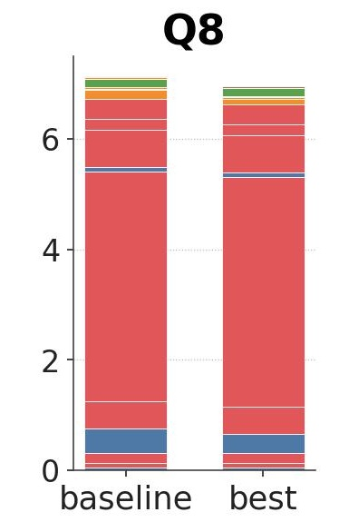 | 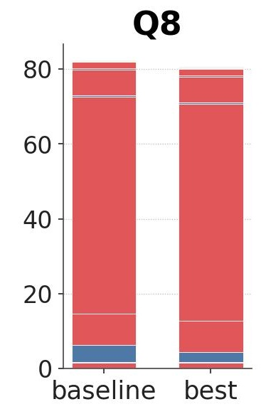 |  |  |  |  |

# Q9 Product Type Profit Measure Query

This query determines how much profit is made on a given line of parts, broken out by supplier nation and year.

```sql
SELECT
    nation,
    o_year,
    sum(amount) AS sum_profit
FROM (
    SELECT
        n_name AS nation,
        extract(year FROM o_orderdate) AS o_year,
        l_extendedprice * (1 - l_discount) - ps_supplycost * l_quantity AS amount
    FROM part, supplier, lineitem, partsupp, orders, nation
    WHERE (s_suppkey = l_suppkey)
        AND (ps_suppkey = l_suppkey)
        AND (ps_partkey = l_partkey)
        AND (p_partkey = l_partkey)
        AND (o_orderkey = l_orderkey)
        AND (s_nationkey = n_nationkey)
        AND (p_name LIKE '%green%')
) AS profit
GROUP BY
    nation,
    o_year
ORDER BY
    nation,
    o_year DESC;
```


| Step | Step kind | Baseline (ms) | Best (ms) | Baseline implementation | Best implementation |
| --- | --- | --- | --- | --- | --- |
| 0 | SourceTable |  |  |  |  |
| 1 | SourceTable |  |  |  |  |
| 2 | Filter | 0.47048 | 0.47048 | fuse | fuse |
| 3 | SourceTable |  |  |  |  |
| 4 | EqJoin | 23.4406 | 9.32189 | hash_gfur | partition_hash_gfur |
| 5 | Reorder | 0.0029408 | 0.0029408 |  |  |
| 6 | SourceTable |  |  |  |  |
| 7 | EqJoin | 3.72616 | 2.69062 | hash_gfur | sort_merge_gfur |
| 8 | Reorder | 0.0028064 | 0.0028064 |  |  |
| 9 | SourceTable |  |  |  |  |
| 10 | EqJoin | 9.54078 | 9.54078 | hash_gfur | hash_gfur |
| 11 | Reorder | 0.0029312 | 0.0029312 |  |  |
| 12 | Filter | 1.42804 | 1.27769 | fuse | nofuse |
| 13 | SourceTable |  |  |  |  |
| 14 | EqJoin | 12.3746 | 4.57023 | hash_gfur | partition_hash_gftr |
| 15 | Reorder | 0.0029184 | 0.0029184 |  |  |
| 16 | EqJoin | 2.42436 | 2.42436 | hash_gfur | hash_gfur |
| 17 | Reorder | 0.0063264 | 0.0063264 |  |  |
| 18 | Project | 0.814374 | 0.814374 | nofuse | nofuse |
| 19 | Reorder | 0.0058624 | 0.0058624 |  |  |
| 20 | GroupBy | 0.635917 | 0.635917 | hash | hash |
| 21 | Sort | 0.596019 | 0.596019 | no_skf | no_skf |
|  | Total | 55.4751 | 32.3661 |  |  |

## Runtime breakdown comparison

| T4 SF1 | T4 SF10 | H200 SF10 | H200 SF30 | H200 SF100 | GH200 SF100 |
| --- | --- | --- | --- | --- | --- |
|  |  |  |  |  |  |

# Q10 Returned Item Reporting Query

The query identifies customers who might be having problems with the parts that are shipped to them.

```sql
SELECT
    c_custkey,
    c_name,
    sum(l_extendedprice * (1 - l_discount)) AS revenue,
    c_acctbal,
    n_name,
    c_address,
    c_phone,
    c_comment
FROM customer, orders, lineitem, nation
WHERE (c_custkey = o_custkey)
    AND (l_orderkey = o_orderkey)
    AND (o_orderdate >= date '1993-10-01')
    AND (o_orderdate < date '1993-10-01' + INTERVAL 3 MONTH)
    AND (l_returnflag = 'R')
    AND (c_nationkey = n_nationkey)
GROUP BY
    c_custkey,
    c_name,
    c_acctbal,
    c_phone,
    n_name,
    c_address,
    c_comment
ORDER BY revenue DESC
LIMIT 20;
```


| Step | Step kind | Baseline (ms) | Best (ms) | Baseline implementation | Best implementation |
| --- | --- | --- | --- | --- | --- |
| 0 | SourceTable |  |  |  |  |
| 1 | SourceTable |  |  |  |  |
| 2 | SourceTable |  |  |  |  |
| 3 | Filter | 3.43499 | 3.43499 | fuse | fuse |
| 4 | SourceTable |  |  |  |  |
| 5 | Filter | 1.2427 | 0.618142 | fuse | nofuse |
| 6 | EqJoin | 5.53664 | 3.52219 | hash_gfur | partition_hash_gfur |
| 7 | Reorder | 0.00282743 | 0.00282743 |  |  |
| 8 | Project | 0.0742651 | 0.0742651 | nofuse | nofuse |
| 9 | Reorder | 0.00293143 | 0.00293143 |  |  |
| 10 | GroupBy | 0.434533 | 0.434533 | hash | hash |
| 11 | EqJoin | 2.94274 | 2.79178 | hash_gfur | sort_merge_gfur |
| 12 | Reorder | 0.0111166 | 0.0111166 |  |  |
| 13 | EqJoin | 2.23831 | 2.23831 | hash_gfur | hash_gfur |
| 14 | Reorder | 0.0139897 | 0.0139897 |  |  |
| 15 | Project | 1.98489 | 1.98489 | nofuse | nofuse |
| 16 | TopK | 0.503106 | 0.503106 |  |  |
|  | Total | 18.423 | 15.6331 |  |  |

## Runtime breakdown comparison

| T4 SF1 | T4 SF10 | H200 SF10 | H200 SF30 | H200 SF100 | GH200 SF100 |
| --- | --- | --- | --- | --- | --- |
|  |  |  |  |  |  |

# Q11 Important Stock Identification Query

This query finds the most important subset of suppliers' stock in a given nation.
The FRACTION parameter in the HAVING clause is 0.0001 / SF (spec section 2.4.11.3).
Current value 0.0001 is for SF = 1. See the README (section Q11) for other scale factors.

```sql
SELECT
    ps_partkey,
    sum(ps_supplycost * ps_availqty) AS value
FROM partsupp, supplier, nation
WHERE (ps_suppkey = s_suppkey)
    AND (s_nationkey = n_nationkey)
    AND (n_name = 'GERMANY')
GROUP BY ps_partkey
HAVING sum(ps_supplycost * ps_availqty) > (
    SELECT sum(ps_supplycost * ps_availqty) * 0.0001
    FROM partsupp, supplier, nation
    WHERE (ps_suppkey = s_suppkey)
        AND (s_nationkey = n_nationkey)
        AND (n_name = 'GERMANY')
)
ORDER BY value DESC;
```


| Step | Step kind | Baseline (ms) | Best (ms) | Baseline implementation | Best implementation |
| --- | --- | --- | --- | --- | --- |
| 0 | SourceTable |  |  |  |  |
| 1 | SourceTable |  |  |  |  |
| 2 | Filter | 0.0581541 | 0.0581541 | nofuse | nofuse |
| 3 | SourceTable |  |  |  |  |
| 4 | EqJoin | 0.119453 | 0.101328 | hash_gfur | sort_merge_gftr |
| 5 | Reorder | 0.00296126 | 0.00296126 |  |  |
| 6 | EqJoin | 5.92019 | 2.84951 | hash_gfur | partition_hash_gfur |
| 7 | Reorder | 0.00288421 | 0.00288421 |  |  |
| 8 | Project | 0.0462143 | 0.0263886 | fuse | nofuse |
| 9 | Reorder | 0.0167225 | 0.0167225 |  |  |
| 10 | GroupBy | 0.238239 | 0.220509 | hash | sort_gftr |
| 11 | Reorder | 0.00286147 | 0.00286147 |  |  |
| 12 | ScalarAgg | 0.0330926 | 0.0330926 |  |  |
| 13 | Project | 0.0154787 | 0.0107764 | fuse | nofuse |
| 14 | CrossJoin | 0.0645288 | 0.0645288 |  |  |
| 15 | Filter | 0.0832354 | 0.0832354 | nofuse | nofuse |
| 16 | Project | 0.00291832 | 0.00291832 | fuse | fuse |
| 17 | Sort | 0.00293095 | 0.00293095 | no_skf | no_skf |
|  | Total | 6.60986 | 3.4788 |  |  |

## Runtime breakdown comparison

| T4 SF1 | T4 SF10 | H200 SF10 | H200 SF30 | H200 SF100 | GH200 SF100 |
| --- | --- | --- | --- | --- | --- |
|  |  |  |  |  |  |

# Q12 Shipping Modes and Order Priority Query

This query determines whether selecting less expensive modes of shipping is negatively affecting the critical-priority orders by causing more parts to be received by customers after the committed date.

```sql
SELECT
    l_shipmode,
    sum(CASE
        WHEN (o_orderpriority = '1-URGENT')
            OR (o_orderpriority = '2-HIGH')
            THEN 1
        ELSE 0
    END) AS high_line_count,
    sum(CASE
        WHEN (o_orderpriority <> '1-URGENT')
            AND (o_orderpriority <> '2-HIGH')
            THEN 1
        ELSE 0
    END) AS low_line_count
FROM orders, lineitem
WHERE (o_orderkey = l_orderkey)
    AND (l_shipmode IN ('MAIL', 'SHIP'))
    AND (l_commitdate < l_receiptdate)
    AND (l_shipdate < l_commitdate)
    AND (l_receiptdate >= date '1994-01-01')
    AND (l_receiptdate < date '1994-01-01' + INTERVAL 1 YEAR)
GROUP BY l_shipmode
ORDER BY l_shipmode;
```


| Step | Step kind | Baseline (ms) | Best (ms) | Baseline implementation | Best implementation |
| --- | --- | --- | --- | --- | --- |
| 0 | SourceTable |  |  |  |  |
| 1 | SourceTable |  |  |  |  |
| 2 | Filter | 12.0851 | 7.65464 | fuse | nofuse |
| 3 | EqJoin | 4.02549 | 3.29251 | hash_gfur | partition_hash_gfur |
| 4 | Reorder | 0.007104 | 0.007104 |  |  |
| 5 | Project | 0.156638 | 0.156638 | nofuse | nofuse |
| 6 | Project | 0.0506997 | 0.0506997 | nofuse | nofuse |
| 7 | Reorder | 0.00288107 | 0.00288107 |  |  |
| 8 | GroupBy | 0.18047 | 0.18047 | hash | hash |
| 9 | Sort | 0.133289 | 0.133289 | no_skf | no_skf |
|  | Total | 16.6417 | 11.4782 |  |  |

## Runtime breakdown comparison

| T4 SF1 | T4 SF10 | H200 SF10 | H200 SF30 | H200 SF100 | GH200 SF100 |
| --- | --- | --- | --- | --- | --- |
|  |  |  |  |  |  |

# Q13 Customer Distribution Query

This query seeks relationships between customers and the size of their orders.

```sql
SELECT
    c_count,
    count(*) AS custdist
FROM (
    SELECT
        c_custkey,
        count(o_orderkey) AS c_count
    FROM customer
    LEFT OUTER JOIN orders ON (c_custkey = o_custkey)
        AND (o_comment NOT LIKE '%special%requests%')
    GROUP BY c_custkey
) AS c_orders
GROUP BY c_count
ORDER BY
    custdist DESC,
    c_count DESC;
```


| Step | Step kind | Baseline (ms) | Best (ms) | Baseline implementation | Best implementation |
| --- | --- | --- | --- | --- | --- |
| 0 | SourceTable |  |  |  |  |
| 1 | SourceTable |  |  |  |  |
| 2 | Filter | 4.2818 | 4.2818 | nofuse | nofuse |
| 3 | EqJoin | 11.5211 | 4.78893 | hash_gfur | partition_hash_gfur |
| 4 | Reorder | 0.003104 | 0.003104 |  |  |
| 5 | Reorder | 0.002928 | 0.002928 |  |  |
| 6 | GroupBy | 6.12645 | 4.10444 | hash | partition_gftr |
| 7 | AntiJoin | 3.08139 | 3.08139 |  |  |
| 8 | Reorder | 0.0028192 | 0.0028192 |  |  |
| 9 | Project | 0.0239488 | 0.0239488 | nofuse | nofuse |
| 10 | Concat | 0.0640752 | 0.0640752 |  |  |
| 11 | Reorder | 0.0028336 | 0.0028336 |  |  |
| 12 | GroupBy | 0.234984 | 0.234984 | hash | hash |
| 13 | Sort | 0.262582 | 0.125408 | no_skf | skf |
|  | Total | 25.608 | 16.7167 |  |  |

## Runtime breakdown comparison

| T4 SF1 | T4 SF10 | H200 SF10 | H200 SF30 | H200 SF100 | GH200 SF100 |
| --- | --- | --- | --- | --- | --- |
|  |  |  |  |  |  |

# Q14 Promotion Effect Query

This query monitors the market response to a promotion such as TV advertisements or a special campaign.

```sql
SELECT
    100.00 * sum(CASE
        WHEN p_type LIKE 'PROMO%'
            THEN l_extendedprice * (1 - l_discount)
        ELSE 0
    END) / sum(l_extendedprice * (1 - l_discount)) AS promo_revenue
FROM lineitem, part
WHERE (l_partkey = p_partkey)
    AND (l_shipdate >= date '1995-09-01')
    AND (l_shipdate < date '1995-09-01' + INTERVAL 1 MONTH);
```


| Step | Step kind | Baseline (ms) | Best (ms) | Baseline implementation | Best implementation |
| --- | --- | --- | --- | --- | --- |
| 0 | SourceTable |  |  |  |  |
| 1 | Filter | 5.31346 | 2.79294 | fuse | nofuse |
| 2 | SourceTable |  |  |  |  |
| 3 | EqJoin | 1.77257 | 1.59483 | hash_gfur | sort_merge_gfur |
| 4 | Reorder | 0.00619409 | 0.00619409 |  |  |
| 5 | Project | 0.0958432 | 0.0958432 | nofuse | nofuse |
| 6 | Project | 0.0225447 | 0.0225447 | nofuse | nofuse |
| 7 | Reorder | 0.00288742 | 0.00288742 |  |  |
| 8 | ScalarAgg | 0.0657122 | 0.0657122 |  |  |
| 9 | Project | 0.0208686 | 0.0208686 | nofuse | nofuse |
|  | Total | 7.30008 | 4.60182 |  |  |

## Runtime breakdown comparison

| T4 SF1 | T4 SF10 | H200 SF10 | H200 SF30 | H200 SF100 | GH200 SF100 |
| --- | --- | --- | --- | --- | --- |
|  |  |  |  |  |  |

# Q15 Top Supplier Query

This query determines the top supplier so it can be rewarded, given more business, or identified for special recognition.

```sql
CREATE VIEW revenue0 AS
    SELECT
        l_suppkey AS supplier_no,
        sum(l_extendedprice * (1 - l_discount)) AS total_revenue
    FROM lineitem
    WHERE (l_shipdate >= date '1996-01-01')
        AND (l_shipdate < date '1996-01-01' + INTERVAL 3 MONTH)
    GROUP BY l_suppkey;


SELECT
    s_suppkey,
    s_name,
    s_address,
    s_phone,
    total_revenue
FROM supplier, revenue0
WHERE (s_suppkey = supplier_no)
    AND (total_revenue = (
        SELECT max(total_revenue)
        FROM revenue0
    ))
ORDER BY s_suppkey;

DROP VIEW revenue0;
```


| Step | Step kind | Baseline (ms) | Best (ms) | Baseline implementation | Best implementation |
| --- | --- | --- | --- | --- | --- |
| 0 | SourceTable |  |  |  |  |
| 1 | SourceTable |  |  |  |  |
| 2 | Filter | 5.41232 | 2.88965 | fuse | nofuse |
| 3 | Project | 0.0874301 | 0.0874301 | nofuse | nofuse |
| 4 | Reorder | 0.00291682 | 0.00291682 |  |  |
| 5 | GroupBy | 0.495943 | 0.495943 | hash | hash |
| 6 | Reorder | 0.00828142 | 0.00828142 |  |  |
| 7 | ScalarAgg | 0.0319106 | 0.0319106 |  |  |
| 8 | CrossJoin | 0.0502553 | 0.0502553 |  |  |
| 9 | Filter | 0.0851257 | 0.0752375 | fuse | nofuse |
| 10 | EqJoin | 0.270024 | 0.270024 | hash_gfur | hash_gfur |
| 11 | Reorder | 0.00886707 | 0.00886707 |  |  |
| 12 | Project | 0.181322 | 0.181322 | nofuse | nofuse |
| 13 | Sort | 0.207537 | 0.207537 | no_skf | no_skf |
|  | Total | 6.84193 | 4.30937 |  |  |

## Runtime breakdown comparison

| T4 SF1 | T4 SF10 | H200 SF10 | H200 SF30 | H200 SF100 | GH200 SF100 |
| --- | --- | --- | --- | --- | --- |
|  |  |  |  |  |  |

# Q16 Parts/Supplier Relationship Query

This query finds out how many suppliers can supply parts with given attributes. It might be used, for example, to determine whether there is a sufficient number of suppliers for heavily ordered parts.

```sql
SELECT
    p_brand,
    p_type,
    p_size,
    count(DISTINCT ps_suppkey) AS supplier_cnt
FROM partsupp, part
WHERE (p_partkey = ps_partkey)
    AND (p_brand <> 'Brand#45')
    AND (p_type NOT LIKE 'MEDIUM POLISHED%')
    AND (p_size IN (49, 14, 23, 45, 19, 3, 36, 9))
    AND (ps_suppkey NOT IN (
        SELECT s_suppkey
        FROM supplier
        WHERE (s_comment LIKE '%Customer%Complaints%')
    ))
GROUP BY
    p_brand,
    p_type,
    p_size
ORDER BY
    supplier_cnt DESC,
    p_brand,
    p_type,
    p_size;
```


| Step | Step kind | Baseline (ms) | Best (ms) | Baseline implementation | Best implementation |
| --- | --- | --- | --- | --- | --- |
| 0 | SourceTable |  |  |  |  |
| 1 | Filter | 1.22136 | 1.01047 | fuse | nofuse |
| 2 | SourceTable |  |  |  |  |
| 3 | SourceTable |  |  |  |  |
| 4 | Filter | 0.0989832 | 0.0989832 | fuse | fuse |
| 5 | AntiJoin | 1.24685 | 1.24685 |  |  |
| 6 | Reorder | 0.00291265 | 0.00291265 |  |  |
| 7 | EqJoin | 3.98878 | 3.32667 | hash_gfur | partition_hash_gfur |
| 8 | Reorder | 0.00719673 | 0.00719673 |  |  |
| 9 | Distinct | 1.65154 | 1.65154 | hash | hash |
| 10 | Reorder | 0.00713208 | 0.00713208 |  |  |
| 11 | GroupBy | 0.543015 | 0.543015 | hash | hash |
| 12 | Sort | 1.52149 | 1.52149 | no_skf | no_skf |
|  | Total | 10.2893 | 9.41626 |  |  |

## Runtime breakdown comparison

| T4 SF1 | T4 SF10 | H200 SF10 | H200 SF30 | H200 SF100 | GH200 SF100 |
| --- | --- | --- | --- | --- | --- |
|  |  |  |  |  |  |

# Q17 Small-Quantity-Order Revenue Query

This query determines how much average yearly revenue would be lost if orders were no longer filled for small quantities of certain parts. This may reduce overhead expenses by concentrating sales on larger shipments.

```sql
SELECT
    sum(l_extendedprice) / 7.0 AS avg_yearly
FROM lineitem, part
WHERE (p_partkey = l_partkey)
    AND (p_brand = 'Brand#23')
    AND (p_container = 'MED BOX')
    AND (l_quantity < (
        SELECT 0.2 * avg(l_quantity)
        FROM lineitem
        WHERE (l_partkey = p_partkey)
    ));
```


| Step | Step kind | Baseline (ms) | Best (ms) | Baseline implementation | Best implementation |
| --- | --- | --- | --- | --- | --- |
| 0 | SourceTable |  |  |  |  |
| 1 | Filter | 0.236168 | 0.236168 | fuse | fuse |
| 2 | SourceTable |  |  |  |  |
| 3 | EqJoin | 20.5422 | 7.77609 | hash_gfur | partition_hash_gfur |
| 4 | Reorder | 0.002856 | 0.002856 |  |  |
| 5 | Reorder | 0.013848 | 0.013848 |  |  |
| 6 | GroupBy | 0.215745 | 0.177653 | hash | sort_gfur |
| 7 | Project | 0.0121293 | 0.0121293 | nofuse | nofuse |
| 8 | EqJoin | 0.15588 | 0.15588 | hash_gfur | hash_gfur |
| 9 | Reorder | 0.002896 | 0.002896 |  |  |
| 10 | Filter | 0.059852 | 0.0468853 | fuse | nofuse |
| 11 | Reorder | 0.00294267 | 0.00294267 |  |  |
| 12 | ScalarAgg | 0.0327813 | 0.0327813 |  |  |
| 13 | Project | 0.0117627 | 0.0117627 | nofuse | nofuse |
|  | Total | 21.2891 | 8.47189 |  |  |

## Runtime breakdown comparison

| T4 SF1 | T4 SF10 | H200 SF10 | H200 SF30 | H200 SF100 | GH200 SF100 |
| --- | --- | --- | --- | --- | --- |
|  |  |  |  |  |  |

# Q18 Large Volume Customer Query

The Large Volume Customer Query ranks customers based on their having placed a large quantity order. Large quantity orders are defined as those orders whose total quantity is above a certain level.

```sql
SELECT
    c_name,
    c_custkey,
    o_orderkey,
    o_orderdate,
    o_totalprice,
    sum(l_quantity)
FROM customer, orders, lineitem
WHERE (o_orderkey IN (
        SELECT l_orderkey
        FROM lineitem
        GROUP BY l_orderkey
        HAVING sum(l_quantity) > 300
    ))
    AND (c_custkey = o_custkey)
    AND (o_orderkey = l_orderkey)
GROUP BY
    c_name,
    c_custkey,
    o_orderkey,
    o_orderdate,
    o_totalprice
ORDER BY
    o_totalprice DESC,
    o_orderdate
LIMIT 100;
```


| Step | Step kind | Baseline (ms) | Best (ms) | Baseline implementation | Best implementation |
| --- | --- | --- | --- | --- | --- |
| 0 | SourceTable |  |  |  |  |
| 1 | SourceTable |  |  |  |  |
| 2 | Reorder | 0.00292533 | 0.00292533 |  |  |
| 3 | GroupBy | 15.6066 | 14.0305 | hash | partition_gftr |
| 4 | Filter | 0.692208 | 0.456559 | fuse | nofuse |
| 5 | EqJoin | 3.5418 | 2.63166 | hash_gfur | partition_hash_gfur |
| 6 | Reorder | 0.00334133 | 0.00334133 |  |  |
| 7 | SourceTable |  |  |  |  |
| 8 | EqJoin | 0.680695 | 0.680695 | hash_gfur | hash_gfur |
| 9 | Reorder | 0.006304 | 0.006304 |  |  |
| 10 | Project | 0.0829413 | 0.0829413 | nofuse | nofuse |
| 11 | TopK | 0.519824 | 0.519824 |  |  |
|  | Total | 21.1366 | 18.4147 |  |  |

## Runtime breakdown comparison

| T4 SF1 | T4 SF10 | H200 SF10 | H200 SF30 | H200 SF100 | GH200 SF100 |
| --- | --- | --- | --- | --- | --- |
|  |  |  |  |  |  |

# Q19 Discounted Revenue Query

The Discounted Revenue Query reports the gross discounted revenue attributed to the sale of selected parts handled in a particular manner. This query is an example of code such as might be produced programmatically by a data mining tool.

```sql
SELECT
    sum(l_extendedprice * (1 - l_discount)) AS revenue
FROM lineitem, part
WHERE (
        (p_partkey = l_partkey)
        AND (p_brand = 'Brand#12')
        AND (p_container IN ('SM CASE', 'SM BOX', 'SM PACK', 'SM PKG'))
        AND (l_quantity >= 1) AND (l_quantity <= 1 + 10)
        AND (p_size BETWEEN 1 AND 5)
        AND (l_shipmode IN ('AIR', 'AIR REG'))
        AND (l_shipinstruct = 'DELIVER IN PERSON')
    )
    OR (
        (p_partkey = l_partkey)
        AND (p_brand = 'Brand#23')
        AND (p_container IN ('MED BAG', 'MED BOX', 'MED PKG', 'MED PACK'))
        AND (l_quantity >= 10) AND (l_quantity <= 10 + 10)
        AND (p_size BETWEEN 1 AND 10)
        AND (l_shipmode IN ('AIR', 'AIR REG'))
        AND (l_shipinstruct = 'DELIVER IN PERSON')
    )
    OR (
        (p_partkey = l_partkey)
        AND (p_brand = 'Brand#34')
        AND (p_container IN ('LG CASE', 'LG BOX', 'LG PACK', 'LG PKG'))
        AND (l_quantity >= 20) AND (l_quantity <= 20 + 10)
        AND (p_size BETWEEN 1 AND 15)
        AND (l_shipmode IN ('AIR', 'AIR REG'))
        AND (l_shipinstruct = 'DELIVER IN PERSON')
    );
```


| Step | Step kind | Baseline (ms) | Best (ms) | Baseline implementation | Best implementation |
| --- | --- | --- | --- | --- | --- |
| 0 | SourceTable |  |  |  |  |
| 1 | Filter | 7.9755 | 7.9755 | fuse | fuse |
| 2 | Project | 0.00293005 | 0.00293005 | nofuse | nofuse |
| 3 | SourceTable |  |  |  |  |
| 4 | EqJoin | 3.09338 | 2.66331 | hash_gfur | sort_merge_gfur |
| 5 | Reorder | 0.00793846 | 0.00793846 |  |  |
| 6 | Filter | 1.98185 | 1.31173 | fuse | nofuse |
| 7 | Project | 0.0218421 | 0.0218421 | nofuse | nofuse |
| 8 | Reorder | 0.00282256 | 0.00282256 |  |  |
| 9 | ScalarAgg | 0.0324242 | 0.0324242 |  |  |
|  | Total | 13.1187 | 12.0185 |  |  |

## Runtime breakdown comparison

| T4 SF1 | T4 SF10 | H200 SF10 | H200 SF30 | H200 SF100 | GH200 SF100 |
| --- | --- | --- | --- | --- | --- |
|  |  |  |  |  |  |

# Q20 Potential Part Promotion Query

The Potential Part Promotion Query identifies suppliers in a particular nation having selected parts that may be candidates for a promotional offer.

```sql
SELECT
    s_name,
    s_address
FROM supplier, nation
WHERE (s_suppkey IN (
        SELECT ps_suppkey
        FROM partsupp
        WHERE (ps_partkey IN (
                SELECT p_partkey
                FROM part
                WHERE (p_name LIKE 'forest%')
            ))
            AND (ps_availqty > (
                SELECT 0.5 * sum(l_quantity)
                FROM lineitem
                WHERE (l_partkey = ps_partkey)
                    AND (l_suppkey = ps_suppkey)
                    AND (l_shipdate >= date '1994-01-01')
                    AND (l_shipdate < date '1994-01-01' + INTERVAL 1 YEAR)
            ))
    ))
    AND (s_nationkey = n_nationkey)
    AND (n_name = 'CANADA')
ORDER BY s_name;
```


| Step | Step kind | Baseline (ms) | Best (ms) | Baseline implementation | Best implementation |
| --- | --- | --- | --- | --- | --- |
| 0 | SourceTable |  |  |  |  |
| 1 | Filter | 0.0534291 | 0.0534291 | fuse | fuse |
| 2 | SourceTable |  |  |  |  |
| 3 | EqJoin | 0.253655 | 0.253655 | hash_gfur | hash_gfur |
| 4 | Reorder | 0.006976 | 0.006976 |  |  |
| 5 | Project | 0.133635 | 0.133635 | nofuse | nofuse |
| 6 | SourceTable |  |  |  |  |
| 7 | SemiJoin | 1.24957 | 1.24957 |  |  |
| 8 | Reorder | 0.00287376 | 0.00287376 |  |  |
| 9 | SourceTable |  |  |  |  |
| 10 | Filter | 0.148043 | 0.148043 | fuse | fuse |
| 11 | SemiJoin | 0.142086 | 0.142086 |  |  |
| 12 | Reorder | 0.00286985 | 0.00286985 |  |  |
| 13 | SourceTable |  |  |  |  |
| 14 | Filter | 5.44438 | 2.92338 | fuse | nofuse |
| 15 | EqJoin | 3.25865 | 2.3445 | hash_gfur | partition_hash_gfur |
| 16 | Reorder | 0.0028519 | 0.0028519 |  |  |
| 17 | Filter | 0.116684 | 0.10364 | fuse | nofuse |
| 18 | Reorder | 0.00293463 | 0.00293463 |  |  |
| 19 | GroupBy | 0.163755 | 0.163755 | hash | hash |
| 20 | Project | 0.0118665 | 0.0118665 | nofuse | nofuse |
| 21 | EqJoin | 0.121583 | 0.121583 | hash_gfur | hash_gfur |
| 22 | Reorder | 0.00285893 | 0.00285893 |  |  |
| 23 | Filter | 0.11551 | 0.103029 | fuse | nofuse |
| 24 | Filter | 0.0542533 | 0.0425212 | fuse | nofuse |
| 25 | SemiJoin | 0.213134 | 0.213134 |  |  |
| 26 | Reorder | 0.00691512 | 0.00691512 |  |  |
| 27 | Project | 0.12863 | 0.12863 | nofuse | nofuse |
| 28 | Sort | 0.521487 | 0.521487 | no_skf | no_skf |
|  | Total | 12.1586 | 8.68622 |  |  |

## Runtime breakdown comparison

| T4 SF1 | T4 SF10 | H200 SF10 | H200 SF30 | H200 SF100 | GH200 SF100 |
| --- | --- | --- | --- | --- | --- |
|  |  |  |  |  |  |

# Q21 Suppliers Who Kept Orders Waiting Query

This query identifies certain suppliers who were not able to ship required parts in a timely manner.

```sql
SELECT
    s_name,
    count(*) AS numwait
FROM supplier, lineitem AS l1, orders, nation
WHERE (s_suppkey = l1.l_suppkey)
    AND (o_orderkey = l1.l_orderkey)
    AND (o_orderstatus = 'F')
    AND (l1.l_receiptdate > l1.l_commitdate)
    AND EXISTS (
        SELECT *
        FROM lineitem AS l2
        WHERE (l2.l_orderkey = l1.l_orderkey)
            AND (l2.l_suppkey <> l1.l_suppkey)
    )
    AND NOT EXISTS (
        SELECT *
        FROM lineitem AS l3
        WHERE (l3.l_orderkey = l1.l_orderkey)
            AND (l3.l_suppkey <> l1.l_suppkey)
            AND (l3.l_receiptdate > l3.l_commitdate)
    )
    AND (s_nationkey = n_nationkey)
    AND (n_name = 'SAUDI ARABIA')
GROUP BY s_name
ORDER BY
    numwait DESC,
    s_name
LIMIT 100;
```
```mermaid
flowchart LR
    REGION --> NATION
    NATION --> SUPPLIER
    NATION --> CUSTOMER
    CUSTOMER --> ORDERS
    ORDERS --> LINEITEM
    PART --> PARTSUPP
    SUPPLIER --> PARTSUPP
    PART --> LINEITEM
    SUPPLIER --> LINEITEM
    PARTSUPP --> LINEITEM
    classDef active fill:#d1fae5,stroke:#059669,stroke-width:1px,color:#064e3b
    class NATION,SUPPLIER,ORDERS,LINEITEM active
```

| Step | Step kind | Baseline (ms) | Best (ms) | Baseline implementation | Best implementation |
| --- | --- | --- | --- | --- | --- |
| 0 | SourceTable |  |  |  |  |
| 1 | Filter | 0.052168 | 0.052168 | fuse | fuse |
| 2 | SourceTable |  |  |  |  |
| 3 | Filter | 3.07542 | 2.19867 | fuse | nofuse |
| 4 | SourceTable |  |  |  |  |
| 5 | Distinct | 42.1182 | 25.4956 | hash | sort_skf |
| 6 | Reorder | 0.002912 | 0.002912 |  |  |
| 7 | GroupBy | 17.0179 | 14.4063 | hash | partition_gftr |
| 8 | Filter | 0.578896 | 0.383795 | fuse | nofuse |
| 9 | SemiJoin | 8.09605 | 8.09605 |  |  |
| 10 | Reorder | 0.002928 | 0.002928 |  |  |
| 11 | Distinct | 26.6413 | 16.3548 | hash | sort_skf |
| 12 | Reorder | 0.00292 | 0.00292 |  |  |
| 13 | GroupBy | 11.8292 | 9.6909 | hash | partition_gftr |
| 14 | Filter | 0.480752 | 0.304173 | fuse | nofuse |
| 15 | SemiJoin | 5.89531 | 5.89531 |  |  |
| 16 | Reorder | 0.002912 | 0.002912 |  |  |
| 17 | SourceTable |  |  |  |  |
| 18 | EqJoin | 1.95811 | 1.95811 | hash_gfur | hash_gfur |
| 19 | Reorder | 0.005328 | 0.005328 |  |  |
| 20 | SourceTable |  |  |  |  |
| 21 | Filter | 0.553864 | 0.553864 | fuse | fuse |
| 22 | EqJoin | 5.14619 | 3.20084 | hash_gfur | partition_hash_gfur |
| 23 | Reorder | 0.00528 | 0.00528 |  |  |
| 24 | EqJoin | 0.506144 | 0.387821 | hash_gfur | sort_merge_gfur |
| 25 | Reorder | 0.005032 | 0.005032 |  |  |
| 26 | Reorder | 0.002856 | 0.002856 |  |  |
| 27 | GroupBy | 0.242664 | 0.242664 | hash | hash |
| 28 | TopK | 1.38512 | 1.38512 |  |  |
|  | Total | 125.607 | 90.6364 |  |  |

## Runtime breakdown comparison

| T4 SF1 | T4 SF10 | H200 SF10 | H200 SF30 | H200 SF100 | GH200 SF100 |
| --- | --- | --- | --- | --- | --- |
|  |  |  |  |  |  |

# Q22 Global Sales Opportunity Query

The Global Sales Opportunity Query identifies geographies where there are customers who may be likely to make a purchase.

```sql
SELECT
    cntrycode,
    count(*) AS numcust,
    sum(c_acctbal) AS totacctbal
FROM (
    SELECT
        substring(c_phone FROM 1 FOR 2) AS cntrycode,
        c_acctbal
    FROM customer
    WHERE (substring(c_phone FROM 1 FOR 2) IN ('13', '31', '23', '29', '30', '18', '17'))
        AND (c_acctbal > (
            SELECT avg(c_acctbal)
            FROM customer
            WHERE (c_acctbal > 0.00)
                AND (substring(c_phone FROM 1 FOR 2) IN ('13', '31', '23', '29', '30', '18', '17'))
        ))
        AND NOT EXISTS (
            SELECT *
            FROM orders
            WHERE (o_custkey = c_custkey)
        )
) AS custsale
GROUP BY cntrycode
ORDER BY cntrycode;
```
```mermaid
flowchart LR
    REGION --> NATION
    NATION --> SUPPLIER
    NATION --> CUSTOMER
    CUSTOMER --> ORDERS
    ORDERS --> LINEITEM
    PART --> PARTSUPP
    SUPPLIER --> PARTSUPP
    PART --> LINEITEM
    SUPPLIER --> LINEITEM
    PARTSUPP --> LINEITEM
    classDef active fill:#d1fae5,stroke:#059669,stroke-width:1px,color:#064e3b
    class CUSTOMER,ORDERS active
```

| Step | Step kind | Baseline (ms) | Best (ms) | Baseline implementation | Best implementation |
| --- | --- | --- | --- | --- | --- |
| 0 | SourceTable |  |  |  |  |
| 1 | Project | 0.203968 | 0.203968 | nofuse | nofuse |
| 2 | Filter | 0.388662 | 0.388662 | fuse | fuse |
| 3 | Filter | 0.0719029 | 0.0583646 | fuse | nofuse |
| 4 | Reorder | 0.0029372 | 0.0029372 |  |  |
| 5 | ScalarAgg | 0.0359162 | 0.0359162 |  |  |
| 6 | CrossJoin | 0.15465 | 0.15465 |  |  |
| 7 | Filter | 0.226034 | 0.210873 | fuse | nofuse |
| 8 | SourceTable |  |  |  |  |
| 9 | AntiJoin | 2.99946 | 2.99946 |  |  |
| 10 | Reorder | 0.00618761 | 0.00618761 |  |  |
| 11 | Reorder | 0.00292163 | 0.00292163 |  |  |
| 12 | GroupBy | 0.160274 | 0.160274 | hash | hash |
| 13 | Sort | 0.133538 | 0.133538 | no_skf | no_skf |
|  | Total | 4.38645 | 4.35775 |  |  |

## Runtime breakdown comparison

| T4 SF1 | T4 SF10 | H200 SF10 | H200 SF30 | H200 SF100 | GH200 SF100 |
| --- | --- | --- | --- | --- | --- |
|  |  |  |  |  |  |

## Runtime breakdown legend


