# Q1 Pricing Summary Report Query

This query reports the amount of business that was billed, shipped, and returned.

```sql
SELECT
    l_returnflag,
    l_linestatus,
    sum(l_quantity) AS sum_qty,
    sum(l_extendedprice) AS sum_base_price,
    sum(l_extendedprice * (1 - l_discount)) AS sum_disc_price,
    sum(l_extendedprice * (1 - l_discount) * (1 + l_tax)) AS sum_charge,
    avg(l_quantity) AS avg_qty,
    avg(l_extendedprice) AS avg_price,
    avg(l_discount) AS avg_disc,
    count(*) AS count_order
FROM lineitem
WHERE (l_shipdate <= date '1998-12-01' - INTERVAL 90 DAY)
GROUP BY
    l_returnflag,
    l_linestatus
ORDER BY
    l_returnflag,
    l_linestatus;
```
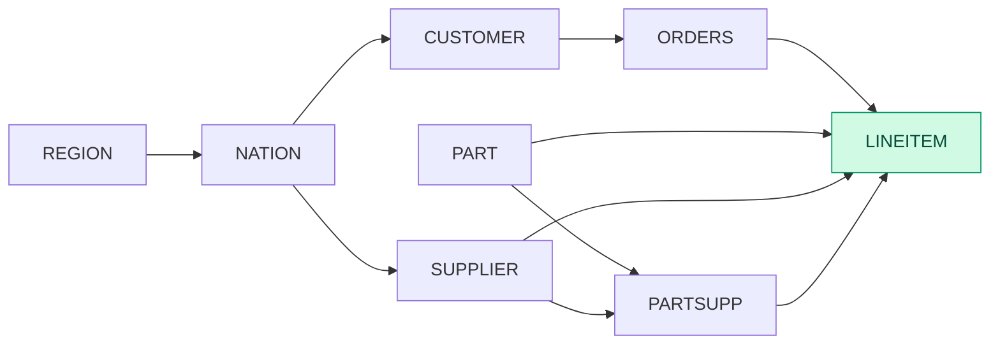

```sql
Sort[l_returnflag ASC, l_linestatus ASC]
  Aggregate(l_returnflag, l_linestatus; sum(l_quantity), sum(l_extendedprice), sum(disc_price), sum(charge), avg(l_quantity), avg(l_extendedprice), avg(l_discount), count_all(*))
    Project(l_returnflag, l_linestatus, l_quantity, l_extendedprice, l_discount, disc_price = (l_extendedprice * (1 - l_discount)), charge = ((l_extendedprice * (1 - l_discount)) * (1 + l_tax)))
      Filter((l_shipdate <= 19980902))
        Scan(lineitem [l_shipdate, l_returnflag, l_linestatus, l_quantity, l_extendedprice, l_discount, l_tax])
```

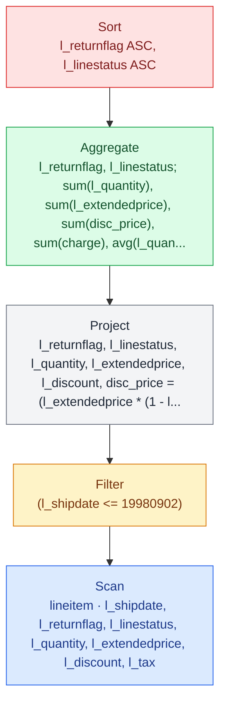


| Step | Operation | Rows | Cols | Tables | Selectivity / Join inputs | Baseline (ms) | Baseline implementation | Physical plan keys / columns |
| --- | --- | --- | --- | --- | --- | --- | --- | --- |
| 0 | SourceTable | 6001215 | 7 | lineitem |  |  |  | l_shipdate, l_returnflag, l_linestatus, l_quantity, l_extendedprice, l_discount, l_tax |
| 1 | Filter | 5916591 | 6 | < | 98.6% | 5.84656 | nofuse |  |
| 2 | Project | 5916591 | 7 |  |  | 1.35117 | fuse | l_returnflag, l_linestatus, l_quantity, l_extendedprice, l_discount, disc_price, charge |
| 3 | Reorder | 5916591 | 7 |  |  | 0.00288474 |  |  |
| 4 | GroupBy | 4 | 10 | < | 0.0000676% | 10.8955 | hash | l_returnflag, l_linestatus; sum(l_quantity), sum(l_extendedprice), sum(disc_price), sum(charge), avg(l_quantity), avg(l_extendedprice), avg(l_discount), count_all(*) |
| 5 | Sort | 4 | 10 |  |  | 0.502388 | no_skf | l_returnflag ASC, l_linestatus ASC |
|  | Total |  |  |  |  | 18.5985 |  |  |

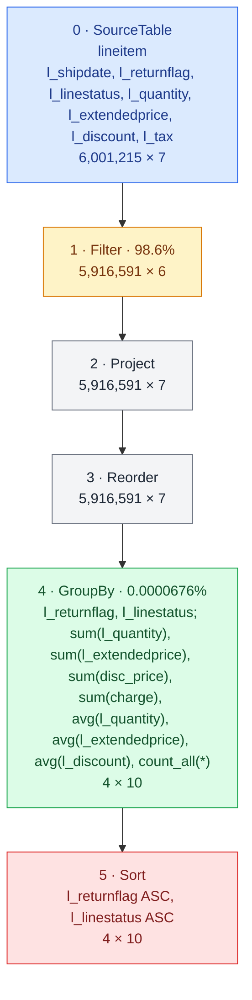


## Notes

- Almost a complete table scan

## Runtime breakdown comparison

| T4 SF1 | T4 SF10 | H200 SF10 | H200 SF30 | H200 SF100 | GH200 SF100 |
| --- | --- | --- | --- | --- | --- |
|  |  |  |  |  |  |

# Q2 Minimum Cost Supplier Query

```sql
SELECT
    s_acctbal,
    s_name,
    n_name,
    p_partkey,
    p_mfgr,
    s_address,
    s_phone,
    s_comment
FROM part, supplier, partsupp, nation, region
WHERE (p_partkey = ps_partkey)
    AND (s_suppkey = ps_suppkey)
    AND (p_size = 15)
    AND (p_type LIKE '%BRASS')
    AND (s_nationkey = n_nationkey)
    AND (n_regionkey = r_regionkey)
    AND (r_name = 'EUROPE')
    AND (ps_supplycost = (
        SELECT min(ps_supplycost)
        FROM partsupp, supplier, nation, region
        WHERE (p_partkey = ps_partkey)
            AND (s_suppkey = ps_suppkey)
            AND (s_nationkey = n_nationkey)
            AND (n_regionkey = r_regionkey)
            AND (r_name = 'EUROPE')
    ))
ORDER BY
    s_acctbal DESC,
    n_name,
    s_name,
    p_partkey
LIMIT 100;
```
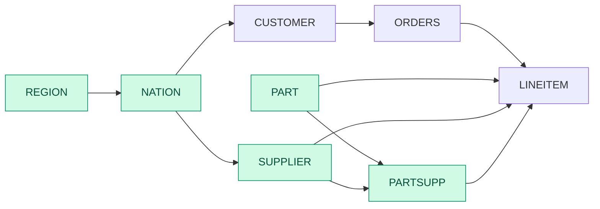

```sql
Limit(n=100)
  Sort[s_acctbal DESC, n_name ASC, s_name ASC, p_partkey ASC]
    Project(s_acctbal, s_name, n_name, p_partkey, p_mfgr, s_address, s_phone, s_comment)
      Filter((min_supplycost == ps_supplycost))
        InnerJoin(on=(p_partkey == p_partkey))
          Project(agg_partkey = p_partkey, min_supplycost)
            Aggregate(p_partkey; min(ps_supplycost))
              Project(p_partkey, ps_supplycost, p_mfgr, n_name, s_acctbal, s_name, s_address, s_phone, s_comment)
                InnerJoin(on=(n_nationkey == s_nationkey))
                  Project(n_nationkey, n_name)
                    InnerJoin(on=(r_regionkey == n_regionkey))
                      Filter(str_eq(r_name, "EUROPE"))
                        Scan(region [r_regionkey, r_name])
                      Scan(nation [n_nationkey, n_name, n_regionkey])
                  Project(p_partkey, ps_supplycost, p_mfgr, s_nationkey, s_acctbal, s_name, s_address, s_phone, s_comment)
                    InnerJoin(on=(s_suppkey == ps_suppkey))
                      Scan(supplier [s_suppkey, s_name, s_address, s_nationkey, s_phone, s_acctbal, s_comment])
                      InnerJoin(on=(ps_partkey == p_partkey))
                        Scan(partsupp [ps_partkey, ps_suppkey, ps_supplycost])
                        Project(p_partkey, p_mfgr)
                          Filter(endswith(p_type, "BRASS"))
                            Filter((p_size == 15))
                              Scan(part [p_partkey, p_mfgr, p_type, p_size])
          Project(p_partkey, ps_supplycost, p_mfgr, n_name, s_acctbal, s_name, s_address, s_phone, s_comment)
            InnerJoin(on=(n_nationkey == s_nationkey))
              Project(n_nationkey, n_name)
                InnerJoin(on=(r_regionkey == n_regionkey))
                  Filter(str_eq(r_name, "EUROPE"))
                    Scan(region [r_regionkey, r_name])
                  Scan(nation [n_nationkey, n_name, n_regionkey])
              Project(p_partkey, ps_supplycost, p_mfgr, s_nationkey, s_acctbal, s_name, s_address, s_phone, s_comment)
                InnerJoin(on=(s_suppkey == ps_suppkey))
                  Scan(supplier [s_suppkey, s_name, s_address, s_nationkey, s_phone, s_acctbal, s_comment])
                  InnerJoin(on=(ps_partkey == p_partkey))
                    Scan(partsupp [ps_partkey, ps_suppkey, ps_supplycost])
                    Project(p_partkey, p_mfgr)
                      Filter(endswith(p_type, "BRASS"))
                        Filter((p_size == 15))
                          Scan(part [p_partkey, p_mfgr, p_type, p_size])
```

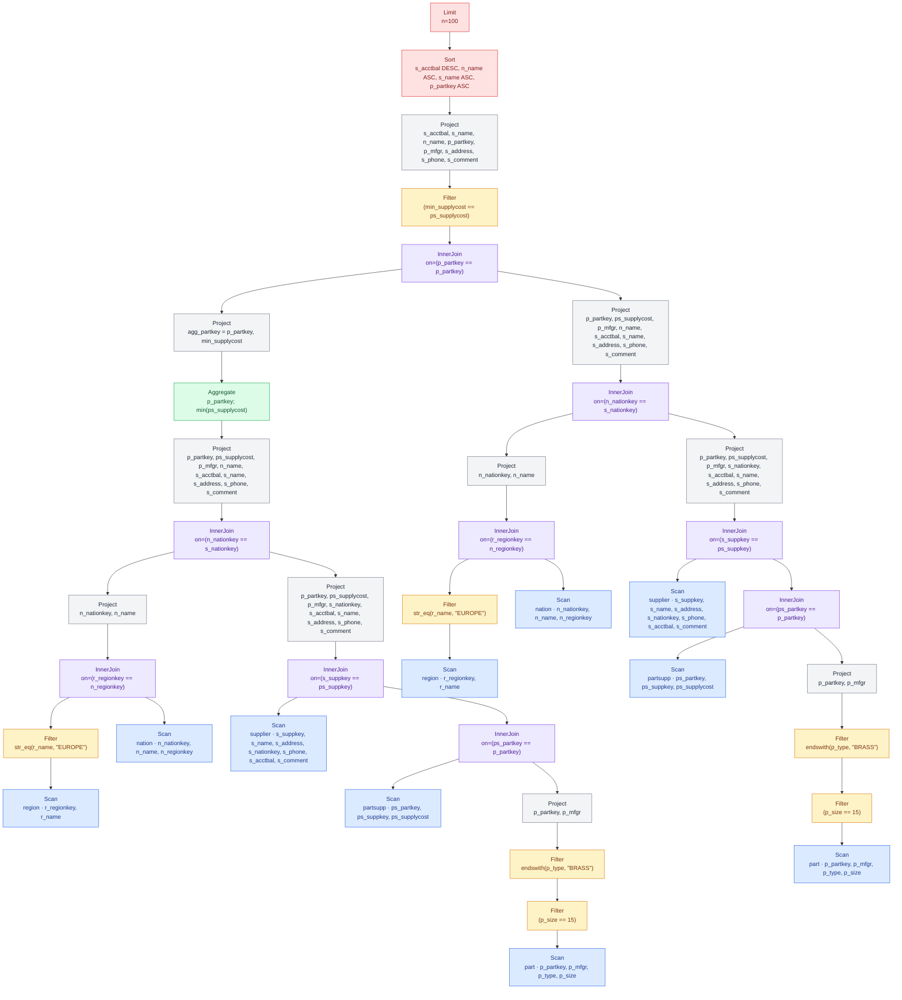


| Step | Operation | Rows | Cols | Tables | Selectivity / Join inputs | Baseline (ms) | Best (ms) | Baseline implementation | Best implementation | Physical plan keys / columns |
| --- | --- | --- | --- | --- | --- | --- | --- | --- | --- | --- |
| 0 | SourceTable | 5 | 2 | region |  |  |  |  |  | r_regionkey, r_name |
| 1 | Filter | 1 | 1 | < | 20% | 0.0496175 | 0.0496175 | nofuse | nofuse |  |
| 2 | SourceTable | 25 | 3 | nation |  |  |  |  |  | n_nationkey, n_name, n_regionkey |
| 3 | EqJoin | 5 | 3 | region⋈nation | 1⋈25 | 0.140919 | 0.140919 | hash_gfur | hash_gfur | regionkey |
| 4 | Reorder | 5 | 4 |  |  | 0.00693055 | 0.00693055 |  |  |  |
| 5 | Project | 5 | 2 |  |  | 0.0614469 | 0.0614469 | nofuse | nofuse | n_nationkey, n_name |
| 6 | SourceTable | 10000 | 7 | supplier |  |  |  |  |  | s_suppkey, s_name, s_address, s_nationkey, s_phone, s_acctbal, s_comment |
| 7 | SourceTable | 800000 | 3 | partsupp |  |  |  |  |  | ps_partkey, ps_suppkey, ps_supplycost |
| 8 | SourceTable | 200000 | 4 | part |  |  |  |  |  | p_partkey, p_mfgr, p_type, p_size |
| 9 | Filter | 3907 | 3 | < | 1.95% | 0.21863 | 0.21863 | nofuse | nofuse |  |
| 10 | Filter | 747 | 2 | < | 19.1% | 0.13022 | 0.13022 | nofuse | nofuse |  |
| 11 | Project | 747 | 2 |  |  | 0.00291091 | 0.00291091 | nofuse | nofuse | p_partkey, p_mfgr |
| 12 | EqJoin | 2988 | 4 | partsupp⋈part | 800K⋈747 | 0.809728 | 0.809728 | hash_gfur | hash_gfur | partkey |
| 13 | Reorder | 2988 | 5 |  |  | 0.00668291 | 0.00668291 |  |  |  |
| 14 | EqJoin | 2988 | 11 | supplier⋈(partsupp⋈part) | 10K⋈3K | 0.414039 | 0.414039 | hash_gfur | hash_gfur | suppkey |
| 15 | Reorder | 2988 | 12 |  |  | 0.0139611 | 0.0139611 |  |  |  |
| 16 | Project | 2988 | 9 |  |  | 0.307858 | 0.307858 | nofuse | nofuse | p_partkey, ps_supplycost, p_mfgr, s_nationkey, s_acctbal, s_name, s_address, s_phone, s_comment |
| 17 | EqJoin | 2988 | 10 | (region⋈nation)⋈(supplier⋈(partsupp⋈part)) | 5⋈3K | 0.413337 | 0.413337 | hash_gfur | hash_gfur | nationkey |
| 18 | Reorder | 642 | 11 |  |  | 0.0155255 | 0.0155255 |  |  |  |
| 19 | Project | 642 | 9 |  |  | 0.335089 | 0.335089 | nofuse | nofuse | p_partkey, ps_supplycost, p_mfgr, n_name, s_acctbal, s_name, s_address, s_phone, s_comment |
| 20 | Reorder | 642 | 2 |  |  | 0.0234884 | 0.0234884 |  |  |  |
| 21 | GroupBy | 460 | 2 | < | 71.7% | 0.111493 | 0.0840908 | hash | sort_gftr | p_partkey; min(ps_supplycost) |
| 22 | Project | 460 | 2 |  |  | 0.00240545 | 0.00240545 | nofuse | nofuse | p_partkey, p_mfgr |
| 23 | EqJoin | 642 | 10 | ((region⋈nation)⋈(supplier⋈(partsupp⋈part))) ⋈ ((region⋈nation)⋈(supplier⋈(partsupp⋈part))) | 460⋈642 | 0.422646 | 0.422646 | hash_gfur | hash_gfur | partkey |
| 24 | Reorder | 642 | 11 |  |  | 0.0193971 | 0.0193971 |  |  |  |
| 25 | Filter | 460 | 9 | < | 71.7% | 0.4506 | 0.4506 | nofuse | nofuse |  |
| 26 | Project | 460 | 8 |  |  | 0.00510109 | 0.00510109 | nofuse | nofuse | s_acctbal, s_name, n_name, p_partkey, p_mfgr, s_address, s_phone, s_comment |
| 27 | TopK | 100 | 8 | < | 21.7% | 1.63239 | 1.63239 |  |  |  |
|  | Total |  |  |  |  | 5.59442 | 5.56701 |  |  |  |

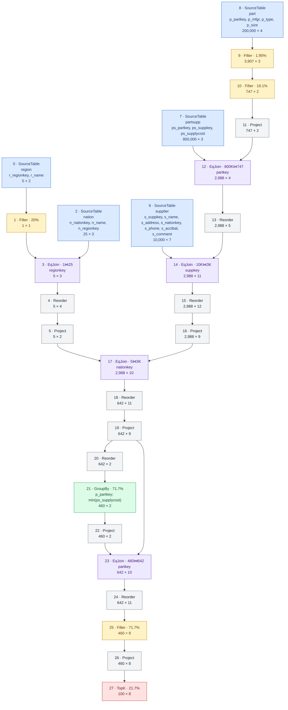


## Notes

- This query joins 5 tables.

- Repeated join subtree for the correlated MIN

## Runtime breakdown comparison

| T4 SF1 | T4 SF10 | H200 SF10 | H200 SF30 | H200 SF100 | GH200 SF100 |
| --- | --- | --- | --- | --- | --- |
|  |  |  |  |  |  |

# Q3 Shipping Priority Query

This query retrieves the 10 unshipped orders with the highest value.

```sql
SELECT
    l_orderkey,
    sum(l_extendedprice * (1 - l_discount)) AS revenue,
    o_orderdate,
    o_shippriority
FROM customer, orders, lineitem
WHERE (c_mktsegment = 'BUILDING')
    AND (c_custkey = o_custkey)
    AND (l_orderkey = o_orderkey)
    AND (o_orderdate < date '1995-03-15')
    AND (l_shipdate > date '1995-03-15')
GROUP BY
    l_orderkey,
    o_orderdate,
    o_shippriority
ORDER BY
    revenue DESC,
    o_orderdate
LIMIT 10;
```
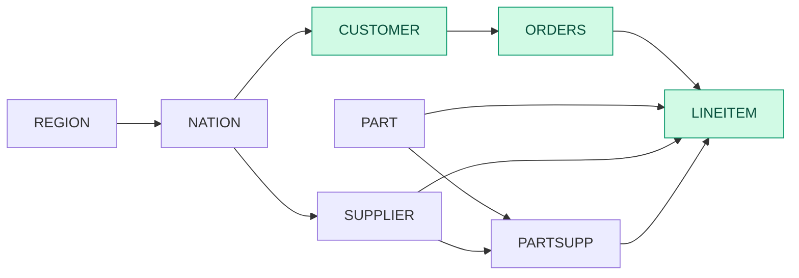

```sql
Limit(n=10)
  Sort[revenue DESC, o_orderdate ASC]
    Project(l_orderkey, revenue, o_orderdate, o_shippriority)
      Aggregate(l_orderkey, o_orderdate, o_shippriority; sum(disc_price))
        Project(l_orderkey, o_orderdate, o_shippriority, disc_price = (l_extendedprice * (1 - l_discount)))
          InnerJoin(on=(l_orderkey == o_orderkey))
            InnerJoin(on=(c_custkey == o_custkey))
              Filter(str_eq(c_mktsegment, "BUILDING"))
                Scan(customer [c_custkey, c_mktsegment])
              Filter((o_orderdate < 19950315))
                Scan(orders [o_orderkey, o_custkey, o_orderdate, o_shippriority])
            Filter((l_shipdate > 19950315))
              Scan(lineitem [l_orderkey, l_extendedprice, l_discount, l_shipdate])
```

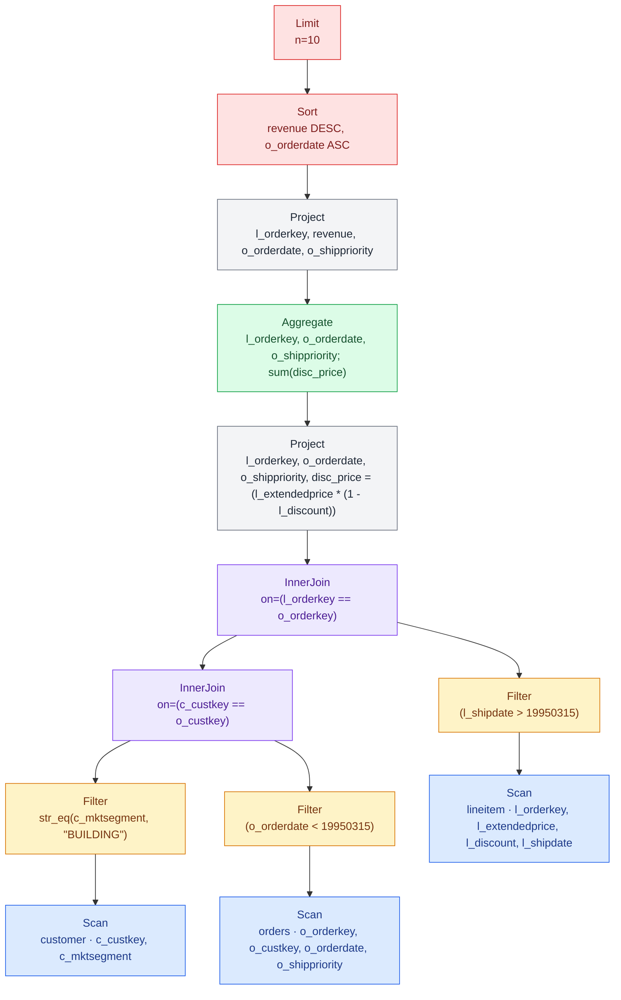


| Step | Operation | Rows | Cols | Tables | Selectivity / Join inputs | Baseline (ms) | Best (ms) | Baseline implementation | Best implementation | Physical plan keys / columns |
| --- | --- | --- | --- | --- | --- | --- | --- | --- | --- | --- |
| 0 | SourceTable | 150000 | 2 | customer |  |  |  |  |  | c_custkey, c_mktsegment |
| 1 | Filter | 30142 | 1 | < | 20.1% | 0.0832018 | 0.0832018 | fuse | fuse |  |
| 2 | SourceTable | 1500000 | 4 | orders |  |  |  |  |  | o_orderkey, o_custkey, o_orderdate, o_shippriority |
| 3 | Filter | 727305 | 4 | < | 48.5% | 0.403085 | 0.341397 | fuse | nofuse |  |
| 4 | EqJoin | 147126 | 4 | customer⋈orders | 30.1K⋈727.3K | 0.706689 | 0.706689 | hash_gfur | hash_gfur | custkey |
| 5 | Reorder | 147126 | 5 |  |  | 0.00173903 | 0.00173903 |  |  |  |
| 6 | SourceTable | 6001215 | 4 | lineitem |  |  |  |  |  | l_orderkey, l_extendedprice, l_discount, l_shipdate |
| 7 | Filter | 3241776 | 3 | < | 54% | 1.50229 | 1.27569 | fuse | nofuse |  |
| 8 | EqJoin | 30519 | 7 | (customer⋈orders)⋈lineitem | 147.1K⋈3.2M | 2.15337 | 2.15337 | hash_gfur | hash_gfur | orderkey |
| 9 | Reorder | 30519 | 8 |  |  | 0.00185232 | 0.00185232 |  |  |  |
| 10 | Project | 30519 | 4 |  |  | 0.0401438 | 0.0401438 | nofuse | nofuse | l_orderkey, o_orderdate, o_shippriority, disc_price |
| 11 | Reorder | 30519 | 4 |  |  | 0.00185048 | 0.00185048 |  |  |  |
| 12 | GroupBy | 11620 | 4 | < | 38.1% | 0.141456 | 0.141456 | hash | hash | l_orderkey, o_orderdate, o_shippriority; sum(disc_price) |
| 13 | Project | 11620 | 4 |  |  | 0.00265085 | 0.00265085 | nofuse | nofuse | l_orderkey, revenue, o_orderdate, o_shippriority |
| 14 | TopK | 10 | 4 | < | 0.0861% | 0.715242 | 0.715242 |  |  |  |
|  | Total |  |  |  |  | 5.75357 | 5.46528 |  |  |  |

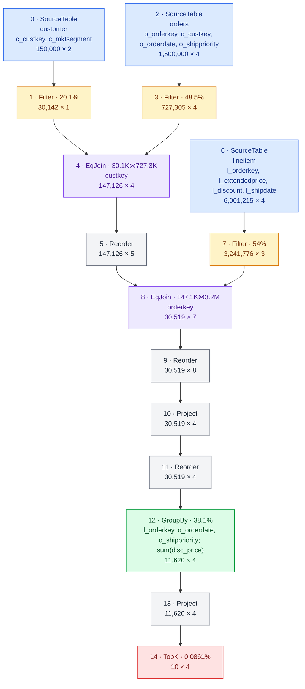


## Notes

- Large intermediate join

## Runtime breakdown comparison

| T4 SF1 | T4 SF10 | H200 SF10 | H200 SF30 | H200 SF100 | GH200 SF100 |
| --- | --- | --- | --- | --- | --- |
|  |  |  |  |  |  |

# Q4 Order Priority Checking Query

This query determines how well the order priority system is working and gives an assessment of customer satisfaction.

```sql
SELECT
    o_orderpriority,
    count(*) AS order_count
FROM orders
WHERE (o_orderdate >= date '1993-07-01')
    AND (o_orderdate < date '1993-07-01' + INTERVAL 3 MONTH)
    AND EXISTS (
        SELECT *
        FROM lineitem
        WHERE (l_orderkey = o_orderkey)
            AND (l_commitdate < l_receiptdate)
    )
GROUP BY o_orderpriority
ORDER BY o_orderpriority;
```
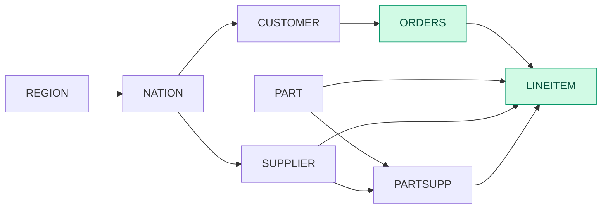

```sql
Sort[o_orderpriority ASC]
  Aggregate(o_orderpriority; count_all(*))
    LeftSemiJoin(on=(o_orderkey == l_orderkey))
      Filter(((o_orderdate >= 19930701) && (o_orderdate < 19931001)))
        Scan(orders [o_orderkey, o_orderdate, o_orderpriority])
      Filter((l_commitdate < l_receiptdate))
        Scan(lineitem [l_orderkey, l_commitdate, l_receiptdate])
```

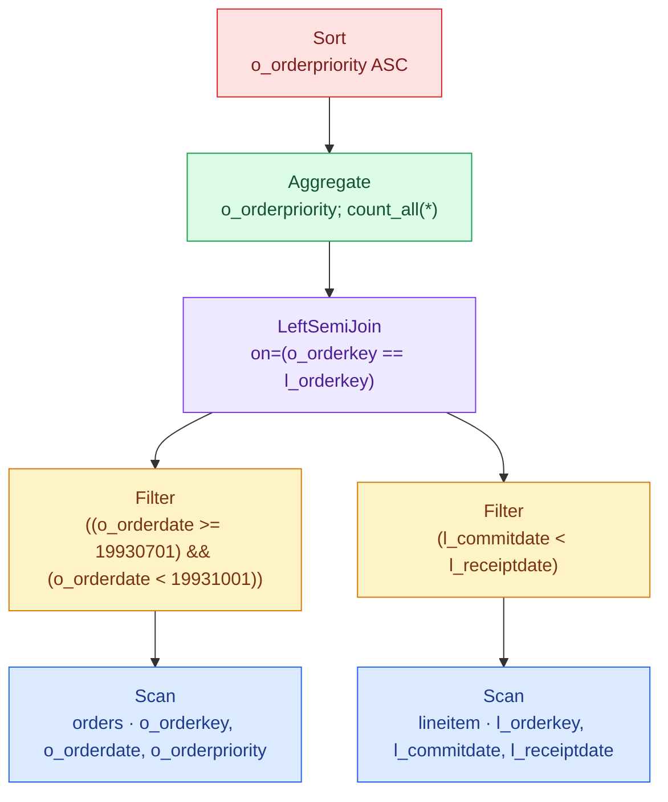


| Step | Operation | Rows | Cols | Tables | Selectivity / Join inputs | Baseline (ms) | Best (ms) | Baseline implementation | Best implementation | Physical plan keys / columns |
| --- | --- | --- | --- | --- | --- | --- | --- | --- | --- | --- |
| 0 | SourceTable | 1500000 | 3 | orders |  |  |  |  |  | o_orderkey, o_orderdate, o_orderpriority |
| 1 | Filter | 57218 | 2 | < | 3.81% | 0.573399 | 0.493515 | fuse | nofuse |  |
| 2 | SourceTable | 6001215 | 3 | lineitem |  |  |  |  |  | l_orderkey, l_commitdate, l_receiptdate |
| 3 | Filter | 3793296 | 1 | < | 63.2% | 0.728793 | 0.626391 | fuse | nofuse |  |
| 4 | SemiJoin | 52523 | 2 | orders⋈lineitem | 57.2K⋈3.8M | 2.74453 | 2.74453 |  |  | o_orderkey; l_orderkey |
| 5 | Reorder | 52523 | 2 |  |  | 0.0075789 | 0.0075789 |  |  |  |
| 6 | Reorder | 52523 | 1 |  |  | 0.00212135 | 0.00212135 |  |  |  |
| 7 | GroupBy | 5 | 2 | < | 0.00952% | 0.187308 | 0.187308 | hash | hash | o_orderpriority; count_all(*) |
| 8 | Sort | 5 | 2 |  |  | 0.157323 | 0.157323 | no_skf | no_skf | o_orderpriority ASC |
|  | Total |  |  |  |  | 4.40105 | 4.21877 |  |  |  |

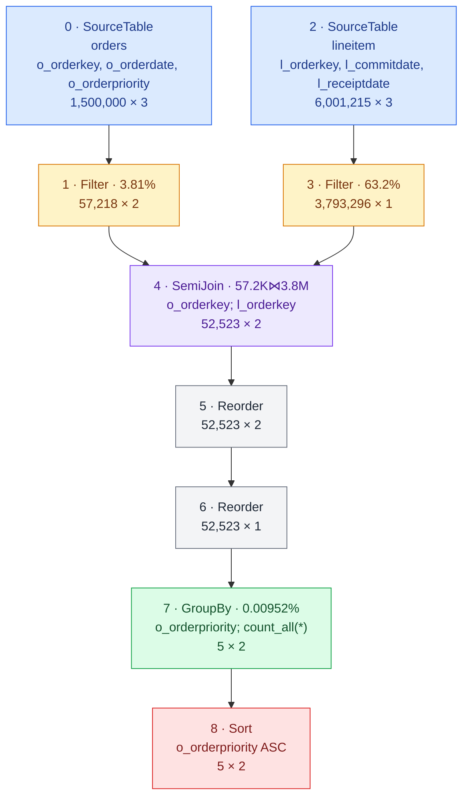


## Runtime breakdown comparison

| T4 SF1 | T4 SF10 | H200 SF10 | H200 SF30 | H200 SF100 | GH200 SF100 |
| --- | --- | --- | --- | --- | --- |
|  |  |  |  |  |  |

# Q5 Local Supplier Volume Query

This query lists the revenue volume done through local suppliers.

```sql
SELECT
    n_name,
    sum(l_extendedprice * (1 - l_discount)) AS revenue
FROM customer, orders, lineitem, supplier, nation, region
WHERE (c_custkey = o_custkey)
    AND (l_orderkey = o_orderkey)
    AND (l_suppkey = s_suppkey)
    AND (c_nationkey = s_nationkey)
    AND (s_nationkey = n_nationkey)
    AND (n_regionkey = r_regionkey)
    AND (r_name = 'ASIA')
    AND (o_orderdate >= date '1994-01-01')
    AND (o_orderdate < date '1994-01-01' + INTERVAL 1 YEAR)
GROUP BY n_name
ORDER BY revenue DESC;
```
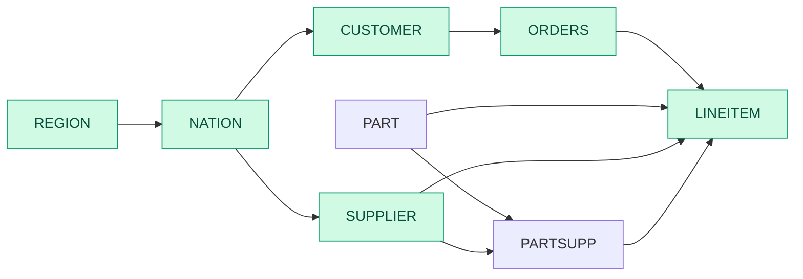

```sql
Sort[revenue DESC]
  Aggregate(n_name; sum(disc_price))
    Project(n_name, disc_price = (l_extendedprice * (1 - l_discount)))
      Filter((c_nationkey == s_nationkey))
        InnerJoin(on=(l_suppkey == s_suppkey))
          InnerJoin(on=(o_orderkey == l_orderkey))
            InnerJoin(on=(c_custkey == o_custkey))
              Scan(customer [c_custkey, c_nationkey])
              Filter(((o_orderdate >= 19940101) && (o_orderdate < 19950101)))
                Scan(orders [o_orderkey, o_custkey, o_orderdate])
            Scan(lineitem [l_orderkey, l_suppkey, l_extendedprice, l_discount])
          InnerJoin(on=(n_nationkey == s_nationkey))
            InnerJoin(on=(r_regionkey == n_regionkey))
              Filter(str_eq(r_name, "ASIA"))
                Scan(region [r_regionkey, r_name])
              Scan(nation [n_nationkey, n_name, n_regionkey])
            Scan(supplier [s_suppkey, s_nationkey])
```

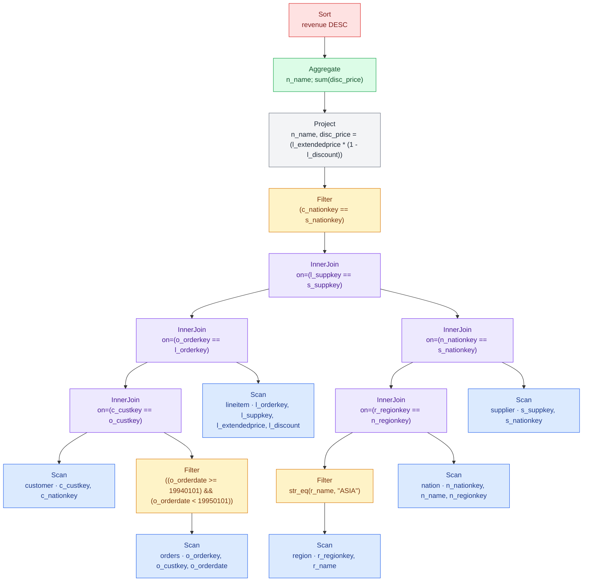


| Step | Operation | Rows | Cols | Tables | Selectivity / Join inputs | Baseline (ms) | Best (ms) | Baseline implementation | Best implementation | Physical plan keys / columns |
| --- | --- | --- | --- | --- | --- | --- | --- | --- | --- | --- |
| 0 | SourceTable | 150000 | 2 | customer |  |  |  |  |  | c_custkey, c_nationkey |
| 1 | SourceTable | 1500000 | 3 | orders |  |  |  |  |  | o_orderkey, o_custkey, o_orderdate |
| 2 | Filter | 227597 | 2 | < | 15.2% | 0.425062 | 0.323168 | fuse | nofuse |  |
| 3 | EqJoin | 227597 | 3 | customer⋈orders | 150K⋈227.6K | 0.479766 | 0.479766 | hash_gfur | hash_gfur | custkey |
| 4 | Reorder | 227597 | 4 |  |  | 0.001834 | 0.001834 |  |  |  |
| 5 | SourceTable | 6001215 | 4 | lineitem |  |  |  |  |  | l_orderkey, l_suppkey, l_extendedprice, l_discount |
| 6 | EqJoin | 910519 | 7 | (customer⋈orders)⋈lineitem | 227.6K⋈6M | 5.15134 | 5.15134 | hash_gfur | hash_gfur | orderkey |
| 7 | Reorder | 910519 | 8 |  |  | 0.00205067 | 0.00205067 |  |  |  |
| 8 | SourceTable | 5 | 2 | region |  |  |  |  |  | r_regionkey, r_name |
| 9 | Filter | 1 | 1 | < | 20% | 0.0532093 | 0.0532093 | fuse | fuse |  |
| 10 | SourceTable | 25 | 3 | nation |  |  |  |  |  | n_nationkey, n_name, n_regionkey |
| 11 | EqJoin | 5 | 3 | region⋈nation | 1⋈25 | 0.148806 | 0.148806 | hash_gfur | hash_gfur | regionkey |
| 12 | Reorder | 5 | 4 |  |  | 0.00740333 | 0.00740333 |  |  |  |
| 13 | SourceTable | 10000 | 2 | supplier |  |  |  |  |  | s_suppkey, s_nationkey |
| 14 | EqJoin | 2003 | 5 | (region⋈nation)⋈supplier | 5⋈10K | 0.15878 | 0.15878 | hash_gfur | hash_gfur | nationkey |
| 15 | Reorder | 2003 | 6 |  |  | 0.00627267 | 0.00627267 |  |  |  |
| 16 | EqJoin | 182183 | 13 | ((customer⋈orders)⋈lineitem)⋈((region⋈nation) ⋈ supplier) | 910.5K⋈2K | 3.57394 | 3.57394 | hash_gfur | hash_gfur | suppkey |
| 17 | Reorder | 182183 | 14 |  |  | 0.00783133 | 0.00783133 |  |  |  |
| 18 | Filter | 7243 | 3 | < | 3.98% | 0.245203 | 0.205272 | fuse | nofuse |  |
| 19 | Project | 7243 | 2 |  |  | 0.0323807 | 0.0323807 | nofuse | nofuse | n_name, disc_price |
| 20 | Reorder | 7243 | 2 |  |  | 0.001952 | 0.001952 |  |  |  |
| 21 | GroupBy | 5 | 2 | < | 0.069% | 0.169658 | 0.169658 | hash | hash | n_name; sum(disc_price) |
| 22 | Sort | 5 | 2 |  |  | 0.102092 | 0.102092 | no_skf | no_skf | sum(disc_price) DESC |
|  | Total |  |  |  |  | 10.5676 | 10.4258 |  |  |  |

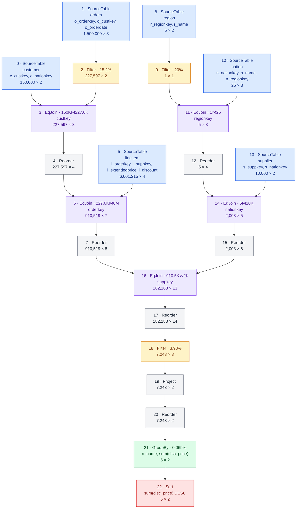


## Notes

- This query joins 6 tables.

- Region and supplier could be filtered from lineitem first before joining

## Runtime breakdown comparison

| T4 SF1 | T4 SF10 | H200 SF10 | H200 SF30 | H200 SF100 | GH200 SF100 |
| --- | --- | --- | --- | --- | --- |
|  |  |  |  |  |  |

# Q6 Forecasting Revenue Change Query

This query quantifies the amount of revenue increase that would have resulted from eliminating certain company-wide discounts in a given percentage range in a given year. Asking this type of "what if" query can be used to look for ways to increase revenues.

```sql
SELECT
    sum(l_extendedprice * l_discount) AS revenue
FROM lineitem
WHERE (l_shipdate >= date '1994-01-01')
    AND (l_shipdate < date '1994-01-01' + INTERVAL 1 YEAR)
    AND (l_discount BETWEEN 0.06::Decimal(12,2) - 0.01::Decimal(12,2) AND 0.06::Decimal(12,2) + 0.01::Decimal(12,2))
    AND (l_quantity < 24);
```


```sql
Aggregate(sum(revenue))
  Project(revenue = (l_extendedprice * l_discount))
    Filter((((((l_shipdate >= 19940101) && (l_shipdate < 19950101)) && (l_discount >= 0.05)) && (l_discount <= 0.07)) && (l_quantity < 24)))
      Scan(lineitem [l_shipdate, l_extendedprice, l_discount, l_quantity])
```

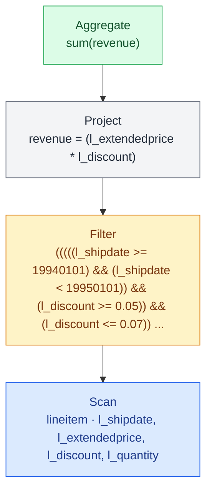


| Step | Operation | Rows | Cols | Tables | Selectivity / Join inputs | Baseline (ms) | Best (ms) | Baseline implementation | Best implementation | Physical plan keys / columns |
| --- | --- | --- | --- | --- | --- | --- | --- | --- | --- | --- |
| 0 | SourceTable | 6001215 | 4 | lineitem |  |  |  |  |  | l_shipdate, l_extendedprice, l_discount, l_quantity |
| 1 | Filter | 114160 | 2 | < | 1.9% | 2.73051 | 1.72603 | fuse | nofuse |  |
| 2 | Project | 114160 | 1 |  |  | 0.0185139 | 0.0185139 | nofuse | nofuse | revenue |
| 3 | Reorder | 114160 | 1 |  |  | 0.00191553 | 0.00191553 |  |  |  |
| 4 | ScalarAgg | 1 | 1 |  |  | 0.0352661 | 0.0352661 |  |  | sum(revenue) |
|  | Total |  |  |  |  | 2.78621 | 1.78173 |  |  |  |

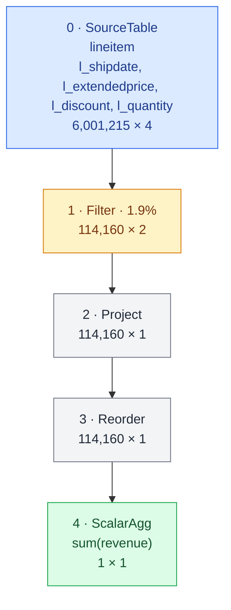


## Runtime breakdown comparison

| T4 SF1 | T4 SF10 | H200 SF10 | H200 SF30 | H200 SF100 | GH200 SF100 |
| --- | --- | --- | --- | --- | --- |
|  |  |  |  |  |  |

# Q7 Volume Shipping Query

This query determines the value of goods shipped between certain nations to help in the re-negotiation of shipping contracts.

```sql
SELECT
    supp_nation,
    cust_nation,
    l_year,
    sum(volume) AS revenue
FROM (
    SELECT
        n1.n_name AS supp_nation,
        n2.n_name AS cust_nation,
        extract(year FROM l_shipdate) AS l_year,
        l_extendedprice * (1 - l_discount) AS volume
    FROM supplier, lineitem, orders, customer, nation AS n1, nation AS n2
    WHERE (s_suppkey = l_suppkey)
        AND (o_orderkey = l_orderkey)
        AND (c_custkey = o_custkey)
        AND (s_nationkey = n1.n_nationkey)
        AND (c_nationkey = n2.n_nationkey)
        AND (
            ((n1.n_name = 'FRANCE') AND (n2.n_name = 'GERMANY'))
            OR ((n1.n_name = 'GERMANY') AND (n2.n_name = 'FRANCE'))
        )
        AND (l_shipdate BETWEEN date '1995-01-01' AND date '1996-12-31')
) AS shipping
GROUP BY
    supp_nation,
    cust_nation,
    l_year
ORDER BY
    supp_nation,
    cust_nation,
    l_year;
```
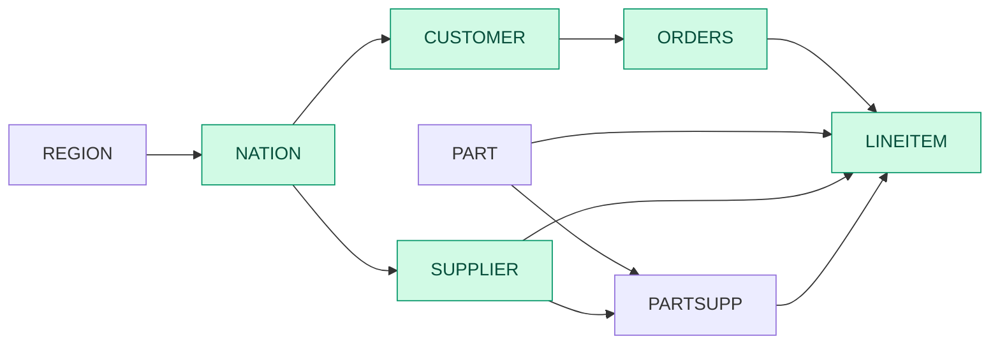

```sql
Sort[n_name#12 ASC, n_name#14 ASC, l_year ASC]
  Aggregate(n_name#12, n_name#14, l_year; sum(volume))
    Project(supp_nation = n_name#12, cust_nation = n_name#14, l_year = year(l_shipdate), volume = (l_extendedprice * (1 - l_discount)))
      Filter(((str_eq(n_name#12, "FRANCE") && str_eq(n_name#14, "GERMANY")) || (str_eq(n_name#12, "GERMANY") && str_eq(n_name#14, "FRANCE"))))
        InnerJoin(on=(o_custkey == c_custkey))
          InnerJoin(on=(l_orderkey == o_orderkey))
            InnerJoin(on=(s_suppkey == l_suppkey))
              InnerJoin(on=(n_nationkey#11 == s_nationkey))
                Filter(str_in(n_name#12, ["FRANCE", "GERMANY"]))
                  Scan(nation [n_nationkey, n_name])
                Scan(supplier [s_suppkey, s_nationkey])
              Filter(((l_shipdate >= 19950101) && (l_shipdate <= 19961231)))
                Scan(lineitem [l_orderkey, l_suppkey, l_extendedprice, l_discount, l_shipdate])
            Scan(orders [o_orderkey, o_custkey])
          InnerJoin(on=(n_nationkey#13 == c_nationkey))
            Filter(str_in(n_name#14, ["FRANCE", "GERMANY"]))
              Scan(nation [n_nationkey, n_name])
            Scan(customer [c_custkey, c_nationkey])
```

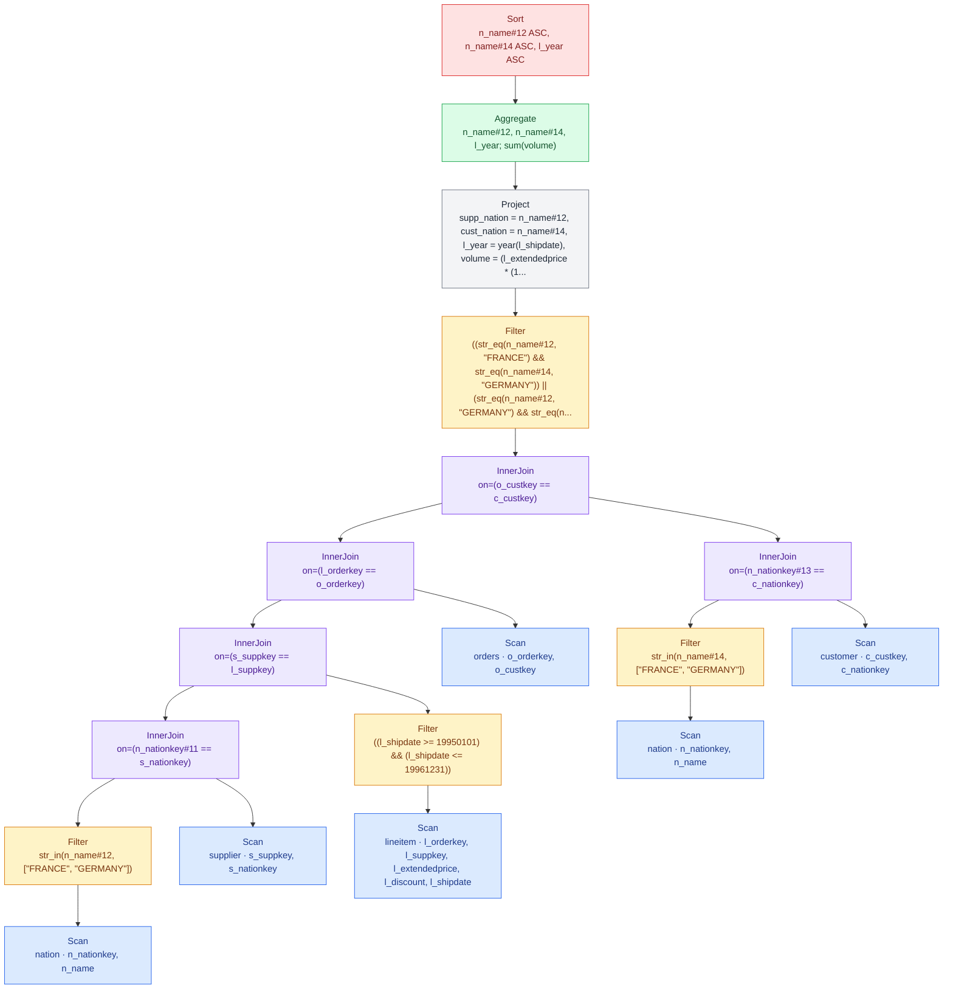


| Step | Operation | Rows | Cols | Tables | Selectivity / Join inputs | Baseline (ms) | Best (ms) | Baseline implementation | Best implementation | Physical plan keys / columns |
| --- | --- | --- | --- | --- | --- | --- | --- | --- | --- | --- |
| 0 | SourceTable | 25 | 2 | nation |  |  |  |  |  | n_nationkey, n_name |
| 1 | Filter | 2 | 2 | < | 8% | 0.127813 | 0.127813 | fuse | fuse |  |
| 2 | SourceTable | 10000 | 2 | supplier |  |  |  |  |  | s_suppkey, s_nationkey |
| 3 | EqJoin | 798 | 3 | nation⋈supplier | 2⋈10K | 0.134012 | 0.134012 | hash_gfur | hash_gfur | nationkey |
| 4 | Reorder | 798 | 4 |  |  | 0.00575247 | 0.00575247 |  |  |  |
| 5 | SourceTable | 6001215 | 5 | lineitem |  |  |  |  |  | l_orderkey, l_suppkey, l_extendedprice, l_discount, l_shipdate |
| 6 | Filter | 1828450 | 5 | < | 30.5% | 2.03619 | 1.68278 | fuse | nofuse |  |
| 7 | EqJoin | 145703 | 8 | (nation⋈supplier)⋈lineitem | 798⋈1.8M | 1.42676 | 1.42676 | hash_gfur | hash_gfur | suppkey |
| 8 | Reorder | 145703 | 9 |  |  | 0.00694918 | 0.00694918 |  |  |  |
| 9 | SourceTable | 1500000 | 2 | orders |  |  |  |  |  | o_orderkey, o_custkey |
| 10 | EqJoin | 145703 | 10 | ((nation⋈supplier)⋈lineitem)⋈orders | 145.7K⋈1.5M | 1.70218 | 1.70218 | hash_gfur | hash_gfur | orderkey |
| 11 | Reorder | 145703 | 11 |  |  | 0.006488 | 0.006488 |  |  |  |
| 12 | SourceTable | 25 | 2 | nation |  |  |  |  |  | n_nationkey, n_name |
| 13 | Filter | 2 | 2 | < | 8% | 0.125733 | 0.125733 | fuse | fuse |  |
| 14 | SourceTable | 150000 | 2 | customer |  |  |  |  |  | c_custkey, c_nationkey |
| 15 | EqJoin | 12008 | 3 | nation⋈customer | 2⋈150K | 0.204058 | 0.204058 | hash_gfur | hash_gfur | nationkey |
| 16 | Reorder | 12008 | 4 |  |  | 0.00538118 | 0.00538118 |  |  |  |
| 17 | EqJoin | 11723 | 14 | (((nation⋈supplier)⋈lineitem)⋈orders)⋈(nation ⋈ customer) | 145.7K⋈12K | 0.409308 | 0.409308 | hash_gfur | hash_gfur | custkey |
| 18 | Reorder | 11723 | 15 |  |  | 0.00847388 | 0.00847388 |  |  |  |
| 19 | Filter | 5924 | 5 | < | 50.5% | 0.316296 | 0.316296 | fuse | fuse |  |
| 20 | Project | 5924 | 4 |  |  | 0.0405925 | 0.0405925 | nofuse | nofuse | supp_nation, cust_nation, l_year, volume |
| 21 | Reorder | 5924 | 4 |  |  | 0.001744 | 0.001744 |  |  |  |
| 22 | GroupBy | 4 | 4 | < | 0.0675% | 0.226223 | 0.226223 | hash | hash | supp_nation, cust_nation, l_year; sum(volume) |
| 23 | Sort | 4 | 4 |  |  | 0.587701 | 0.587701 | no_skf | no_skf | supp_nation ASC, cust_nation ASC, l_year ASC |
|  | Total |  |  |  |  | 7.37166 | 7.01825 |  |  |  |

```mermaid
flowchart TD
    step_0["0 · SourceTable<br/>nation<br/>n_nationkey, n_name<br/>25 × 2"]
    step_1["1 · Filter · 8%<br/>2 × 2"]
    step_0 --> step_1
    step_2["2 · SourceTable<br/>supplier<br/>s_suppkey, s_nationkey<br/>10,000 × 2"]
    step_3["3 · EqJoin · 2⋈10K<br/>nationkey<br/>798 × 3"]
    step_1 --> step_3
    step_2 --> step_3
    step_4["4 · Reorder<br/>798 × 4"]
    step_3 --> step_4
    step_5["5 · SourceTable<br/>lineitem<br/>l_orderkey, l_suppkey, l_extendedprice, l_discount, l_shipdate<br/>6,001,215 × 5"]
    step_6["6 · Filter · 30.5%<br/>1,828,450 × 5"]
    step_5 --> step_6
    step_7["7 · EqJoin · 798⋈1.8M<br/>suppkey<br/>145,703 × 8"]
    step_4 --> step_7
    step_6 --> step_7
    step_8["8 · Reorder<br/>145,703 × 9"]
    step_7 --> step_8
    step_9["9 · SourceTable<br/>orders<br/>o_orderkey, o_custkey<br/>1,500,000 × 2"]
    step_10["10 · EqJoin · 145.7K⋈1.5M<br/>orderkey<br/>145,703 × 10"]
    step_8 --> step_10
    step_9 --> step_10
    step_11["11 · Reorder<br/>145,703 × 11"]
    step_10 --> step_11
    step_12["12 · SourceTable<br/>nation<br/>n_nationkey, n_name<br/>25 × 2"]
    step_13["13 · Filter · 8%<br/>2 × 2"]
    step_12 --> step_13
    step_14["14 · SourceTable<br/>customer<br/>c_custkey, c_nationkey<br/>150,000 × 2"]
    step_15["15 · EqJoin · 2⋈150K<br/>nationkey<br/>12,008 × 3"]
    step_13 --> step_15
    step_14 --> step_15
    step_16["16 · Reorder<br/>12,008 × 4"]
    step_15 --> step_16
    step_17["17 · EqJoin · 145.7K⋈12K<br/>custkey<br/>11,723 × 14"]
    step_11 --> step_17
    step_16 --> step_17
    step_18["18 · Reorder<br/>11,723 × 15"]
    step_17 --> step_18
    step_19["19 · Filter · 50.5%<br/>5,924 × 5"]
    step_18 --> step_19
    step_20["20 · Project<br/>5,924 × 4"]
    step_19 --> step_20
    step_21["21 · Reorder<br/>5,924 × 4"]
    step_20 --> step_21
    step_22["22 · GroupBy · 0.0675%<br/>supp_nation, cust_nation, l_year; sum(volume)<br/>4 × 4"]
    step_21 --> step_22
    step_23["23 · Sort<br/>supp_nation ASC, cust_nation ASC, l_year ASC<br/>4 × 4"]
    step_22 --> step_23
    classDef source fill:#dbeafe,stroke:#2563eb,color:#1e3a8a
    classDef filter fill:#fef3c7,stroke:#d97706,color:#78350f
    classDef join fill:#ede9fe,stroke:#7c3aed,color:#4c1d95
    classDef aggregate fill:#dcfce7,stroke:#16a34a,color:#14532d
    classDef transform fill:#f3f4f6,stroke:#6b7280,color:#1f2937
    classDef ordering fill:#fee2e2,stroke:#dc2626,color:#7f1d1d
    class step_0,step_2,step_5,step_9,step_12,step_14 source
    class step_1,step_6,step_13,step_19 filter
    class step_3,step_7,step_10,step_15,step_17 join
    class step_22 aggregate
    class step_4,step_8,step_11,step_16,step_18,step_20,step_21 transform
    class step_23 ordering
```


## Notes

- This query joins 5 tables.

- Nation is read multiple times.

- FIlter is applied twice on nation. This is not a problem since nation is very small.

## Runtime breakdown comparison

| T4 SF1 | T4 SF10 | H200 SF10 | H200 SF30 | H200 SF100 | GH200 SF100 |
| --- | --- | --- | --- | --- | --- |
|  |  |  |  |  |  |

# Q8 National Market Share Query

This query determines how the market share of a given nation within a given region has changed over two years for a given part type.

```sql
SELECT
    o_year,
    sum(CASE
        WHEN nation = 'BRAZIL' THEN volume
        ELSE 0
    END) / sum(volume) AS mkt_share
FROM (
    SELECT
        extract(year FROM o_orderdate) AS o_year,
        l_extendedprice * (1 - l_discount) AS volume,
        n2.n_name AS nation
    FROM part, supplier, lineitem, orders, customer, nation AS n1, nation AS n2, region
    WHERE (p_partkey = l_partkey)
        AND (s_suppkey = l_suppkey)
        AND (l_orderkey = o_orderkey)
        AND (o_custkey = c_custkey)
        AND (c_nationkey = n1.n_nationkey)
        AND (n1.n_regionkey = r_regionkey)
        AND (r_name = 'AMERICA')
        AND (s_nationkey = n2.n_nationkey)
        AND (o_orderdate BETWEEN date '1995-01-01' AND date '1996-12-31')
        AND (p_type = 'ECONOMY ANODIZED STEEL')
) AS all_nations
GROUP BY o_year
ORDER BY o_year;
```
```mermaid
flowchart LR
    REGION --> NATION
    NATION --> SUPPLIER
    NATION --> CUSTOMER
    CUSTOMER --> ORDERS
    ORDERS --> LINEITEM
    PART --> PARTSUPP
    SUPPLIER --> PARTSUPP
    PART --> LINEITEM
    SUPPLIER --> LINEITEM
    PARTSUPP --> LINEITEM
    classDef active fill:#d1fae5,stroke:#059669,stroke-width:1px,color:#064e3b
    class REGION,NATION,SUPPLIER,CUSTOMER,PART,ORDERS,LINEITEM active
```

```sql
Sort[o_year ASC]
  Project(o_year, mkt_share = (sum_brazil / sum_total))
    Aggregate(o_year; sum(brazil_volume), sum(volume))
      Project(o_year, volume, brazil_volume = case(is_brazil, volume, 0))
        Project(o_year, volume, is_brazil = str_eq(n_name, "BRAZIL"))
          Project(o_year = year(o_orderdate), volume = (l_extendedprice * (1 - l_discount)), nation = n_name)
            InnerJoin(on=(s_nationkey == n_nationkey#16))
              InnerJoin(on=(l_suppkey == s_suppkey))
                InnerJoin(on=(l_partkey == p_partkey))
                  InnerJoin(on=(o_orderkey == l_orderkey))
                    InnerJoin(on=(c_custkey == o_custkey))
                      InnerJoin(on=(n_nationkey#14 == c_nationkey))
                        InnerJoin(on=(r_regionkey == n_regionkey))
                          Filter(str_eq(r_name, "AMERICA"))
                            Scan(region [r_regionkey, r_name])
                          Scan(nation [n_nationkey, n_regionkey])
                        Scan(customer [c_custkey, c_nationkey])
                      Filter(((o_orderdate >= 19950101) && (o_orderdate <= 19961231)))
                        Scan(orders [o_orderkey, o_custkey, o_orderdate])
                    Scan(lineitem [l_orderkey, l_partkey, l_suppkey, l_extendedprice, l_discount])
                  Filter(str_eq(p_type, "ECONOMY ANODIZED STEEL"))
                    Scan(part [p_partkey, p_type])
                Scan(supplier [s_suppkey, s_nationkey])
              Scan(nation [n_nationkey, n_name])
```

```mermaid
flowchart TD
    ir_0["Sort<br/>o_year ASC"]
    ir_1["Project<br/>o_year, mkt_share = (sum_brazil / sum_total)"]
    ir_0 --> ir_1
    ir_2["Aggregate<br/>o_year; sum(brazil_volume), sum(volume)"]
    ir_1 --> ir_2
    ir_3["Project<br/>o_year, volume, brazil_volume = case(is_brazil, volume, 0)"]
    ir_2 --> ir_3
    ir_4["Project<br/>o_year, volume, is_brazil = str_eq(n_name, #quot;BRAZIL#quot;)"]
    ir_3 --> ir_4
    ir_5["Project<br/>o_year = year(o_orderdate), volume = (l_extendedprice * (1 - l_discount)), nation = n_name"]
    ir_4 --> ir_5
    ir_6["InnerJoin<br/>on=(s_nationkey == n_nationkey#16)"]
    ir_5 --> ir_6
    ir_7["InnerJoin<br/>on=(l_suppkey == s_suppkey)"]
    ir_6 --> ir_7
    ir_8["InnerJoin<br/>on=(l_partkey == p_partkey)"]
    ir_7 --> ir_8
    ir_9["InnerJoin<br/>on=(o_orderkey == l_orderkey)"]
    ir_8 --> ir_9
    ir_10["InnerJoin<br/>on=(c_custkey == o_custkey)"]
    ir_9 --> ir_10
    ir_11["InnerJoin<br/>on=(n_nationkey#14 == c_nationkey)"]
    ir_10 --> ir_11
    ir_12["InnerJoin<br/>on=(r_regionkey == n_regionkey)"]
    ir_11 --> ir_12
    ir_13["Filter<br/>str_eq(r_name, #quot;AMERICA#quot;)"]
    ir_12 --> ir_13
    ir_14["Scan<br/>region · r_regionkey, r_name"]
    ir_13 --> ir_14
    ir_15["Scan<br/>nation · n_nationkey, n_regionkey"]
    ir_12 --> ir_15
    ir_16["Scan<br/>customer · c_custkey, c_nationkey"]
    ir_11 --> ir_16
    ir_17["Filter<br/>((o_orderdate &gt;= 19950101) &amp;&amp; (o_orderdate &lt;= 19961231))"]
    ir_10 --> ir_17
    ir_18["Scan<br/>orders · o_orderkey, o_custkey, o_orderdate"]
    ir_17 --> ir_18
    ir_19["Scan<br/>lineitem · l_orderkey, l_partkey, l_suppkey, l_extendedprice, l_discount"]
    ir_9 --> ir_19
    ir_20["Filter<br/>str_eq(p_type, #quot;ECONOMY ANODIZED STEEL#quot;)"]
    ir_8 --> ir_20
    ir_21["Scan<br/>part · p_partkey, p_type"]
    ir_20 --> ir_21
    ir_22["Scan<br/>supplier · s_suppkey, s_nationkey"]
    ir_7 --> ir_22
    ir_23["Scan<br/>nation · n_nationkey, n_name"]
    ir_6 --> ir_23
    classDef source fill:#dbeafe,stroke:#2563eb,color:#1e3a8a
    classDef filter fill:#fef3c7,stroke:#d97706,color:#78350f
    classDef join fill:#ede9fe,stroke:#7c3aed,color:#4c1d95
    classDef aggregate fill:#dcfce7,stroke:#16a34a,color:#14532d
    classDef transform fill:#f3f4f6,stroke:#6b7280,color:#1f2937
    classDef ordering fill:#fee2e2,stroke:#dc2626,color:#7f1d1d
    class ir_14,ir_15,ir_16,ir_18,ir_19,ir_21,ir_22,ir_23 source
    class ir_13,ir_17,ir_20 filter
    class ir_6,ir_7,ir_8,ir_9,ir_10,ir_11,ir_12 join
    class ir_2 aggregate
    class ir_1,ir_3,ir_4,ir_5 transform
    class ir_0 ordering
```


| Step | Operation | Rows | Cols | Tables | Selectivity / Join inputs | Baseline (ms) | Baseline implementation | Physical plan keys / columns |
| --- | --- | --- | --- | --- | --- | --- | --- | --- |
| 0 | SourceTable | 5 | 2 | region |  |  |  | r_regionkey, r_name |
| 1 | Filter | 1 | 1 | < | 20% | 0.0494525 | nofuse |  |
| 2 | SourceTable | 25 | 2 | nation |  |  |  | n_nationkey, n_regionkey |
| 3 | EqJoin | 5 | 2 | region⋈nation | 1⋈25 | 0.086727 | hash_gfur | regionkey |
| 4 | Reorder | 5 | 3 |  |  | 0.00172475 |  |  |
| 5 | SourceTable | 150000 | 2 | customer |  |  |  | c_custkey, c_nationkey |
| 6 | EqJoin | 29952 | 4 | (region⋈nation)⋈customer | 5⋈150K | 0.168699 | hash_gfur | nationkey |
| 7 | Reorder | 29952 | 5 |  |  | 0.00177067 |  |  |
| 8 | SourceTable | 1500000 | 3 | orders |  |  |  | o_orderkey, o_custkey, o_orderdate |
| 9 | Filter | 457263 | 3 | < | 30.5% | 0.338978 | nofuse |  |
| 10 | EqJoin | 91179 | 7 | ((region⋈nation)⋈customer)⋈orders | 30K⋈457.3K | 0.485158 | hash_gfur | custkey |
| 11 | Reorder | 91179 | 8 |  |  | 0.00169507 |  |  |
| 12 | SourceTable | 6001215 | 5 | lineitem |  |  |  | l_orderkey, l_partkey, l_suppkey, l_extendedprice, l_discount |
| 13 | EqJoin | 365091 | 12 | (((region⋈nation)⋈customer)⋈orders)⋈lineitem | 91.2K⋈6M | 4.07806 | hash_gfur | orderkey |
| 14 | Reorder | 365091 | 13 |  |  | 0.00181612 |  |  |
| 15 | SourceTable | 200000 | 2 | part |  |  |  | p_partkey, p_type |
| 16 | Filter | 1451 | 1 | < | 0.726% | 0.0874477 | nofuse |  |
| 17 | EqJoin | 2603 | 13 | ((((region⋈nation)⋈customer)⋈orders)⋈lineitem) ⋈ part | 365.1K⋈1.5K | 0.668509 | hash_gfur | partkey |
| 18 | Reorder | 2603 | 14 |  |  | 0.00167652 |  |  |
| 19 | SourceTable | 10000 | 2 | supplier |  |  |  | s_suppkey, s_nationkey |
| 20 | EqJoin | 2603 | 15 | (((((region⋈nation)⋈customer)⋈orders)⋈lineitem) ⋈ part)⋈supplier | 2.6K⋈10K | 0.188778 | hash_gfur | suppkey |
| 21 | Reorder | 2603 | 16 |  |  | 0.00160881 |  |  |
| 22 | SourceTable | 25 | 2 | nation |  |  |  | n_nationkey, n_name |
| 23 | EqJoin | 2603 | 17 | ((((((region⋈nation)⋈customer)⋈orders)⋈lineitem) ⋈ part)⋈supplier)⋈nation | 2.6K⋈25 | 0.347195 | hash_gfur | nationkey |
| 24 | Reorder | 2603 | 18 |  |  | 0.00785159 |  |  |
| 25 | Project | 2603 | 3 |  |  | 0.0910497 | nofuse | o_year, volume, nation |
| 26 | Project | 2603 | 3 |  |  | 0.0247008 | nofuse | o_year, volume, is_brazil |
| 27 | Project | 2603 | 3 |  |  | 0.01351 | nofuse | o_year, volume, brazil_volume |
| 28 | Reorder | 2603 | 3 |  |  | 0.0016167 |  |  |
| 29 | GroupBy | 2 | 3 | < | 0.0768% | 0.495086 | partition_gftr | o_year; sum(brazil_volume), sum(volume) |
| 30 | Project | 2 | 2 |  |  | 0.0144297 | nofuse | o_year, mkt_share |
| 31 | Sort | 2 | 2 |  |  | 0.0226361 | no_skf | o_year ASC |
|  | Total |  |  |  |  | 7.18018 |  |  |

```mermaid
flowchart TD
    step_0["0 · SourceTable<br/>region<br/>r_regionkey, r_name<br/>5 × 2"]
    step_1["1 · Filter · 20%<br/>1 × 1"]
    step_0 --> step_1
    step_2["2 · SourceTable<br/>nation<br/>n_nationkey, n_regionkey<br/>25 × 2"]
    step_3["3 · EqJoin · 1⋈25<br/>regionkey<br/>5 × 2"]
    step_1 --> step_3
    step_2 --> step_3
    step_4["4 · Reorder<br/>5 × 3"]
    step_3 --> step_4
    step_5["5 · SourceTable<br/>customer<br/>c_custkey, c_nationkey<br/>150,000 × 2"]
    step_6["6 · EqJoin · 5⋈150K<br/>nationkey<br/>29,952 × 4"]
    step_4 --> step_6
    step_5 --> step_6
    step_7["7 · Reorder<br/>29,952 × 5"]
    step_6 --> step_7
    step_8["8 · SourceTable<br/>orders<br/>o_orderkey, o_custkey, o_orderdate<br/>1,500,000 × 3"]
    step_9["9 · Filter · 30.5%<br/>457,263 × 3"]
    step_8 --> step_9
    step_10["10 · EqJoin · 30K⋈457.3K<br/>custkey<br/>91,179 × 7"]
    step_7 --> step_10
    step_9 --> step_10
    step_11["11 · Reorder<br/>91,179 × 8"]
    step_10 --> step_11
    step_12["12 · SourceTable<br/>lineitem<br/>l_orderkey, l_partkey, l_suppkey, l_extendedprice, l_discount<br/>6,001,215 × 5"]
    step_13["13 · EqJoin · 91.2K⋈6M<br/>orderkey<br/>365,091 × 12"]
    step_11 --> step_13
    step_12 --> step_13
    step_14["14 · Reorder<br/>365,091 × 13"]
    step_13 --> step_14
    step_15["15 · SourceTable<br/>part<br/>p_partkey, p_type<br/>200,000 × 2"]
    step_16["16 · Filter · 0.726%<br/>1,451 × 1"]
    step_15 --> step_16
    step_17["17 · EqJoin · 365.1K⋈1.5K<br/>partkey<br/>2,603 × 13"]
    step_14 --> step_17
    step_16 --> step_17
    step_18["18 · Reorder<br/>2,603 × 14"]
    step_17 --> step_18
    step_19["19 · SourceTable<br/>supplier<br/>s_suppkey, s_nationkey<br/>10,000 × 2"]
    step_20["20 · EqJoin · 2.6K⋈10K<br/>suppkey<br/>2,603 × 15"]
    step_18 --> step_20
    step_19 --> step_20
    step_21["21 · Reorder<br/>2,603 × 16"]
    step_20 --> step_21
    step_22["22 · SourceTable<br/>nation<br/>n_nationkey, n_name<br/>25 × 2"]
    step_23["23 · EqJoin · 2.6K⋈25<br/>nationkey<br/>2,603 × 17"]
    step_21 --> step_23
    step_22 --> step_23
    step_24["24 · Reorder<br/>2,603 × 18"]
    step_23 --> step_24
    step_25["25 · Project<br/>2,603 × 3"]
    step_24 --> step_25
    step_26["26 · Project<br/>2,603 × 3"]
    step_25 --> step_26
    step_27["27 · Project<br/>2,603 × 3"]
    step_26 --> step_27
    step_28["28 · Reorder<br/>2,603 × 3"]
    step_27 --> step_28
    step_29["29 · GroupBy · 0.0768%<br/>o_year; sum(brazil_volume), sum(volume)<br/>2 × 3"]
    step_28 --> step_29
    step_30["30 · Project<br/>2 × 2"]
    step_29 --> step_30
    step_31["31 · Sort<br/>o_year ASC<br/>2 × 2"]
    step_30 --> step_31
    classDef source fill:#dbeafe,stroke:#2563eb,color:#1e3a8a
    classDef filter fill:#fef3c7,stroke:#d97706,color:#78350f
    classDef join fill:#ede9fe,stroke:#7c3aed,color:#4c1d95
    classDef aggregate fill:#dcfce7,stroke:#16a34a,color:#14532d
    classDef transform fill:#f3f4f6,stroke:#6b7280,color:#1f2937
    classDef ordering fill:#fee2e2,stroke:#dc2626,color:#7f1d1d
    class step_0,step_2,step_5,step_8,step_12,step_15,step_19,step_22 source
    class step_1,step_9,step_16 filter
    class step_3,step_6,step_10,step_13,step_17,step_20,step_23 join
    class step_29 aggregate
    class step_4,step_7,step_11,step_14,step_18,step_21,step_24,step_25,step_26,step_27,step_28,step_30 transform
    class step_31 ordering
```


## Notes

- This query joins 7 tables.

- Nation is read multiple times.

## Runtime breakdown comparison

| T4 SF1 | T4 SF10 | H200 SF10 | H200 SF30 | H200 SF100 | GH200 SF100 |
| --- | --- | --- | --- | --- | --- |
|  |  |  |  |  |  |

# Q9 Product Type Profit Measure Query

This query determines how much profit is made on a given line of parts, broken out by supplier nation and year.

```sql
SELECT
    nation,
    o_year,
    sum(amount) AS sum_profit
FROM (
    SELECT
        n_name AS nation,
        extract(year FROM o_orderdate) AS o_year,
        l_extendedprice * (1 - l_discount) - ps_supplycost * l_quantity AS amount
    FROM part, supplier, lineitem, partsupp, orders, nation
    WHERE (s_suppkey = l_suppkey)
        AND (ps_suppkey = l_suppkey)
        AND (ps_partkey = l_partkey)
        AND (p_partkey = l_partkey)
        AND (o_orderkey = l_orderkey)
        AND (s_nationkey = n_nationkey)
        AND (p_name LIKE '%green%')
) AS profit
GROUP BY
    nation,
    o_year
ORDER BY
    nation,
    o_year DESC;
```
```mermaid
flowchart LR
    REGION --> NATION
    NATION --> SUPPLIER
    NATION --> CUSTOMER
    CUSTOMER --> ORDERS
    ORDERS --> LINEITEM
    PART --> PARTSUPP
    SUPPLIER --> PARTSUPP
    PART --> LINEITEM
    SUPPLIER --> LINEITEM
    PARTSUPP --> LINEITEM
    classDef active fill:#d1fae5,stroke:#059669,stroke-width:1px,color:#064e3b
    class NATION,SUPPLIER,PART,PARTSUPP,ORDERS,LINEITEM active
```

```sql
Sort[n_name ASC, o_year DESC]
  Aggregate(n_name, o_year; sum(amount))
    Project(nation = n_name, o_year = year(o_orderdate), amount = ((l_extendedprice * (1 - l_discount)) - (ps_supplycost * l_quantity)))
      InnerJoin(on=(n_nationkey == s_nationkey))
        Scan(nation [n_nationkey, n_name])
        InnerJoin(on=(l_orderkey == o_orderkey))
          Filter((l_suppkey == ps_suppkey))
            InnerJoin(on=(l_partkey == ps_partkey))
              InnerJoin(on=(l_suppkey == s_suppkey))
                InnerJoin(on=(p_partkey == l_partkey))
                  Filter(contains(p_name, "green"))
                    Scan(part [p_partkey, p_name])
                  Scan(lineitem [l_orderkey, l_partkey, l_suppkey, l_quantity, l_extendedprice, l_discount])
                Scan(supplier [s_suppkey, s_nationkey])
              Scan(partsupp [ps_partkey, ps_suppkey, ps_supplycost])
          Scan(orders [o_orderkey, o_orderdate])
```

```mermaid
flowchart TD
    ir_0["Sort<br/>n_name ASC, o_year DESC"]
    ir_1["Aggregate<br/>n_name, o_year; sum(amount)"]
    ir_0 --> ir_1
    ir_2["Project<br/>nation = n_name, o_year = year(o_orderdate), amount = ((l_extendedprice * (1 - l_discount)) - (ps_supplycos..."]
    ir_1 --> ir_2
    ir_3["InnerJoin<br/>on=(n_nationkey == s_nationkey)"]
    ir_2 --> ir_3
    ir_4["Scan<br/>nation · n_nationkey, n_name"]
    ir_3 --> ir_4
    ir_5["InnerJoin<br/>on=(l_orderkey == o_orderkey)"]
    ir_3 --> ir_5
    ir_6["Filter<br/>(l_suppkey == ps_suppkey)"]
    ir_5 --> ir_6
    ir_7["InnerJoin<br/>on=(l_partkey == ps_partkey)"]
    ir_6 --> ir_7
    ir_8["InnerJoin<br/>on=(l_suppkey == s_suppkey)"]
    ir_7 --> ir_8
    ir_9["InnerJoin<br/>on=(p_partkey == l_partkey)"]
    ir_8 --> ir_9
    ir_10["Filter<br/>contains(p_name, #quot;green#quot;)"]
    ir_9 --> ir_10
    ir_11["Scan<br/>part · p_partkey, p_name"]
    ir_10 --> ir_11
    ir_12["Scan<br/>lineitem · l_orderkey, l_partkey, l_suppkey, l_quantity, l_extendedprice, l_discount"]
    ir_9 --> ir_12
    ir_13["Scan<br/>supplier · s_suppkey, s_nationkey"]
    ir_8 --> ir_13
    ir_14["Scan<br/>partsupp · ps_partkey, ps_suppkey, ps_supplycost"]
    ir_7 --> ir_14
    ir_15["Scan<br/>orders · o_orderkey, o_orderdate"]
    ir_5 --> ir_15
    classDef source fill:#dbeafe,stroke:#2563eb,color:#1e3a8a
    classDef filter fill:#fef3c7,stroke:#d97706,color:#78350f
    classDef join fill:#ede9fe,stroke:#7c3aed,color:#4c1d95
    classDef aggregate fill:#dcfce7,stroke:#16a34a,color:#14532d
    classDef transform fill:#f3f4f6,stroke:#6b7280,color:#1f2937
    classDef ordering fill:#fee2e2,stroke:#dc2626,color:#7f1d1d
    class ir_4,ir_11,ir_12,ir_13,ir_14,ir_15 source
    class ir_6,ir_10 filter
    class ir_3,ir_5,ir_7,ir_8,ir_9 join
    class ir_1 aggregate
    class ir_2 transform
    class ir_0 ordering
```


| Step | Operation | Rows | Cols | Tables | Selectivity / Join inputs | Baseline (ms) | Baseline implementation | Physical plan keys / columns |
| --- | --- | --- | --- | --- | --- | --- | --- | --- |
| 0 | SourceTable | 25 | 2 | nation |  |  |  | n_nationkey, n_name |
| 1 | SourceTable | 200000 | 2 | part |  |  |  | p_partkey, p_name |
| 2 | Filter | 10664 | 1 | < | 5.33% | 0.172931 | fuse |  |
| 3 | SourceTable | 6001215 | 6 | lineitem |  |  |  | l_orderkey, l_partkey, l_suppkey, l_quantity, l_extendedprice, l_discount |
| 4 | EqJoin | 319404 | 6 | part⋈lineitem | 10.7K⋈6M | 4.52898 | hash_gfur | partkey |
| 5 | Reorder | 319404 | 7 |  |  | 0.00202971 |  |  |
| 6 | SourceTable | 10000 | 2 | supplier |  |  |  | s_suppkey, s_nationkey |
| 7 | EqJoin | 319404 | 8 | (part⋈lineitem)⋈supplier | 319.4K⋈10K | 0.943431 | hash_gfur | suppkey |
| 8 | Reorder | 319404 | 9 |  |  | 0.00175634 |  |  |
| 9 | SourceTable | 800000 | 3 | partsupp |  |  |  | ps_partkey, ps_suppkey, ps_supplycost |
| 10 | EqJoin | 1277616 | 11 | ((part⋈lineitem)⋈supplier)⋈partsupp | 319.4K⋈800K | 2.81387 | hash_gfur | partkey |
| 11 | Reorder | 1277616 | 12 |  |  | 0.00199223 |  |  |
| 12 | Filter | 319404 | 6 | < | 25% | 0.648463 | fuse |  |
| 13 | SourceTable | 1500000 | 2 | orders |  |  |  | o_orderkey, o_orderdate |
| 14 | EqJoin | 319404 | 7 | (((part⋈lineitem)⋈supplier)⋈partsupp)⋈orders | 319.4K⋈1.5M | 3.15748 | hash_gfur | orderkey |
| 15 | Reorder | 319404 | 8 |  |  | 0.001824 |  |  |
| 16 | EqJoin | 319404 | 9 | nation⋈((((part⋈lineitem)⋈supplier)⋈partsupp) ⋈ orders) | 25⋈319.4K | 0.65697 | hash_gfur | nationkey |
| 17 | Reorder | 319404 | 10 |  |  | 0.00752549 |  |  |
| 18 | Project | 319404 | 3 |  |  | 0.359775 | nofuse | nation, o_year, amount |
| 19 | Reorder | 319404 | 3 |  |  | 0.00581577 |  |  |
| 20 | GroupBy | 175 | 3 | < | 0.0548% | 0.348003 | hash | nation, o_year; sum(amount) |
| 21 | Sort | 175 | 3 |  |  | 0.736459 | no_skf | nation ASC, o_year DESC |
|  | Total |  |  |  |  | 14.3873 |  |  |

```mermaid
flowchart TD
    step_0["0 · SourceTable<br/>nation<br/>n_nationkey, n_name<br/>25 × 2"]
    step_1["1 · SourceTable<br/>part<br/>p_partkey, p_name<br/>200,000 × 2"]
    step_2["2 · Filter · 5.33%<br/>10,664 × 1"]
    step_1 --> step_2
    step_3["3 · SourceTable<br/>lineitem<br/>l_orderkey, l_partkey, l_suppkey, l_quantity, l_extendedprice, l_discount<br/>6,001,215 × 6"]
    step_4["4 · EqJoin · 10.7K⋈6M<br/>partkey<br/>319,404 × 6"]
    step_2 --> step_4
    step_3 --> step_4
    step_5["5 · Reorder<br/>319,404 × 7"]
    step_4 --> step_5
    step_6["6 · SourceTable<br/>supplier<br/>s_suppkey, s_nationkey<br/>10,000 × 2"]
    step_7["7 · EqJoin · 319.4K⋈10K<br/>suppkey<br/>319,404 × 8"]
    step_5 --> step_7
    step_6 --> step_7
    step_8["8 · Reorder<br/>319,404 × 9"]
    step_7 --> step_8
    step_9["9 · SourceTable<br/>partsupp<br/>ps_partkey, ps_suppkey, ps_supplycost<br/>800,000 × 3"]
    step_10["10 · EqJoin · 319.4K⋈800K<br/>partkey<br/>1,277,616 × 11"]
    step_8 --> step_10
    step_9 --> step_10
    step_11["11 · Reorder<br/>1,277,616 × 12"]
    step_10 --> step_11
    step_12["12 · Filter · 25%<br/>319,404 × 6"]
    step_11 --> step_12
    step_13["13 · SourceTable<br/>orders<br/>o_orderkey, o_orderdate<br/>1,500,000 × 2"]
    step_14["14 · EqJoin · 319.4K⋈1.5M<br/>orderkey<br/>319,404 × 7"]
    step_12 --> step_14
    step_13 --> step_14
    step_15["15 · Reorder<br/>319,404 × 8"]
    step_14 --> step_15
    step_16["16 · EqJoin · 25⋈319.4K<br/>nationkey<br/>319,404 × 9"]
    step_0 --> step_16
    step_15 --> step_16
    step_17["17 · Reorder<br/>319,404 × 10"]
    step_16 --> step_17
    step_18["18 · Project<br/>319,404 × 3"]
    step_17 --> step_18
    step_19["19 · Reorder<br/>319,404 × 3"]
    step_18 --> step_19
    step_20["20 · GroupBy · 0.0548%<br/>nation, o_year; sum(amount)<br/>175 × 3"]
    step_19 --> step_20
    step_21["21 · Sort<br/>nation ASC, o_year DESC<br/>175 × 3"]
    step_20 --> step_21
    classDef source fill:#dbeafe,stroke:#2563eb,color:#1e3a8a
    classDef filter fill:#fef3c7,stroke:#d97706,color:#78350f
    classDef join fill:#ede9fe,stroke:#7c3aed,color:#4c1d95
    classDef aggregate fill:#dcfce7,stroke:#16a34a,color:#14532d
    classDef transform fill:#f3f4f6,stroke:#6b7280,color:#1f2937
    classDef ordering fill:#fee2e2,stroke:#dc2626,color:#7f1d1d
    class step_0,step_1,step_3,step_6,step_9,step_13 source
    class step_2,step_12 filter
    class step_4,step_7,step_10,step_14,step_16 join
    class step_20 aggregate
    class step_5,step_8,step_11,step_15,step_17,step_18,step_19 transform
    class step_21 ordering
```


## Notes

- This query joins 6 tables.

- Multikey joins could result in smaller joins

## Runtime breakdown comparison

| T4 SF1 | T4 SF10 | H200 SF10 | H200 SF30 | H200 SF100 | GH200 SF100 |
| --- | --- | --- | --- | --- | --- |
|  |  |  |  |  |  |

# Q10 Returned Item Reporting Query

The query identifies customers who might be having problems with the parts that are shipped to them.

```sql
SELECT
    c_custkey,
    c_name,
    sum(l_extendedprice * (1 - l_discount)) AS revenue,
    c_acctbal,
    n_name,
    c_address,
    c_phone,
    c_comment
FROM customer, orders, lineitem, nation
WHERE (c_custkey = o_custkey)
    AND (l_orderkey = o_orderkey)
    AND (o_orderdate >= date '1993-10-01')
    AND (o_orderdate < date '1993-10-01' + INTERVAL 3 MONTH)
    AND (l_returnflag = 'R')
    AND (c_nationkey = n_nationkey)
GROUP BY
    c_custkey,
    c_name,
    c_acctbal,
    c_phone,
    n_name,
    c_address,
    c_comment
ORDER BY revenue DESC
LIMIT 20;
```
```mermaid
flowchart LR
    REGION --> NATION
    NATION --> SUPPLIER
    NATION --> CUSTOMER
    CUSTOMER --> ORDERS
    ORDERS --> LINEITEM
    PART --> PARTSUPP
    SUPPLIER --> PARTSUPP
    PART --> LINEITEM
    SUPPLIER --> LINEITEM
    PARTSUPP --> LINEITEM
    classDef active fill:#d1fae5,stroke:#059669,stroke-width:1px,color:#064e3b
    class NATION,CUSTOMER,ORDERS,LINEITEM active
```

```sql
Limit(n=20)
  Sort[revenue DESC]
    Project(c_custkey, c_name, revenue, c_acctbal, n_name, c_address, c_phone, c_comment)
      InnerJoin(on=(n_nationkey == c_nationkey))
        Scan(nation [n_nationkey, n_name])
        InnerJoin(on=(c_custkey == o_custkey))
          Scan(customer [c_custkey, c_name, c_address, c_nationkey, c_phone, c_acctbal, c_comment])
          Aggregate(o_custkey; sum(disc_price))
            Project(o_custkey, disc_price = (l_extendedprice * (1 - l_discount)))
              InnerJoin(on=(l_orderkey == o_orderkey))
                Filter(str_eq(l_returnflag, "R"))
                  Scan(lineitem [l_orderkey, l_returnflag, l_extendedprice, l_discount])
                Filter(((o_orderdate >= 19931001) && (o_orderdate < 19940101)))
                  Scan(orders [o_orderkey, o_custkey, o_orderdate])
```

```mermaid
flowchart TD
    ir_0["Limit<br/>n=20"]
    ir_1["Sort<br/>revenue DESC"]
    ir_0 --> ir_1
    ir_2["Project<br/>c_custkey, c_name, revenue, c_acctbal, n_name, c_address, c_phone, c_comment"]
    ir_1 --> ir_2
    ir_3["InnerJoin<br/>on=(n_nationkey == c_nationkey)"]
    ir_2 --> ir_3
    ir_4["Scan<br/>nation · n_nationkey, n_name"]
    ir_3 --> ir_4
    ir_5["InnerJoin<br/>on=(c_custkey == o_custkey)"]
    ir_3 --> ir_5
    ir_6["Scan<br/>customer · c_custkey, c_name, c_address, c_nationkey, c_phone, c_acctbal, c_comment"]
    ir_5 --> ir_6
    ir_7["Aggregate<br/>o_custkey; sum(disc_price)"]
    ir_5 --> ir_7
    ir_8["Project<br/>o_custkey, disc_price = (l_extendedprice * (1 - l_discount))"]
    ir_7 --> ir_8
    ir_9["InnerJoin<br/>on=(l_orderkey == o_orderkey)"]
    ir_8 --> ir_9
    ir_10["Filter<br/>str_eq(l_returnflag, #quot;R#quot;)"]
    ir_9 --> ir_10
    ir_11["Scan<br/>lineitem · l_orderkey, l_returnflag, l_extendedprice, l_discount"]
    ir_10 --> ir_11
    ir_12["Filter<br/>((o_orderdate &gt;= 19931001) &amp;&amp; (o_orderdate &lt; 19940101))"]
    ir_9 --> ir_12
    ir_13["Scan<br/>orders · o_orderkey, o_custkey, o_orderdate"]
    ir_12 --> ir_13
    classDef source fill:#dbeafe,stroke:#2563eb,color:#1e3a8a
    classDef filter fill:#fef3c7,stroke:#d97706,color:#78350f
    classDef join fill:#ede9fe,stroke:#7c3aed,color:#4c1d95
    classDef aggregate fill:#dcfce7,stroke:#16a34a,color:#14532d
    classDef transform fill:#f3f4f6,stroke:#6b7280,color:#1f2937
    classDef ordering fill:#fee2e2,stroke:#dc2626,color:#7f1d1d
    class ir_4,ir_6,ir_11,ir_13 source
    class ir_10,ir_12 filter
    class ir_3,ir_5,ir_9 join
    class ir_7 aggregate
    class ir_2,ir_8 transform
    class ir_0,ir_1 ordering
```


| Step | Operation | Rows | Cols | Tables | Selectivity / Join inputs | Baseline (ms) | Best (ms) | Baseline implementation | Best implementation | Physical plan keys / columns |
| --- | --- | --- | --- | --- | --- | --- | --- | --- | --- | --- |
| 0 | SourceTable | 25 | 2 | nation |  |  |  |  |  | n_nationkey, n_name |
| 1 | SourceTable | 150000 | 7 | customer |  |  |  |  |  | c_custkey, c_name, c_address, c_nationkey, c_phone, c_acctbal, c_comment |
| 2 | SourceTable | 6001215 | 4 | lineitem |  |  |  |  |  | l_orderkey, l_returnflag, l_extendedprice, l_discount |
| 3 | Filter | 1478870 | 3 | < | 24.6% | 1.26605 | 1.26605 | fuse | fuse |  |
| 4 | SourceTable | 1500000 | 3 | orders |  |  |  |  |  | o_orderkey, o_custkey, o_orderdate |
| 5 | Filter | 57069 | 2 | < | 3.8% | 0.354863 | 0.276867 | fuse | nofuse |  |
| 6 | EqJoin | 114705 | 4 | lineitem⋈orders | 1.5M⋈57.1K | 1.62777 | 1.62777 | hash_gfur | hash_gfur | orderkey |
| 7 | Reorder | 114705 | 5 |  |  | 0.00181951 | 0.00181951 |  |  |  |
| 8 | Project | 114705 | 2 |  |  | 0.0446877 | 0.0446877 | nofuse | nofuse | o_custkey, disc_price |
| 9 | Reorder | 114705 | 2 |  |  | 0.00159719 | 0.00159719 |  |  |  |
| 10 | GroupBy | 37967 | 2 | < | 33.1% | 0.177004 | 0.177004 | hash | hash | o_custkey; sum(disc_price) |
| 11 | EqJoin | 37967 | 8 | customer⋈(lineitem⋈orders) | 150K⋈38K | 2.20003 | 2.20003 | hash_gfur | hash_gfur | custkey |
| 12 | Reorder | 37967 | 9 |  |  | 0.0137465 | 0.0137465 |  |  |  |
| 13 | EqJoin | 37967 | 10 | nation⋈(customer⋈(lineitem⋈orders)) | 25⋈38K | 1.38466 | 1.38466 | hash_gfur | hash_gfur | nationkey |
| 14 | Reorder | 37967 | 11 |  |  | 0.0150007 | 0.0150007 |  |  |  |
| 15 | Project | 37967 | 8 |  |  | 1.27849 | 1.27849 | nofuse | nofuse | c_custkey, c_name, revenue, c_acctbal, n_name, c_address, c_phone, c_comment |
| 16 | TopK | 20 | 8 | < | 0.0527% | 0.392296 | 0.392296 |  |  |  |
|  | Total |  |  |  |  | 8.75801 | 8.68002 |  |  |  |

```mermaid
flowchart TD
    step_0["0 · SourceTable<br/>nation<br/>n_nationkey, n_name<br/>25 × 2"]
    step_1["1 · SourceTable<br/>customer<br/>c_custkey, c_name, c_address, c_nationkey, c_phone, c_acctbal, c_comment<br/>150,000 × 7"]
    step_2["2 · SourceTable<br/>lineitem<br/>l_orderkey, l_returnflag, l_extendedprice, l_discount<br/>6,001,215 × 4"]
    step_3["3 · Filter · 24.6%<br/>1,478,870 × 3"]
    step_2 --> step_3
    step_4["4 · SourceTable<br/>orders<br/>o_orderkey, o_custkey, o_orderdate<br/>1,500,000 × 3"]
    step_5["5 · Filter · 3.8%<br/>57,069 × 2"]
    step_4 --> step_5
    step_6["6 · EqJoin · 1.5M⋈57.1K<br/>orderkey<br/>114,705 × 4"]
    step_3 --> step_6
    step_5 --> step_6
    step_7["7 · Reorder<br/>114,705 × 5"]
    step_6 --> step_7
    step_8["8 · Project<br/>114,705 × 2"]
    step_7 --> step_8
    step_9["9 · Reorder<br/>114,705 × 2"]
    step_8 --> step_9
    step_10["10 · GroupBy · 33.1%<br/>o_custkey; sum(disc_price)<br/>37,967 × 2"]
    step_9 --> step_10
    step_11["11 · EqJoin · 150K⋈38K<br/>custkey<br/>37,967 × 8"]
    step_1 --> step_11
    step_10 --> step_11
    step_12["12 · Reorder<br/>37,967 × 9"]
    step_11 --> step_12
    step_13["13 · EqJoin · 25⋈38K<br/>nationkey<br/>37,967 × 10"]
    step_0 --> step_13
    step_12 --> step_13
    step_14["14 · Reorder<br/>37,967 × 11"]
    step_13 --> step_14
    step_15["15 · Project<br/>37,967 × 8"]
    step_14 --> step_15
    step_16["16 · TopK · 0.0527%<br/>20 × 8"]
    step_15 --> step_16
    classDef source fill:#dbeafe,stroke:#2563eb,color:#1e3a8a
    classDef filter fill:#fef3c7,stroke:#d97706,color:#78350f
    classDef join fill:#ede9fe,stroke:#7c3aed,color:#4c1d95
    classDef aggregate fill:#dcfce7,stroke:#16a34a,color:#14532d
    classDef transform fill:#f3f4f6,stroke:#6b7280,color:#1f2937
    classDef ordering fill:#fee2e2,stroke:#dc2626,color:#7f1d1d
    class step_0,step_1,step_2,step_4 source
    class step_3,step_5 filter
    class step_6,step_11,step_13 join
    class step_10 aggregate
    class step_7,step_8,step_9,step_12,step_14,step_15 transform
    class step_16 ordering
```


## Runtime breakdown comparison

| T4 SF1 | T4 SF10 | H200 SF10 | H200 SF30 | H200 SF100 | GH200 SF100 |
| --- | --- | --- | --- | --- | --- |
|  |  |  |  |  |  |

# Q11 Important Stock Identification Query

This query finds the most important subset of suppliers' stock in a given nation.
The FRACTION parameter in the HAVING clause is 0.0001 / SF (spec section 2.4.11.3).
Current value 0.0001 is for SF = 1. See the README (section Q11) for other scale factors.

```sql
SELECT
    ps_partkey,
    sum(ps_supplycost * ps_availqty) AS value
FROM partsupp, supplier, nation
WHERE (ps_suppkey = s_suppkey)
    AND (s_nationkey = n_nationkey)
    AND (n_name = 'GERMANY')
GROUP BY ps_partkey
HAVING sum(ps_supplycost * ps_availqty) > (
    SELECT sum(ps_supplycost * ps_availqty) * 0.0001
    FROM partsupp, supplier, nation
    WHERE (ps_suppkey = s_suppkey)
        AND (s_nationkey = n_nationkey)
        AND (n_name = 'GERMANY')
)
ORDER BY value DESC;
```
```mermaid
flowchart LR
    REGION --> NATION
    NATION --> SUPPLIER
    NATION --> CUSTOMER
    CUSTOMER --> ORDERS
    ORDERS --> LINEITEM
    PART --> PARTSUPP
    SUPPLIER --> PARTSUPP
    PART --> LINEITEM
    SUPPLIER --> LINEITEM
    PARTSUPP --> LINEITEM
    classDef active fill:#d1fae5,stroke:#059669,stroke-width:1px,color:#064e3b
    class NATION,SUPPLIER,PARTSUPP active
```

```sql
Sort[partkey_value DESC]
  Project(ps_partkey, partkey_value)
    Filter((partkey_value > threshold))
      CrossJoin
        Aggregate(ps_partkey; sum(value))
          Project(ps_partkey, value = (ps_supplycost * ps_availqty))
            InnerJoin(on=(ps_suppkey == s_suppkey))
              Scan(partsupp [ps_partkey, ps_suppkey, ps_availqty, ps_supplycost])
              InnerJoin(on=(n_nationkey == s_nationkey))
                Filter(str_eq(n_name, "GERMANY"))
                  Scan(nation [n_nationkey, n_name])
                Scan(supplier [s_suppkey, s_nationkey])
        Project(threshold = (global_sum * 0.0001))
          Aggregate(sum(value))
            Project(ps_partkey, value = (ps_supplycost * ps_availqty))
              InnerJoin(on=(ps_suppkey == s_suppkey))
                Scan(partsupp [ps_partkey, ps_suppkey, ps_availqty, ps_supplycost])
                InnerJoin(on=(n_nationkey == s_nationkey))
                  Filter(str_eq(n_name, "GERMANY"))
                    Scan(nation [n_nationkey, n_name])
                  Scan(supplier [s_suppkey, s_nationkey])
```

```mermaid
flowchart TD
    ir_0["Sort<br/>partkey_value DESC"]
    ir_1["Project<br/>ps_partkey, partkey_value"]
    ir_0 --> ir_1
    ir_2["Filter<br/>(partkey_value &gt; threshold)"]
    ir_1 --> ir_2
    ir_3["CrossJoin"]
    ir_2 --> ir_3
    ir_4["Aggregate<br/>ps_partkey; sum(value)"]
    ir_3 --> ir_4
    ir_5["Project<br/>ps_partkey, value = (ps_supplycost * ps_availqty)"]
    ir_4 --> ir_5
    ir_6["InnerJoin<br/>on=(ps_suppkey == s_suppkey)"]
    ir_5 --> ir_6
    ir_7["Scan<br/>partsupp · ps_partkey, ps_suppkey, ps_availqty, ps_supplycost"]
    ir_6 --> ir_7
    ir_8["InnerJoin<br/>on=(n_nationkey == s_nationkey)"]
    ir_6 --> ir_8
    ir_9["Filter<br/>str_eq(n_name, #quot;GERMANY#quot;)"]
    ir_8 --> ir_9
    ir_10["Scan<br/>nation · n_nationkey, n_name"]
    ir_9 --> ir_10
    ir_11["Scan<br/>supplier · s_suppkey, s_nationkey"]
    ir_8 --> ir_11
    ir_12["Project<br/>threshold = (global_sum * 0.0001)"]
    ir_3 --> ir_12
    ir_13["Aggregate<br/>sum(value)"]
    ir_12 --> ir_13
    ir_14["Project<br/>ps_partkey, value = (ps_supplycost * ps_availqty)"]
    ir_13 --> ir_14
    ir_15["InnerJoin<br/>on=(ps_suppkey == s_suppkey)"]
    ir_14 --> ir_15
    ir_16["Scan<br/>partsupp · ps_partkey, ps_suppkey, ps_availqty, ps_supplycost"]
    ir_15 --> ir_16
    ir_17["InnerJoin<br/>on=(n_nationkey == s_nationkey)"]
    ir_15 --> ir_17
    ir_18["Filter<br/>str_eq(n_name, #quot;GERMANY#quot;)"]
    ir_17 --> ir_18
    ir_19["Scan<br/>nation · n_nationkey, n_name"]
    ir_18 --> ir_19
    ir_20["Scan<br/>supplier · s_suppkey, s_nationkey"]
    ir_17 --> ir_20
    classDef source fill:#dbeafe,stroke:#2563eb,color:#1e3a8a
    classDef filter fill:#fef3c7,stroke:#d97706,color:#78350f
    classDef join fill:#ede9fe,stroke:#7c3aed,color:#4c1d95
    classDef aggregate fill:#dcfce7,stroke:#16a34a,color:#14532d
    classDef transform fill:#f3f4f6,stroke:#6b7280,color:#1f2937
    classDef ordering fill:#fee2e2,stroke:#dc2626,color:#7f1d1d
    class ir_7,ir_10,ir_11,ir_16,ir_19,ir_20 source
    class ir_2,ir_9,ir_18 filter
    class ir_3,ir_6,ir_8,ir_15,ir_17 join
    class ir_4,ir_13 aggregate
    class ir_1,ir_5,ir_12,ir_14 transform
    class ir_0 ordering
```


| Step | Operation | Rows | Cols | Tables | Selectivity / Join inputs | Baseline (ms) | Baseline implementation | Physical plan keys / columns |
| --- | --- | --- | --- | --- | --- | --- | --- | --- |
| 0 | SourceTable | 800000 | 4 | partsupp |  |  |  | ps_partkey, ps_suppkey, ps_availqty, ps_supplycost |
| 1 | SourceTable | 25 | 2 | nation |  |  |  | n_nationkey, n_name |
| 2 | Filter | 1 | 1 | < | 4% | 0.0456413 | nofuse |  |
| 3 | SourceTable | 10000 | 2 | supplier |  |  |  | s_suppkey, s_nationkey |
| 4 | EqJoin | 396 | 2 | nation⋈supplier | 1⋈10K | 0.0906745 | hash_gfur | nationkey |
| 5 | Reorder | 396 | 3 |  |  | 0.00157921 |  |  |
| 6 | EqJoin | 31680 | 6 | partsupp⋈(nation⋈supplier) | 800K⋈396 | 3.1153 | hash_gfur | suppkey |
| 7 | Reorder | 31680 | 7 |  |  | 0.0016668 |  |  |
| 8 | Project | 31680 | 2 |  |  | 0.0211123 | nofuse | ps_partkey, value |
| 9 | Reorder | 31680 | 2 |  |  | 0.0109849 |  |  |
| 10 | GroupBy | 29818 | 2 | < | 94.1% | 0.152938 | sort_gftr | ps_partkey; sum(value) |
| 11 | Reorder | 31680 | 1 |  |  | 0.00165185 |  |  |
| 12 | ScalarAgg | 1 | 1 |  |  | 0.0306707 |  | sum(value) |
| 13 | Project | 1 | 1 |  |  | 0.0129098 | nofuse | threshold |
| 14 | CrossJoin | 29818 | 3 | (partsupp⋈(nation⋈supplier))⋈(partsupp⋈(nation ⋈ supplier)) | 29.8K⋈1 | 0.0428648 |  |  |
| 15 | Filter | 1048 | 2 | < | 3.51% | 0.0703615 | nofuse |  |
| 16 | Project | 1048 | 2 |  |  | 0.00178406 | nofuse | ps_partkey, value |
| 17 | Sort | 1048 | 2 |  |  | 0.0321453 | no_skf | value DESC |
|  | Total |  |  |  |  | 3.63229 |  |  |

```mermaid
flowchart TD
    step_0["0 · SourceTable<br/>partsupp<br/>ps_partkey, ps_suppkey, ps_availqty, ps_supplycost<br/>800,000 × 4"]
    step_1["1 · SourceTable<br/>nation<br/>n_nationkey, n_name<br/>25 × 2"]
    step_2["2 · Filter · 4%<br/>1 × 1"]
    step_1 --> step_2
    step_3["3 · SourceTable<br/>supplier<br/>s_suppkey, s_nationkey<br/>10,000 × 2"]
    step_4["4 · EqJoin · 1⋈10K<br/>nationkey<br/>396 × 2"]
    step_2 --> step_4
    step_3 --> step_4
    step_5["5 · Reorder<br/>396 × 3"]
    step_4 --> step_5
    step_6["6 · EqJoin · 800K⋈396<br/>suppkey<br/>31,680 × 6"]
    step_0 --> step_6
    step_5 --> step_6
    step_7["7 · Reorder<br/>31,680 × 7"]
    step_6 --> step_7
    step_8["8 · Project<br/>31,680 × 2"]
    step_7 --> step_8
    step_9["9 · Reorder<br/>31,680 × 2"]
    step_8 --> step_9
    step_10["10 · GroupBy · 94.1%<br/>ps_partkey; sum(value)<br/>29,818 × 2"]
    step_9 --> step_10
    step_11["11 · Reorder<br/>31,680 × 1"]
    step_8 --> step_11
    step_12["12 · ScalarAgg<br/>sum(value)<br/>1 × 1"]
    step_11 --> step_12
    step_13["13 · Project<br/>1 × 1"]
    step_12 --> step_13
    step_14["14 · CrossJoin · 29.8K⋈1<br/>29,818 × 3"]
    step_10 --> step_14
    step_13 --> step_14
    step_15["15 · Filter · 3.51%<br/>1,048 × 2"]
    step_14 --> step_15
    step_16["16 · Project<br/>1,048 × 2"]
    step_15 --> step_16
    step_17["17 · Sort<br/>value DESC<br/>1,048 × 2"]
    step_16 --> step_17
    classDef source fill:#dbeafe,stroke:#2563eb,color:#1e3a8a
    classDef filter fill:#fef3c7,stroke:#d97706,color:#78350f
    classDef join fill:#ede9fe,stroke:#7c3aed,color:#4c1d95
    classDef aggregate fill:#dcfce7,stroke:#16a34a,color:#14532d
    classDef transform fill:#f3f4f6,stroke:#6b7280,color:#1f2937
    classDef ordering fill:#fee2e2,stroke:#dc2626,color:#7f1d1d
    class step_0,step_1,step_3 source
    class step_2,step_15 filter
    class step_4,step_6,step_14 join
    class step_10,step_12 aggregate
    class step_5,step_7,step_8,step_9,step_11,step_13,step_16 transform
    class step_17 ordering
```


## Notes

- Repeated computation of the global threshold

## Runtime breakdown comparison

| T4 SF1 | T4 SF10 | H200 SF10 | H200 SF30 | H200 SF100 | GH200 SF100 |
| --- | --- | --- | --- | --- | --- |
|  |  |  |  |  |  |

# Q12 Shipping Modes and Order Priority Query

This query determines whether selecting less expensive modes of shipping is negatively affecting the critical-priority orders by causing more parts to be received by customers after the committed date.

```sql
SELECT
    l_shipmode,
    sum(CASE
        WHEN (o_orderpriority = '1-URGENT')
            OR (o_orderpriority = '2-HIGH')
            THEN 1
        ELSE 0
    END) AS high_line_count,
    sum(CASE
        WHEN (o_orderpriority <> '1-URGENT')
            AND (o_orderpriority <> '2-HIGH')
            THEN 1
        ELSE 0
    END) AS low_line_count
FROM orders, lineitem
WHERE (o_orderkey = l_orderkey)
    AND (l_shipmode IN ('MAIL', 'SHIP'))
    AND (l_commitdate < l_receiptdate)
    AND (l_shipdate < l_commitdate)
    AND (l_receiptdate >= date '1994-01-01')
    AND (l_receiptdate < date '1994-01-01' + INTERVAL 1 YEAR)
GROUP BY l_shipmode
ORDER BY l_shipmode;
```
```mermaid
flowchart LR
    REGION --> NATION
    NATION --> SUPPLIER
    NATION --> CUSTOMER
    CUSTOMER --> ORDERS
    ORDERS --> LINEITEM
    PART --> PARTSUPP
    SUPPLIER --> PARTSUPP
    PART --> LINEITEM
    SUPPLIER --> LINEITEM
    PARTSUPP --> LINEITEM
    classDef active fill:#d1fae5,stroke:#059669,stroke-width:1px,color:#064e3b
    class ORDERS,LINEITEM active
```

```sql
Sort[l_shipmode ASC]
  Aggregate(l_shipmode; sum(high), sum(low))
    Project(l_shipmode, high = case(is_high, 1, 0), low = case(is_high, 0, 1))
      Project(l_shipmode, is_high = (str_eq(o_orderpriority, "1-URGENT") || str_eq(o_orderpriority, "2-HIGH")))
        InnerJoin(on=(o_orderkey == l_orderkey))
          Scan(orders [o_orderkey, o_orderpriority])
          Filter(((((str_in(l_shipmode, ["MAIL", "SHIP"]) && (l_commitdate < l_receiptdate)) && (l_shipdate < l_commitdate)) && (l_receiptdate >= 19940101)) && (l_receiptdate < 19950101)))
            Scan(lineitem [l_orderkey, l_shipmode, l_commitdate, l_receiptdate, l_shipdate])
```

```mermaid
flowchart TD
    ir_0["Sort<br/>l_shipmode ASC"]
    ir_1["Aggregate<br/>l_shipmode; sum(high), sum(low)"]
    ir_0 --> ir_1
    ir_2["Project<br/>l_shipmode, high = case(is_high, 1, 0), low = case(is_high, 0, 1)"]
    ir_1 --> ir_2
    ir_3["Project<br/>l_shipmode, is_high = (str_eq(o_orderpriority, #quot;1-URGENT#quot;) || str_eq(o_orderpriority, #quot;2-HIGH#quot;))"]
    ir_2 --> ir_3
    ir_4["InnerJoin<br/>on=(o_orderkey == l_orderkey)"]
    ir_3 --> ir_4
    ir_5["Scan<br/>orders · o_orderkey, o_orderpriority"]
    ir_4 --> ir_5
    ir_6["Filter<br/>((((str_in(l_shipmode, [#quot;MAIL#quot;, #quot;SHIP#quot;]) &amp;&amp; (l_commitdate &lt; l_receiptdate)) &amp;&amp; (l_shipdate &lt; l_commitdate))..."]
    ir_4 --> ir_6
    ir_7["Scan<br/>lineitem · l_orderkey, l_shipmode, l_commitdate, l_receiptdate, l_shipdate"]
    ir_6 --> ir_7
    classDef source fill:#dbeafe,stroke:#2563eb,color:#1e3a8a
    classDef filter fill:#fef3c7,stroke:#d97706,color:#78350f
    classDef join fill:#ede9fe,stroke:#7c3aed,color:#4c1d95
    classDef aggregate fill:#dcfce7,stroke:#16a34a,color:#14532d
    classDef transform fill:#f3f4f6,stroke:#6b7280,color:#1f2937
    classDef ordering fill:#fee2e2,stroke:#dc2626,color:#7f1d1d
    class ir_5,ir_7 source
    class ir_6 filter
    class ir_4 join
    class ir_1 aggregate
    class ir_2,ir_3 transform
    class ir_0 ordering
```


| Step | Operation | Rows | Cols | Tables | Selectivity / Join inputs | Baseline (ms) | Best (ms) | Baseline implementation | Best implementation | Physical plan keys / columns |
| --- | --- | --- | --- | --- | --- | --- | --- | --- | --- | --- |
| 0 | SourceTable | 1500000 | 2 | orders |  |  |  |  |  | o_orderkey, o_orderpriority |
| 1 | SourceTable | 6001215 | 5 | lineitem |  |  |  |  |  | l_orderkey, l_shipmode, l_commitdate, l_receiptdate, l_shipdate |
| 2 | Filter | 30988 | 2 | < | 0.516% | 3.08543 | 2.50617 | fuse | nofuse |  |
| 3 | EqJoin | 30988 | 3 | orders⋈lineitem | 1.5M⋈31K | 2.66252 | 2.66252 | hash_gfur | hash_gfur | orderkey |
| 4 | Reorder | 30988 | 4 |  |  | 0.0091072 | 0.0091072 |  |  |  |
| 5 | Project | 30988 | 2 |  |  | 0.102 | 0.102 | nofuse | nofuse | l_shipmode, is_high |
| 6 | Project | 30988 | 3 |  |  | 0.0438496 | 0.0438496 | nofuse | nofuse | l_shipmode, high, low |
| 7 | Reorder | 30988 | 3 |  |  | 0.0015788 | 0.0015788 |  |  |  |
| 8 | GroupBy | 2 | 3 | < | 0.00645% | 0.181404 | 0.181404 | hash | hash | l_shipmode; sum(high), sum(low) |
| 9 | Sort | 2 | 3 |  |  | 0.162462 | 0.162462 | no_skf | no_skf | l_shipmode ASC |
|  | Total |  |  |  |  | 6.24835 | 5.66909 |  |  |  |

```mermaid
flowchart TD
    step_0["0 · SourceTable<br/>orders<br/>o_orderkey, o_orderpriority<br/>1,500,000 × 2"]
    step_1["1 · SourceTable<br/>lineitem<br/>l_orderkey, l_shipmode, l_commitdate, l_receiptdate, l_shipdate<br/>6,001,215 × 5"]
    step_2["2 · Filter · 0.516%<br/>30,988 × 2"]
    step_1 --> step_2
    step_3["3 · EqJoin · 1.5M⋈31K<br/>orderkey<br/>30,988 × 3"]
    step_0 --> step_3
    step_2 --> step_3
    step_4["4 · Reorder<br/>30,988 × 4"]
    step_3 --> step_4
    step_5["5 · Project<br/>30,988 × 2"]
    step_4 --> step_5
    step_6["6 · Project<br/>30,988 × 3"]
    step_5 --> step_6
    step_7["7 · Reorder<br/>30,988 × 3"]
    step_6 --> step_7
    step_8["8 · GroupBy · 0.00645%<br/>l_shipmode; sum(high), sum(low)<br/>2 × 3"]
    step_7 --> step_8
    step_9["9 · Sort<br/>l_shipmode ASC<br/>2 × 3"]
    step_8 --> step_9
    classDef source fill:#dbeafe,stroke:#2563eb,color:#1e3a8a
    classDef filter fill:#fef3c7,stroke:#d97706,color:#78350f
    classDef join fill:#ede9fe,stroke:#7c3aed,color:#4c1d95
    classDef aggregate fill:#dcfce7,stroke:#16a34a,color:#14532d
    classDef transform fill:#f3f4f6,stroke:#6b7280,color:#1f2937
    classDef ordering fill:#fee2e2,stroke:#dc2626,color:#7f1d1d
    class step_0,step_1 source
    class step_2 filter
    class step_3 join
    class step_8 aggregate
    class step_4,step_5,step_6,step_7 transform
    class step_9 ordering
```


## Runtime breakdown comparison

| T4 SF1 | T4 SF10 | H200 SF10 | H200 SF30 | H200 SF100 | GH200 SF100 |
| --- | --- | --- | --- | --- | --- |
|  |  |  |  |  |  |

# Q13 Customer Distribution Query

This query seeks relationships between customers and the size of their orders.

```sql
SELECT
    c_count,
    count(*) AS custdist
FROM (
    SELECT
        c_custkey,
        count(o_orderkey) AS c_count
    FROM customer
    LEFT OUTER JOIN orders ON (c_custkey = o_custkey)
        AND (o_comment NOT LIKE '%special%requests%')
    GROUP BY c_custkey
) AS c_orders
GROUP BY c_count
ORDER BY
    custdist DESC,
    c_count DESC;
```
```mermaid
flowchart LR
    REGION --> NATION
    NATION --> SUPPLIER
    NATION --> CUSTOMER
    CUSTOMER --> ORDERS
    ORDERS --> LINEITEM
    PART --> PARTSUPP
    SUPPLIER --> PARTSUPP
    PART --> LINEITEM
    SUPPLIER --> LINEITEM
    PARTSUPP --> LINEITEM
    classDef active fill:#d1fae5,stroke:#059669,stroke-width:1px,color:#064e3b
    class CUSTOMER,ORDERS active
```

```sql
Sort[custdist DESC, c_count#6 DESC]
  Aggregate(c_count#6; count_all(*))
    Concat(#inputs=2)
      Aggregate(c_custkey#0; count_all(*))
        InnerJoin(on=(c_custkey#0 == o_custkey))
          Scan(customer [c_custkey])
          Filter(!contains_multiple(o_comment, ["special", "requests"]))
            Scan(orders [o_custkey, o_comment])
      Project(c_custkey = c_custkey#0, c_count = 0)
        LeftAntiJoin(on=(c_custkey#0 == o_custkey))
          Scan(customer [c_custkey])
          Filter(!contains_multiple(o_comment, ["special", "requests"]))
            Scan(orders [o_custkey, o_comment])
```

```mermaid
flowchart TD
    ir_0["Sort<br/>custdist DESC, c_count#6 DESC"]
    ir_1["Aggregate<br/>c_count#6; count_all(*)"]
    ir_0 --> ir_1
    ir_2["Concat<br/>#inputs=2"]
    ir_1 --> ir_2
    ir_3["Aggregate<br/>c_custkey#0; count_all(*)"]
    ir_2 --> ir_3
    ir_4["InnerJoin<br/>on=(c_custkey#0 == o_custkey)"]
    ir_3 --> ir_4
    ir_5["Scan<br/>customer · c_custkey"]
    ir_4 --> ir_5
    ir_6["Filter<br/>!contains_multiple(o_comment, [#quot;special#quot;, #quot;requests#quot;])"]
    ir_4 --> ir_6
    ir_7["Scan<br/>orders · o_custkey, o_comment"]
    ir_6 --> ir_7
    ir_8["Project<br/>c_custkey = c_custkey#0, c_count = 0"]
    ir_2 --> ir_8
    ir_9["LeftAntiJoin<br/>on=(c_custkey#0 == o_custkey)"]
    ir_8 --> ir_9
    ir_10["Scan<br/>customer · c_custkey"]
    ir_9 --> ir_10
    ir_11["Filter<br/>!contains_multiple(o_comment, [#quot;special#quot;, #quot;requests#quot;])"]
    ir_9 --> ir_11
    ir_12["Scan<br/>orders · o_custkey, o_comment"]
    ir_11 --> ir_12
    classDef source fill:#dbeafe,stroke:#2563eb,color:#1e3a8a
    classDef filter fill:#fef3c7,stroke:#d97706,color:#78350f
    classDef join fill:#ede9fe,stroke:#7c3aed,color:#4c1d95
    classDef aggregate fill:#dcfce7,stroke:#16a34a,color:#14532d
    classDef transform fill:#f3f4f6,stroke:#6b7280,color:#1f2937
    classDef ordering fill:#fee2e2,stroke:#dc2626,color:#7f1d1d
    class ir_5,ir_7,ir_10,ir_12 source
    class ir_6,ir_11 filter
    class ir_4,ir_9 join
    class ir_1,ir_3 aggregate
    class ir_2,ir_8 transform
    class ir_0 ordering
```


| Step | Operation | Rows | Cols | Tables | Selectivity / Join inputs | Baseline (ms) | Best (ms) | Baseline implementation | Best implementation | Physical plan keys / columns |
| --- | --- | --- | --- | --- | --- | --- | --- | --- | --- | --- |
| 0 | SourceTable | 150000 | 1 | customer |  |  |  |  |  | c_custkey |
| 1 | SourceTable | 1500000 | 2 | orders |  |  |  |  |  | o_custkey, o_comment |
| 2 | Filter | 1484298 | 1 | < | 99% | 1.31893 | 1.31893 | nofuse | nofuse |  |
| 3 | EqJoin | 1484298 | 1 | customer⋈orders | 150K⋈1.5M | 1.94605 | 1.94605 | hash_gfur | hash_gfur | custkey |
| 4 | Reorder | 1484298 | 2 |  |  | 0.00169915 | 0.00169915 |  |  |  |
| 5 | Reorder | 1484298 | 1 |  |  | 0.00163425 | 0.00163425 |  |  |  |
| 6 | GroupBy | 99996 | 2 | < | 6.74% | 2.1255 | 2.1255 | hash | hash | c_custkey; count_all(*) |
| 7 | AntiJoin | 50004 | 1 | customer⋈orders | 150K⋈1.5M | 1.04629 | 1.04629 |  |  | c_custkey; o_custkey |
| 8 | Reorder | 50004 | 1 |  |  | 0.00180462 | 0.00180462 |  |  |  |
| 9 | Project | 50004 | 2 |  |  | 0.0196318 | 0.0196318 | nofuse | nofuse | c_custkey, c_count |
| 10 | Concat | 150000 | 2 |  |  | 0.0311784 | 0.0311784 |  |  |  |
| 11 | Reorder | 150000 | 1 |  |  | 0.00169915 | 0.00169915 |  |  |  |
| 12 | GroupBy | 42 | 2 | < | 0.028% | 0.201206 | 0.201206 | hash | hash | output column 1; count_all(*) |
| 13 | Sort | 42 | 2 |  |  | 0.32746 | 0.122279 | no_skf | skf | count_all(*) DESC, output column 1 DESC |
|  | Total |  |  |  |  | 7.02308 | 6.8179 |  |  |  |

```mermaid
flowchart TD
    step_0["0 · SourceTable<br/>customer<br/>c_custkey<br/>150,000 × 1"]
    step_1["1 · SourceTable<br/>orders<br/>o_custkey, o_comment<br/>1,500,000 × 2"]
    step_2["2 · Filter · 99%<br/>1,484,298 × 1"]
    step_1 --> step_2
    step_3["3 · EqJoin · 150K⋈1.5M<br/>custkey<br/>1,484,298 × 1"]
    step_0 --> step_3
    step_2 --> step_3
    step_4["4 · Reorder<br/>1,484,298 × 2"]
    step_3 --> step_4
    step_5["5 · Reorder<br/>1,484,298 × 1"]
    step_4 --> step_5
    step_6["6 · GroupBy · 6.74%<br/>c_custkey; count_all(*)<br/>99,996 × 2"]
    step_5 --> step_6
    step_7["7 · AntiJoin · 150K⋈1.5M<br/>c_custkey; o_custkey<br/>50,004 × 1"]
    step_0 --> step_7
    step_2 --> step_7
    step_8["8 · Reorder<br/>50,004 × 1"]
    step_7 --> step_8
    step_9["9 · Project<br/>50,004 × 2"]
    step_8 --> step_9
    step_10["10 · Concat<br/>150,000 × 2"]
    step_6 --> step_10
    step_9 --> step_10
    step_11["11 · Reorder<br/>150,000 × 1"]
    step_10 --> step_11
    step_12["12 · GroupBy · 0.028%<br/>output column 1; count_all(*)<br/>42 × 2"]
    step_11 --> step_12
    step_13["13 · Sort<br/>count_all(*) DESC, output column 1 DESC<br/>42 × 2"]
    step_12 --> step_13
    classDef source fill:#dbeafe,stroke:#2563eb,color:#1e3a8a
    classDef filter fill:#fef3c7,stroke:#d97706,color:#78350f
    classDef join fill:#ede9fe,stroke:#7c3aed,color:#4c1d95
    classDef aggregate fill:#dcfce7,stroke:#16a34a,color:#14532d
    classDef transform fill:#f3f4f6,stroke:#6b7280,color:#1f2937
    classDef ordering fill:#fee2e2,stroke:#dc2626,color:#7f1d1d
    class step_0,step_1 source
    class step_2 filter
    class step_3,step_7 join
    class step_6,step_12 aggregate
    class step_4,step_5,step_8,step_9,step_10,step_11 transform
    class step_13 ordering
```


## Runtime breakdown comparison

| T4 SF1 | T4 SF10 | H200 SF10 | H200 SF30 | H200 SF100 | GH200 SF100 |
| --- | --- | --- | --- | --- | --- |
|  |  |  |  |  |  |

# Q14 Promotion Effect Query

This query monitors the market response to a promotion such as TV advertisements or a special campaign.

```sql
SELECT
    100.00 * sum(CASE
        WHEN p_type LIKE 'PROMO%'
            THEN l_extendedprice * (1 - l_discount)
        ELSE 0
    END) / sum(l_extendedprice * (1 - l_discount)) AS promo_revenue
FROM lineitem, part
WHERE (l_partkey = p_partkey)
    AND (l_shipdate >= date '1995-09-01')
    AND (l_shipdate < date '1995-09-01' + INTERVAL 1 MONTH);
```
```mermaid
flowchart LR
    REGION --> NATION
    NATION --> SUPPLIER
    NATION --> CUSTOMER
    CUSTOMER --> ORDERS
    ORDERS --> LINEITEM
    PART --> PARTSUPP
    SUPPLIER --> PARTSUPP
    PART --> LINEITEM
    SUPPLIER --> LINEITEM
    PARTSUPP --> LINEITEM
    classDef active fill:#d1fae5,stroke:#059669,stroke-width:1px,color:#064e3b
    class PART,LINEITEM active
```

```sql
Project(promo_revenue = ((100 * sum_promo) / sum_total))
  Aggregate(sum(promo_volume), sum(disc_price))
    Project(promo_volume = case(is_promo, disc_price, 0), volume = disc_price)
      Project(disc_price = (l_extendedprice * (1 - l_discount)), is_promo = startswith(p_type, "PROMO"))
        InnerJoin(on=(l_partkey == p_partkey))
          Filter(((l_shipdate >= 19950901) && (l_shipdate < 19951001)))
            Scan(lineitem [l_partkey, l_extendedprice, l_discount, l_shipdate])
          Scan(part [p_partkey, p_type])
```

```mermaid
flowchart TD
    ir_0["Project<br/>promo_revenue = ((100 * sum_promo) / sum_total)"]
    ir_1["Aggregate<br/>sum(promo_volume), sum(disc_price)"]
    ir_0 --> ir_1
    ir_2["Project<br/>promo_volume = case(is_promo, disc_price, 0), volume = disc_price"]
    ir_1 --> ir_2
    ir_3["Project<br/>disc_price = (l_extendedprice * (1 - l_discount)), is_promo = startswith(p_type, #quot;PROMO#quot;)"]
    ir_2 --> ir_3
    ir_4["InnerJoin<br/>on=(l_partkey == p_partkey)"]
    ir_3 --> ir_4
    ir_5["Filter<br/>((l_shipdate &gt;= 19950901) &amp;&amp; (l_shipdate &lt; 19951001))"]
    ir_4 --> ir_5
    ir_6["Scan<br/>lineitem · l_partkey, l_extendedprice, l_discount, l_shipdate"]
    ir_5 --> ir_6
    ir_7["Scan<br/>part · p_partkey, p_type"]
    ir_4 --> ir_7
    classDef source fill:#dbeafe,stroke:#2563eb,color:#1e3a8a
    classDef filter fill:#fef3c7,stroke:#d97706,color:#78350f
    classDef join fill:#ede9fe,stroke:#7c3aed,color:#4c1d95
    classDef aggregate fill:#dcfce7,stroke:#16a34a,color:#14532d
    classDef transform fill:#f3f4f6,stroke:#6b7280,color:#1f2937
    classDef ordering fill:#fee2e2,stroke:#dc2626,color:#7f1d1d
    class ir_6,ir_7 source
    class ir_5 filter
    class ir_4 join
    class ir_1 aggregate
    class ir_0,ir_2,ir_3 transform
```


| Step | Operation | Rows | Cols | Tables | Selectivity / Join inputs | Baseline (ms) | Best (ms) | Baseline implementation | Best implementation | Physical plan keys / columns |
| --- | --- | --- | --- | --- | --- | --- | --- | --- | --- | --- |
| 0 | SourceTable | 6001215 | 4 | lineitem |  |  |  |  |  | l_partkey, l_extendedprice, l_discount, l_shipdate |
| 1 | Filter | 75983 | 3 | < | 1.27% | 1.48825 | 1.12137 | fuse | nofuse |  |
| 2 | SourceTable | 200000 | 2 | part |  |  |  |  |  | p_partkey, p_type |
| 3 | EqJoin | 75983 | 4 | lineitem⋈part | 76K⋈200K | 0.432097 | 0.432097 | hash_gfur | hash_gfur | partkey |
| 4 | Reorder | 75983 | 5 |  |  | 0.00838373 | 0.00838373 |  |  |  |
| 5 | Project | 75983 | 2 |  |  | 0.0649448 | 0.0649448 | nofuse | nofuse | disc_price, is_promo |
| 6 | Project | 75983 | 2 |  |  | 0.0162572 | 0.0162572 | nofuse | nofuse | promo_volume, volume |
| 7 | Reorder | 75983 | 2 |  |  | 0.00208407 | 0.00208407 |  |  |  |
| 8 | ScalarAgg | 1 | 2 |  |  | 0.0592348 | 0.0592348 |  |  | sum(promo_volume), sum(volume) |
| 9 | Project | 1 | 1 |  |  | 0.0235143 | 0.0235143 | nofuse | nofuse | promo_revenue |
|  | Total |  |  |  |  | 2.09477 | 1.72789 |  |  |  |

```mermaid
flowchart TD
    step_0["0 · SourceTable<br/>lineitem<br/>l_partkey, l_extendedprice, l_discount, l_shipdate<br/>6,001,215 × 4"]
    step_1["1 · Filter · 1.27%<br/>75,983 × 3"]
    step_0 --> step_1
    step_2["2 · SourceTable<br/>part<br/>p_partkey, p_type<br/>200,000 × 2"]
    step_3["3 · EqJoin · 76K⋈200K<br/>partkey<br/>75,983 × 4"]
    step_1 --> step_3
    step_2 --> step_3
    step_4["4 · Reorder<br/>75,983 × 5"]
    step_3 --> step_4
    step_5["5 · Project<br/>75,983 × 2"]
    step_4 --> step_5
    step_6["6 · Project<br/>75,983 × 2"]
    step_5 --> step_6
    step_7["7 · Reorder<br/>75,983 × 2"]
    step_6 --> step_7
    step_8["8 · ScalarAgg<br/>sum(promo_volume), sum(volume)<br/>1 × 2"]
    step_7 --> step_8
    step_9["9 · Project<br/>1 × 1"]
    step_8 --> step_9
    classDef source fill:#dbeafe,stroke:#2563eb,color:#1e3a8a
    classDef filter fill:#fef3c7,stroke:#d97706,color:#78350f
    classDef join fill:#ede9fe,stroke:#7c3aed,color:#4c1d95
    classDef aggregate fill:#dcfce7,stroke:#16a34a,color:#14532d
    classDef transform fill:#f3f4f6,stroke:#6b7280,color:#1f2937
    classDef ordering fill:#fee2e2,stroke:#dc2626,color:#7f1d1d
    class step_0,step_2 source
    class step_1 filter
    class step_3 join
    class step_8 aggregate
    class step_4,step_5,step_6,step_7,step_9 transform
```


## Runtime breakdown comparison

| T4 SF1 | T4 SF10 | H200 SF10 | H200 SF30 | H200 SF100 | GH200 SF100 |
| --- | --- | --- | --- | --- | --- |
|  |  |  |  |  |  |

# Q15 Top Supplier Query

This query determines the top supplier so it can be rewarded, given more business, or identified for special recognition.

```sql
CREATE VIEW revenue0 AS
    SELECT
        l_suppkey AS supplier_no,
        sum(l_extendedprice * (1 - l_discount)) AS total_revenue
    FROM lineitem
    WHERE (l_shipdate >= date '1996-01-01')
        AND (l_shipdate < date '1996-01-01' + INTERVAL 3 MONTH)
    GROUP BY l_suppkey;


SELECT
    s_suppkey,
    s_name,
    s_address,
    s_phone,
    total_revenue
FROM supplier, revenue0
WHERE (s_suppkey = supplier_no)
    AND (total_revenue = (
        SELECT max(total_revenue)
        FROM revenue0
    ))
ORDER BY s_suppkey;

DROP VIEW revenue0;
```
```mermaid
flowchart LR
    REGION --> NATION
    NATION --> SUPPLIER
    NATION --> CUSTOMER
    CUSTOMER --> ORDERS
    ORDERS --> LINEITEM
    PART --> PARTSUPP
    SUPPLIER --> PARTSUPP
    PART --> LINEITEM
    SUPPLIER --> LINEITEM
    PARTSUPP --> LINEITEM
    classDef active fill:#d1fae5,stroke:#059669,stroke-width:1px,color:#064e3b
    class SUPPLIER,LINEITEM active
```

```sql
Sort[s_suppkey ASC]
  Project(s_suppkey, s_name, s_address, s_phone, total_revenue)
    InnerJoin(on=(s_suppkey == l_suppkey))
      Scan(supplier [s_suppkey, s_name, s_address, s_phone])
      Filter((total_revenue == max_revenue))
        CrossJoin
          Aggregate(l_suppkey; sum(rev))
            Project(supplier_no = l_suppkey, rev = (l_extendedprice * (1 - l_discount)))
              Filter(((l_shipdate >= 19960101) && (l_shipdate < 19960401)))
                Scan(lineitem [l_suppkey, l_extendedprice, l_discount, l_shipdate])
          Aggregate(max(total_revenue))
            Aggregate(l_suppkey; sum(rev))
              Project(supplier_no = l_suppkey, rev = (l_extendedprice * (1 - l_discount)))
                Filter(((l_shipdate >= 19960101) && (l_shipdate < 19960401)))
                  Scan(lineitem [l_suppkey, l_extendedprice, l_discount, l_shipdate])
```

```mermaid
flowchart TD
    ir_0["Sort<br/>s_suppkey ASC"]
    ir_1["Project<br/>s_suppkey, s_name, s_address, s_phone, total_revenue"]
    ir_0 --> ir_1
    ir_2["InnerJoin<br/>on=(s_suppkey == l_suppkey)"]
    ir_1 --> ir_2
    ir_3["Scan<br/>supplier · s_suppkey, s_name, s_address, s_phone"]
    ir_2 --> ir_3
    ir_4["Filter<br/>(total_revenue == max_revenue)"]
    ir_2 --> ir_4
    ir_5["CrossJoin"]
    ir_4 --> ir_5
    ir_6["Aggregate<br/>l_suppkey; sum(rev)"]
    ir_5 --> ir_6
    ir_7["Project<br/>supplier_no = l_suppkey, rev = (l_extendedprice * (1 - l_discount))"]
    ir_6 --> ir_7
    ir_8["Filter<br/>((l_shipdate &gt;= 19960101) &amp;&amp; (l_shipdate &lt; 19960401))"]
    ir_7 --> ir_8
    ir_9["Scan<br/>lineitem · l_suppkey, l_extendedprice, l_discount, l_shipdate"]
    ir_8 --> ir_9
    ir_10["Aggregate<br/>max(total_revenue)"]
    ir_5 --> ir_10
    ir_11["Aggregate<br/>l_suppkey; sum(rev)"]
    ir_10 --> ir_11
    ir_12["Project<br/>supplier_no = l_suppkey, rev = (l_extendedprice * (1 - l_discount))"]
    ir_11 --> ir_12
    ir_13["Filter<br/>((l_shipdate &gt;= 19960101) &amp;&amp; (l_shipdate &lt; 19960401))"]
    ir_12 --> ir_13
    ir_14["Scan<br/>lineitem · l_suppkey, l_extendedprice, l_discount, l_shipdate"]
    ir_13 --> ir_14
    classDef source fill:#dbeafe,stroke:#2563eb,color:#1e3a8a
    classDef filter fill:#fef3c7,stroke:#d97706,color:#78350f
    classDef join fill:#ede9fe,stroke:#7c3aed,color:#4c1d95
    classDef aggregate fill:#dcfce7,stroke:#16a34a,color:#14532d
    classDef transform fill:#f3f4f6,stroke:#6b7280,color:#1f2937
    classDef ordering fill:#fee2e2,stroke:#dc2626,color:#7f1d1d
    class ir_3,ir_9,ir_14 source
    class ir_4,ir_8,ir_13 filter
    class ir_2,ir_5 join
    class ir_6,ir_10,ir_11 aggregate
    class ir_1,ir_7,ir_12 transform
    class ir_0 ordering
```


| Step | Operation | Rows | Cols | Tables | Selectivity / Join inputs | Baseline (ms) | Best (ms) | Baseline implementation | Best implementation | Physical plan keys / columns |
| --- | --- | --- | --- | --- | --- | --- | --- | --- | --- | --- |
| 0 | SourceTable | 10000 | 4 | supplier |  |  |  |  |  | s_suppkey, s_name, s_address, s_phone |
| 1 | SourceTable | 6001215 | 4 | lineitem |  |  |  |  |  | l_suppkey, l_extendedprice, l_discount, l_shipdate |
| 2 | Filter | 225954 | 3 | < | 3.77% | 1.46039 | 1.15678 | fuse | nofuse |  |
| 3 | Project | 225954 | 2 |  |  | 0.0464166 | 0.0464166 | nofuse | nofuse | supplier_no, rev |
| 4 | Reorder | 225954 | 2 |  |  | 0.00178123 | 0.00178123 |  |  |  |
| 5 | GroupBy | 10000 | 2 | < | 4.43% | 0.196211 | 0.196211 | hash | hash | supplier_no; sum(rev) |
| 6 | Reorder | 10000 | 1 |  |  | 0.00721286 | 0.00721286 |  |  |  |
| 7 | ScalarAgg | 1 | 1 |  |  | 0.0312445 | 0.0312445 |  |  | max(sum(rev)) |
| 8 | CrossJoin | 10000 | 3 | lineitem⋈lineitem | 10K⋈1 | 0.0428379 | 0.0428379 |  |  |  |
| 9 | Filter | 1 | 2 | < | 0.01% | 0.0775616 | 0.0681308 | fuse | nofuse |  |
| 10 | EqJoin | 1 | 5 | supplier⋈(lineitem⋈lineitem) | 10K⋈1 | 0.225216 | 0.225216 | hash_gfur | hash_gfur | s_suppkey; supplier_no |
| 11 | Reorder | 1 | 6 |  |  | 0.0107978 | 0.0107978 |  |  |  |
| 12 | Project | 1 | 5 |  |  | 0.163341 | 0.163341 | nofuse | nofuse | s_suppkey, s_name, s_address, s_phone, total_revenue |
| 13 | Sort | 1 | 5 |  |  | 0.212059 | 0.212059 | no_skf | no_skf | s_suppkey ASC |
|  | Total |  |  |  |  | 2.47507 | 2.16203 |  |  |  |

```mermaid
flowchart TD
    step_0["0 · SourceTable<br/>supplier<br/>s_suppkey, s_name, s_address, s_phone<br/>10,000 × 4"]
    step_1["1 · SourceTable<br/>lineitem<br/>l_suppkey, l_extendedprice, l_discount, l_shipdate<br/>6,001,215 × 4"]
    step_2["2 · Filter · 3.77%<br/>225,954 × 3"]
    step_1 --> step_2
    step_3["3 · Project<br/>225,954 × 2"]
    step_2 --> step_3
    step_4["4 · Reorder<br/>225,954 × 2"]
    step_3 --> step_4
    step_5["5 · GroupBy · 4.43%<br/>supplier_no; sum(rev)<br/>10,000 × 2"]
    step_4 --> step_5
    step_6["6 · Reorder<br/>10,000 × 1"]
    step_5 --> step_6
    step_7["7 · ScalarAgg<br/>max(sum(rev))<br/>1 × 1"]
    step_6 --> step_7
    step_8["8 · CrossJoin · 10K⋈1<br/>10,000 × 3"]
    step_5 --> step_8
    step_7 --> step_8
    step_9["9 · Filter · 0.01%<br/>1 × 2"]
    step_8 --> step_9
    step_10["10 · EqJoin · 10K⋈1<br/>s_suppkey; supplier_no<br/>1 × 5"]
    step_0 --> step_10
    step_9 --> step_10
    step_11["11 · Reorder<br/>1 × 6"]
    step_10 --> step_11
    step_12["12 · Project<br/>1 × 5"]
    step_11 --> step_12
    step_13["13 · Sort<br/>s_suppkey ASC<br/>1 × 5"]
    step_12 --> step_13
    classDef source fill:#dbeafe,stroke:#2563eb,color:#1e3a8a
    classDef filter fill:#fef3c7,stroke:#d97706,color:#78350f
    classDef join fill:#ede9fe,stroke:#7c3aed,color:#4c1d95
    classDef aggregate fill:#dcfce7,stroke:#16a34a,color:#14532d
    classDef transform fill:#f3f4f6,stroke:#6b7280,color:#1f2937
    classDef ordering fill:#fee2e2,stroke:#dc2626,color:#7f1d1d
    class step_0,step_1 source
    class step_2,step_9 filter
    class step_8,step_10 join
    class step_5,step_7 aggregate
    class step_3,step_4,step_6,step_11,step_12 transform
    class step_13 ordering
```


## Notes

- Duplicate Aggregation

## Runtime breakdown comparison

| T4 SF1 | T4 SF10 | H200 SF10 | H200 SF30 | H200 SF100 | GH200 SF100 |
| --- | --- | --- | --- | --- | --- |
|  |  |  |  |  |  |

# Q16 Parts/Supplier Relationship Query

This query finds out how many suppliers can supply parts with given attributes. It might be used, for example, to determine whether there is a sufficient number of suppliers for heavily ordered parts.

```sql
SELECT
    p_brand,
    p_type,
    p_size,
    count(DISTINCT ps_suppkey) AS supplier_cnt
FROM partsupp, part
WHERE (p_partkey = ps_partkey)
    AND (p_brand <> 'Brand#45')
    AND (p_type NOT LIKE 'MEDIUM POLISHED%')
    AND (p_size IN (49, 14, 23, 45, 19, 3, 36, 9))
    AND (ps_suppkey NOT IN (
        SELECT s_suppkey
        FROM supplier
        WHERE (s_comment LIKE '%Customer%Complaints%')
    ))
GROUP BY
    p_brand,
    p_type,
    p_size
ORDER BY
    supplier_cnt DESC,
    p_brand,
    p_type,
    p_size;
```
```mermaid
flowchart LR
    REGION --> NATION
    NATION --> SUPPLIER
    NATION --> CUSTOMER
    CUSTOMER --> ORDERS
    ORDERS --> LINEITEM
    PART --> PARTSUPP
    SUPPLIER --> PARTSUPP
    PART --> LINEITEM
    SUPPLIER --> LINEITEM
    PARTSUPP --> LINEITEM
    classDef active fill:#d1fae5,stroke:#059669,stroke-width:1px,color:#064e3b
    class SUPPLIER,CUSTOMER,PART,PARTSUPP active
```

```sql
Sort[supplier_cnt DESC, p_brand ASC, p_type ASC, p_size ASC]
  Aggregate(p_brand, p_type, p_size; count_all(*))
    Distinct(keys=[p_brand, p_type, p_size, ps_suppkey])
      InnerJoin(on=(p_partkey == ps_partkey))
        Filter(((!str_eq(p_brand, "Brand#45") && !startswith(p_type, "MEDIUM POLISHED")) && ((((((((p_size == 49) || (p_size == 14)) || (p_size == 23)) || (p_size == 45)) || (p_size == 19)) || (p_size == 3)) || (p_size == 36)) || (p_size == 9))))
          Scan(part [p_partkey, p_brand, p_type, p_size])
        LeftAntiJoin(on=(ps_suppkey == s_suppkey))
          Scan(partsupp [ps_partkey, ps_suppkey])
          Filter(contains_multiple(s_comment, ["Customer", "Complaints"]))
            Scan(supplier [s_suppkey, s_comment])
```

```mermaid
flowchart TD
    ir_0["Sort<br/>supplier_cnt DESC, p_brand ASC, p_type ASC, p_size ASC"]
    ir_1["Aggregate<br/>p_brand, p_type, p_size; count_all(*)"]
    ir_0 --> ir_1
    ir_2["Distinct<br/>keys=[p_brand, p_type, p_size, ps_suppkey]"]
    ir_1 --> ir_2
    ir_3["InnerJoin<br/>on=(p_partkey == ps_partkey)"]
    ir_2 --> ir_3
    ir_4["Filter<br/>((!str_eq(p_brand, #quot;Brand#45#quot;) &amp;&amp; !startswith(p_type, #quot;MEDIUM POLISHED#quot;)) &amp;&amp; ((((((((p_size == 49) || (p_si..."]
    ir_3 --> ir_4
    ir_5["Scan<br/>part · p_partkey, p_brand, p_type, p_size"]
    ir_4 --> ir_5
    ir_6["LeftAntiJoin<br/>on=(ps_suppkey == s_suppkey)"]
    ir_3 --> ir_6
    ir_7["Scan<br/>partsupp · ps_partkey, ps_suppkey"]
    ir_6 --> ir_7
    ir_8["Filter<br/>contains_multiple(s_comment, [#quot;Customer#quot;, #quot;Complaints#quot;])"]
    ir_6 --> ir_8
    ir_9["Scan<br/>supplier · s_suppkey, s_comment"]
    ir_8 --> ir_9
    classDef source fill:#dbeafe,stroke:#2563eb,color:#1e3a8a
    classDef filter fill:#fef3c7,stroke:#d97706,color:#78350f
    classDef join fill:#ede9fe,stroke:#7c3aed,color:#4c1d95
    classDef aggregate fill:#dcfce7,stroke:#16a34a,color:#14532d
    classDef transform fill:#f3f4f6,stroke:#6b7280,color:#1f2937
    classDef ordering fill:#fee2e2,stroke:#dc2626,color:#7f1d1d
    class ir_5,ir_7,ir_9 source
    class ir_4,ir_8 filter
    class ir_3,ir_6 join
    class ir_1,ir_2 aggregate
    class ir_0 ordering
```


| Step | Operation | Rows | Cols | Tables | Selectivity / Join inputs | Baseline (ms) | Baseline implementation | Physical plan keys / columns |
| --- | --- | --- | --- | --- | --- | --- | --- | --- |
| 0 | SourceTable | 200000 | 4 | part |  |  |  | p_partkey, p_brand, p_type, p_size |
| 1 | Filter | 29581 | 4 | < | 14.8% | 0.485452 | fuse |  |
| 2 | SourceTable | 800000 | 2 | partsupp |  |  |  | ps_partkey, ps_suppkey |
| 3 | SourceTable | 10000 | 2 | supplier |  |  |  | s_suppkey, s_comment |
| 4 | Filter | 4 | 1 | < | 0.04% | 0.0729618 | fuse |  |
| 5 | AntiJoin | 799680 | 2 | partsupp⋈supplier | 800K⋈4 | 0.287642 |  | ps_suppkey; s_suppkey |
| 6 | Reorder | 799680 | 2 |  |  | 0.00159029 |  |  |
| 7 | EqJoin | 118274 | 5 | part⋈(partsupp⋈supplier) | 29.6K⋈799.7K | 0.734813 | hash_gfur | p_partkey; ps_suppkey |
| 8 | Reorder | 118274 | 6 |  |  | 0.00792449 |  |  |
| 9 | Distinct | 118250 | 4 |  |  | 0.456529 | hash | 1, 2, 3, 5 |
| 10 | Reorder | 118250 | 3 |  |  | 0.00774508 |  |  |
| 11 | GroupBy | 18314 | 4 | < | 15.5% | 0.397752 | hash | output column 0, output column 1, output column 2; count_all(*) |
| 12 | Sort | 18314 | 4 |  |  | 3.15732 | no_skf | count_all(*) DESC, output column 0 ASC, output column 1 ASC, output column 2 ASC |
|  | Total |  |  |  |  | 5.60973 |  |  |

```mermaid
flowchart TD
    step_0["0 · SourceTable<br/>part<br/>p_partkey, p_brand, p_type, p_size<br/>200,000 × 4"]
    step_1["1 · Filter · 14.8%<br/>29,581 × 4"]
    step_0 --> step_1
    step_2["2 · SourceTable<br/>partsupp<br/>ps_partkey, ps_suppkey<br/>800,000 × 2"]
    step_3["3 · SourceTable<br/>supplier<br/>s_suppkey, s_comment<br/>10,000 × 2"]
    step_4["4 · Filter · 0.04%<br/>4 × 1"]
    step_3 --> step_4
    step_5["5 · AntiJoin · 800K⋈4<br/>ps_suppkey; s_suppkey<br/>799,680 × 2"]
    step_2 --> step_5
    step_4 --> step_5
    step_6["6 · Reorder<br/>799,680 × 2"]
    step_5 --> step_6
    step_7["7 · EqJoin · 29.6K⋈799.7K<br/>p_partkey; ps_suppkey<br/>118,274 × 5"]
    step_1 --> step_7
    step_6 --> step_7
    step_8["8 · Reorder<br/>118,274 × 6"]
    step_7 --> step_8
    step_9["9 · Distinct<br/>1, 2, 3, 5<br/>118,250 × 4"]
    step_8 --> step_9
    step_10["10 · Reorder<br/>118,250 × 3"]
    step_9 --> step_10
    step_11["11 · GroupBy · 15.5%<br/>output column 0, output column 1, output column 2; count_all(*)<br/>18,314 × 4"]
    step_10 --> step_11
    step_12["12 · Sort<br/>count_all(*) DESC, output column 0 ASC, output column 1 ASC, output column 2 ASC<br/>18,314 × 4"]
    step_11 --> step_12
    classDef source fill:#dbeafe,stroke:#2563eb,color:#1e3a8a
    classDef filter fill:#fef3c7,stroke:#d97706,color:#78350f
    classDef join fill:#ede9fe,stroke:#7c3aed,color:#4c1d95
    classDef aggregate fill:#dcfce7,stroke:#16a34a,color:#14532d
    classDef transform fill:#f3f4f6,stroke:#6b7280,color:#1f2937
    classDef ordering fill:#fee2e2,stroke:#dc2626,color:#7f1d1d
    class step_0,step_2,step_3 source
    class step_1,step_4 filter
    class step_5,step_7 join
    class step_11 aggregate
    class step_6,step_8,step_9,step_10 transform
    class step_12 ordering
```


## Notes

- Anti-join with very low selectivity

## Runtime breakdown comparison

| T4 SF1 | T4 SF10 | H200 SF10 | H200 SF30 | H200 SF100 | GH200 SF100 |
| --- | --- | --- | --- | --- | --- |
|  |  |  |  |  |  |

# Q17 Small-Quantity-Order Revenue Query

This query determines how much average yearly revenue would be lost if orders were no longer filled for small quantities of certain parts. This may reduce overhead expenses by concentrating sales on larger shipments.

```sql
SELECT
    sum(l_extendedprice) / 7.0 AS avg_yearly
FROM lineitem, part
WHERE (p_partkey = l_partkey)
    AND (p_brand = 'Brand#23')
    AND (p_container = 'MED BOX')
    AND (l_quantity < (
        SELECT 0.2 * avg(l_quantity)
        FROM lineitem
        WHERE (l_partkey = p_partkey)
    ));
```
```mermaid
flowchart LR
    REGION --> NATION
    NATION --> SUPPLIER
    NATION --> CUSTOMER
    CUSTOMER --> ORDERS
    ORDERS --> LINEITEM
    PART --> PARTSUPP
    SUPPLIER --> PARTSUPP
    PART --> LINEITEM
    SUPPLIER --> LINEITEM
    PARTSUPP --> LINEITEM
    classDef active fill:#d1fae5,stroke:#059669,stroke-width:1px,color:#064e3b
    class PART,LINEITEM active
```

```sql
Project(avg_yearly = (sum_price / 7))
  Aggregate(sum(l_extendedprice))
    Filter((l_quantity < thr))
      InnerJoin(on=(l_partkey == l_partkey))
        Project(l_partkey, thr = (0.2 * avg_qty))
          Aggregate(l_partkey; avg(l_quantity))
            InnerJoin(on=(p_partkey == l_partkey))
              Filter((str_eq(p_brand, "Brand#23") && str_eq(p_container, "MED BOX")))
                Scan(part [p_partkey, p_brand, p_container])
              Scan(lineitem [l_partkey, l_quantity, l_extendedprice])
        InnerJoin(on=(p_partkey == l_partkey))
          Filter((str_eq(p_brand, "Brand#23") && str_eq(p_container, "MED BOX")))
            Scan(part [p_partkey, p_brand, p_container])
          Scan(lineitem [l_partkey, l_quantity, l_extendedprice])
```

```mermaid
flowchart TD
    ir_0["Project<br/>avg_yearly = (sum_price / 7)"]
    ir_1["Aggregate<br/>sum(l_extendedprice)"]
    ir_0 --> ir_1
    ir_2["Filter<br/>(l_quantity &lt; thr)"]
    ir_1 --> ir_2
    ir_3["InnerJoin<br/>on=(l_partkey == l_partkey)"]
    ir_2 --> ir_3
    ir_4["Project<br/>l_partkey, thr = (0.2 * avg_qty)"]
    ir_3 --> ir_4
    ir_5["Aggregate<br/>l_partkey; avg(l_quantity)"]
    ir_4 --> ir_5
    ir_6["InnerJoin<br/>on=(p_partkey == l_partkey)"]
    ir_5 --> ir_6
    ir_7["Filter<br/>(str_eq(p_brand, #quot;Brand#23#quot;) &amp;&amp; str_eq(p_container, #quot;MED BOX#quot;))"]
    ir_6 --> ir_7
    ir_8["Scan<br/>part · p_partkey, p_brand, p_container"]
    ir_7 --> ir_8
    ir_9["Scan<br/>lineitem · l_partkey, l_quantity, l_extendedprice"]
    ir_6 --> ir_9
    ir_10["InnerJoin<br/>on=(p_partkey == l_partkey)"]
    ir_3 --> ir_10
    ir_11["Filter<br/>(str_eq(p_brand, #quot;Brand#23#quot;) &amp;&amp; str_eq(p_container, #quot;MED BOX#quot;))"]
    ir_10 --> ir_11
    ir_12["Scan<br/>part · p_partkey, p_brand, p_container"]
    ir_11 --> ir_12
    ir_13["Scan<br/>lineitem · l_partkey, l_quantity, l_extendedprice"]
    ir_10 --> ir_13
    classDef source fill:#dbeafe,stroke:#2563eb,color:#1e3a8a
    classDef filter fill:#fef3c7,stroke:#d97706,color:#78350f
    classDef join fill:#ede9fe,stroke:#7c3aed,color:#4c1d95
    classDef aggregate fill:#dcfce7,stroke:#16a34a,color:#14532d
    classDef transform fill:#f3f4f6,stroke:#6b7280,color:#1f2937
    classDef ordering fill:#fee2e2,stroke:#dc2626,color:#7f1d1d
    class ir_8,ir_9,ir_12,ir_13 source
    class ir_2,ir_7,ir_11 filter
    class ir_3,ir_6,ir_10 join
    class ir_1,ir_5 aggregate
    class ir_0,ir_4 transform
```


| Step | Operation | Rows | Cols | Tables | Selectivity / Join inputs | Baseline (ms) | Baseline implementation | Physical plan keys / columns |
| --- | --- | --- | --- | --- | --- | --- | --- | --- |
| 0 | SourceTable | 200000 | 3 | part |  |  |  | p_partkey, p_brand, p_container |
| 1 | Filter | 204 | 1 | < | 0.102% | 0.123122 | nofuse |  |
| 2 | SourceTable | 6001215 | 3 | lineitem |  |  |  | l_partkey, l_quantity, l_extendedprice |
| 3 | EqJoin | 6088 | 3 | part⋈lineitem | 204⋈6M | 3.28401 | hash_gfur | partkey |
| 4 | Reorder | 6088 | 4 |  |  | 0.0016755 |  |  |
| 5 | Reorder | 6088 | 2 |  |  | 0.012514 |  |  |
| 6 | GroupBy | 204 | 2 | < | 3.35% | 0.275564 | sort_gftr | p_partkey; avg(l_quantity) |
| 7 | Project | 204 | 2 |  |  | 0.0138148 | nofuse | l_partkey, thr |
| 8 | EqJoin | 6088 | 5 | (part⋈lineitem)⋈(part⋈lineitem) | 204⋈6.1K | 0.109117 | hash_gfur | partkey |
| 9 | Reorder | 6088 | 6 |  |  | 0.0017735 |  |  |
| 10 | Filter | 587 | 1 | < | 9.64% | 0.0443433 | nofuse |  |
| 11 | Reorder | 587 | 1 |  |  | 0.00164225 |  |  |
| 12 | ScalarAgg | 1 | 1 |  |  | 0.0256675 |  | sum(l_extendedprice) |
| 13 | Project | 1 | 1 |  |  | 0.0129085 | nofuse | avg_yearly |
|  | Total |  |  |  |  | 3.90615 |  |  |

```mermaid
flowchart TD
    step_0["0 · SourceTable<br/>part<br/>p_partkey, p_brand, p_container<br/>200,000 × 3"]
    step_1["1 · Filter · 0.102%<br/>204 × 1"]
    step_0 --> step_1
    step_2["2 · SourceTable<br/>lineitem<br/>l_partkey, l_quantity, l_extendedprice<br/>6,001,215 × 3"]
    step_3["3 · EqJoin · 204⋈6M<br/>partkey<br/>6,088 × 3"]
    step_1 --> step_3
    step_2 --> step_3
    step_4["4 · Reorder<br/>6,088 × 4"]
    step_3 --> step_4
    step_5["5 · Reorder<br/>6,088 × 2"]
    step_4 --> step_5
    step_6["6 · GroupBy · 3.35%<br/>p_partkey; avg(l_quantity)<br/>204 × 2"]
    step_5 --> step_6
    step_7["7 · Project<br/>204 × 2"]
    step_6 --> step_7
    step_8["8 · EqJoin · 204⋈6.1K<br/>partkey<br/>6,088 × 5"]
    step_7 --> step_8
    step_4 --> step_8
    step_9["9 · Reorder<br/>6,088 × 6"]
    step_8 --> step_9
    step_10["10 · Filter · 9.64%<br/>587 × 1"]
    step_9 --> step_10
    step_11["11 · Reorder<br/>587 × 1"]
    step_10 --> step_11
    step_12["12 · ScalarAgg<br/>sum(l_extendedprice)<br/>1 × 1"]
    step_11 --> step_12
    step_13["13 · Project<br/>1 × 1"]
    step_12 --> step_13
    classDef source fill:#dbeafe,stroke:#2563eb,color:#1e3a8a
    classDef filter fill:#fef3c7,stroke:#d97706,color:#78350f
    classDef join fill:#ede9fe,stroke:#7c3aed,color:#4c1d95
    classDef aggregate fill:#dcfce7,stroke:#16a34a,color:#14532d
    classDef transform fill:#f3f4f6,stroke:#6b7280,color:#1f2937
    classDef ordering fill:#fee2e2,stroke:#dc2626,color:#7f1d1d
    class step_0,step_2 source
    class step_1,step_10 filter
    class step_3,step_8 join
    class step_6,step_12 aggregate
    class step_4,step_5,step_7,step_9,step_11,step_13 transform
```


## Runtime breakdown comparison

| T4 SF1 | T4 SF10 | H200 SF10 | H200 SF30 | H200 SF100 | GH200 SF100 |
| --- | --- | --- | --- | --- | --- |
|  |  |  |  |  |  |

# Q18 Large Volume Customer Query

The Large Volume Customer Query ranks customers based on their having placed a large quantity order. Large quantity orders are defined as those orders whose total quantity is above a certain level.

```sql
SELECT
    c_name,
    c_custkey,
    o_orderkey,
    o_orderdate,
    o_totalprice,
    sum(l_quantity)
FROM customer, orders, lineitem
WHERE (o_orderkey IN (
        SELECT l_orderkey
        FROM lineitem
        GROUP BY l_orderkey
        HAVING sum(l_quantity) > 300
    ))
    AND (c_custkey = o_custkey)
    AND (o_orderkey = l_orderkey)
GROUP BY
    c_name,
    c_custkey,
    o_orderkey,
    o_orderdate,
    o_totalprice
ORDER BY
    o_totalprice DESC,
    o_orderdate
LIMIT 100;
```
```mermaid
flowchart LR
    REGION --> NATION
    NATION --> SUPPLIER
    NATION --> CUSTOMER
    CUSTOMER --> ORDERS
    ORDERS --> LINEITEM
    PART --> PARTSUPP
    SUPPLIER --> PARTSUPP
    PART --> LINEITEM
    SUPPLIER --> LINEITEM
    PARTSUPP --> LINEITEM
    classDef active fill:#d1fae5,stroke:#059669,stroke-width:1px,color:#064e3b
    class CUSTOMER,ORDERS,LINEITEM active
```

```sql
Limit(n=100)
  Sort[o_totalprice DESC, o_orderdate ASC]
    Project(c_name, c_custkey, o_orderkey, o_orderdate, o_totalprice, sum_quantity = sum_qty)
      InnerJoin(on=(o_custkey == c_custkey))
        InnerJoin(on=(o_orderkey == l_orderkey))
          Scan(orders [o_orderkey, o_custkey, o_orderdate, o_totalprice])
          Filter((sum_qty > 300))
            Aggregate(l_orderkey; sum(l_quantity))
              Scan(lineitem [l_orderkey, l_quantity])
        Scan(customer [c_custkey, c_name])
```

```mermaid
flowchart TD
    ir_0["Limit<br/>n=100"]
    ir_1["Sort<br/>o_totalprice DESC, o_orderdate ASC"]
    ir_0 --> ir_1
    ir_2["Project<br/>c_name, c_custkey, o_orderkey, o_orderdate, o_totalprice, sum_quantity = sum_qty"]
    ir_1 --> ir_2
    ir_3["InnerJoin<br/>on=(o_custkey == c_custkey)"]
    ir_2 --> ir_3
    ir_4["InnerJoin<br/>on=(o_orderkey == l_orderkey)"]
    ir_3 --> ir_4
    ir_5["Scan<br/>orders · o_orderkey, o_custkey, o_orderdate, o_totalprice"]
    ir_4 --> ir_5
    ir_6["Filter<br/>(sum_qty &gt; 300)"]
    ir_4 --> ir_6
    ir_7["Aggregate<br/>l_orderkey; sum(l_quantity)"]
    ir_6 --> ir_7
    ir_8["Scan<br/>lineitem · l_orderkey, l_quantity"]
    ir_7 --> ir_8
    ir_9["Scan<br/>customer · c_custkey, c_name"]
    ir_3 --> ir_9
    classDef source fill:#dbeafe,stroke:#2563eb,color:#1e3a8a
    classDef filter fill:#fef3c7,stroke:#d97706,color:#78350f
    classDef join fill:#ede9fe,stroke:#7c3aed,color:#4c1d95
    classDef aggregate fill:#dcfce7,stroke:#16a34a,color:#14532d
    classDef transform fill:#f3f4f6,stroke:#6b7280,color:#1f2937
    classDef ordering fill:#fee2e2,stroke:#dc2626,color:#7f1d1d
    class ir_5,ir_8,ir_9 source
    class ir_6 filter
    class ir_3,ir_4 join
    class ir_7 aggregate
    class ir_2 transform
    class ir_0,ir_1 ordering
```


| Step | Operation | Rows | Cols | Tables | Selectivity / Join inputs | Baseline (ms) | Baseline implementation | Physical plan keys / columns |
| --- | --- | --- | --- | --- | --- | --- | --- | --- |
| 0 | SourceTable | 1500000 | 4 | orders |  |  |  | o_orderkey, o_custkey, o_orderdate, o_totalprice |
| 1 | SourceTable | 6001215 | 2 | lineitem |  |  |  | l_orderkey, l_quantity |
| 2 | Reorder | 6001215 | 2 |  |  | 0.00164098 |  |  |
| 3 | GroupBy | 1500000 | 2 | < | 25% | 5.38093 | hash | l_orderkey; sum(l_quantity) |
| 4 | Filter | 57 | 2 | < | 0.0038% | 0.220077 | nofuse |  |
| 5 | EqJoin | 57 | 5 | orders⋈lineitem | 1.5M⋈57 | 2.40733 | hash_gfur | orderkey |
| 6 | Reorder | 57 | 6 |  |  | 0.00209628 |  |  |
| 7 | SourceTable | 150000 | 2 | customer |  |  |  | c_custkey, c_name |
| 8 | EqJoin | 57 | 7 | (orders⋈lineitem)⋈customer | 57⋈150K | 0.220122 | hash_gfur | custkey |
| 9 | Reorder | 57 | 8 |  |  | 0.00671607 |  |  |
| 10 | Project | 57 | 6 |  |  | 0.0753005 | nofuse | c_name, c_custkey, o_orderkey, o_orderdate, o_totalprice, sum_quantity |
| 11 | TopK | 57 | 6 | < | 100% | 0.445286 |  |  |
|  | Total |  |  |  |  | 8.7595 |  |  |

```mermaid
flowchart TD
    step_0["0 · SourceTable<br/>orders<br/>o_orderkey, o_custkey, o_orderdate, o_totalprice<br/>1,500,000 × 4"]
    step_1["1 · SourceTable<br/>lineitem<br/>l_orderkey, l_quantity<br/>6,001,215 × 2"]
    step_2["2 · Reorder<br/>6,001,215 × 2"]
    step_1 --> step_2
    step_3["3 · GroupBy · 25%<br/>l_orderkey; sum(l_quantity)<br/>1,500,000 × 2"]
    step_2 --> step_3
    step_4["4 · Filter · 0.0038%<br/>57 × 2"]
    step_3 --> step_4
    step_5["5 · EqJoin · 1.5M⋈57<br/>orderkey<br/>57 × 5"]
    step_0 --> step_5
    step_4 --> step_5
    step_6["6 · Reorder<br/>57 × 6"]
    step_5 --> step_6
    step_7["7 · SourceTable<br/>customer<br/>c_custkey, c_name<br/>150,000 × 2"]
    step_8["8 · EqJoin · 57⋈150K<br/>custkey<br/>57 × 7"]
    step_6 --> step_8
    step_7 --> step_8
    step_9["9 · Reorder<br/>57 × 8"]
    step_8 --> step_9
    step_10["10 · Project<br/>57 × 6"]
    step_9 --> step_10
    step_11["11 · TopK · 100%<br/>57 × 6"]
    step_10 --> step_11
    classDef source fill:#dbeafe,stroke:#2563eb,color:#1e3a8a
    classDef filter fill:#fef3c7,stroke:#d97706,color:#78350f
    classDef join fill:#ede9fe,stroke:#7c3aed,color:#4c1d95
    classDef aggregate fill:#dcfce7,stroke:#16a34a,color:#14532d
    classDef transform fill:#f3f4f6,stroke:#6b7280,color:#1f2937
    classDef ordering fill:#fee2e2,stroke:#dc2626,color:#7f1d1d
    class step_0,step_1,step_7 source
    class step_4 filter
    class step_5,step_8 join
    class step_3 aggregate
    class step_2,step_6,step_9,step_10 transform
    class step_11 ordering
```


## Notes

- Aggregating the entire LINEITEM table

## Runtime breakdown comparison

| T4 SF1 | T4 SF10 | H200 SF10 | H200 SF30 | H200 SF100 | GH200 SF100 |
| --- | --- | --- | --- | --- | --- |
|  |  |  |  |  |  |

# Q19 Discounted Revenue Query

The Discounted Revenue Query reports the gross discounted revenue attributed to the sale of selected parts handled in a particular manner. This query is an example of code such as might be produced programmatically by a data mining tool.

```sql
SELECT
    sum(l_extendedprice * (1 - l_discount)) AS revenue
FROM lineitem, part
WHERE (
        (p_partkey = l_partkey)
        AND (p_brand = 'Brand#12')
        AND (p_container IN ('SM CASE', 'SM BOX', 'SM PACK', 'SM PKG'))
        AND (l_quantity >= 1) AND (l_quantity <= 1 + 10)
        AND (p_size BETWEEN 1 AND 5)
        AND (l_shipmode IN ('AIR', 'AIR REG'))
        AND (l_shipinstruct = 'DELIVER IN PERSON')
    )
    OR (
        (p_partkey = l_partkey)
        AND (p_brand = 'Brand#23')
        AND (p_container IN ('MED BAG', 'MED BOX', 'MED PKG', 'MED PACK'))
        AND (l_quantity >= 10) AND (l_quantity <= 10 + 10)
        AND (p_size BETWEEN 1 AND 10)
        AND (l_shipmode IN ('AIR', 'AIR REG'))
        AND (l_shipinstruct = 'DELIVER IN PERSON')
    )
    OR (
        (p_partkey = l_partkey)
        AND (p_brand = 'Brand#34')
        AND (p_container IN ('LG CASE', 'LG BOX', 'LG PACK', 'LG PKG'))
        AND (l_quantity >= 20) AND (l_quantity <= 20 + 10)
        AND (p_size BETWEEN 1 AND 15)
        AND (l_shipmode IN ('AIR', 'AIR REG'))
        AND (l_shipinstruct = 'DELIVER IN PERSON')
    );
```
```mermaid
flowchart LR
    REGION --> NATION
    NATION --> SUPPLIER
    NATION --> CUSTOMER
    CUSTOMER --> ORDERS
    ORDERS --> LINEITEM
    PART --> PARTSUPP
    SUPPLIER --> PARTSUPP
    PART --> LINEITEM
    SUPPLIER --> LINEITEM
    PARTSUPP --> LINEITEM
    classDef active fill:#d1fae5,stroke:#059669,stroke-width:1px,color:#064e3b
    class PART,LINEITEM active
```

```sql
Aggregate(sum(disc_price))
  Project(disc_price = (l_extendedprice * (1 - l_discount)))
    Filter((((((((str_eq(p_brand, "Brand#12") && str_in(p_container, ["SM CASE", "SM BOX", "SM PACK", "SM PKG"])) && (l_quantity >= 1)) && (l_quantity <= 11)) && (p_size >= 1)) && (p_size <= 5)) || (((((str_eq(p_brand, "Brand#23") && str_in(p_container, ["MED BAG", "MED BOX", "MED PKG", "MED PACK"])) && (l_quantity >= 10)) && (l_quantity <= 20)) && (p_size >= 1)) && (p_size <= 10))) || (((((str_eq(p_brand, "Brand#34") && str_in(p_container, ["LG CASE", "LG BOX", "LG PACK", "LG PKG"])) && (l_quantity >= 20)) && (l_quantity <= 30)) && (p_size >= 1)) && (p_size <= 15))))
      InnerJoin(on=(l_partkey == p_partkey))
        Project(l_partkey, l_quantity, l_extendedprice, l_discount)
          Filter((str_in(l_shipmode, ["AIR", "AIR REG"]) && str_eq(l_shipinstruct, "DELIVER IN PERSON")))
            Scan(lineitem [l_partkey, l_quantity, l_extendedprice, l_discount, l_shipmode, l_shipinstruct])
        Scan(part [p_partkey, p_brand, p_container, p_size])
```

```mermaid
flowchart TD
    ir_0["Aggregate<br/>sum(disc_price)"]
    ir_1["Project<br/>disc_price = (l_extendedprice * (1 - l_discount))"]
    ir_0 --> ir_1
    ir_2["Filter<br/>(((((((str_eq(p_brand, #quot;Brand#12#quot;) &amp;&amp; str_in(p_container, [#quot;SM CASE#quot;, #quot;SM BOX#quot;, #quot;SM PACK#quot;, #quot;SM PKG#quot;])) &amp;&amp; (..."]
    ir_1 --> ir_2
    ir_3["InnerJoin<br/>on=(l_partkey == p_partkey)"]
    ir_2 --> ir_3
    ir_4["Project<br/>l_partkey, l_quantity, l_extendedprice, l_discount"]
    ir_3 --> ir_4
    ir_5["Filter<br/>(str_in(l_shipmode, [#quot;AIR#quot;, #quot;AIR REG#quot;]) &amp;&amp; str_eq(l_shipinstruct, #quot;DELIVER IN PERSON#quot;))"]
    ir_4 --> ir_5
    ir_6["Scan<br/>lineitem · l_partkey, l_quantity, l_extendedprice, l_discount, l_shipmode, l_shipinstruct"]
    ir_5 --> ir_6
    ir_7["Scan<br/>part · p_partkey, p_brand, p_container, p_size"]
    ir_3 --> ir_7
    classDef source fill:#dbeafe,stroke:#2563eb,color:#1e3a8a
    classDef filter fill:#fef3c7,stroke:#d97706,color:#78350f
    classDef join fill:#ede9fe,stroke:#7c3aed,color:#4c1d95
    classDef aggregate fill:#dcfce7,stroke:#16a34a,color:#14532d
    classDef transform fill:#f3f4f6,stroke:#6b7280,color:#1f2937
    classDef ordering fill:#fee2e2,stroke:#dc2626,color:#7f1d1d
    class ir_6,ir_7 source
    class ir_2,ir_5 filter
    class ir_3 join
    class ir_0 aggregate
    class ir_1,ir_4 transform
```


| Step | Operation | Rows | Cols | Tables | Selectivity / Join inputs | Baseline (ms) | Best (ms) | Baseline implementation | Best implementation | Physical plan keys / columns |
| --- | --- | --- | --- | --- | --- | --- | --- | --- | --- | --- |
| 0 | SourceTable | 6001215 | 6 | lineitem |  |  |  |  |  | l_partkey, l_quantity, l_extendedprice, l_discount, l_shipmode, l_shipinstruct |
| 1 | Filter | 214377 | 4 | < | 3.57% | 2.41517 | 2.41517 | fuse | fuse |  |
| 2 | Project | 214377 | 4 |  |  | 0.00164063 | 0.00164063 | nofuse | nofuse | l_partkey, l_quantity, l_extendedprice, l_discount |
| 3 | SourceTable | 200000 | 4 | part |  |  |  |  |  | p_partkey, p_brand, p_container, p_size |
| 4 | EqJoin | 214377 | 7 | lineitem⋈part | 214.4K⋈200K | 0.955445 | 0.955445 | hash_gfur | hash_gfur | partkey |
| 5 | Reorder | 214377 | 8 |  |  | 0.0125885 | 0.0125885 |  |  |  |
| 6 | Filter | 121 | 2 | < | 0.0564% | 0.898578 | 0.591924 | fuse | nofuse |  |
| 7 | Project | 121 | 1 |  |  | 0.021863 | 0.021863 | nofuse | nofuse | disc_price |
| 8 | Reorder | 121 | 1 |  |  | 0.00242115 | 0.00242115 |  |  |  |
| 9 | ScalarAgg | 1 | 1 |  |  | 0.0311224 | 0.0311224 |  |  | sum(disc_price) |
|  | Total |  |  |  |  | 4.33883 | 4.03217 |  |  |  |

```mermaid
flowchart TD
    step_0["0 · SourceTable<br/>lineitem<br/>l_partkey, l_quantity, l_extendedprice, l_discount, l_shipmode, l_shipinstruct<br/>6,001,215 × 6"]
    step_1["1 · Filter · 3.57%<br/>214,377 × 4"]
    step_0 --> step_1
    step_2["2 · Project<br/>214,377 × 4"]
    step_1 --> step_2
    step_3["3 · SourceTable<br/>part<br/>p_partkey, p_brand, p_container, p_size<br/>200,000 × 4"]
    step_4["4 · EqJoin · 214.4K⋈200K<br/>partkey<br/>214,377 × 7"]
    step_2 --> step_4
    step_3 --> step_4
    step_5["5 · Reorder<br/>214,377 × 8"]
    step_4 --> step_5
    step_6["6 · Filter · 0.0564%<br/>121 × 2"]
    step_5 --> step_6
    step_7["7 · Project<br/>121 × 1"]
    step_6 --> step_7
    step_8["8 · Reorder<br/>121 × 1"]
    step_7 --> step_8
    step_9["9 · ScalarAgg<br/>sum(disc_price)<br/>1 × 1"]
    step_8 --> step_9
    classDef source fill:#dbeafe,stroke:#2563eb,color:#1e3a8a
    classDef filter fill:#fef3c7,stroke:#d97706,color:#78350f
    classDef join fill:#ede9fe,stroke:#7c3aed,color:#4c1d95
    classDef aggregate fill:#dcfce7,stroke:#16a34a,color:#14532d
    classDef transform fill:#f3f4f6,stroke:#6b7280,color:#1f2937
    classDef ordering fill:#fee2e2,stroke:#dc2626,color:#7f1d1d
    class step_0,step_3 source
    class step_1,step_6 filter
    class step_4 join
    class step_9 aggregate
    class step_2,step_5,step_7,step_8 transform
```


## Runtime breakdown comparison

| T4 SF1 | T4 SF10 | H200 SF10 | H200 SF30 | H200 SF100 | GH200 SF100 |
| --- | --- | --- | --- | --- | --- |
|  |  |  |  |  |  |

# Q20 Potential Part Promotion Query

The Potential Part Promotion Query identifies suppliers in a particular nation having selected parts that may be candidates for a promotional offer.

```sql
SELECT
    s_name,
    s_address
FROM supplier, nation
WHERE (s_suppkey IN (
        SELECT ps_suppkey
        FROM partsupp
        WHERE (ps_partkey IN (
                SELECT p_partkey
                FROM part
                WHERE (p_name LIKE 'forest%')
            ))
            AND (ps_availqty > (
                SELECT 0.5 * sum(l_quantity)
                FROM lineitem
                WHERE (l_partkey = ps_partkey)
                    AND (l_suppkey = ps_suppkey)
                    AND (l_shipdate >= date '1994-01-01')
                    AND (l_shipdate < date '1994-01-01' + INTERVAL 1 YEAR)
            ))
    ))
    AND (s_nationkey = n_nationkey)
    AND (n_name = 'CANADA')
ORDER BY s_name;
```
```mermaid
flowchart LR
    REGION --> NATION
    NATION --> SUPPLIER
    NATION --> CUSTOMER
    CUSTOMER --> ORDERS
    ORDERS --> LINEITEM
    PART --> PARTSUPP
    SUPPLIER --> PARTSUPP
    PART --> LINEITEM
    SUPPLIER --> LINEITEM
    PARTSUPP --> LINEITEM
    classDef active fill:#d1fae5,stroke:#059669,stroke-width:1px,color:#064e3b
    class NATION,SUPPLIER,PART,PARTSUPP,LINEITEM active
```

```sql
Sort[s_name ASC]
  Project(s_name, s_address)
    LeftSemiJoin(on=(s_suppkey == ps_suppkey))
      Project(s_suppkey, s_name, s_address)
        InnerJoin(on=(s_nationkey == n_nationkey))
          Filter(str_eq(n_name, "CANADA"))
            Scan(nation [n_nationkey, n_name])
          Scan(supplier [s_suppkey, s_name, s_address, s_nationkey])
      Filter((ps_availqty > qty_threshold))
        Filter((ps_suppkey == l_suppkey))
          InnerJoin(on=(ps_partkey == l_partkey))
            Project(l_partkey, l_suppkey, qty_threshold = (sum_quantity * 0.5))
              Aggregate(l_partkey, l_suppkey; sum(l_quantity))
                Filter((ps_suppkey == l_suppkey))
                  InnerJoin(on=(ps_partkey == l_partkey))
                    LeftSemiJoin(on=(ps_partkey == p_partkey))
                      LeftSemiJoin(on=(ps_suppkey == s_suppkey))
                        Scan(partsupp [ps_partkey, ps_suppkey, ps_availqty])
                        Project(s_suppkey, s_name, s_address)
                          InnerJoin(on=(s_nationkey == n_nationkey))
                            Filter(str_eq(n_name, "CANADA"))
                              Scan(nation [n_nationkey, n_name])
                            Scan(supplier [s_suppkey, s_name, s_address, s_nationkey])
                      Filter(startswith(p_name, "forest"))
                        Scan(part [p_partkey, p_name])
                    Filter(((l_shipdate >= 19940101) && (l_shipdate < 19950101)))
                      Scan(lineitem [l_partkey, l_suppkey, l_quantity, l_shipdate])
            LeftSemiJoin(on=(ps_partkey == p_partkey))
              LeftSemiJoin(on=(ps_suppkey == s_suppkey))
                Scan(partsupp [ps_partkey, ps_suppkey, ps_availqty])
                Project(s_suppkey, s_name, s_address)
                  InnerJoin(on=(s_nationkey == n_nationkey))
                    Filter(str_eq(n_name, "CANADA"))
                      Scan(nation [n_nationkey, n_name])
                    Scan(supplier [s_suppkey, s_name, s_address, s_nationkey])
              Filter(startswith(p_name, "forest"))
                Scan(part [p_partkey, p_name])
```

```mermaid
flowchart TD
    ir_0["Sort<br/>s_name ASC"]
    ir_1["Project<br/>s_name, s_address"]
    ir_0 --> ir_1
    ir_2["LeftSemiJoin<br/>on=(s_suppkey == ps_suppkey)"]
    ir_1 --> ir_2
    ir_3["Project<br/>s_suppkey, s_name, s_address"]
    ir_2 --> ir_3
    ir_4["InnerJoin<br/>on=(s_nationkey == n_nationkey)"]
    ir_3 --> ir_4
    ir_5["Filter<br/>str_eq(n_name, #quot;CANADA#quot;)"]
    ir_4 --> ir_5
    ir_6["Scan<br/>nation · n_nationkey, n_name"]
    ir_5 --> ir_6
    ir_7["Scan<br/>supplier · s_suppkey, s_name, s_address, s_nationkey"]
    ir_4 --> ir_7
    ir_8["Filter<br/>(ps_availqty &gt; qty_threshold)"]
    ir_2 --> ir_8
    ir_9["Filter<br/>(ps_suppkey == l_suppkey)"]
    ir_8 --> ir_9
    ir_10["InnerJoin<br/>on=(ps_partkey == l_partkey)"]
    ir_9 --> ir_10
    ir_11["Project<br/>l_partkey, l_suppkey, qty_threshold = (sum_quantity * 0.5)"]
    ir_10 --> ir_11
    ir_12["Aggregate<br/>l_partkey, l_suppkey; sum(l_quantity)"]
    ir_11 --> ir_12
    ir_13["Filter<br/>(ps_suppkey == l_suppkey)"]
    ir_12 --> ir_13
    ir_14["InnerJoin<br/>on=(ps_partkey == l_partkey)"]
    ir_13 --> ir_14
    ir_15["LeftSemiJoin<br/>on=(ps_partkey == p_partkey)"]
    ir_14 --> ir_15
    ir_16["LeftSemiJoin<br/>on=(ps_suppkey == s_suppkey)"]
    ir_15 --> ir_16
    ir_17["Scan<br/>partsupp · ps_partkey, ps_suppkey, ps_availqty"]
    ir_16 --> ir_17
    ir_18["Project<br/>s_suppkey, s_name, s_address"]
    ir_16 --> ir_18
    ir_19["InnerJoin<br/>on=(s_nationkey == n_nationkey)"]
    ir_18 --> ir_19
    ir_20["Filter<br/>str_eq(n_name, #quot;CANADA#quot;)"]
    ir_19 --> ir_20
    ir_21["Scan<br/>nation · n_nationkey, n_name"]
    ir_20 --> ir_21
    ir_22["Scan<br/>supplier · s_suppkey, s_name, s_address, s_nationkey"]
    ir_19 --> ir_22
    ir_23["Filter<br/>startswith(p_name, #quot;forest#quot;)"]
    ir_15 --> ir_23
    ir_24["Scan<br/>part · p_partkey, p_name"]
    ir_23 --> ir_24
    ir_25["Filter<br/>((l_shipdate &gt;= 19940101) &amp;&amp; (l_shipdate &lt; 19950101))"]
    ir_14 --> ir_25
    ir_26["Scan<br/>lineitem · l_partkey, l_suppkey, l_quantity, l_shipdate"]
    ir_25 --> ir_26
    ir_27["LeftSemiJoin<br/>on=(ps_partkey == p_partkey)"]
    ir_10 --> ir_27
    ir_28["LeftSemiJoin<br/>on=(ps_suppkey == s_suppkey)"]
    ir_27 --> ir_28
    ir_29["Scan<br/>partsupp · ps_partkey, ps_suppkey, ps_availqty"]
    ir_28 --> ir_29
    ir_30["Project<br/>s_suppkey, s_name, s_address"]
    ir_28 --> ir_30
    ir_31["InnerJoin<br/>on=(s_nationkey == n_nationkey)"]
    ir_30 --> ir_31
    ir_32["Filter<br/>str_eq(n_name, #quot;CANADA#quot;)"]
    ir_31 --> ir_32
    ir_33["Scan<br/>nation · n_nationkey, n_name"]
    ir_32 --> ir_33
    ir_34["Scan<br/>supplier · s_suppkey, s_name, s_address, s_nationkey"]
    ir_31 --> ir_34
    ir_35["Filter<br/>startswith(p_name, #quot;forest#quot;)"]
    ir_27 --> ir_35
    ir_36["Scan<br/>part · p_partkey, p_name"]
    ir_35 --> ir_36
    classDef source fill:#dbeafe,stroke:#2563eb,color:#1e3a8a
    classDef filter fill:#fef3c7,stroke:#d97706,color:#78350f
    classDef join fill:#ede9fe,stroke:#7c3aed,color:#4c1d95
    classDef aggregate fill:#dcfce7,stroke:#16a34a,color:#14532d
    classDef transform fill:#f3f4f6,stroke:#6b7280,color:#1f2937
    classDef ordering fill:#fee2e2,stroke:#dc2626,color:#7f1d1d
    class ir_6,ir_7,ir_17,ir_21,ir_22,ir_24,ir_26,ir_29,ir_33,ir_34,ir_36 source
    class ir_5,ir_8,ir_9,ir_13,ir_20,ir_23,ir_25,ir_32,ir_35 filter
    class ir_2,ir_4,ir_10,ir_14,ir_15,ir_16,ir_19,ir_27,ir_28,ir_31 join
    class ir_12 aggregate
    class ir_1,ir_3,ir_11,ir_18,ir_30 transform
    class ir_0 ordering
```


| Step | Operation | Rows | Cols | Tables | Selectivity / Join inputs | Baseline (ms) | Best (ms) | Baseline implementation | Best implementation | Physical plan keys / columns |
| --- | --- | --- | --- | --- | --- | --- | --- | --- | --- | --- |
| 0 | SourceTable | 25 | 2 | nation |  |  |  |  |  | n_nationkey, n_name |
| 1 | Filter | 1 | 1 | < | 4% | 0.0468702 | 0.0468702 | fuse | fuse |  |
| 2 | SourceTable | 10000 | 4 | supplier |  |  |  |  |  | s_suppkey, s_name, s_address, s_nationkey |
| 3 | EqJoin | 412 | 4 | nation⋈supplier | 1⋈10K | 0.204142 | 0.204142 | hash_gfur | hash_gfur | nationkey |
| 4 | Reorder | 412 | 5 |  |  | 0.0082203 | 0.0082203 |  |  |  |
| 5 | Project | 412 | 3 |  |  | 0.11573 | 0.11573 | nofuse | nofuse | s_suppkey, s_name, s_address |
| 6 | SourceTable | 800000 | 3 | partsupp |  |  |  |  |  | ps_partkey, ps_suppkey, ps_availqty |
| 7 | SemiJoin | 32960 | 3 | partsupp⋈(nation⋈supplier) | 800K⋈412 | 0.308204 | 0.308204 |  |  | ps_suppkey; s_suppkey |
| 8 | Reorder | 32960 | 3 |  |  | 0.00175709 | 0.00175709 |  |  |  |
| 9 | SourceTable | 200000 | 2 | part |  |  |  |  |  | p_partkey, p_name |
| 10 | Filter | 2127 | 1 | < | 1.06% | 0.0932163 | 0.0932163 | fuse | fuse |  |
| 11 | SemiJoin | 366 | 3 | (partsupp⋈(nation⋈supplier))⋈part | 33K⋈2.1K | 0.0861242 | 0.0861242 |  |  | ps_suppkey; p_partkey |
| 12 | Reorder | 366 | 3 |  |  | 0.00169045 | 0.00169045 |  |  |  |
| 13 | SourceTable | 6001215 | 4 | lineitem |  |  |  |  |  | l_partkey, l_suppkey, l_quantity, l_shipdate |
| 14 | Filter | 909455 | 3 | < | 15.2% | 1.59417 | 1.28489 | fuse | nofuse |  |
| 15 | EqJoin | 1660 | 5 | ((partsupp⋈(nation⋈supplier))⋈part)⋈lineitem | 366⋈909.5K | 0.519861 | 0.519861 | hash_gfur | hash_gfur | ps_suppkey; l_partkey |
| 16 | Reorder | 1660 | 6 |  |  | 0.00200383 | 0.00200383 |  |  |  |
| 17 | Filter | 433 | 3 | < | 26.1% | 0.0990104 | 0.0819162 | fuse | nofuse |  |
| 18 | Reorder | 433 | 3 |  |  | 0.00168145 | 0.00168145 |  |  |  |
| 19 | GroupBy | 263 | 3 | < | 60.7% | 0.125299 | 0.125299 | hash | hash | ps_suppkey, l_suppkey; sum(l_quantity) |
| 20 | Project | 263 | 3 |  |  | 0.0154272 | 0.0154272 | nofuse | nofuse | l_partkey, l_suppkey, qty_threshold |
| 21 | EqJoin | 306 | 5 | (((partsupp⋈(nation⋈supplier))⋈part)⋈lineitem) ⋈ ((partsupp⋈(nation⋈supplier))⋈part) | 263⋈366 | 0.100922 | 0.100922 | hash_gfur | hash_gfur | l_partkey; ps_suppkey |
| 22 | Reorder | 306 | 6 |  |  | 0.00183537 | 0.00183537 |  |  |  |
| 23 | Filter | 263 | 3 | < | 85.9% | 0.0959043 | 0.0804437 | fuse | nofuse |  |
| 24 | Filter | 263 | 1 | < | 100% | 0.0484393 | 0.0352437 | fuse | nofuse |  |
| 25 | SemiJoin | 186 | 3 | (nation⋈supplier)⋈((((partsupp⋈(nation⋈supplier)) ⋈ part)⋈lineitem)⋈((partsupp⋈(nation⋈supplier)) ⋈ part)) | 412⋈263 | 0.179293 | 0.179293 |  |  | s_suppkey; ps_partkey |
| 26 | Reorder | 186 | 3 |  |  | 0.00784582 | 0.00784582 |  |  |  |
| 27 | Project | 186 | 2 |  |  | 0.108009 | 0.108009 | nofuse | nofuse | s_name, s_address |
| 28 | Sort | 186 | 2 |  |  | 0.311019 | 0.311019 | no_skf | no_skf | s_name ASC |
|  | Total |  |  |  |  | 4.07668 | 3.72164 |  |  |  |

```mermaid
flowchart TD
    step_0["0 · SourceTable<br/>nation<br/>n_nationkey, n_name<br/>25 × 2"]
    step_1["1 · Filter · 4%<br/>1 × 1"]
    step_0 --> step_1
    step_2["2 · SourceTable<br/>supplier<br/>s_suppkey, s_name, s_address, s_nationkey<br/>10,000 × 4"]
    step_3["3 · EqJoin · 1⋈10K<br/>nationkey<br/>412 × 4"]
    step_1 --> step_3
    step_2 --> step_3
    step_4["4 · Reorder<br/>412 × 5"]
    step_3 --> step_4
    step_5["5 · Project<br/>412 × 3"]
    step_4 --> step_5
    step_6["6 · SourceTable<br/>partsupp<br/>ps_partkey, ps_suppkey, ps_availqty<br/>800,000 × 3"]
    step_7["7 · SemiJoin · 800K⋈412<br/>ps_suppkey; s_suppkey<br/>32,960 × 3"]
    step_6 --> step_7
    step_5 --> step_7
    step_8["8 · Reorder<br/>32,960 × 3"]
    step_7 --> step_8
    step_9["9 · SourceTable<br/>part<br/>p_partkey, p_name<br/>200,000 × 2"]
    step_10["10 · Filter · 1.06%<br/>2,127 × 1"]
    step_9 --> step_10
    step_11["11 · SemiJoin · 33K⋈2.1K<br/>ps_suppkey; p_partkey<br/>366 × 3"]
    step_8 --> step_11
    step_10 --> step_11
    step_12["12 · Reorder<br/>366 × 3"]
    step_11 --> step_12
    step_13["13 · SourceTable<br/>lineitem<br/>l_partkey, l_suppkey, l_quantity, l_shipdate<br/>6,001,215 × 4"]
    step_14["14 · Filter · 15.2%<br/>909,455 × 3"]
    step_13 --> step_14
    step_15["15 · EqJoin · 366⋈909.5K<br/>ps_suppkey; l_partkey<br/>1,660 × 5"]
    step_12 --> step_15
    step_14 --> step_15
    step_16["16 · Reorder<br/>1,660 × 6"]
    step_15 --> step_16
    step_17["17 · Filter · 26.1%<br/>433 × 3"]
    step_16 --> step_17
    step_18["18 · Reorder<br/>433 × 3"]
    step_17 --> step_18
    step_19["19 · GroupBy · 60.7%<br/>ps_suppkey, l_suppkey; sum(l_quantity)<br/>263 × 3"]
    step_18 --> step_19
    step_20["20 · Project<br/>263 × 3"]
    step_19 --> step_20
    step_21["21 · EqJoin · 263⋈366<br/>l_partkey; ps_suppkey<br/>306 × 5"]
    step_20 --> step_21
    step_12 --> step_21
    step_22["22 · Reorder<br/>306 × 6"]
    step_21 --> step_22
    step_23["23 · Filter · 85.9%<br/>263 × 3"]
    step_22 --> step_23
    step_24["24 · Filter · 100%<br/>263 × 1"]
    step_23 --> step_24
    step_25["25 · SemiJoin · 412⋈263<br/>s_suppkey; ps_partkey<br/>186 × 3"]
    step_5 --> step_25
    step_24 --> step_25
    step_26["26 · Reorder<br/>186 × 3"]
    step_25 --> step_26
    step_27["27 · Project<br/>186 × 2"]
    step_26 --> step_27
    step_28["28 · Sort<br/>s_name ASC<br/>186 × 2"]
    step_27 --> step_28
    classDef source fill:#dbeafe,stroke:#2563eb,color:#1e3a8a
    classDef filter fill:#fef3c7,stroke:#d97706,color:#78350f
    classDef join fill:#ede9fe,stroke:#7c3aed,color:#4c1d95
    classDef aggregate fill:#dcfce7,stroke:#16a34a,color:#14532d
    classDef transform fill:#f3f4f6,stroke:#6b7280,color:#1f2937
    classDef ordering fill:#fee2e2,stroke:#dc2626,color:#7f1d1d
    class step_0,step_2,step_6,step_9,step_13 source
    class step_1,step_10,step_14,step_17,step_23,step_24 filter
    class step_3,step_7,step_11,step_15,step_21,step_25 join
    class step_19 aggregate
    class step_4,step_5,step_8,step_12,step_16,step_18,step_20,step_22,step_26,step_27 transform
    class step_28 ordering
```


## Notes

- This query joins 5 tables.

- Duplicated subplans and joins

## Runtime breakdown comparison

| T4 SF1 | T4 SF10 | H200 SF10 | H200 SF30 | H200 SF100 | GH200 SF100 |
| --- | --- | --- | --- | --- | --- |
|  |  |  |  |  |  |

# Q21 Suppliers Who Kept Orders Waiting Query

This query identifies certain suppliers who were not able to ship required parts in a timely manner.

```sql
SELECT
    s_name,
    count(*) AS numwait
FROM supplier, lineitem AS l1, orders, nation
WHERE (s_suppkey = l1.l_suppkey)
    AND (o_orderkey = l1.l_orderkey)
    AND (o_orderstatus = 'F')
    AND (l1.l_receiptdate > l1.l_commitdate)
    AND EXISTS (
        SELECT *
        FROM lineitem AS l2
        WHERE (l2.l_orderkey = l1.l_orderkey)
            AND (l2.l_suppkey <> l1.l_suppkey)
    )
    AND NOT EXISTS (
        SELECT *
        FROM lineitem AS l3
        WHERE (l3.l_orderkey = l1.l_orderkey)
            AND (l3.l_suppkey <> l1.l_suppkey)
            AND (l3.l_receiptdate > l3.l_commitdate)
    )
    AND (s_nationkey = n_nationkey)
    AND (n_name = 'SAUDI ARABIA')
GROUP BY s_name
ORDER BY
    numwait DESC,
    s_name
LIMIT 100;
```
```mermaid
flowchart LR
    REGION --> NATION
    NATION --> SUPPLIER
    NATION --> CUSTOMER
    CUSTOMER --> ORDERS
    ORDERS --> LINEITEM
    PART --> PARTSUPP
    SUPPLIER --> PARTSUPP
    PART --> LINEITEM
    SUPPLIER --> LINEITEM
    PARTSUPP --> LINEITEM
    classDef active fill:#d1fae5,stroke:#059669,stroke-width:1px,color:#064e3b
    class NATION,SUPPLIER,ORDERS,LINEITEM active
```

```sql
Limit(n=100)
  Sort[numwait DESC, s_name ASC]
    Aggregate(s_name; count_all(*))
      InnerJoin(on=(n_nationkey == s_nationkey))
        Filter(str_eq(n_name, "SAUDI ARABIA"))
          Scan(nation [n_nationkey, n_name])
        InnerJoin(on=(l_orderkey#2 == o_orderkey))
          InnerJoin(on=(l_suppkey#3 == s_suppkey))
            LeftSemiJoin(on=(l_orderkey#2 == l_orderkey#2))
              LeftSemiJoin(on=(l_orderkey#2 == l_orderkey#0))
                Filter((l_receiptdate > l_commitdate))
                  Scan(lineitem [l_orderkey, l_suppkey, l_commitdate, l_receiptdate])
                Filter((n_supp > 1))
                  Aggregate(l_orderkey#0; count_all(*))
                    Distinct(keys=[l_orderkey#0, l_suppkey#1])
                      Scan(lineitem [l_orderkey, l_suppkey])
              Filter((n_failed_supp == 1))
                Aggregate(l_orderkey#2; count_all(*))
                  Distinct(keys=[l_orderkey#2, l_suppkey#3])
                    Filter((l_receiptdate > l_commitdate))
                      Scan(lineitem [l_orderkey, l_suppkey, l_commitdate, l_receiptdate])
            Scan(supplier [s_suppkey, s_name, s_nationkey])
          Filter(str_eq(o_orderstatus, "F"))
            Scan(orders [o_orderkey, o_orderstatus])
```

```mermaid
flowchart TD
    ir_0["Limit<br/>n=100"]
    ir_1["Sort<br/>numwait DESC, s_name ASC"]
    ir_0 --> ir_1
    ir_2["Aggregate<br/>s_name; count_all(*)"]
    ir_1 --> ir_2
    ir_3["InnerJoin<br/>on=(n_nationkey == s_nationkey)"]
    ir_2 --> ir_3
    ir_4["Filter<br/>str_eq(n_name, #quot;SAUDI ARABIA#quot;)"]
    ir_3 --> ir_4
    ir_5["Scan<br/>nation · n_nationkey, n_name"]
    ir_4 --> ir_5
    ir_6["InnerJoin<br/>on=(l_orderkey#2 == o_orderkey)"]
    ir_3 --> ir_6
    ir_7["InnerJoin<br/>on=(l_suppkey#3 == s_suppkey)"]
    ir_6 --> ir_7
    ir_8["LeftSemiJoin<br/>on=(l_orderkey#2 == l_orderkey#2)"]
    ir_7 --> ir_8
    ir_9["LeftSemiJoin<br/>on=(l_orderkey#2 == l_orderkey#0)"]
    ir_8 --> ir_9
    ir_10["Filter<br/>(l_receiptdate &gt; l_commitdate)"]
    ir_9 --> ir_10
    ir_11["Scan<br/>lineitem · l_orderkey, l_suppkey, l_commitdate, l_receiptdate"]
    ir_10 --> ir_11
    ir_12["Filter<br/>(n_supp &gt; 1)"]
    ir_9 --> ir_12
    ir_13["Aggregate<br/>l_orderkey#0; count_all(*)"]
    ir_12 --> ir_13
    ir_14["Distinct<br/>keys=[l_orderkey#0, l_suppkey#1]"]
    ir_13 --> ir_14
    ir_15["Scan<br/>lineitem · l_orderkey, l_suppkey"]
    ir_14 --> ir_15
    ir_16["Filter<br/>(n_failed_supp == 1)"]
    ir_8 --> ir_16
    ir_17["Aggregate<br/>l_orderkey#2; count_all(*)"]
    ir_16 --> ir_17
    ir_18["Distinct<br/>keys=[l_orderkey#2, l_suppkey#3]"]
    ir_17 --> ir_18
    ir_19["Filter<br/>(l_receiptdate &gt; l_commitdate)"]
    ir_18 --> ir_19
    ir_20["Scan<br/>lineitem · l_orderkey, l_suppkey, l_commitdate, l_receiptdate"]
    ir_19 --> ir_20
    ir_21["Scan<br/>supplier · s_suppkey, s_name, s_nationkey"]
    ir_7 --> ir_21
    ir_22["Filter<br/>str_eq(o_orderstatus, #quot;F#quot;)"]
    ir_6 --> ir_22
    ir_23["Scan<br/>orders · o_orderkey, o_orderstatus"]
    ir_22 --> ir_23
    classDef source fill:#dbeafe,stroke:#2563eb,color:#1e3a8a
    classDef filter fill:#fef3c7,stroke:#d97706,color:#78350f
    classDef join fill:#ede9fe,stroke:#7c3aed,color:#4c1d95
    classDef aggregate fill:#dcfce7,stroke:#16a34a,color:#14532d
    classDef transform fill:#f3f4f6,stroke:#6b7280,color:#1f2937
    classDef ordering fill:#fee2e2,stroke:#dc2626,color:#7f1d1d
    class ir_5,ir_11,ir_15,ir_20,ir_21,ir_23 source
    class ir_4,ir_10,ir_12,ir_16,ir_19,ir_22 filter
    class ir_3,ir_6,ir_7,ir_8,ir_9 join
    class ir_2,ir_13,ir_14,ir_17,ir_18 aggregate
    class ir_0,ir_1 ordering
```


| Step | Operation | Rows | Cols | Tables | Selectivity / Join inputs | Baseline (ms) | Best (ms) | Baseline implementation | Best implementation | Physical plan keys / columns |
| --- | --- | --- | --- | --- | --- | --- | --- | --- | --- | --- |
| 0 | SourceTable | 25 | 2 | nation |  |  |  |  |  | n_nationkey, n_name |
| 1 | Filter | 1 | 1 | < | 4% | 0.0485867 | 0.0485867 | fuse | fuse |  |
| 2 | SourceTable | 6001215 | 4 | lineitem |  |  |  |  |  | l_orderkey, l_suppkey, l_commitdate, l_receiptdate |
| 3 | Filter | 3793296 | 2 | < | 63.2% | 1.12583 | 1.0411 | fuse | nofuse |  |
| 4 | SourceTable | 6001215 | 2 | lineitem |  |  |  |  |  | l_orderkey, l_suppkey |
| 5 | Distinct | 5999989 | 2 |  |  | 13.8304 | 13.8304 | hash | hash | 0, 1 |
| 6 | Reorder | 5999989 | 1 |  |  | 0.00163467 | 0.00163467 |  |  |  |
| 7 | GroupBy | 1500000 | 2 | < | 25% | 5.80955 | 5.80955 | hash | hash | l_orderkey; count_all(*) |
| 8 | Filter | 1285803 | 1 | < | 85.7% | 0.216533 | 0.19936 | fuse | nofuse |  |
| 9 | SemiJoin | 3657708 | 2 | lineitem⋈lineitem | 3.8M⋈1.3M | 3.50279 | 3.50279 |  |  | l_orderkey; l_orderkey |
| 10 | Reorder | 3657708 | 2 |  |  | 0.00152533 | 0.00152533 |  |  |  |
| 11 | Distinct | 3792811 | 2 |  |  | 8.70334 | 8.70334 | hash | hash | 0, 1 |
| 12 | Reorder | 3792811 | 1 |  |  | 0.001544 | 0.001544 |  |  |  |
| 13 | GroupBy | 1375365 | 2 | < | 36.3% | 4.52481 | 4.52481 | hash | hash | l_orderkey; count_all(*) |
| 14 | Filter | 337654 | 1 | < | 24.6% | 0.172355 | 0.159675 | fuse | nofuse |  |
| 15 | SemiJoin | 202092 | 2 | (lineitem⋈lineitem)⋈lineitem | 3.7M⋈337.7K | 1.60502 | 1.60502 |  |  | l_orderkey; l_orderkey |
| 16 | Reorder | 202092 | 2 |  |  | 0.00161333 | 0.00161333 |  |  |  |
| 17 | SourceTable | 10000 | 3 | supplier |  |  |  |  |  | s_suppkey, s_name, s_nationkey |
| 18 | EqJoin | 202092 | 4 | ((lineitem⋈lineitem)⋈lineitem)⋈supplier | 202.1K⋈10K | 0.522445 | 0.522445 | hash_gfur | hash_gfur | suppkey |
| 19 | Reorder | 202092 | 5 |  |  | 0.00683467 | 0.00683467 |  |  |  |
| 20 | SourceTable | 1500000 | 2 | orders |  |  |  |  |  | o_orderkey, o_orderstatus |
| 21 | Filter | 729413 | 1 | < | 48.6% | 0.201677 | 0.201677 | fuse | fuse |  |
| 22 | EqJoin | 98833 | 5 | (((lineitem⋈lineitem)⋈lineitem)⋈supplier)⋈orders | 202.1K⋈729.4K | 1.32601 | 1.32601 | hash_gfur | hash_gfur | orderkey |
| 23 | Reorder | 98833 | 6 |  |  | 0.00659733 | 0.00659733 |  |  |  |
| 24 | EqJoin | 4141 | 6 | nation⋈((((lineitem⋈lineitem)⋈lineitem)⋈supplier) ⋈ orders) | 1⋈98.8K | 0.206317 | 0.206317 | hash_gfur | hash_gfur | nationkey |
| 25 | Reorder | 4141 | 7 |  |  | 0.00622133 | 0.00622133 |  |  |  |
| 26 | Reorder | 4141 | 1 |  |  | 0.00165867 | 0.00165867 |  |  |  |
| 27 | GroupBy | 411 | 2 | < | 9.93% | 0.163189 | 0.163189 | hash | hash | s_name; count_all(*) |
| 28 | TopK | 100 | 2 | < | 24.3% | 1.00875 | 1.00875 |  |  |  |
|  | Total |  |  |  |  | 42.9952 | 42.8806 |  |  |  |

```mermaid
flowchart TD
    step_0["0 · SourceTable<br/>nation<br/>n_nationkey, n_name<br/>25 × 2"]
    step_1["1 · Filter · 4%<br/>1 × 1"]
    step_0 --> step_1
    step_2["2 · SourceTable<br/>lineitem<br/>l_orderkey, l_suppkey, l_commitdate, l_receiptdate<br/>6,001,215 × 4"]
    step_3["3 · Filter · 63.2%<br/>3,793,296 × 2"]
    step_2 --> step_3
    step_4["4 · SourceTable<br/>lineitem<br/>l_orderkey, l_suppkey<br/>6,001,215 × 2"]
    step_5["5 · Distinct<br/>0, 1<br/>5,999,989 × 2"]
    step_4 --> step_5
    step_6["6 · Reorder<br/>5,999,989 × 1"]
    step_5 --> step_6
    step_7["7 · GroupBy · 25%<br/>l_orderkey; count_all(*)<br/>1,500,000 × 2"]
    step_6 --> step_7
    step_8["8 · Filter · 85.7%<br/>1,285,803 × 1"]
    step_7 --> step_8
    step_9["9 · SemiJoin · 3.8M⋈1.3M<br/>l_orderkey; l_orderkey<br/>3,657,708 × 2"]
    step_3 --> step_9
    step_8 --> step_9
    step_10["10 · Reorder<br/>3,657,708 × 2"]
    step_9 --> step_10
    step_11["11 · Distinct<br/>0, 1<br/>3,792,811 × 2"]
    step_3 --> step_11
    step_12["12 · Reorder<br/>3,792,811 × 1"]
    step_11 --> step_12
    step_13["13 · GroupBy · 36.3%<br/>l_orderkey; count_all(*)<br/>1,375,365 × 2"]
    step_12 --> step_13
    step_14["14 · Filter · 24.6%<br/>337,654 × 1"]
    step_13 --> step_14
    step_15["15 · SemiJoin · 3.7M⋈337.7K<br/>l_orderkey; l_orderkey<br/>202,092 × 2"]
    step_10 --> step_15
    step_14 --> step_15
    step_16["16 · Reorder<br/>202,092 × 2"]
    step_15 --> step_16
    step_17["17 · SourceTable<br/>supplier<br/>s_suppkey, s_name, s_nationkey<br/>10,000 × 3"]
    step_18["18 · EqJoin · 202.1K⋈10K<br/>suppkey<br/>202,092 × 4"]
    step_16 --> step_18
    step_17 --> step_18
    step_19["19 · Reorder<br/>202,092 × 5"]
    step_18 --> step_19
    step_20["20 · SourceTable<br/>orders<br/>o_orderkey, o_orderstatus<br/>1,500,000 × 2"]
    step_21["21 · Filter · 48.6%<br/>729,413 × 1"]
    step_20 --> step_21
    step_22["22 · EqJoin · 202.1K⋈729.4K<br/>orderkey<br/>98,833 × 5"]
    step_19 --> step_22
    step_21 --> step_22
    step_23["23 · Reorder<br/>98,833 × 6"]
    step_22 --> step_23
    step_24["24 · EqJoin · 1⋈98.8K<br/>nationkey<br/>4,141 × 6"]
    step_1 --> step_24
    step_23 --> step_24
    step_25["25 · Reorder<br/>4,141 × 7"]
    step_24 --> step_25
    step_26["26 · Reorder<br/>4,141 × 1"]
    step_25 --> step_26
    step_27["27 · GroupBy · 9.93%<br/>s_name; count_all(*)<br/>411 × 2"]
    step_26 --> step_27
    step_28["28 · TopK · 24.3%<br/>100 × 2"]
    step_27 --> step_28
    classDef source fill:#dbeafe,stroke:#2563eb,color:#1e3a8a
    classDef filter fill:#fef3c7,stroke:#d97706,color:#78350f
    classDef join fill:#ede9fe,stroke:#7c3aed,color:#4c1d95
    classDef aggregate fill:#dcfce7,stroke:#16a34a,color:#14532d
    classDef transform fill:#f3f4f6,stroke:#6b7280,color:#1f2937
    classDef ordering fill:#fee2e2,stroke:#dc2626,color:#7f1d1d
    class step_0,step_2,step_4,step_17,step_20 source
    class step_1,step_3,step_8,step_14,step_21 filter
    class step_9,step_15,step_18,step_22,step_24 join
    class step_7,step_13,step_27 aggregate
    class step_5,step_6,step_10,step_11,step_12,step_16,step_19,step_23,step_25,step_26 transform
    class step_28 ordering
```


## Notes

- Lineitem is read multiple times.

- Expensive aggregation
- Two DISTINCT on lineitem

## Runtime breakdown comparison

| T4 SF1 | T4 SF10 | H200 SF10 | H200 SF30 | H200 SF100 | GH200 SF100 |
| --- | --- | --- | --- | --- | --- |
|  |  |  |  |  |  |

# Q22 Global Sales Opportunity Query

The Global Sales Opportunity Query identifies geographies where there are customers who may be likely to make a purchase.

```sql
SELECT
    cntrycode,
    count(*) AS numcust,
    sum(c_acctbal) AS totacctbal
FROM (
    SELECT
        substring(c_phone FROM 1 FOR 2) AS cntrycode,
        c_acctbal
    FROM customer
    WHERE (substring(c_phone FROM 1 FOR 2) IN ('13', '31', '23', '29', '30', '18', '17'))
        AND (c_acctbal > (
            SELECT avg(c_acctbal)
            FROM customer
            WHERE (c_acctbal > 0.00)
                AND (substring(c_phone FROM 1 FOR 2) IN ('13', '31', '23', '29', '30', '18', '17'))
        ))
        AND NOT EXISTS (
            SELECT *
            FROM orders
            WHERE (o_custkey = c_custkey)
        )
) AS custsale
GROUP BY cntrycode
ORDER BY cntrycode;
```
```mermaid
flowchart LR
    REGION --> NATION
    NATION --> SUPPLIER
    NATION --> CUSTOMER
    CUSTOMER --> ORDERS
    ORDERS --> LINEITEM
    PART --> PARTSUPP
    SUPPLIER --> PARTSUPP
    PART --> LINEITEM
    SUPPLIER --> LINEITEM
    PARTSUPP --> LINEITEM
    classDef active fill:#d1fae5,stroke:#059669,stroke-width:1px,color:#064e3b
    class CUSTOMER,ORDERS active
```

```sql
Sort[cntrycode ASC]
  Aggregate(cntrycode; count_all(*), sum(c_acctbal))
    LeftAntiJoin(on=(c_custkey == o_custkey))
      Filter((c_acctbal > avg_acctbal))
        CrossJoin
          Filter(str_in(cntrycode, ["13", "31", "23", "29", "30", "18", "17"]))
            Project(c_custkey, c_acctbal, cntrycode = substring(c_phone, 1, 2))
              Scan(customer [c_custkey, c_phone, c_acctbal])
          Aggregate(avg(c_acctbal))
            Filter((c_acctbal > 0))
              Filter(str_in(cntrycode, ["13", "31", "23", "29", "30", "18", "17"]))
                Project(c_custkey, c_acctbal, cntrycode = substring(c_phone, 1, 2))
                  Scan(customer [c_custkey, c_phone, c_acctbal])
      Scan(orders [o_custkey])
```

```mermaid
flowchart TD
    ir_0["Sort<br/>cntrycode ASC"]
    ir_1["Aggregate<br/>cntrycode; count_all(*), sum(c_acctbal)"]
    ir_0 --> ir_1
    ir_2["LeftAntiJoin<br/>on=(c_custkey == o_custkey)"]
    ir_1 --> ir_2
    ir_3["Filter<br/>(c_acctbal &gt; avg_acctbal)"]
    ir_2 --> ir_3
    ir_4["CrossJoin"]
    ir_3 --> ir_4
    ir_5["Filter<br/>str_in(cntrycode, [#quot;13#quot;, #quot;31#quot;, #quot;23#quot;, #quot;29#quot;, #quot;30#quot;, #quot;18#quot;, #quot;17#quot;])"]
    ir_4 --> ir_5
    ir_6["Project<br/>c_custkey, c_acctbal, cntrycode = substring(c_phone, 1, 2)"]
    ir_5 --> ir_6
    ir_7["Scan<br/>customer · c_custkey, c_phone, c_acctbal"]
    ir_6 --> ir_7
    ir_8["Aggregate<br/>avg(c_acctbal)"]
    ir_4 --> ir_8
    ir_9["Filter<br/>(c_acctbal &gt; 0)"]
    ir_8 --> ir_9
    ir_10["Filter<br/>str_in(cntrycode, [#quot;13#quot;, #quot;31#quot;, #quot;23#quot;, #quot;29#quot;, #quot;30#quot;, #quot;18#quot;, #quot;17#quot;])"]
    ir_9 --> ir_10
    ir_11["Project<br/>c_custkey, c_acctbal, cntrycode = substring(c_phone, 1, 2)"]
    ir_10 --> ir_11
    ir_12["Scan<br/>customer · c_custkey, c_phone, c_acctbal"]
    ir_11 --> ir_12
    ir_13["Scan<br/>orders · o_custkey"]
    ir_2 --> ir_13
    classDef source fill:#dbeafe,stroke:#2563eb,color:#1e3a8a
    classDef filter fill:#fef3c7,stroke:#d97706,color:#78350f
    classDef join fill:#ede9fe,stroke:#7c3aed,color:#4c1d95
    classDef aggregate fill:#dcfce7,stroke:#16a34a,color:#14532d
    classDef transform fill:#f3f4f6,stroke:#6b7280,color:#1f2937
    classDef ordering fill:#fee2e2,stroke:#dc2626,color:#7f1d1d
    class ir_7,ir_12,ir_13 source
    class ir_3,ir_5,ir_9,ir_10 filter
    class ir_2,ir_4 join
    class ir_1,ir_8 aggregate
    class ir_6,ir_11 transform
    class ir_0 ordering
```


| Step | Operation | Rows | Cols | Tables | Selectivity / Join inputs | Baseline (ms) | Baseline implementation | Physical plan keys / columns |
| --- | --- | --- | --- | --- | --- | --- | --- | --- |
| 0 | SourceTable | 150000 | 3 | customer |  |  |  | c_custkey, c_phone, c_acctbal |
| 1 | Project | 150000 | 3 |  |  | 0.122742 | nofuse | c_custkey, c_acctbal, cntrycode |
| 2 | Filter | 42015 | 3 | < | 28% | 0.22473 | nofuse |  |
| 3 | Filter | 38120 | 1 | < | 90.7% | 0.0511879 | nofuse |  |
| 4 | Reorder | 38120 | 1 |  |  | 0.00182757 |  |  |
| 5 | ScalarAgg | 1 | 1 |  |  | 0.0334742 |  | avg(c_acctbal) |
| 6 | CrossJoin | 42015 | 4 | customer⋈customer | 42K⋈1 | 0.108752 |  |  |
| 7 | Filter | 19000 | 3 | < | 45.2% | 0.166847 | nofuse |  |
| 8 | SourceTable | 1500000 | 1 | orders |  |  |  | o_custkey |
| 9 | AntiJoin | 6384 | 3 | (customer⋈customer)⋈orders | 19K⋈1.5M | 1.04028 |  | c_custkey; o_custkey |
| 10 | Reorder | 6384 | 3 |  |  | 0.00708532 |  |  |
| 11 | Reorder | 6384 | 2 |  |  | 0.00204621 |  |  |
| 12 | GroupBy | 7 | 3 | < | 0.11% | 0.17992 | hash | cntrycode; count_all(*), sum(c_acctbal) |
| 13 | Sort | 7 | 3 |  |  | 0.167072 | skf | cntrycode ASC |
|  | Total |  |  |  |  | 2.10596 |  |  |

```mermaid
flowchart TD
    step_0["0 · SourceTable<br/>customer<br/>c_custkey, c_phone, c_acctbal<br/>150,000 × 3"]
    step_1["1 · Project<br/>150,000 × 3"]
    step_0 --> step_1
    step_2["2 · Filter · 28%<br/>42,015 × 3"]
    step_1 --> step_2
    step_3["3 · Filter · 90.7%<br/>38,120 × 1"]
    step_2 --> step_3
    step_4["4 · Reorder<br/>38,120 × 1"]
    step_3 --> step_4
    step_5["5 · ScalarAgg<br/>avg(c_acctbal)<br/>1 × 1"]
    step_4 --> step_5
    step_6["6 · CrossJoin · 42K⋈1<br/>42,015 × 4"]
    step_2 --> step_6
    step_5 --> step_6
    step_7["7 · Filter · 45.2%<br/>19,000 × 3"]
    step_6 --> step_7
    step_8["8 · SourceTable<br/>orders<br/>o_custkey<br/>1,500,000 × 1"]
    step_9["9 · AntiJoin · 19K⋈1.5M<br/>c_custkey; o_custkey<br/>6,384 × 3"]
    step_7 --> step_9
    step_8 --> step_9
    step_10["10 · Reorder<br/>6,384 × 3"]
    step_9 --> step_10
    step_11["11 · Reorder<br/>6,384 × 2"]
    step_10 --> step_11
    step_12["12 · GroupBy · 0.11%<br/>cntrycode; count_all(*), sum(c_acctbal)<br/>7 × 3"]
    step_11 --> step_12
    step_13["13 · Sort<br/>cntrycode ASC<br/>7 × 3"]
    step_12 --> step_13
    classDef source fill:#dbeafe,stroke:#2563eb,color:#1e3a8a
    classDef filter fill:#fef3c7,stroke:#d97706,color:#78350f
    classDef join fill:#ede9fe,stroke:#7c3aed,color:#4c1d95
    classDef aggregate fill:#dcfce7,stroke:#16a34a,color:#14532d
    classDef transform fill:#f3f4f6,stroke:#6b7280,color:#1f2937
    classDef ordering fill:#fee2e2,stroke:#dc2626,color:#7f1d1d
    class step_0,step_8 source
    class step_2,step_3,step_7 filter
    class step_6,step_9 join
    class step_5,step_12 aggregate
    class step_1,step_4,step_10,step_11 transform
    class step_13 ordering
```


## Runtime breakdown comparison

| T4 SF1 | T4 SF10 | H200 SF10 | H200 SF30 | H200 SF100 | GH200 SF100 |
| --- | --- | --- | --- | --- | --- |
|  |  |  |  |  |  |

## Runtime breakdown legend


