# Q1

```sql
SELECT
    l_returnflag,
    l_linestatus,
    sum(l_quantity) AS sum_qty,
    sum(l_extendedprice) AS sum_base_price,
    sum(l_extendedprice * (1 - l_discount)) AS sum_disc_price,
    sum(l_extendedprice * (1 - l_discount) * (1 + l_tax)) AS sum_charge,
    avg(l_quantity) AS avg_qty,
    avg(l_extendedprice) AS avg_price,
    avg(l_discount) AS avg_disc,
    count(*) AS count_order
FROM lineitem
WHERE (l_shipdate <= date '1998-12-01' - INTERVAL 90 DAY)
GROUP BY
    l_returnflag,
    l_linestatus
ORDER BY
    l_returnflag,
    l_linestatus;
```
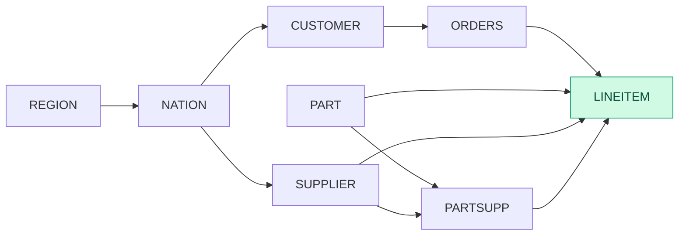

```sql
Sort[l_returnflag ASC, l_linestatus ASC]
  Aggregate(keys=[l_returnflag, l_linestatus]; aggs=[sum(l_quantity) AS sum_qty, sum(l_extendedprice) AS sum_base_price, sum(disc_price) AS sum_disc_price, sum(charge) AS sum_charge, avg(l_quantity) AS avg_qty, avg(l_extendedprice) AS avg_price, avg(l_discount) AS avg_disc, count_all(*) AS count_order])
    Project(l_returnflag = l_returnflag, l_linestatus = l_linestatus, l_quantity = l_quantity, l_extendedprice = l_extendedprice, l_discount = l_discount, disc_price = (l_extendedprice * (1 - l_discount)), charge = ((l_extendedprice * (1 - l_discount)) * (1 + l_tax)))
      Filter((l_shipdate <= 19980902))
        Scan(lineitem [l_shipdate, l_returnflag, l_linestatus, l_quantity, l_extendedprice, l_discount, l_tax])
```

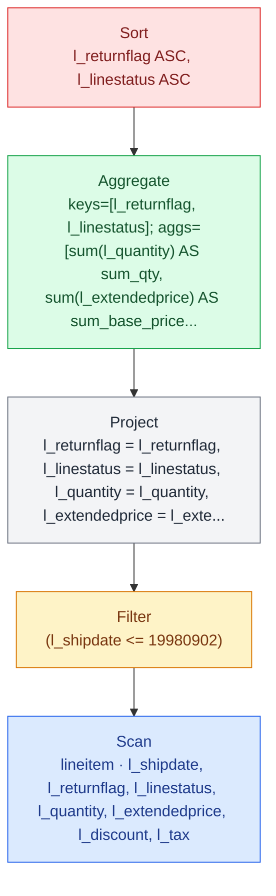


| Step | Operation | Rows | Cols | Tables | Selectivity | Baseline (ms) | Baseline implementation |
| --- | --- | --- | --- | --- | --- | --- | --- |
| 0 | SourceTable | 59986052 | 7 | lineitem |  |  |  |
| 1 | Filter | 59142609 | 6 | < | 98.6% | 56.1025 | nofuse |
| 2 | Project | 59142609 | 7 |  |  | 13.0981 | fuse |
| 3 | Reorder | 59142609 | 7 |  |  | 0.002568 |  |
| 4 | GroupBy | 4 | 10 | < | 0.00000676% | 112.201 | hash |
| 5 | Sort | 4 | 10 |  |  | 0.53216 | no_skf |
|  | Total |  |  |  |  | 181.936 |  |

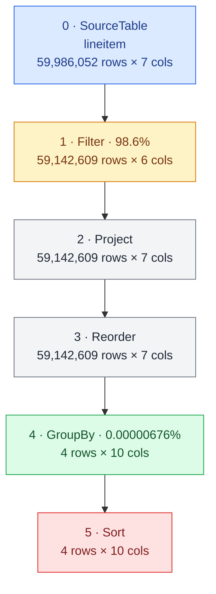


## Notes

- Almost a complete table scan

## Runtime breakdown


# Q2

```sql
SELECT
    s_acctbal,
    s_name,
    n_name,
    p_partkey,
    p_mfgr,
    s_address,
    s_phone,
    s_comment
FROM part, supplier, partsupp, nation, region
WHERE (p_partkey = ps_partkey)
    AND (s_suppkey = ps_suppkey)
    AND (p_size = 15)
    AND (p_type LIKE '%BRASS')
    AND (s_nationkey = n_nationkey)
    AND (n_regionkey = r_regionkey)
    AND (r_name = 'EUROPE')
    AND (ps_supplycost = (
        SELECT min(ps_supplycost)
        FROM partsupp, supplier, nation, region
        WHERE (p_partkey = ps_partkey)
            AND (s_suppkey = ps_suppkey)
            AND (s_nationkey = n_nationkey)
            AND (n_regionkey = r_regionkey)
            AND (r_name = 'EUROPE')
    ))
ORDER BY
    s_acctbal DESC,
    n_name,
    s_name,
    p_partkey
LIMIT 100;
```
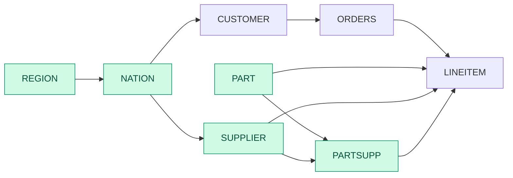

```sql
Limit(n=100)
  Sort[s_acctbal DESC, n_name ASC, s_name ASC, p_partkey ASC]
    Project(s_acctbal = s_acctbal, s_name = s_name, n_name = n_name, p_partkey = p_partkey, p_mfgr = p_mfgr, s_address = s_address, s_phone = s_phone, s_comment = s_comment)
      Filter((min_supplycost == ps_supplycost))
        InnerJoin(on=(p_partkey == p_partkey))
          Project(agg_partkey = p_partkey, min_supplycost = min_supplycost)
            Aggregate(keys=[p_partkey]; aggs=[min(ps_supplycost) AS min_supplycost])
              Project(p_partkey = p_partkey, ps_supplycost = ps_supplycost, p_mfgr = p_mfgr, n_name = n_name, s_acctbal = s_acctbal, s_name = s_name, s_address = s_address, s_phone = s_phone, s_comment = s_comment)
                InnerJoin(on=(n_nationkey == s_nationkey))
                  Project(n_nationkey = n_nationkey, n_name = n_name)
                    InnerJoin(on=(r_regionkey == n_regionkey))
                      Filter(str_eq(r_name, "EUROPE"))
                        Scan(region [r_regionkey, r_name])
                      Scan(nation [n_nationkey, n_name, n_regionkey])
                  Project(p_partkey = p_partkey, ps_supplycost = ps_supplycost, p_mfgr = p_mfgr, s_nationkey = s_nationkey, s_acctbal = s_acctbal, s_name = s_name, s_address = s_address, s_phone = s_phone, s_comment = s_comment)
                    InnerJoin(on=(s_suppkey == ps_suppkey))
                      Scan(supplier [s_suppkey, s_name, s_address, s_nationkey, s_phone, s_acctbal, s_comment])
                      InnerJoin(on=(ps_partkey == p_partkey))
                        Scan(partsupp [ps_partkey, ps_suppkey, ps_supplycost])
                        Project(p_partkey = p_partkey, p_mfgr = p_mfgr)
                          Filter(endswith(p_type, "BRASS"))
                            Filter((p_size == 15))
                              Scan(part [p_partkey, p_mfgr, p_type, p_size])
          Project(p_partkey = p_partkey, ps_supplycost = ps_supplycost, p_mfgr = p_mfgr, n_name = n_name, s_acctbal = s_acctbal, s_name = s_name, s_address = s_address, s_phone = s_phone, s_comment = s_comment)
            InnerJoin(on=(n_nationkey == s_nationkey))
              Project(n_nationkey = n_nationkey, n_name = n_name)
                InnerJoin(on=(r_regionkey == n_regionkey))
                  Filter(str_eq(r_name, "EUROPE"))
                    Scan(region [r_regionkey, r_name])
                  Scan(nation [n_nationkey, n_name, n_regionkey])
              Project(p_partkey = p_partkey, ps_supplycost = ps_supplycost, p_mfgr = p_mfgr, s_nationkey = s_nationkey, s_acctbal = s_acctbal, s_name = s_name, s_address = s_address, s_phone = s_phone, s_comment = s_comment)
                InnerJoin(on=(s_suppkey == ps_suppkey))
                  Scan(supplier [s_suppkey, s_name, s_address, s_nationkey, s_phone, s_acctbal, s_comment])
                  InnerJoin(on=(ps_partkey == p_partkey))
                    Scan(partsupp [ps_partkey, ps_suppkey, ps_supplycost])
                    Project(p_partkey = p_partkey, p_mfgr = p_mfgr)
                      Filter(endswith(p_type, "BRASS"))
                        Filter((p_size == 15))
                          Scan(part [p_partkey, p_mfgr, p_type, p_size])
```

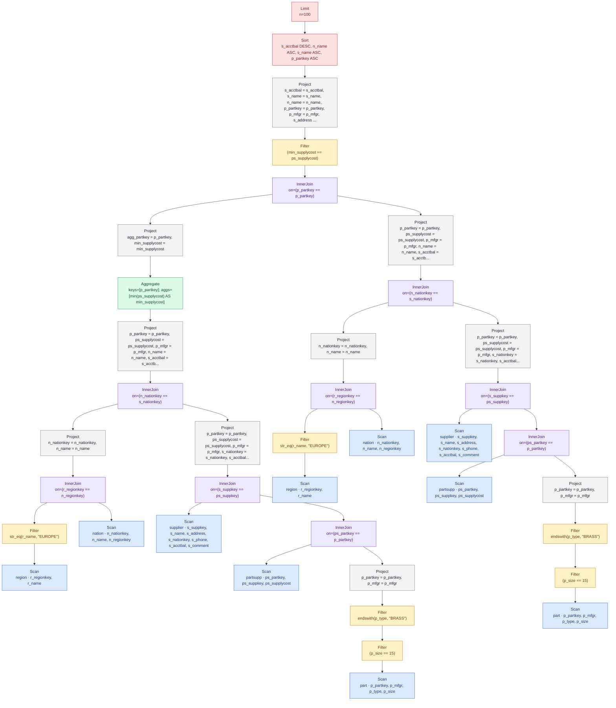


| Step | Operation | Rows | Cols | Tables | Selectivity | Baseline (ms) | Best (ms) | Baseline implementation | Best implementation |
| --- | --- | --- | --- | --- | --- | --- | --- | --- | --- |
| 0 | SourceTable | 5 | 2 | region |  |  |  |  |  |
| 1 | Filter | 1 | 1 | < | 20% | 0.0493819 | 0.0493819 | nofuse | nofuse |
| 2 | SourceTable | 25 | 3 | nation |  |  |  |  |  |
| 3 | EqJoin | 5 | 3 | region⋈nation | 20% | 0.140861 | 0.140861 | hash_gfur | hash_gfur |
| 4 | Reorder | 5 | 4 |  |  | 0.00705179 | 0.00705179 |  |  |
| 5 | Project | 5 | 2 |  |  | 0.0621196 | 0.0621196 | nofuse | nofuse |
| 6 | SourceTable | 100000 | 7 | supplier |  |  |  |  |  |
| 7 | SourceTable | 8000000 | 3 | partsupp |  |  |  |  |  |
| 8 | SourceTable | 2000000 | 4 | part |  |  |  |  |  |
| 9 | Filter | 39575 | 3 | < | 1.98% | 0.781625 | 0.781625 | nofuse | nofuse |
| 10 | Filter | 7854 | 2 | < | 19.8% | 0.160744 | 0.160744 | nofuse | nofuse |
| 11 | Project | 7854 | 2 |  |  | 0.00236042 | 0.00236042 | nofuse | nofuse |
| 12 | EqJoin | 31416 | 4 | partsupp⋈part | 0.00005% | 6.87367 | 6.87367 | hash_gfur | hash_gfur |
| 13 | Reorder | 31416 | 5 |  |  | 0.00728421 | 0.00728421 |  |  |
| 14 | EqJoin | 31416 | 11 | supplier⋈(partsupp⋈part) | 0.001% | 1.00285 | 1.00285 | hash_gfur | hash_gfur |
| 15 | Reorder | 31416 | 12 |  |  | 0.0165432 | 0.0165432 |  |  |
| 16 | Project | 31416 | 9 |  |  | 0.554563 | 0.554563 | nofuse | nofuse |
| 17 | EqJoin | 6351 | 10 | (region⋈nation)⋈(supplier⋈(partsupp⋈part)) | 4.04% | 0.52478 | 0.52478 | hash_gfur | hash_gfur |
| 18 | Reorder | 6351 | 11 |  |  | 0.0171646 | 0.0171646 |  |  |
| 19 | Project | 6351 | 9 |  |  | 0.405231 | 0.405231 | nofuse | nofuse |
| 20 | Reorder | 6351 | 2 |  |  | 0.0266762 | 0.0266762 |  |  |
| 21 | GroupBy | 4667 | 2 | < | 73.5% | 0.181685 | 0.149288 | hash | sort_gftr_opt |
| 22 | Project | 4667 | 2 |  |  | 0.00282863 | 0.00282863 | nofuse | nofuse |
| 23 | EqJoin | 6351 | 10 | ((region⋈nation)⋈(supplier⋈(partsupp⋈part))) ⋈ ((region⋈nation)⋈(supplier⋈(partsupp⋈part))) | 0.0214% | 0.474924 | 0.474924 | hash_gfur | hash_gfur |
| 24 | Reorder | 6351 | 11 |  |  | 0.0170223 | 0.0170223 |  |  |
| 25 | Filter | 4667 | 9 | < | 73.5% | 0.485811 | 0.485811 | nofuse | nofuse |
| 26 | Project | 4667 | 8 |  |  | 0.00460547 | 0.00460547 | nofuse | nofuse |
| 27 | TopK | 100 | 8 | < | 2.14% | 1.55757 | 1.55757 |  |  |
|  | Total |  |  |  |  | 13.3574 | 13.325 |  |  |

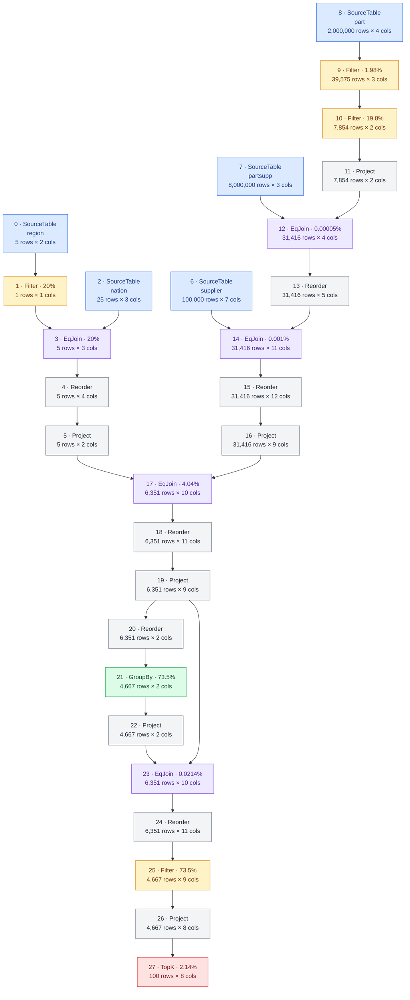


## Notes

- Repeated join subtree for the correlated MIN

## Runtime breakdown


# Q3

```sql
SELECT
    l_orderkey,
    sum(l_extendedprice * (1 - l_discount)) AS revenue,
    o_orderdate,
    o_shippriority
FROM customer, orders, lineitem
WHERE (c_mktsegment = 'BUILDING')
    AND (c_custkey = o_custkey)
    AND (l_orderkey = o_orderkey)
    AND (o_orderdate < date '1995-03-15')
    AND (l_shipdate > date '1995-03-15')
GROUP BY
    l_orderkey,
    o_orderdate,
    o_shippriority
ORDER BY
    revenue DESC,
    o_orderdate
LIMIT 10;
```
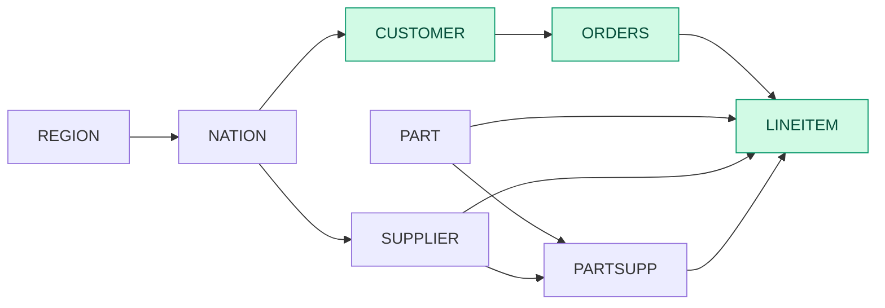

```sql
Limit(n=10)
  Sort[revenue DESC, o_orderdate ASC]
    Project(l_orderkey = l_orderkey, revenue = revenue, o_orderdate = o_orderdate, o_shippriority = o_shippriority)
      Aggregate(keys=[l_orderkey, o_orderdate, o_shippriority]; aggs=[sum(disc_price) AS revenue])
        Project(l_orderkey = l_orderkey, o_orderdate = o_orderdate, o_shippriority = o_shippriority, disc_price = (l_extendedprice * (1 - l_discount)))
          InnerJoin(on=(l_orderkey == o_orderkey))
            InnerJoin(on=(c_custkey == o_custkey))
              Filter(str_eq(c_mktsegment, "BUILDING"))
                Scan(customer [c_custkey, c_mktsegment])
              Filter((o_orderdate < 19950315))
                Scan(orders [o_orderkey, o_custkey, o_orderdate, o_shippriority])
            Filter((l_shipdate > 19950315))
              Scan(lineitem [l_orderkey, l_extendedprice, l_discount, l_shipdate])
```

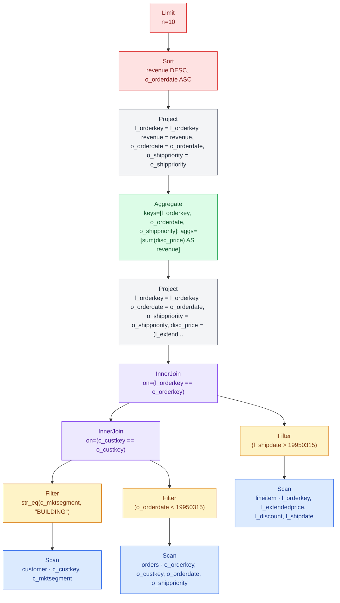


| Step | Operation | Rows | Cols | Tables | Selectivity | Baseline (ms) | Best (ms) | Baseline implementation | Best implementation |
| --- | --- | --- | --- | --- | --- | --- | --- | --- | --- |
| 0 | SourceTable | 1500000 | 2 | customer |  |  |  |  |  |
| 1 | Filter | 300276 | 1 | < | 20% | 0.31404 | 0.31404 | fuse | fuse |
| 2 | SourceTable | 15000000 | 4 | orders |  |  |  |  |  |
| 3 | Filter | 7289442 | 4 | < | 48.6% | 3.69772 | 2.94776 | fuse | nofuse |
| 4 | EqJoin | 1461923 | 4 | customer⋈orders | 0.0000668% | 12.6894 | 12.6894 | hash_gfur | hash_gfur |
| 5 | Reorder | 1461923 | 5 |  |  | 0.001904 | 0.001904 |  |  |
| 6 | SourceTable | 59986052 | 4 | lineitem |  |  |  |  |  |
| 7 | Filter | 32334250 | 3 | < | 53.9% | 14.9623 | 11.948 | fuse | nofuse |
| 8 | EqJoin | 302114 | 7 | (customer⋈orders)⋈lineitem | 0.000000639% | 30.8889 | 30.8889 | hash_gfur | hash_gfur |
| 9 | Reorder | 302114 | 8 |  |  | 0.002064 | 0.002064 |  |  |
| 10 | Project | 302114 | 4 |  |  | 0.123448 | 0.123448 | nofuse | nofuse |
| 11 | Reorder | 302114 | 4 |  |  | 0.001812 | 0.001812 |  |  |
| 12 | GroupBy | 114003 | 4 | < | 37.7% | 0.45488 | 0.45488 | hash | hash |
| 13 | Project | 114003 | 4 |  |  | 0.002776 | 0.002776 | nofuse | nofuse |
| 14 | TopK | 10 | 4 | < | 0.00877% | 1.06854 | 1.06854 |  |  |
|  | Total |  |  |  |  | 64.2078 | 60.4435 |  |  |

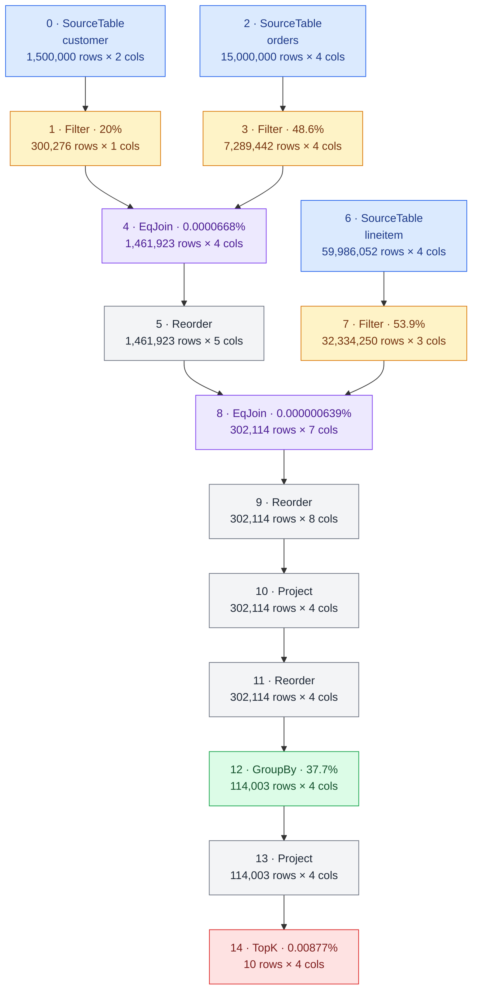


## Notes

- Large intermediate join

## Runtime breakdown


# Q4

```sql
SELECT
    o_orderpriority,
    count(*) AS order_count
FROM orders
WHERE (o_orderdate >= date '1993-07-01')
    AND (o_orderdate < date '1993-07-01' + INTERVAL 3 MONTH)
    AND EXISTS (
        SELECT *
        FROM lineitem
        WHERE (l_orderkey = o_orderkey)
            AND (l_commitdate < l_receiptdate)
    )
GROUP BY o_orderpriority
ORDER BY o_orderpriority;
```
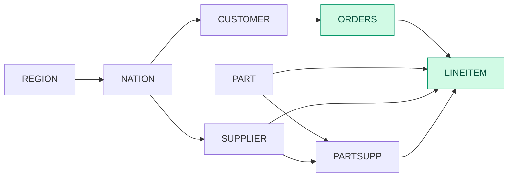

```sql
Sort[o_orderpriority ASC]
  Aggregate(keys=[o_orderpriority]; aggs=[count_all(*) AS order_count])
    LeftSemiJoin(on=(o_orderkey == l_orderkey))
      Filter(((o_orderdate >= 19930701) && (o_orderdate < 19931001)))
        Scan(orders [o_orderkey, o_orderdate, o_orderpriority])
      Filter((l_commitdate < l_receiptdate))
        Scan(lineitem [l_orderkey, l_commitdate, l_receiptdate])
```

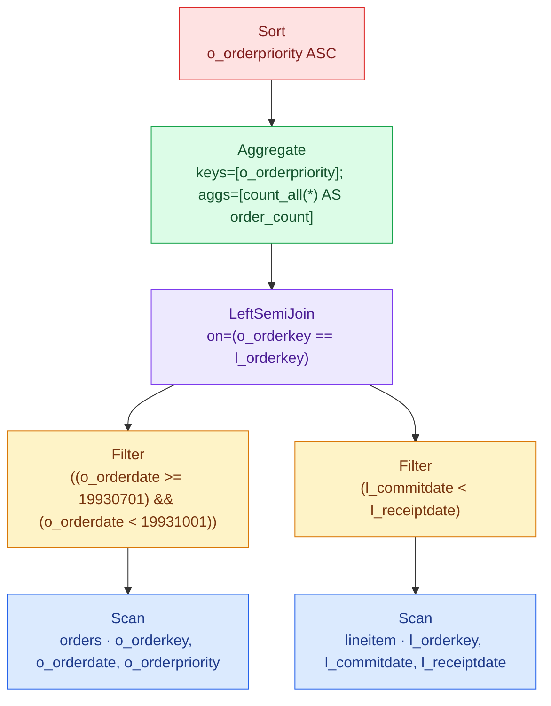


| Step | Operation | Rows | Cols | Tables | Selectivity | Baseline (ms) | Best (ms) | Baseline implementation | Best implementation |
| --- | --- | --- | --- | --- | --- | --- | --- | --- | --- |
| 0 | SourceTable | 15000000 | 3 | orders |  |  |  |  |  |
| 1 | Filter | 573671 | 2 | < | 3.82% | 4.36072 | 3.35254 | fuse | nofuse |
| 2 | SourceTable | 59986052 | 3 | lineitem |  |  |  |  |  |
| 3 | Filter | 37929348 | 1 | < | 63.2% | 6.98947 | 5.87889 | fuse | nofuse |
| 4 | SemiJoin | 526040 | 2 | orders⋈lineitem | 0.00000242% | 26.8662 | 26.8662 |  |  |
| 5 | Reorder | 526040 | 2 |  |  | 0.00768 | 0.00768 |  |  |
| 6 | Reorder | 526040 | 1 |  |  | 0.00191262 | 0.00191262 |  |  |
| 7 | GroupBy | 5 | 2 | < | 0.00095% | 0.482398 | 0.482398 | hash | hash |
| 8 | Sort | 5 | 2 |  |  | 0.157541 | 0.157541 | no_skf | no_skf |
|  | Total |  |  |  |  | 38.8659 | 36.7472 |  |  |

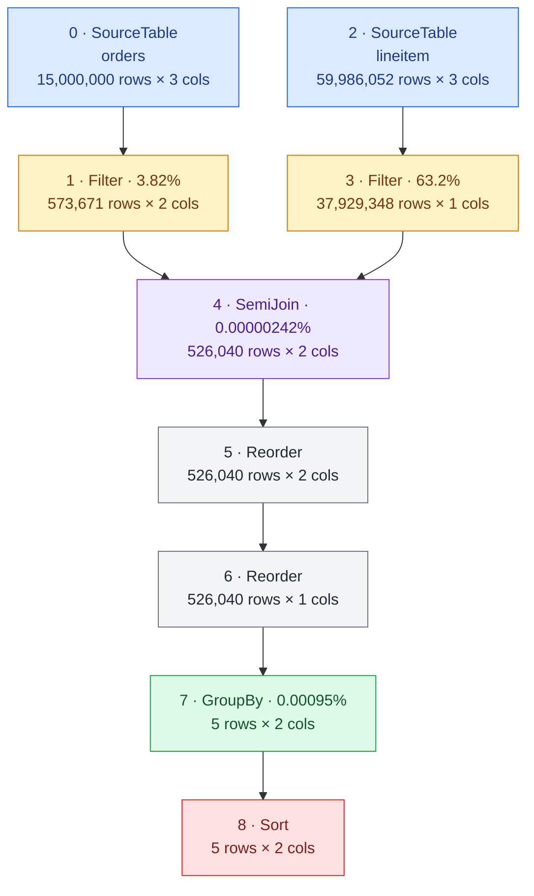


## Runtime breakdown


# Q5

```sql
SELECT
    n_name,
    sum(l_extendedprice * (1 - l_discount)) AS revenue
FROM customer, orders, lineitem, supplier, nation, region
WHERE (c_custkey = o_custkey)
    AND (l_orderkey = o_orderkey)
    AND (l_suppkey = s_suppkey)
    AND (c_nationkey = s_nationkey)
    AND (s_nationkey = n_nationkey)
    AND (n_regionkey = r_regionkey)
    AND (r_name = 'ASIA')
    AND (o_orderdate >= date '1994-01-01')
    AND (o_orderdate < date '1994-01-01' + INTERVAL 1 YEAR)
GROUP BY n_name
ORDER BY revenue DESC;
```
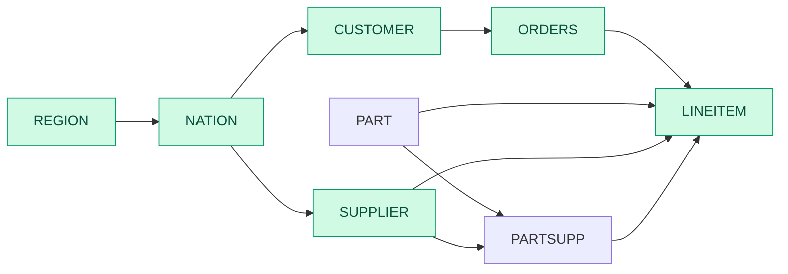

```sql
Sort[revenue DESC]
  Aggregate(keys=[n_name]; aggs=[sum(disc_price) AS revenue])
    Project(n_name = n_name, disc_price = (l_extendedprice * (1 - l_discount)))
      Filter((c_nationkey == s_nationkey))
        InnerJoin(on=(l_suppkey == s_suppkey))
          InnerJoin(on=(o_orderkey == l_orderkey))
            InnerJoin(on=(c_custkey == o_custkey))
              Scan(customer [c_custkey, c_nationkey])
              Filter(((o_orderdate >= 19940101) && (o_orderdate < 19950101)))
                Scan(orders [o_orderkey, o_custkey, o_orderdate])
            Scan(lineitem [l_orderkey, l_suppkey, l_extendedprice, l_discount])
          InnerJoin(on=(n_nationkey == s_nationkey))
            InnerJoin(on=(r_regionkey == n_regionkey))
              Filter(str_eq(r_name, "ASIA"))
                Scan(region [r_regionkey, r_name])
              Scan(nation [n_nationkey, n_name, n_regionkey])
            Scan(supplier [s_suppkey, s_nationkey])
```

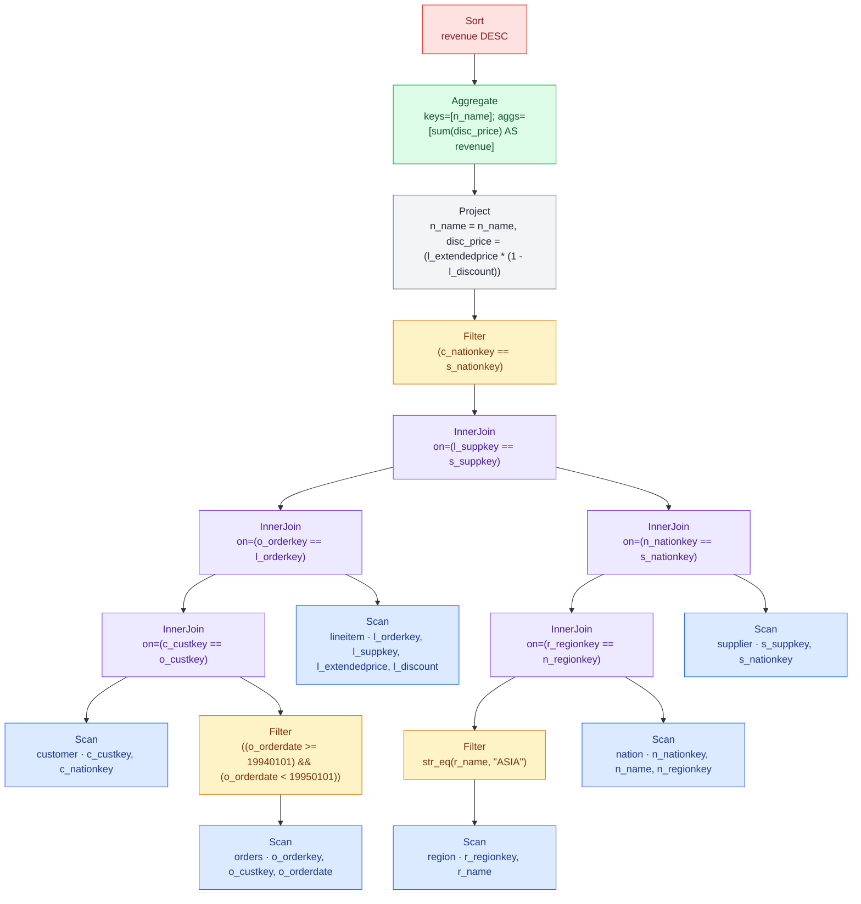


| Step | Operation | Rows | Cols | Tables | Selectivity | Baseline (ms) | Best (ms) | Baseline implementation | Best implementation |
| --- | --- | --- | --- | --- | --- | --- | --- | --- | --- |
| 0 | SourceTable | 1500000 | 2 | customer |  |  |  |  |  |
| 1 | SourceTable | 15000000 | 3 | orders |  |  |  |  |  |
| 2 | Filter | 2275919 | 2 | < | 15.2% | 3.55093 | 2.35943 | fuse | nofuse |
| 3 | EqJoin | 2275919 | 3 | customer⋈orders | 0.0000667% | 12.5685 | 12.5685 | hash_gfur | hash_gfur |
| 4 | Reorder | 2275919 | 4 |  |  | 0.001864 | 0.001864 |  |  |
| 5 | SourceTable | 59986052 | 4 | lineitem |  |  |  |  |  |
| 6 | EqJoin | 9103367 | 7 | (customer⋈orders)⋈lineitem | 0.00000667% | 66.4261 | 66.4261 | hash_gfur | hash_gfur |
| 7 | Reorder | 9103367 | 8 |  |  | 0.002176 | 0.002176 |  |  |
| 8 | SourceTable | 5 | 2 | region |  |  |  |  |  |
| 9 | Filter | 1 | 1 | < | 20% | 0.057248 | 0.057248 | fuse | fuse |
| 10 | SourceTable | 25 | 3 | nation |  |  |  |  |  |
| 11 | EqJoin | 5 | 3 | region⋈nation | 20% | 0.162176 | 0.162176 | hash_gfur | hash_gfur |
| 12 | Reorder | 5 | 4 |  |  | 0.00712 | 0.00712 |  |  |
| 13 | SourceTable | 100000 | 2 | supplier |  |  |  |  |  |
| 14 | EqJoin | 20037 | 5 | (region⋈nation)⋈supplier | 4.01% | 0.250944 | 0.250944 | hash_gfur | hash_gfur |
| 15 | Reorder | 20037 | 6 |  |  | 0.006408 | 0.006408 |  |  |
| 16 | EqJoin | 1825042 | 13 | ((customer⋈orders)⋈lineitem)⋈((region⋈nation) ⋈ supplier) | 0.001% | 56.1677 | 56.1677 | hash_gfur | hash_gfur |
| 17 | Reorder | 1825042 | 14 |  |  | 0.007792 | 0.007792 |  |  |
| 18 | Filter | 72985 | 3 | < | 4% | 0.700368 | 0.631832 | fuse | nofuse |
| 19 | Project | 72985 | 2 |  |  | 0.041488 | 0.041488 | nofuse | nofuse |
| 20 | Reorder | 72985 | 2 |  |  | 0.002016 | 0.002016 |  |  |
| 21 | GroupBy | 5 | 2 | < | 0.00685% | 0.242168 | 0.242168 | hash | hash |
| 22 | Sort | 5 | 2 |  |  | 0.10648 | 0.10648 | no_skf | no_skf |
|  | Total |  |  |  |  | 140.301 | 139.041 |  |  |

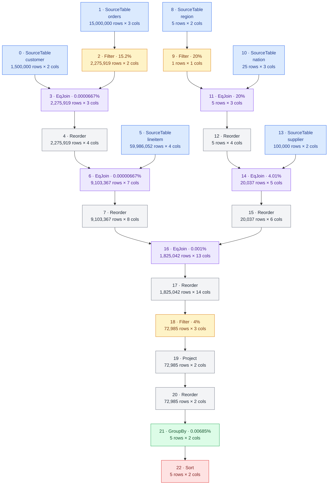


## Runtime breakdown


# Q6

```sql
SELECT
    sum(l_extendedprice * l_discount) AS revenue
FROM lineitem
WHERE (l_shipdate >= date '1994-01-01')
    AND (l_shipdate < date '1994-01-01' + INTERVAL 1 YEAR)
    AND (l_discount BETWEEN 0.06::Decimal(12,2) - 0.01::Decimal(12,2) AND 0.06::Decimal(12,2) + 0.01::Decimal(12,2))
    AND (l_quantity < 24);
```


```sql
Aggregate(aggs=[sum(revenue) AS total])
  Project(revenue = (l_extendedprice * l_discount))
    Filter((((((l_shipdate >= 19940101) && (l_shipdate < 19950101)) && (l_discount >= 0.05)) && (l_discount <= 0.07)) && (l_quantity < 24)))
      Scan(lineitem [l_shipdate, l_extendedprice, l_discount, l_quantity])
```

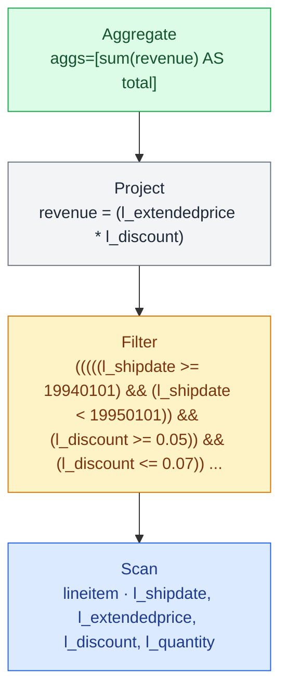


| Step | Operation | Rows | Cols | Tables | Selectivity | Baseline (ms) | Best (ms) | Baseline implementation | Best implementation |
| --- | --- | --- | --- | --- | --- | --- | --- | --- | --- |
| 0 | SourceTable | 59986052 | 4 | lineitem |  |  |  |  |  |
| 1 | Filter | 1139264 | 2 | < | 1.9% | 27.2187 | 15.9113 | fuse | nofuse |
| 2 | Project | 1139264 | 1 |  |  | 0.141295 | 0.141295 | nofuse | nofuse |
| 3 | Reorder | 1139264 | 1 |  |  | 0.00193347 | 0.00193347 |  |  |
| 4 | ScalarAgg | 1 | 1 |  |  | 0.080128 | 0.080128 |  |  |
|  | Total |  |  |  |  | 27.4421 | 16.1347 |  |  |

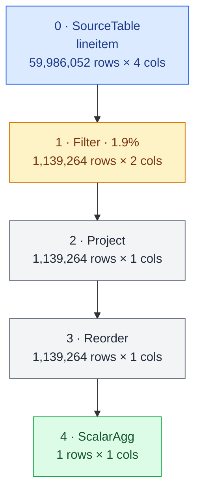


## Runtime breakdown


# Q7

```sql
SELECT
    supp_nation,
    cust_nation,
    l_year,
    sum(volume) AS revenue
FROM (
    SELECT
        n1.n_name AS supp_nation,
        n2.n_name AS cust_nation,
        extract(year FROM l_shipdate) AS l_year,
        l_extendedprice * (1 - l_discount) AS volume
    FROM supplier, lineitem, orders, customer, nation AS n1, nation AS n2
    WHERE (s_suppkey = l_suppkey)
        AND (o_orderkey = l_orderkey)
        AND (c_custkey = o_custkey)
        AND (s_nationkey = n1.n_nationkey)
        AND (c_nationkey = n2.n_nationkey)
        AND (
            ((n1.n_name = 'FRANCE') AND (n2.n_name = 'GERMANY'))
            OR ((n1.n_name = 'GERMANY') AND (n2.n_name = 'FRANCE'))
        )
        AND (l_shipdate BETWEEN date '1995-01-01' AND date '1996-12-31')
) AS shipping
GROUP BY
    supp_nation,
    cust_nation,
    l_year
ORDER BY
    supp_nation,
    cust_nation,
    l_year;
```
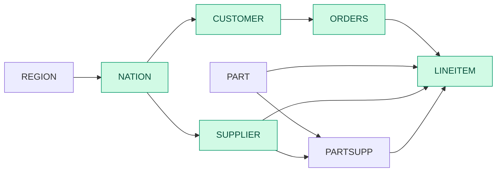

```sql
Sort[n_name#12 ASC, n_name#14 ASC, l_year ASC]
  Aggregate(keys=[n_name#12, n_name#14, l_year]; aggs=[sum(volume) AS revenue])
    Project(supp_nation = n_name#12, cust_nation = n_name#14, l_year = year(l_shipdate), volume = (l_extendedprice * (1 - l_discount)))
      Filter(((str_eq(n_name#12, "FRANCE") && str_eq(n_name#14, "GERMANY")) || (str_eq(n_name#12, "GERMANY") && str_eq(n_name#14, "FRANCE"))))
        InnerJoin(on=(o_custkey == c_custkey))
          InnerJoin(on=(l_orderkey == o_orderkey))
            InnerJoin(on=(s_suppkey == l_suppkey))
              InnerJoin(on=(n_nationkey#11 == s_nationkey))
                Filter(str_in(n_name#12, ["FRANCE", "GERMANY"]))
                  Scan(nation [n_nationkey, n_name])
                Scan(supplier [s_suppkey, s_nationkey])
              Filter(((l_shipdate >= 19950101) && (l_shipdate <= 19961231)))
                Scan(lineitem [l_orderkey, l_suppkey, l_extendedprice, l_discount, l_shipdate])
            Scan(orders [o_orderkey, o_custkey])
          InnerJoin(on=(n_nationkey#13 == c_nationkey))
            Filter(str_in(n_name#14, ["FRANCE", "GERMANY"]))
              Scan(nation [n_nationkey, n_name])
            Scan(customer [c_custkey, c_nationkey])
```

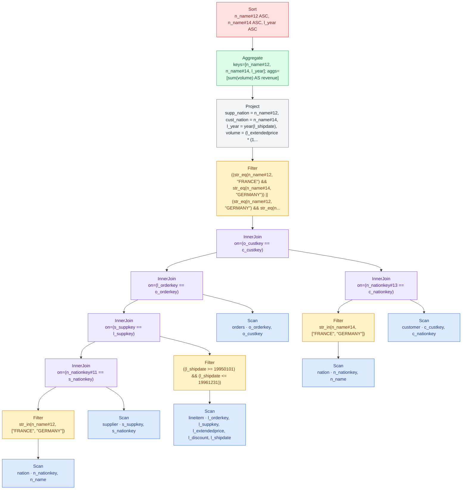


| Step | Operation | Rows | Cols | Tables | Selectivity | Baseline (ms) | Best (ms) | Baseline implementation | Best implementation |
| --- | --- | --- | --- | --- | --- | --- | --- | --- | --- |
| 0 | SourceTable | 25 | 2 | nation |  |  |  |  |  |
| 1 | Filter | 2 | 2 | < | 8% | 0.136859 | 0.136859 | fuse | fuse |
| 2 | SourceTable | 100000 | 2 | supplier |  |  |  |  |  |
| 3 | EqJoin | 8010 | 3 | nation⋈supplier | 4% | 0.19464 | 0.19464 | hash_gfur | hash_gfur |
| 4 | Reorder | 8010 | 4 |  |  | 0.00575467 | 0.00575467 |  |  |
| 5 | SourceTable | 59986052 | 5 | lineitem |  |  |  |  |  |
| 6 | Filter | 18230325 | 5 | < | 30.4% | 20.7792 | 16.0126 | fuse | nofuse |
| 7 | EqJoin | 1460257 | 8 | (nation⋈supplier)⋈lineitem | 0.001% | 15.1967 | 15.1967 | hash_gfur | hash_gfur |
| 8 | Reorder | 1460257 | 9 |  |  | 0.00783467 | 0.00783467 |  |  |
| 9 | SourceTable | 15000000 | 2 | orders |  |  |  |  |  |
| 10 | EqJoin | 1460257 | 10 | ((nation⋈supplier)⋈lineitem)⋈orders | 0.00000667% | 42.3044 | 42.3044 | hash_gfur | hash_gfur |
| 11 | Reorder | 1460257 | 11 |  |  | 0.007248 | 0.007248 |  |  |
| 12 | SourceTable | 25 | 2 | nation |  |  |  |  |  |
| 13 | Filter | 2 | 2 | < | 8% | 0.137792 | 0.137792 | fuse | fuse |
| 14 | SourceTable | 1500000 | 2 | customer |  |  |  |  |  |
| 15 | EqJoin | 120469 | 3 | nation⋈customer | 4.02% | 1.04668 | 1.04668 | hash_gfur | hash_gfur |
| 16 | Reorder | 120469 | 4 |  |  | 0.006192 | 0.006192 |  |  |
| 17 | EqJoin | 117014 | 14 | (((nation⋈supplier)⋈lineitem)⋈orders)⋈(nation ⋈ customer) | 0.0000665% | 3.37125 | 3.37125 | hash_gfur | hash_gfur |
| 18 | Reorder | 117014 | 15 |  |  | 0.00813333 | 0.00813333 |  |  |
| 19 | Filter | 58365 | 5 | < | 49.9% | 0.421419 | 0.421419 | fuse | fuse |
| 20 | Project | 58365 | 4 |  |  | 0.0526347 | 0.0526347 | nofuse | nofuse |
| 21 | Reorder | 58365 | 4 |  |  | 0.00209067 | 0.00209067 |  |  |
| 22 | GroupBy | 4 | 4 | < | 0.00685% | 0.303339 | 0.303339 | hash | hash |
| 23 | Sort | 4 | 4 |  |  | 0.672187 | 0.65029 | no_skf | skf |
|  | Total |  |  |  |  | 84.6544 | 79.8659 |  |  |

```mermaid
flowchart TD
    step_0["0 · SourceTable<br/>nation<br/>25 rows × 2 cols"]
    step_1["1 · Filter · 8%<br/>2 rows × 2 cols"]
    step_0 --> step_1
    step_2["2 · SourceTable<br/>supplier<br/>100,000 rows × 2 cols"]
    step_3["3 · EqJoin · 4%<br/>8,010 rows × 3 cols"]
    step_1 --> step_3
    step_2 --> step_3
    step_4["4 · Reorder<br/>8,010 rows × 4 cols"]
    step_3 --> step_4
    step_5["5 · SourceTable<br/>lineitem<br/>59,986,052 rows × 5 cols"]
    step_6["6 · Filter · 30.4%<br/>18,230,325 rows × 5 cols"]
    step_5 --> step_6
    step_7["7 · EqJoin · 0.001%<br/>1,460,257 rows × 8 cols"]
    step_4 --> step_7
    step_6 --> step_7
    step_8["8 · Reorder<br/>1,460,257 rows × 9 cols"]
    step_7 --> step_8
    step_9["9 · SourceTable<br/>orders<br/>15,000,000 rows × 2 cols"]
    step_10["10 · EqJoin · 0.00000667%<br/>1,460,257 rows × 10 cols"]
    step_8 --> step_10
    step_9 --> step_10
    step_11["11 · Reorder<br/>1,460,257 rows × 11 cols"]
    step_10 --> step_11
    step_12["12 · SourceTable<br/>nation<br/>25 rows × 2 cols"]
    step_13["13 · Filter · 8%<br/>2 rows × 2 cols"]
    step_12 --> step_13
    step_14["14 · SourceTable<br/>customer<br/>1,500,000 rows × 2 cols"]
    step_15["15 · EqJoin · 4.02%<br/>120,469 rows × 3 cols"]
    step_13 --> step_15
    step_14 --> step_15
    step_16["16 · Reorder<br/>120,469 rows × 4 cols"]
    step_15 --> step_16
    step_17["17 · EqJoin · 0.0000665%<br/>117,014 rows × 14 cols"]
    step_11 --> step_17
    step_16 --> step_17
    step_18["18 · Reorder<br/>117,014 rows × 15 cols"]
    step_17 --> step_18
    step_19["19 · Filter · 49.9%<br/>58,365 rows × 5 cols"]
    step_18 --> step_19
    step_20["20 · Project<br/>58,365 rows × 4 cols"]
    step_19 --> step_20
    step_21["21 · Reorder<br/>58,365 rows × 4 cols"]
    step_20 --> step_21
    step_22["22 · GroupBy · 0.00685%<br/>4 rows × 4 cols"]
    step_21 --> step_22
    step_23["23 · Sort<br/>4 rows × 4 cols"]
    step_22 --> step_23
    classDef source fill:#dbeafe,stroke:#2563eb,color:#1e3a8a
    classDef filter fill:#fef3c7,stroke:#d97706,color:#78350f
    classDef join fill:#ede9fe,stroke:#7c3aed,color:#4c1d95
    classDef aggregate fill:#dcfce7,stroke:#16a34a,color:#14532d
    classDef transform fill:#f3f4f6,stroke:#6b7280,color:#1f2937
    classDef ordering fill:#fee2e2,stroke:#dc2626,color:#7f1d1d
    class step_0,step_2,step_5,step_9,step_12,step_14 source
    class step_1,step_6,step_13,step_19 filter
    class step_3,step_7,step_10,step_15,step_17 join
    class step_22 aggregate
    class step_4,step_8,step_11,step_16,step_18,step_20,step_21 transform
    class step_23 ordering
```


## Notes

- nation is read multiple times.

## Runtime breakdown


# Q8

```sql
SELECT
    o_year,
    sum(CASE
        WHEN nation = 'BRAZIL' THEN volume
        ELSE 0
    END) / sum(volume) AS mkt_share
FROM (
    SELECT
        extract(year FROM o_orderdate) AS o_year,
        l_extendedprice * (1 - l_discount) AS volume,
        n2.n_name AS nation
    FROM part, supplier, lineitem, orders, customer, nation AS n1, nation AS n2, region
    WHERE (p_partkey = l_partkey)
        AND (s_suppkey = l_suppkey)
        AND (l_orderkey = o_orderkey)
        AND (o_custkey = c_custkey)
        AND (c_nationkey = n1.n_nationkey)
        AND (n1.n_regionkey = r_regionkey)
        AND (r_name = 'AMERICA')
        AND (s_nationkey = n2.n_nationkey)
        AND (o_orderdate BETWEEN date '1995-01-01' AND date '1996-12-31')
        AND (p_type = 'ECONOMY ANODIZED STEEL')
) AS all_nations
GROUP BY o_year
ORDER BY o_year;
```
```mermaid
flowchart LR
    REGION --> NATION
    NATION --> SUPPLIER
    NATION --> CUSTOMER
    CUSTOMER --> ORDERS
    ORDERS --> LINEITEM
    PART --> PARTSUPP
    SUPPLIER --> PARTSUPP
    PART --> LINEITEM
    SUPPLIER --> LINEITEM
    PARTSUPP --> LINEITEM
    classDef active fill:#d1fae5,stroke:#059669,stroke-width:1px,color:#064e3b
    class REGION,NATION,SUPPLIER,CUSTOMER,PART,ORDERS,LINEITEM active
```

```sql
Sort[o_year ASC]
  Project(o_year = o_year, mkt_share = (sum_brazil / sum_total))
    Aggregate(keys=[o_year]; aggs=[sum(brazil_volume) AS sum_brazil, sum(volume) AS sum_total])
      Project(o_year = o_year, volume = volume, brazil_volume = case(is_brazil, volume, 0))
        Project(o_year = o_year, volume = volume, is_brazil = str_eq(n_name, "BRAZIL"))
          Project(o_year = year(o_orderdate), volume = (l_extendedprice * (1 - l_discount)), nation = n_name)
            InnerJoin(on=(s_nationkey == n_nationkey#16))
              InnerJoin(on=(l_suppkey == s_suppkey))
                InnerJoin(on=(l_partkey == p_partkey))
                  InnerJoin(on=(o_orderkey == l_orderkey))
                    InnerJoin(on=(c_custkey == o_custkey))
                      InnerJoin(on=(n_nationkey#14 == c_nationkey))
                        InnerJoin(on=(r_regionkey == n_regionkey))
                          Filter(str_eq(r_name, "AMERICA"))
                            Scan(region [r_regionkey, r_name])
                          Scan(nation [n_nationkey, n_regionkey])
                        Scan(customer [c_custkey, c_nationkey])
                      Filter(((o_orderdate >= 19950101) && (o_orderdate <= 19961231)))
                        Scan(orders [o_orderkey, o_custkey, o_orderdate])
                    Scan(lineitem [l_orderkey, l_partkey, l_suppkey, l_extendedprice, l_discount])
                  Filter(str_eq(p_type, "ECONOMY ANODIZED STEEL"))
                    Scan(part [p_partkey, p_type])
                Scan(supplier [s_suppkey, s_nationkey])
              Scan(nation [n_nationkey, n_name])
```

```mermaid
flowchart TD
    ir_0["Sort<br/>o_year ASC"]
    ir_1["Project<br/>o_year = o_year, mkt_share = (sum_brazil / sum_total)"]
    ir_0 --> ir_1
    ir_2["Aggregate<br/>keys=[o_year]; aggs=[sum(brazil_volume) AS sum_brazil, sum(volume) AS sum_total]"]
    ir_1 --> ir_2
    ir_3["Project<br/>o_year = o_year, volume = volume, brazil_volume = case(is_brazil, volume, 0)"]
    ir_2 --> ir_3
    ir_4["Project<br/>o_year = o_year, volume = volume, is_brazil = str_eq(n_name, #quot;BRAZIL#quot;)"]
    ir_3 --> ir_4
    ir_5["Project<br/>o_year = year(o_orderdate), volume = (l_extendedprice * (1 - l_discount)), nation = n_name"]
    ir_4 --> ir_5
    ir_6["InnerJoin<br/>on=(s_nationkey == n_nationkey#16)"]
    ir_5 --> ir_6
    ir_7["InnerJoin<br/>on=(l_suppkey == s_suppkey)"]
    ir_6 --> ir_7
    ir_8["InnerJoin<br/>on=(l_partkey == p_partkey)"]
    ir_7 --> ir_8
    ir_9["InnerJoin<br/>on=(o_orderkey == l_orderkey)"]
    ir_8 --> ir_9
    ir_10["InnerJoin<br/>on=(c_custkey == o_custkey)"]
    ir_9 --> ir_10
    ir_11["InnerJoin<br/>on=(n_nationkey#14 == c_nationkey)"]
    ir_10 --> ir_11
    ir_12["InnerJoin<br/>on=(r_regionkey == n_regionkey)"]
    ir_11 --> ir_12
    ir_13["Filter<br/>str_eq(r_name, #quot;AMERICA#quot;)"]
    ir_12 --> ir_13
    ir_14["Scan<br/>region · r_regionkey, r_name"]
    ir_13 --> ir_14
    ir_15["Scan<br/>nation · n_nationkey, n_regionkey"]
    ir_12 --> ir_15
    ir_16["Scan<br/>customer · c_custkey, c_nationkey"]
    ir_11 --> ir_16
    ir_17["Filter<br/>((o_orderdate &gt;= 19950101) &amp;&amp; (o_orderdate &lt;= 19961231))"]
    ir_10 --> ir_17
    ir_18["Scan<br/>orders · o_orderkey, o_custkey, o_orderdate"]
    ir_17 --> ir_18
    ir_19["Scan<br/>lineitem · l_orderkey, l_partkey, l_suppkey, l_extendedprice, l_discount"]
    ir_9 --> ir_19
    ir_20["Filter<br/>str_eq(p_type, #quot;ECONOMY ANODIZED STEEL#quot;)"]
    ir_8 --> ir_20
    ir_21["Scan<br/>part · p_partkey, p_type"]
    ir_20 --> ir_21
    ir_22["Scan<br/>supplier · s_suppkey, s_nationkey"]
    ir_7 --> ir_22
    ir_23["Scan<br/>nation · n_nationkey, n_name"]
    ir_6 --> ir_23
    classDef source fill:#dbeafe,stroke:#2563eb,color:#1e3a8a
    classDef filter fill:#fef3c7,stroke:#d97706,color:#78350f
    classDef join fill:#ede9fe,stroke:#7c3aed,color:#4c1d95
    classDef aggregate fill:#dcfce7,stroke:#16a34a,color:#14532d
    classDef transform fill:#f3f4f6,stroke:#6b7280,color:#1f2937
    classDef ordering fill:#fee2e2,stroke:#dc2626,color:#7f1d1d
    class ir_14,ir_15,ir_16,ir_18,ir_19,ir_21,ir_22,ir_23 source
    class ir_13,ir_17,ir_20 filter
    class ir_6,ir_7,ir_8,ir_9,ir_10,ir_11,ir_12 join
    class ir_2 aggregate
    class ir_1,ir_3,ir_4,ir_5 transform
    class ir_0 ordering
```


| Step | Operation | Rows | Cols | Tables | Selectivity | Baseline (ms) | Best (ms) | Baseline implementation | Best implementation |
| --- | --- | --- | --- | --- | --- | --- | --- | --- | --- |
| 0 | SourceTable | 5 | 2 | region |  |  |  |  |  |
| 1 | Filter | 1 | 1 | < | 20% | 0.0585326 | 0.0585326 | fuse | fuse |
| 2 | SourceTable | 25 | 2 | nation |  |  |  |  |  |
| 3 | EqJoin | 5 | 2 | region⋈nation | 20% | 0.103954 | 0.103954 | hash_gfur | hash_gfur |
| 4 | Reorder | 5 | 3 |  |  | 0.002112 | 0.002112 |  |  |
| 5 | SourceTable | 1500000 | 2 | customer |  |  |  |  |  |
| 6 | EqJoin | 299436 | 4 | (region⋈nation)⋈customer | 3.99% | 1.42759 | 1.42759 | hash_gfur | hash_gfur |
| 7 | Reorder | 299436 | 5 |  |  | 0.00200686 | 0.00200686 |  |  |
| 8 | SourceTable | 15000000 | 3 | orders |  |  |  |  |  |
| 9 | Filter | 4557513 | 3 | < | 30.4% | 4.67057 | 2.78978 | fuse | nofuse |
| 10 | EqJoin | 910360 | 7 | ((region⋈nation)⋈customer)⋈orders | 0.0000667% | 8.14634 | 8.14634 | hash_gfur | hash_gfur |
| 11 | Reorder | 910360 | 8 |  |  | 0.00209371 | 0.00209371 |  |  |
| 12 | SourceTable | 59986052 | 5 | lineitem |  |  |  |  |  |
| 13 | EqJoin | 3638929 | 12 | (((region⋈nation)⋈customer)⋈orders)⋈lineitem | 0.00000666% | 57.1499 | 57.1499 | hash_gfur | hash_gfur |
| 14 | Reorder | 3638929 | 13 |  |  | 0.00213943 | 0.00213943 |  |  |
| 15 | SourceTable | 2000000 | 2 | part |  |  |  |  |  |
| 16 | Filter | 13452 | 1 | < | 0.673% | 0.371173 | 0.371173 | fuse | fuse |
| 17 | EqJoin | 24254 | 13 | ((((region⋈nation)⋈customer)⋈orders)⋈lineitem) ⋈ part | 0.0000495% | 6.92702 | 6.92702 | hash_gfur | hash_gfur |
| 18 | Reorder | 24254 | 14 |  |  | 0.00210286 | 0.00210286 |  |  |
| 19 | SourceTable | 100000 | 2 | supplier |  |  |  |  |  |
| 20 | EqJoin | 24254 | 15 | (((((region⋈nation)⋈customer)⋈orders)⋈lineitem) ⋈ part)⋈supplier | 0.001% | 0.361367 | 0.361367 | hash_gfur | hash_gfur |
| 21 | Reorder | 24254 | 16 |  |  | 0.00297143 | 0.00297143 |  |  |
| 22 | SourceTable | 25 | 2 | nation |  |  |  |  |  |
| 23 | EqJoin | 24254 | 17 | ((((((region⋈nation)⋈customer)⋈orders)⋈lineitem) ⋈ part)⋈supplier)⋈nation | 4% | 1.67774 | 1.67774 | hash_gfur | hash_gfur |
| 24 | Reorder | 24254 | 18 |  |  | 0.010272 | 0.010272 |  |  |
| 25 | Project | 24254 | 3 |  |  | 0.121842 | 0.121842 | nofuse | nofuse |
| 26 | Project | 24254 | 3 |  |  | 0.0295131 | 0.0295131 | nofuse | nofuse |
| 27 | Project | 24254 | 3 |  |  | 0.0164709 | 0.0164709 | nofuse | nofuse |
| 28 | Reorder | 24254 | 3 |  |  | 0.00184229 | 0.00184229 |  |  |
| 29 | GroupBy | 2 | 3 | < | 0.00825% | 0.222139 | 0.185051 | hash | sort_gfur |
| 30 | Project | 2 | 2 |  |  | 0.016672 | 0.016672 | nofuse | nofuse |
| 31 | Sort | 2 | 2 |  |  | 0.0351543 | 0.0351543 | no_skf | no_skf |
|  | Total |  |  |  |  | 81.3615 | 79.4436 |  |  |

```mermaid
flowchart TD
    step_0["0 · SourceTable<br/>region<br/>5 rows × 2 cols"]
    step_1["1 · Filter · 20%<br/>1 rows × 1 cols"]
    step_0 --> step_1
    step_2["2 · SourceTable<br/>nation<br/>25 rows × 2 cols"]
    step_3["3 · EqJoin · 20%<br/>5 rows × 2 cols"]
    step_1 --> step_3
    step_2 --> step_3
    step_4["4 · Reorder<br/>5 rows × 3 cols"]
    step_3 --> step_4
    step_5["5 · SourceTable<br/>customer<br/>1,500,000 rows × 2 cols"]
    step_6["6 · EqJoin · 3.99%<br/>299,436 rows × 4 cols"]
    step_4 --> step_6
    step_5 --> step_6
    step_7["7 · Reorder<br/>299,436 rows × 5 cols"]
    step_6 --> step_7
    step_8["8 · SourceTable<br/>orders<br/>15,000,000 rows × 3 cols"]
    step_9["9 · Filter · 30.4%<br/>4,557,513 rows × 3 cols"]
    step_8 --> step_9
    step_10["10 · EqJoin · 0.0000667%<br/>910,360 rows × 7 cols"]
    step_7 --> step_10
    step_9 --> step_10
    step_11["11 · Reorder<br/>910,360 rows × 8 cols"]
    step_10 --> step_11
    step_12["12 · SourceTable<br/>lineitem<br/>59,986,052 rows × 5 cols"]
    step_13["13 · EqJoin · 0.00000666%<br/>3,638,929 rows × 12 cols"]
    step_11 --> step_13
    step_12 --> step_13
    step_14["14 · Reorder<br/>3,638,929 rows × 13 cols"]
    step_13 --> step_14
    step_15["15 · SourceTable<br/>part<br/>2,000,000 rows × 2 cols"]
    step_16["16 · Filter · 0.673%<br/>13,452 rows × 1 cols"]
    step_15 --> step_16
    step_17["17 · EqJoin · 0.0000495%<br/>24,254 rows × 13 cols"]
    step_14 --> step_17
    step_16 --> step_17
    step_18["18 · Reorder<br/>24,254 rows × 14 cols"]
    step_17 --> step_18
    step_19["19 · SourceTable<br/>supplier<br/>100,000 rows × 2 cols"]
    step_20["20 · EqJoin · 0.001%<br/>24,254 rows × 15 cols"]
    step_18 --> step_20
    step_19 --> step_20
    step_21["21 · Reorder<br/>24,254 rows × 16 cols"]
    step_20 --> step_21
    step_22["22 · SourceTable<br/>nation<br/>25 rows × 2 cols"]
    step_23["23 · EqJoin · 4%<br/>24,254 rows × 17 cols"]
    step_21 --> step_23
    step_22 --> step_23
    step_24["24 · Reorder<br/>24,254 rows × 18 cols"]
    step_23 --> step_24
    step_25["25 · Project<br/>24,254 rows × 3 cols"]
    step_24 --> step_25
    step_26["26 · Project<br/>24,254 rows × 3 cols"]
    step_25 --> step_26
    step_27["27 · Project<br/>24,254 rows × 3 cols"]
    step_26 --> step_27
    step_28["28 · Reorder<br/>24,254 rows × 3 cols"]
    step_27 --> step_28
    step_29["29 · GroupBy · 0.00825%<br/>2 rows × 3 cols"]
    step_28 --> step_29
    step_30["30 · Project<br/>2 rows × 2 cols"]
    step_29 --> step_30
    step_31["31 · Sort<br/>2 rows × 2 cols"]
    step_30 --> step_31
    classDef source fill:#dbeafe,stroke:#2563eb,color:#1e3a8a
    classDef filter fill:#fef3c7,stroke:#d97706,color:#78350f
    classDef join fill:#ede9fe,stroke:#7c3aed,color:#4c1d95
    classDef aggregate fill:#dcfce7,stroke:#16a34a,color:#14532d
    classDef transform fill:#f3f4f6,stroke:#6b7280,color:#1f2937
    classDef ordering fill:#fee2e2,stroke:#dc2626,color:#7f1d1d
    class step_0,step_2,step_5,step_8,step_12,step_15,step_19,step_22 source
    class step_1,step_9,step_16 filter
    class step_3,step_6,step_10,step_13,step_17,step_20,step_23 join
    class step_29 aggregate
    class step_4,step_7,step_11,step_14,step_18,step_21,step_24,step_25,step_26,step_27,step_28,step_30 transform
    class step_31 ordering
```


## Notes

- nation is read multiple times.

## Runtime breakdown


# Q9

```sql
SELECT
    nation,
    o_year,
    sum(amount) AS sum_profit
FROM (
    SELECT
        n_name AS nation,
        extract(year FROM o_orderdate) AS o_year,
        l_extendedprice * (1 - l_discount) - ps_supplycost * l_quantity AS amount
    FROM part, supplier, lineitem, partsupp, orders, nation
    WHERE (s_suppkey = l_suppkey)
        AND (ps_suppkey = l_suppkey)
        AND (ps_partkey = l_partkey)
        AND (p_partkey = l_partkey)
        AND (o_orderkey = l_orderkey)
        AND (s_nationkey = n_nationkey)
        AND (p_name LIKE '%green%')
) AS profit
GROUP BY
    nation,
    o_year
ORDER BY
    nation,
    o_year DESC;
```
```mermaid
flowchart LR
    REGION --> NATION
    NATION --> SUPPLIER
    NATION --> CUSTOMER
    CUSTOMER --> ORDERS
    ORDERS --> LINEITEM
    PART --> PARTSUPP
    SUPPLIER --> PARTSUPP
    PART --> LINEITEM
    SUPPLIER --> LINEITEM
    PARTSUPP --> LINEITEM
    classDef active fill:#d1fae5,stroke:#059669,stroke-width:1px,color:#064e3b
    class NATION,SUPPLIER,PART,PARTSUPP,ORDERS,LINEITEM active
```

```sql
Sort[n_name ASC, o_year DESC]
  Aggregate(keys=[n_name, o_year]; aggs=[sum(amount) AS sum_profit])
    Project(nation = n_name, o_year = year(o_orderdate), amount = ((l_extendedprice * (1 - l_discount)) - (ps_supplycost * l_quantity)))
      InnerJoin(on=(n_nationkey == s_nationkey))
        Scan(nation [n_nationkey, n_name])
        InnerJoin(on=(l_orderkey == o_orderkey))
          Filter((l_suppkey == ps_suppkey))
            InnerJoin(on=(l_partkey == ps_partkey))
              InnerJoin(on=(l_suppkey == s_suppkey))
                InnerJoin(on=(p_partkey == l_partkey))
                  Filter(contains(p_name, "green"))
                    Scan(part [p_partkey, p_name])
                  Scan(lineitem [l_orderkey, l_partkey, l_suppkey, l_quantity, l_extendedprice, l_discount])
                Scan(supplier [s_suppkey, s_nationkey])
              Scan(partsupp [ps_partkey, ps_suppkey, ps_supplycost])
          Scan(orders [o_orderkey, o_orderdate])
```

```mermaid
flowchart TD
    ir_0["Sort<br/>n_name ASC, o_year DESC"]
    ir_1["Aggregate<br/>keys=[n_name, o_year]; aggs=[sum(amount) AS sum_profit]"]
    ir_0 --> ir_1
    ir_2["Project<br/>nation = n_name, o_year = year(o_orderdate), amount = ((l_extendedprice * (1 - l_discount)) - (ps_supplycos..."]
    ir_1 --> ir_2
    ir_3["InnerJoin<br/>on=(n_nationkey == s_nationkey)"]
    ir_2 --> ir_3
    ir_4["Scan<br/>nation · n_nationkey, n_name"]
    ir_3 --> ir_4
    ir_5["InnerJoin<br/>on=(l_orderkey == o_orderkey)"]
    ir_3 --> ir_5
    ir_6["Filter<br/>(l_suppkey == ps_suppkey)"]
    ir_5 --> ir_6
    ir_7["InnerJoin<br/>on=(l_partkey == ps_partkey)"]
    ir_6 --> ir_7
    ir_8["InnerJoin<br/>on=(l_suppkey == s_suppkey)"]
    ir_7 --> ir_8
    ir_9["InnerJoin<br/>on=(p_partkey == l_partkey)"]
    ir_8 --> ir_9
    ir_10["Filter<br/>contains(p_name, #quot;green#quot;)"]
    ir_9 --> ir_10
    ir_11["Scan<br/>part · p_partkey, p_name"]
    ir_10 --> ir_11
    ir_12["Scan<br/>lineitem · l_orderkey, l_partkey, l_suppkey, l_quantity, l_extendedprice, l_discount"]
    ir_9 --> ir_12
    ir_13["Scan<br/>supplier · s_suppkey, s_nationkey"]
    ir_8 --> ir_13
    ir_14["Scan<br/>partsupp · ps_partkey, ps_suppkey, ps_supplycost"]
    ir_7 --> ir_14
    ir_15["Scan<br/>orders · o_orderkey, o_orderdate"]
    ir_5 --> ir_15
    classDef source fill:#dbeafe,stroke:#2563eb,color:#1e3a8a
    classDef filter fill:#fef3c7,stroke:#d97706,color:#78350f
    classDef join fill:#ede9fe,stroke:#7c3aed,color:#4c1d95
    classDef aggregate fill:#dcfce7,stroke:#16a34a,color:#14532d
    classDef transform fill:#f3f4f6,stroke:#6b7280,color:#1f2937
    classDef ordering fill:#fee2e2,stroke:#dc2626,color:#7f1d1d
    class ir_4,ir_11,ir_12,ir_13,ir_14,ir_15 source
    class ir_6,ir_10 filter
    class ir_3,ir_5,ir_7,ir_8,ir_9 join
    class ir_1 aggregate
    class ir_2 transform
    class ir_0 ordering
```


| Step | Operation | Rows | Cols | Tables | Selectivity | Baseline (ms) | Best (ms) | Baseline implementation | Best implementation |
| --- | --- | --- | --- | --- | --- | --- | --- | --- | --- |
| 0 | SourceTable | 25 | 2 | nation |  |  |  |  |  |
| 1 | SourceTable | 2000000 | 2 | part |  |  |  |  |  |
| 2 | Filter | 108782 | 1 | < | 5.44% | 1.0344 | 1.0344 | fuse | fuse |
| 3 | SourceTable | 59986052 | 6 | lineitem |  |  |  |  |  |
| 4 | EqJoin | 3261613 | 6 | part⋈lineitem | 0.00005% | 53.2063 | 53.2063 | hash_gfur | hash_gfur |
| 5 | Reorder | 3261613 | 7 |  |  | 0.00196 | 0.00196 |  |  |
| 6 | SourceTable | 100000 | 2 | supplier |  |  |  |  |  |
| 7 | EqJoin | 3261613 | 8 | (part⋈lineitem)⋈supplier | 0.001% | 25.2001 | 25.2001 | hash_gfur | hash_gfur |
| 8 | Reorder | 3261613 | 9 |  |  | 0.002168 | 0.002168 |  |  |
| 9 | SourceTable | 8000000 | 3 | partsupp |  |  |  |  |  |
| 10 | EqJoin | 13046452 | 11 | ((part⋈lineitem)⋈supplier)⋈partsupp | 0.00005% | 35.6903 | 35.6903 | hash_gfur | hash_gfur |
| 11 | Reorder | 13046452 | 12 |  |  | 0.00336 | 0.00336 |  |  |
| 12 | Filter | 3261613 | 6 | < | 25% | 4.71559 | 4.71559 | fuse | fuse |
| 13 | SourceTable | 15000000 | 2 | orders |  |  |  |  |  |
| 14 | EqJoin | 3261613 | 7 | (((part⋈lineitem)⋈supplier)⋈partsupp)⋈orders | 0.00000667% | 65.2255 | 65.2255 | hash_gfur | hash_gfur |
| 15 | Reorder | 3261613 | 8 |  |  | 0.001824 | 0.001824 |  |  |
| 16 | EqJoin | 3261613 | 9 | nation⋈((((part⋈lineitem)⋈supplier)⋈partsupp) ⋈ orders) | 4% | 5.33718 | 5.33718 | hash_gfur | hash_gfur |
| 17 | Reorder | 3261613 | 10 |  |  | 0.011896 | 0.011896 |  |  |
| 18 | Project | 3261613 | 3 |  |  | 2.9913 | 2.9913 | nofuse | nofuse |
| 19 | Reorder | 3261613 | 3 |  |  | 0.007056 | 0.007056 |  |  |
| 20 | GroupBy | 175 | 3 | < | 0.00537% | 2.02798 | 2.02798 | hash | hash |
| 21 | Sort | 175 | 3 |  |  | 0.75868 | 0.762672 | no_skf | skf |
|  | Total |  |  |  |  | 196.216 | 196.22 |  |  |

```mermaid
flowchart TD
    step_0["0 · SourceTable<br/>nation<br/>25 rows × 2 cols"]
    step_1["1 · SourceTable<br/>part<br/>2,000,000 rows × 2 cols"]
    step_2["2 · Filter · 5.44%<br/>108,782 rows × 1 cols"]
    step_1 --> step_2
    step_3["3 · SourceTable<br/>lineitem<br/>59,986,052 rows × 6 cols"]
    step_4["4 · EqJoin · 0.00005%<br/>3,261,613 rows × 6 cols"]
    step_2 --> step_4
    step_3 --> step_4
    step_5["5 · Reorder<br/>3,261,613 rows × 7 cols"]
    step_4 --> step_5
    step_6["6 · SourceTable<br/>supplier<br/>100,000 rows × 2 cols"]
    step_7["7 · EqJoin · 0.001%<br/>3,261,613 rows × 8 cols"]
    step_5 --> step_7
    step_6 --> step_7
    step_8["8 · Reorder<br/>3,261,613 rows × 9 cols"]
    step_7 --> step_8
    step_9["9 · SourceTable<br/>partsupp<br/>8,000,000 rows × 3 cols"]
    step_10["10 · EqJoin · 0.00005%<br/>13,046,452 rows × 11 cols"]
    step_8 --> step_10
    step_9 --> step_10
    step_11["11 · Reorder<br/>13,046,452 rows × 12 cols"]
    step_10 --> step_11
    step_12["12 · Filter · 25%<br/>3,261,613 rows × 6 cols"]
    step_11 --> step_12
    step_13["13 · SourceTable<br/>orders<br/>15,000,000 rows × 2 cols"]
    step_14["14 · EqJoin · 0.00000667%<br/>3,261,613 rows × 7 cols"]
    step_12 --> step_14
    step_13 --> step_14
    step_15["15 · Reorder<br/>3,261,613 rows × 8 cols"]
    step_14 --> step_15
    step_16["16 · EqJoin · 4%<br/>3,261,613 rows × 9 cols"]
    step_0 --> step_16
    step_15 --> step_16
    step_17["17 · Reorder<br/>3,261,613 rows × 10 cols"]
    step_16 --> step_17
    step_18["18 · Project<br/>3,261,613 rows × 3 cols"]
    step_17 --> step_18
    step_19["19 · Reorder<br/>3,261,613 rows × 3 cols"]
    step_18 --> step_19
    step_20["20 · GroupBy · 0.00537%<br/>175 rows × 3 cols"]
    step_19 --> step_20
    step_21["21 · Sort<br/>175 rows × 3 cols"]
    step_20 --> step_21
    classDef source fill:#dbeafe,stroke:#2563eb,color:#1e3a8a
    classDef filter fill:#fef3c7,stroke:#d97706,color:#78350f
    classDef join fill:#ede9fe,stroke:#7c3aed,color:#4c1d95
    classDef aggregate fill:#dcfce7,stroke:#16a34a,color:#14532d
    classDef transform fill:#f3f4f6,stroke:#6b7280,color:#1f2937
    classDef ordering fill:#fee2e2,stroke:#dc2626,color:#7f1d1d
    class step_0,step_1,step_3,step_6,step_9,step_13 source
    class step_2,step_12 filter
    class step_4,step_7,step_10,step_14,step_16 join
    class step_20 aggregate
    class step_5,step_8,step_11,step_15,step_17,step_18,step_19 transform
    class step_21 ordering
```


## Runtime breakdown


# Q10

```sql
SELECT
    c_custkey,
    c_name,
    sum(l_extendedprice * (1 - l_discount)) AS revenue,
    c_acctbal,
    n_name,
    c_address,
    c_phone,
    c_comment
FROM customer, orders, lineitem, nation
WHERE (c_custkey = o_custkey)
    AND (l_orderkey = o_orderkey)
    AND (o_orderdate >= date '1993-10-01')
    AND (o_orderdate < date '1993-10-01' + INTERVAL 3 MONTH)
    AND (l_returnflag = 'R')
    AND (c_nationkey = n_nationkey)
GROUP BY
    c_custkey,
    c_name,
    c_acctbal,
    c_phone,
    n_name,
    c_address,
    c_comment
ORDER BY revenue DESC
LIMIT 20;
```
```mermaid
flowchart LR
    REGION --> NATION
    NATION --> SUPPLIER
    NATION --> CUSTOMER
    CUSTOMER --> ORDERS
    ORDERS --> LINEITEM
    PART --> PARTSUPP
    SUPPLIER --> PARTSUPP
    PART --> LINEITEM
    SUPPLIER --> LINEITEM
    PARTSUPP --> LINEITEM
    classDef active fill:#d1fae5,stroke:#059669,stroke-width:1px,color:#064e3b
    class NATION,CUSTOMER,ORDERS,LINEITEM active
```

```sql
Limit(n=20)
  Sort[revenue DESC]
    Project(c_custkey = c_custkey, c_name = c_name, revenue = revenue, c_acctbal = c_acctbal, n_name = n_name, c_address = c_address, c_phone = c_phone, c_comment = c_comment)
      InnerJoin(on=(n_nationkey == c_nationkey))
        Scan(nation [n_nationkey, n_name])
        InnerJoin(on=(c_custkey == o_custkey))
          Scan(customer [c_custkey, c_name, c_address, c_nationkey, c_phone, c_acctbal, c_comment])
          Aggregate(keys=[o_custkey]; aggs=[sum(disc_price) AS revenue])
            Project(o_custkey = o_custkey, disc_price = (l_extendedprice * (1 - l_discount)))
              InnerJoin(on=(l_orderkey == o_orderkey))
                Filter(str_eq(l_returnflag, "R"))
                  Scan(lineitem [l_orderkey, l_returnflag, l_extendedprice, l_discount])
                Filter(((o_orderdate >= 19931001) && (o_orderdate < 19940101)))
                  Scan(orders [o_orderkey, o_custkey, o_orderdate])
```

```mermaid
flowchart TD
    ir_0["Limit<br/>n=20"]
    ir_1["Sort<br/>revenue DESC"]
    ir_0 --> ir_1
    ir_2["Project<br/>c_custkey = c_custkey, c_name = c_name, revenue = revenue, c_acctbal = c_acctbal, n_name = n_name, c_addres..."]
    ir_1 --> ir_2
    ir_3["InnerJoin<br/>on=(n_nationkey == c_nationkey)"]
    ir_2 --> ir_3
    ir_4["Scan<br/>nation · n_nationkey, n_name"]
    ir_3 --> ir_4
    ir_5["InnerJoin<br/>on=(c_custkey == o_custkey)"]
    ir_3 --> ir_5
    ir_6["Scan<br/>customer · c_custkey, c_name, c_address, c_nationkey, c_phone, c_acctbal, c_comment"]
    ir_5 --> ir_6
    ir_7["Aggregate<br/>keys=[o_custkey]; aggs=[sum(disc_price) AS revenue]"]
    ir_5 --> ir_7
    ir_8["Project<br/>o_custkey = o_custkey, disc_price = (l_extendedprice * (1 - l_discount))"]
    ir_7 --> ir_8
    ir_9["InnerJoin<br/>on=(l_orderkey == o_orderkey)"]
    ir_8 --> ir_9
    ir_10["Filter<br/>str_eq(l_returnflag, #quot;R#quot;)"]
    ir_9 --> ir_10
    ir_11["Scan<br/>lineitem · l_orderkey, l_returnflag, l_extendedprice, l_discount"]
    ir_10 --> ir_11
    ir_12["Filter<br/>((o_orderdate &gt;= 19931001) &amp;&amp; (o_orderdate &lt; 19940101))"]
    ir_9 --> ir_12
    ir_13["Scan<br/>orders · o_orderkey, o_custkey, o_orderdate"]
    ir_12 --> ir_13
    classDef source fill:#dbeafe,stroke:#2563eb,color:#1e3a8a
    classDef filter fill:#fef3c7,stroke:#d97706,color:#78350f
    classDef join fill:#ede9fe,stroke:#7c3aed,color:#4c1d95
    classDef aggregate fill:#dcfce7,stroke:#16a34a,color:#14532d
    classDef transform fill:#f3f4f6,stroke:#6b7280,color:#1f2937
    classDef ordering fill:#fee2e2,stroke:#dc2626,color:#7f1d1d
    class ir_4,ir_6,ir_11,ir_13 source
    class ir_10,ir_12 filter
    class ir_3,ir_5,ir_9 join
    class ir_7 aggregate
    class ir_2,ir_8 transform
    class ir_0,ir_1 ordering
```


| Step | Operation | Rows | Cols | Tables | Selectivity | Baseline (ms) | Best (ms) | Baseline implementation | Best implementation |
| --- | --- | --- | --- | --- | --- | --- | --- | --- | --- |
| 0 | SourceTable | 25 | 2 | nation |  |  |  |  |  |
| 1 | SourceTable | 1500000 | 7 | customer |  |  |  |  |  |
| 2 | SourceTable | 59986052 | 4 | lineitem |  |  |  |  |  |
| 3 | Filter | 14808183 | 3 | < | 24.7% | 11.7255 | 11.7255 | fuse | fuse |
| 4 | SourceTable | 15000000 | 3 | orders |  |  |  |  |  |
| 5 | Filter | 573157 | 2 | < | 3.82% | 3.06078 | 2.06517 | fuse | nofuse |
| 6 | EqJoin | 1147084 | 4 | lineitem⋈orders | 0.0000135% | 16.2753 | 16.2753 | hash_gfur | hash_gfur |
| 7 | Reorder | 1147084 | 5 |  |  | 0.00184686 | 0.00184686 |  |  |
| 8 | Project | 1147084 | 2 |  |  | 0.355273 | 0.355273 | nofuse | nofuse |
| 9 | Reorder | 1147084 | 2 |  |  | 0.00183314 | 0.00183314 |  |  |
| 10 | GroupBy | 381105 | 2 | < | 33.2% | 1.42471 | 1.42471 | hash | hash |
| 11 | EqJoin | 381105 | 8 | customer⋈(lineitem⋈orders) | 0.0000667% | 26.842 | 26.842 | hash_gfur | hash_gfur |
| 12 | Reorder | 381105 | 9 |  |  | 0.0150674 | 0.0150674 |  |  |
| 13 | EqJoin | 381105 | 10 | nation⋈(customer⋈(lineitem⋈orders)) | 4% | 7.95907 | 7.95907 | hash_gfur | hash_gfur |
| 14 | Reorder | 381105 | 11 |  |  | 0.016224 | 0.016224 |  |  |
| 15 | Project | 381105 | 8 |  |  | 7.38965 | 7.38965 | nofuse | nofuse |
| 16 | TopK | 20 | 8 | < | 0.00525% | 0.709536 | 0.709536 |  |  |
|  | Total |  |  |  |  | 75.7768 | 74.7812 |  |  |

```mermaid
flowchart TD
    step_0["0 · SourceTable<br/>nation<br/>25 rows × 2 cols"]
    step_1["1 · SourceTable<br/>customer<br/>1,500,000 rows × 7 cols"]
    step_2["2 · SourceTable<br/>lineitem<br/>59,986,052 rows × 4 cols"]
    step_3["3 · Filter · 24.7%<br/>14,808,183 rows × 3 cols"]
    step_2 --> step_3
    step_4["4 · SourceTable<br/>orders<br/>15,000,000 rows × 3 cols"]
    step_5["5 · Filter · 3.82%<br/>573,157 rows × 2 cols"]
    step_4 --> step_5
    step_6["6 · EqJoin · 0.0000135%<br/>1,147,084 rows × 4 cols"]
    step_3 --> step_6
    step_5 --> step_6
    step_7["7 · Reorder<br/>1,147,084 rows × 5 cols"]
    step_6 --> step_7
    step_8["8 · Project<br/>1,147,084 rows × 2 cols"]
    step_7 --> step_8
    step_9["9 · Reorder<br/>1,147,084 rows × 2 cols"]
    step_8 --> step_9
    step_10["10 · GroupBy · 33.2%<br/>381,105 rows × 2 cols"]
    step_9 --> step_10
    step_11["11 · EqJoin · 0.0000667%<br/>381,105 rows × 8 cols"]
    step_1 --> step_11
    step_10 --> step_11
    step_12["12 · Reorder<br/>381,105 rows × 9 cols"]
    step_11 --> step_12
    step_13["13 · EqJoin · 4%<br/>381,105 rows × 10 cols"]
    step_0 --> step_13
    step_12 --> step_13
    step_14["14 · Reorder<br/>381,105 rows × 11 cols"]
    step_13 --> step_14
    step_15["15 · Project<br/>381,105 rows × 8 cols"]
    step_14 --> step_15
    step_16["16 · TopK · 0.00525%<br/>20 rows × 8 cols"]
    step_15 --> step_16
    classDef source fill:#dbeafe,stroke:#2563eb,color:#1e3a8a
    classDef filter fill:#fef3c7,stroke:#d97706,color:#78350f
    classDef join fill:#ede9fe,stroke:#7c3aed,color:#4c1d95
    classDef aggregate fill:#dcfce7,stroke:#16a34a,color:#14532d
    classDef transform fill:#f3f4f6,stroke:#6b7280,color:#1f2937
    classDef ordering fill:#fee2e2,stroke:#dc2626,color:#7f1d1d
    class step_0,step_1,step_2,step_4 source
    class step_3,step_5 filter
    class step_6,step_11,step_13 join
    class step_10 aggregate
    class step_7,step_8,step_9,step_12,step_14,step_15 transform
    class step_16 ordering
```


## Runtime breakdown


# Q11

```sql
-- The FRACTION parameter in the HAVING clause is 0.0001 / SF (spec section 2.4.11.3).
-- Current value 0.0001 is for SF = 1. See the README (section Q11) for other scale factors.

SELECT
    ps_partkey,
    sum(ps_supplycost * ps_availqty) AS value
FROM partsupp, supplier, nation
WHERE (ps_suppkey = s_suppkey)
    AND (s_nationkey = n_nationkey)
    AND (n_name = 'GERMANY')
GROUP BY ps_partkey
HAVING sum(ps_supplycost * ps_availqty) > (
    SELECT sum(ps_supplycost * ps_availqty) * 0.0001
    FROM partsupp, supplier, nation
    WHERE (ps_suppkey = s_suppkey)
        AND (s_nationkey = n_nationkey)
        AND (n_name = 'GERMANY')
)
ORDER BY value DESC;
```
```mermaid
flowchart LR
    REGION --> NATION
    NATION --> SUPPLIER
    NATION --> CUSTOMER
    CUSTOMER --> ORDERS
    ORDERS --> LINEITEM
    PART --> PARTSUPP
    SUPPLIER --> PARTSUPP
    PART --> LINEITEM
    SUPPLIER --> LINEITEM
    PARTSUPP --> LINEITEM
    classDef active fill:#d1fae5,stroke:#059669,stroke-width:1px,color:#064e3b
    class NATION,SUPPLIER,PARTSUPP active
```

```sql
Sort[partkey_value DESC]
  Project(ps_partkey = ps_partkey, partkey_value = partkey_value)
    Filter((partkey_value > threshold))
      CrossJoin
        Aggregate(keys=[ps_partkey]; aggs=[sum(value) AS partkey_value])
          Project(ps_partkey = ps_partkey, value = (ps_supplycost * ps_availqty))
            InnerJoin(on=(ps_suppkey == s_suppkey))
              Scan(partsupp [ps_partkey, ps_suppkey, ps_availqty, ps_supplycost])
              InnerJoin(on=(n_nationkey == s_nationkey))
                Filter(str_eq(n_name, "GERMANY"))
                  Scan(nation [n_nationkey, n_name])
                Scan(supplier [s_suppkey, s_nationkey])
        Project(threshold = (global_sum * 0.0001))
          Aggregate(aggs=[sum(value) AS global_sum])
            Project(ps_partkey = ps_partkey, value = (ps_supplycost * ps_availqty))
              InnerJoin(on=(ps_suppkey == s_suppkey))
                Scan(partsupp [ps_partkey, ps_suppkey, ps_availqty, ps_supplycost])
                InnerJoin(on=(n_nationkey == s_nationkey))
                  Filter(str_eq(n_name, "GERMANY"))
                    Scan(nation [n_nationkey, n_name])
                  Scan(supplier [s_suppkey, s_nationkey])
```

```mermaid
flowchart TD
    ir_0["Sort<br/>partkey_value DESC"]
    ir_1["Project<br/>ps_partkey = ps_partkey, partkey_value = partkey_value"]
    ir_0 --> ir_1
    ir_2["Filter<br/>(partkey_value &gt; threshold)"]
    ir_1 --> ir_2
    ir_3["CrossJoin"]
    ir_2 --> ir_3
    ir_4["Aggregate<br/>keys=[ps_partkey]; aggs=[sum(value) AS partkey_value]"]
    ir_3 --> ir_4
    ir_5["Project<br/>ps_partkey = ps_partkey, value = (ps_supplycost * ps_availqty)"]
    ir_4 --> ir_5
    ir_6["InnerJoin<br/>on=(ps_suppkey == s_suppkey)"]
    ir_5 --> ir_6
    ir_7["Scan<br/>partsupp · ps_partkey, ps_suppkey, ps_availqty, ps_supplycost"]
    ir_6 --> ir_7
    ir_8["InnerJoin<br/>on=(n_nationkey == s_nationkey)"]
    ir_6 --> ir_8
    ir_9["Filter<br/>str_eq(n_name, #quot;GERMANY#quot;)"]
    ir_8 --> ir_9
    ir_10["Scan<br/>nation · n_nationkey, n_name"]
    ir_9 --> ir_10
    ir_11["Scan<br/>supplier · s_suppkey, s_nationkey"]
    ir_8 --> ir_11
    ir_12["Project<br/>threshold = (global_sum * 0.0001)"]
    ir_3 --> ir_12
    ir_13["Aggregate<br/>aggs=[sum(value) AS global_sum]"]
    ir_12 --> ir_13
    ir_14["Project<br/>ps_partkey = ps_partkey, value = (ps_supplycost * ps_availqty)"]
    ir_13 --> ir_14
    ir_15["InnerJoin<br/>on=(ps_suppkey == s_suppkey)"]
    ir_14 --> ir_15
    ir_16["Scan<br/>partsupp · ps_partkey, ps_suppkey, ps_availqty, ps_supplycost"]
    ir_15 --> ir_16
    ir_17["InnerJoin<br/>on=(n_nationkey == s_nationkey)"]
    ir_15 --> ir_17
    ir_18["Filter<br/>str_eq(n_name, #quot;GERMANY#quot;)"]
    ir_17 --> ir_18
    ir_19["Scan<br/>nation · n_nationkey, n_name"]
    ir_18 --> ir_19
    ir_20["Scan<br/>supplier · s_suppkey, s_nationkey"]
    ir_17 --> ir_20
    classDef source fill:#dbeafe,stroke:#2563eb,color:#1e3a8a
    classDef filter fill:#fef3c7,stroke:#d97706,color:#78350f
    classDef join fill:#ede9fe,stroke:#7c3aed,color:#4c1d95
    classDef aggregate fill:#dcfce7,stroke:#16a34a,color:#14532d
    classDef transform fill:#f3f4f6,stroke:#6b7280,color:#1f2937
    classDef ordering fill:#fee2e2,stroke:#dc2626,color:#7f1d1d
    class ir_7,ir_10,ir_11,ir_16,ir_19,ir_20 source
    class ir_2,ir_9,ir_18 filter
    class ir_3,ir_6,ir_8,ir_15,ir_17 join
    class ir_4,ir_13 aggregate
    class ir_1,ir_5,ir_12,ir_14 transform
    class ir_0 ordering
```


| Step | Operation | Rows | Cols | Tables | Selectivity | Baseline (ms) | Best (ms) | Baseline implementation | Best implementation |
| --- | --- | --- | --- | --- | --- | --- | --- | --- | --- |
| 0 | SourceTable | 8000000 | 4 | partsupp |  |  |  |  |  |
| 1 | SourceTable | 25 | 2 | nation |  |  |  |  |  |
| 2 | Filter | 1 | 1 | < | 4% | 0.0505006 | 0.0505006 | nofuse | nofuse |
| 3 | SourceTable | 100000 | 2 | supplier |  |  |  |  |  |
| 4 | EqJoin | 4049 | 2 | nation⋈supplier | 4.05% | 0.139422 | 0.139422 | hash_gfur | hash_gfur |
| 5 | Reorder | 4049 | 3 |  |  | 0.00201829 | 0.00201829 |  |  |
| 6 | EqJoin | 323920 | 6 | partsupp⋈(nation⋈supplier) | 0.001% | 36.9888 | 36.9888 | hash_gfur | hash_gfur |
| 7 | Reorder | 323920 | 7 |  |  | 0.002544 | 0.002544 |  |  |
| 8 | Project | 323920 | 2 |  |  | 0.0813806 | 0.0813806 | nofuse | nofuse |
| 9 | Reorder | 323920 | 2 |  |  | 0.0388914 | 0.0388914 |  |  |
| 10 | GroupBy | 304774 | 2 | < | 94.1% | 0.733605 | 0.563847 | hash | sort_gftr |
| 11 | Reorder | 323920 | 1 |  |  | 0.00186286 | 0.00186286 |  |  |
| 12 | ScalarAgg | 1 | 1 |  |  | 0.0489097 | 0.0489097 |  |  |
| 13 | Project | 1 | 1 |  |  | 0.014512 | 0.014512 | nofuse | nofuse |
| 14 | CrossJoin | 304774 | 3 | (partsupp⋈(nation⋈supplier))⋈(partsupp⋈(nation ⋈ supplier)) | 100% | 0.137701 | 0.137701 |  |  |
| 15 | Filter | 0 | 2 | < | 0% | 0.133986 | 0.133986 | nofuse | nofuse |
| 16 | Project | 0 | 2 |  |  | 0.00196343 | 0.00196343 | nofuse | nofuse |
| 17 | Sort | 0 | 2 |  |  | 0.00207543 | 0.00207543 | no_skf | no_skf |
|  | Total |  |  |  |  | 38.3782 | 38.2084 |  |  |

```mermaid
flowchart TD
    step_0["0 · SourceTable<br/>partsupp<br/>8,000,000 rows × 4 cols"]
    step_1["1 · SourceTable<br/>nation<br/>25 rows × 2 cols"]
    step_2["2 · Filter · 4%<br/>1 rows × 1 cols"]
    step_1 --> step_2
    step_3["3 · SourceTable<br/>supplier<br/>100,000 rows × 2 cols"]
    step_4["4 · EqJoin · 4.05%<br/>4,049 rows × 2 cols"]
    step_2 --> step_4
    step_3 --> step_4
    step_5["5 · Reorder<br/>4,049 rows × 3 cols"]
    step_4 --> step_5
    step_6["6 · EqJoin · 0.001%<br/>323,920 rows × 6 cols"]
    step_0 --> step_6
    step_5 --> step_6
    step_7["7 · Reorder<br/>323,920 rows × 7 cols"]
    step_6 --> step_7
    step_8["8 · Project<br/>323,920 rows × 2 cols"]
    step_7 --> step_8
    step_9["9 · Reorder<br/>323,920 rows × 2 cols"]
    step_8 --> step_9
    step_10["10 · GroupBy · 94.1%<br/>304,774 rows × 2 cols"]
    step_9 --> step_10
    step_11["11 · Reorder<br/>323,920 rows × 1 cols"]
    step_8 --> step_11
    step_12["12 · ScalarAgg<br/>1 rows × 1 cols"]
    step_11 --> step_12
    step_13["13 · Project<br/>1 rows × 1 cols"]
    step_12 --> step_13
    step_14["14 · CrossJoin · 100%<br/>304,774 rows × 3 cols"]
    step_10 --> step_14
    step_13 --> step_14
    step_15["15 · Filter · 0%<br/>0 rows × 2 cols"]
    step_14 --> step_15
    step_16["16 · Project<br/>0 rows × 2 cols"]
    step_15 --> step_16
    step_17["17 · Sort<br/>0 rows × 2 cols"]
    step_16 --> step_17
    classDef source fill:#dbeafe,stroke:#2563eb,color:#1e3a8a
    classDef filter fill:#fef3c7,stroke:#d97706,color:#78350f
    classDef join fill:#ede9fe,stroke:#7c3aed,color:#4c1d95
    classDef aggregate fill:#dcfce7,stroke:#16a34a,color:#14532d
    classDef transform fill:#f3f4f6,stroke:#6b7280,color:#1f2937
    classDef ordering fill:#fee2e2,stroke:#dc2626,color:#7f1d1d
    class step_0,step_1,step_3 source
    class step_2,step_15 filter
    class step_4,step_6,step_14 join
    class step_10,step_12 aggregate
    class step_5,step_7,step_8,step_9,step_11,step_13,step_16 transform
    class step_17 ordering
```


## Notes

- Repeated computation of the global threshold

## Runtime breakdown


# Q12

```sql
SELECT
    l_shipmode,
    sum(CASE
        WHEN (o_orderpriority = '1-URGENT')
            OR (o_orderpriority = '2-HIGH')
            THEN 1
        ELSE 0
    END) AS high_line_count,
    sum(CASE
        WHEN (o_orderpriority <> '1-URGENT')
            AND (o_orderpriority <> '2-HIGH')
            THEN 1
        ELSE 0
    END) AS low_line_count
FROM orders, lineitem
WHERE (o_orderkey = l_orderkey)
    AND (l_shipmode IN ('MAIL', 'SHIP'))
    AND (l_commitdate < l_receiptdate)
    AND (l_shipdate < l_commitdate)
    AND (l_receiptdate >= date '1994-01-01')
    AND (l_receiptdate < date '1994-01-01' + INTERVAL 1 YEAR)
GROUP BY l_shipmode
ORDER BY l_shipmode;
```
```mermaid
flowchart LR
    REGION --> NATION
    NATION --> SUPPLIER
    NATION --> CUSTOMER
    CUSTOMER --> ORDERS
    ORDERS --> LINEITEM
    PART --> PARTSUPP
    SUPPLIER --> PARTSUPP
    PART --> LINEITEM
    SUPPLIER --> LINEITEM
    PARTSUPP --> LINEITEM
    classDef active fill:#d1fae5,stroke:#059669,stroke-width:1px,color:#064e3b
    class ORDERS,LINEITEM active
```

```sql
Sort[l_shipmode ASC]
  Aggregate(keys=[l_shipmode]; aggs=[sum(high) AS high_line_count, sum(low) AS low_line_count])
    Project(l_shipmode = l_shipmode, high = case(is_high, 1, 0), low = case(is_high, 0, 1))
      Project(l_shipmode = l_shipmode, is_high = (str_eq(o_orderpriority, "1-URGENT") || str_eq(o_orderpriority, "2-HIGH")))
        InnerJoin(on=(o_orderkey == l_orderkey))
          Scan(orders [o_orderkey, o_orderpriority])
          Filter(((((str_in(l_shipmode, ["MAIL", "SHIP"]) && (l_commitdate < l_receiptdate)) && (l_shipdate < l_commitdate)) && (l_receiptdate >= 19940101)) && (l_receiptdate < 19950101)))
            Scan(lineitem [l_orderkey, l_shipmode, l_commitdate, l_receiptdate, l_shipdate])
```

```mermaid
flowchart TD
    ir_0["Sort<br/>l_shipmode ASC"]
    ir_1["Aggregate<br/>keys=[l_shipmode]; aggs=[sum(high) AS high_line_count, sum(low) AS low_line_count]"]
    ir_0 --> ir_1
    ir_2["Project<br/>l_shipmode = l_shipmode, high = case(is_high, 1, 0), low = case(is_high, 0, 1)"]
    ir_1 --> ir_2
    ir_3["Project<br/>l_shipmode = l_shipmode, is_high = (str_eq(o_orderpriority, #quot;1-URGENT#quot;) || str_eq(o_orderpriority, #quot;2-HIGH#quot;))"]
    ir_2 --> ir_3
    ir_4["InnerJoin<br/>on=(o_orderkey == l_orderkey)"]
    ir_3 --> ir_4
    ir_5["Scan<br/>orders · o_orderkey, o_orderpriority"]
    ir_4 --> ir_5
    ir_6["Filter<br/>((((str_in(l_shipmode, [#quot;MAIL#quot;, #quot;SHIP#quot;]) &amp;&amp; (l_commitdate &lt; l_receiptdate)) &amp;&amp; (l_shipdate &lt; l_commitdate))..."]
    ir_4 --> ir_6
    ir_7["Scan<br/>lineitem · l_orderkey, l_shipmode, l_commitdate, l_receiptdate, l_shipdate"]
    ir_6 --> ir_7
    classDef source fill:#dbeafe,stroke:#2563eb,color:#1e3a8a
    classDef filter fill:#fef3c7,stroke:#d97706,color:#78350f
    classDef join fill:#ede9fe,stroke:#7c3aed,color:#4c1d95
    classDef aggregate fill:#dcfce7,stroke:#16a34a,color:#14532d
    classDef transform fill:#f3f4f6,stroke:#6b7280,color:#1f2937
    classDef ordering fill:#fee2e2,stroke:#dc2626,color:#7f1d1d
    class ir_5,ir_7 source
    class ir_6 filter
    class ir_4 join
    class ir_1 aggregate
    class ir_2,ir_3 transform
    class ir_0 ordering
```


| Step | Operation | Rows | Cols | Tables | Selectivity | Baseline (ms) | Best (ms) | Baseline implementation | Best implementation |
| --- | --- | --- | --- | --- | --- | --- | --- | --- | --- |
| 0 | SourceTable | 15000000 | 2 | orders |  |  |  |  |  |
| 1 | SourceTable | 59986052 | 5 | lineitem |  |  |  |  |  |
| 2 | Filter | 310803 | 2 | < | 0.518% | 29.9621 | 23.6523 | fuse | nofuse |
| 3 | EqJoin | 310803 | 3 | orders⋈lineitem | 0.00000667% | 26.6645 | 26.6645 | hash_gfur | hash_gfur |
| 4 | Reorder | 310803 | 4 |  |  | 0.0115484 | 0.0115484 |  |  |
| 5 | Project | 310803 | 2 |  |  | 0.269799 | 0.269799 | nofuse | nofuse |
| 6 | Project | 310803 | 3 |  |  | 0.0946809 | 0.0946809 | nofuse | nofuse |
| 7 | Reorder | 310803 | 3 |  |  | 0.00198756 | 0.00198756 |  |  |
| 8 | GroupBy | 2 | 3 | < | 0.000643% | 0.397518 | 0.397518 | hash | hash |
| 9 | Sort | 2 | 3 |  |  | 0.178844 | 0.178844 | no_skf | no_skf |
|  | Total |  |  |  |  | 57.581 | 51.2712 |  |  |

```mermaid
flowchart TD
    step_0["0 · SourceTable<br/>orders<br/>15,000,000 rows × 2 cols"]
    step_1["1 · SourceTable<br/>lineitem<br/>59,986,052 rows × 5 cols"]
    step_2["2 · Filter · 0.518%<br/>310,803 rows × 2 cols"]
    step_1 --> step_2
    step_3["3 · EqJoin · 0.00000667%<br/>310,803 rows × 3 cols"]
    step_0 --> step_3
    step_2 --> step_3
    step_4["4 · Reorder<br/>310,803 rows × 4 cols"]
    step_3 --> step_4
    step_5["5 · Project<br/>310,803 rows × 2 cols"]
    step_4 --> step_5
    step_6["6 · Project<br/>310,803 rows × 3 cols"]
    step_5 --> step_6
    step_7["7 · Reorder<br/>310,803 rows × 3 cols"]
    step_6 --> step_7
    step_8["8 · GroupBy · 0.000643%<br/>2 rows × 3 cols"]
    step_7 --> step_8
    step_9["9 · Sort<br/>2 rows × 3 cols"]
    step_8 --> step_9
    classDef source fill:#dbeafe,stroke:#2563eb,color:#1e3a8a
    classDef filter fill:#fef3c7,stroke:#d97706,color:#78350f
    classDef join fill:#ede9fe,stroke:#7c3aed,color:#4c1d95
    classDef aggregate fill:#dcfce7,stroke:#16a34a,color:#14532d
    classDef transform fill:#f3f4f6,stroke:#6b7280,color:#1f2937
    classDef ordering fill:#fee2e2,stroke:#dc2626,color:#7f1d1d
    class step_0,step_1 source
    class step_2 filter
    class step_3 join
    class step_8 aggregate
    class step_4,step_5,step_6,step_7 transform
    class step_9 ordering
```


## Runtime breakdown


# Q13

```sql
SELECT
    c_count,
    count(*) AS custdist
FROM (
    SELECT
        c_custkey,
        count(o_orderkey) AS c_count
    FROM customer
    LEFT OUTER JOIN orders ON (c_custkey = o_custkey)
        AND (o_comment NOT LIKE '%special%requests%')
    GROUP BY c_custkey
) AS c_orders
GROUP BY c_count
ORDER BY
    custdist DESC,
    c_count DESC;
```
```mermaid
flowchart LR
    REGION --> NATION
    NATION --> SUPPLIER
    NATION --> CUSTOMER
    CUSTOMER --> ORDERS
    ORDERS --> LINEITEM
    PART --> PARTSUPP
    SUPPLIER --> PARTSUPP
    PART --> LINEITEM
    SUPPLIER --> LINEITEM
    PARTSUPP --> LINEITEM
    classDef active fill:#d1fae5,stroke:#059669,stroke-width:1px,color:#064e3b
    class CUSTOMER,ORDERS active
```

```sql
Sort[custdist DESC, c_count#6 DESC]
  Aggregate(keys=[c_count#6]; aggs=[count_all(*) AS custdist])
    Concat(#inputs=2)
      Aggregate(keys=[c_custkey#0]; aggs=[count_all(*) AS c_count])
        InnerJoin(on=(c_custkey#0 == o_custkey))
          Scan(customer [c_custkey])
          Filter(!contains_multiple(o_comment, ["special", "requests"]))
            Scan(orders [o_custkey, o_comment])
      Project(c_custkey = c_custkey#0, c_count = 0)
        LeftAntiJoin(on=(c_custkey#0 == o_custkey))
          Scan(customer [c_custkey])
          Filter(!contains_multiple(o_comment, ["special", "requests"]))
            Scan(orders [o_custkey, o_comment])
```

```mermaid
flowchart TD
    ir_0["Sort<br/>custdist DESC, c_count#6 DESC"]
    ir_1["Aggregate<br/>keys=[c_count#6]; aggs=[count_all(*) AS custdist]"]
    ir_0 --> ir_1
    ir_2["Concat<br/>#inputs=2"]
    ir_1 --> ir_2
    ir_3["Aggregate<br/>keys=[c_custkey#0]; aggs=[count_all(*) AS c_count]"]
    ir_2 --> ir_3
    ir_4["InnerJoin<br/>on=(c_custkey#0 == o_custkey)"]
    ir_3 --> ir_4
    ir_5["Scan<br/>customer · c_custkey"]
    ir_4 --> ir_5
    ir_6["Filter<br/>!contains_multiple(o_comment, [#quot;special#quot;, #quot;requests#quot;])"]
    ir_4 --> ir_6
    ir_7["Scan<br/>orders · o_custkey, o_comment"]
    ir_6 --> ir_7
    ir_8["Project<br/>c_custkey = c_custkey#0, c_count = 0"]
    ir_2 --> ir_8
    ir_9["LeftAntiJoin<br/>on=(c_custkey#0 == o_custkey)"]
    ir_8 --> ir_9
    ir_10["Scan<br/>customer · c_custkey"]
    ir_9 --> ir_10
    ir_11["Filter<br/>!contains_multiple(o_comment, [#quot;special#quot;, #quot;requests#quot;])"]
    ir_9 --> ir_11
    ir_12["Scan<br/>orders · o_custkey, o_comment"]
    ir_11 --> ir_12
    classDef source fill:#dbeafe,stroke:#2563eb,color:#1e3a8a
    classDef filter fill:#fef3c7,stroke:#d97706,color:#78350f
    classDef join fill:#ede9fe,stroke:#7c3aed,color:#4c1d95
    classDef aggregate fill:#dcfce7,stroke:#16a34a,color:#14532d
    classDef transform fill:#f3f4f6,stroke:#6b7280,color:#1f2937
    classDef ordering fill:#fee2e2,stroke:#dc2626,color:#7f1d1d
    class ir_5,ir_7,ir_10,ir_12 source
    class ir_6,ir_11 filter
    class ir_4,ir_9 join
    class ir_1,ir_3 aggregate
    class ir_2,ir_8 transform
    class ir_0 ordering
```


| Step | Operation | Rows | Cols | Tables | Selectivity | Baseline (ms) | Best (ms) | Baseline implementation | Best implementation |
| --- | --- | --- | --- | --- | --- | --- | --- | --- | --- |
| 0 | SourceTable | 1500000 | 1 | customer |  |  |  |  |  |
| 1 | SourceTable | 15000000 | 2 | orders |  |  |  |  |  |
| 2 | Filter | 14845369 | 1 | < | 99% | 12.0886 | 12.0886 | fuse | fuse |
| 3 | EqJoin | 14845369 | 1 | customer⋈orders | 0.0000667% | 71.4798 | 71.4798 | hash_gfur | hash_gfur |
| 4 | Reorder | 14845369 | 2 |  |  | 0.00172 | 0.00172 |  |  |
| 5 | Reorder | 14845369 | 1 |  |  | 0.001416 | 0.001416 |  |  |
| 6 | GroupBy | 999981 | 2 | < | 6.74% | 46.8193 | 20.7011 | hash | sort_gftr |
| 7 | AntiJoin | 500019 | 1 | customer⋈orders | 0.00000225% | 12.1619 | 12.1619 |  |  |
| 8 | Reorder | 500019 | 1 |  |  | 0.001456 | 0.001456 |  |  |
| 9 | Project | 500019 | 2 |  |  | 0.089328 | 0.089328 | nofuse | nofuse |
| 10 | Concat | 1500000 | 2 |  |  | 0.223456 | 0.223456 |  |  |
| 11 | Reorder | 1500000 | 1 |  |  | 0.001824 | 0.001824 |  |  |
| 12 | GroupBy | 45 | 2 | < | 0.003% | 0.999672 | 0.999672 | hash | hash |
| 13 | Sort | 45 | 2 |  |  | 0.327088 | 0.135744 | no_skf | skf |
|  | Total |  |  |  |  | 144.196 | 117.886 |  |  |

```mermaid
flowchart TD
    step_0["0 · SourceTable<br/>customer<br/>1,500,000 rows × 1 cols"]
    step_1["1 · SourceTable<br/>orders<br/>15,000,000 rows × 2 cols"]
    step_2["2 · Filter · 99%<br/>14,845,369 rows × 1 cols"]
    step_1 --> step_2
    step_3["3 · EqJoin · 0.0000667%<br/>14,845,369 rows × 1 cols"]
    step_0 --> step_3
    step_2 --> step_3
    step_4["4 · Reorder<br/>14,845,369 rows × 2 cols"]
    step_3 --> step_4
    step_5["5 · Reorder<br/>14,845,369 rows × 1 cols"]
    step_4 --> step_5
    step_6["6 · GroupBy · 6.74%<br/>999,981 rows × 2 cols"]
    step_5 --> step_6
    step_7["7 · AntiJoin · 0.00000225%<br/>500,019 rows × 1 cols"]
    step_0 --> step_7
    step_2 --> step_7
    step_8["8 · Reorder<br/>500,019 rows × 1 cols"]
    step_7 --> step_8
    step_9["9 · Project<br/>500,019 rows × 2 cols"]
    step_8 --> step_9
    step_10["10 · Concat<br/>1,500,000 rows × 2 cols"]
    step_6 --> step_10
    step_9 --> step_10
    step_11["11 · Reorder<br/>1,500,000 rows × 1 cols"]
    step_10 --> step_11
    step_12["12 · GroupBy · 0.003%<br/>45 rows × 2 cols"]
    step_11 --> step_12
    step_13["13 · Sort<br/>45 rows × 2 cols"]
    step_12 --> step_13
    classDef source fill:#dbeafe,stroke:#2563eb,color:#1e3a8a
    classDef filter fill:#fef3c7,stroke:#d97706,color:#78350f
    classDef join fill:#ede9fe,stroke:#7c3aed,color:#4c1d95
    classDef aggregate fill:#dcfce7,stroke:#16a34a,color:#14532d
    classDef transform fill:#f3f4f6,stroke:#6b7280,color:#1f2937
    classDef ordering fill:#fee2e2,stroke:#dc2626,color:#7f1d1d
    class step_0,step_1 source
    class step_2 filter
    class step_3,step_7 join
    class step_6,step_12 aggregate
    class step_4,step_5,step_8,step_9,step_10,step_11 transform
    class step_13 ordering
```


## Runtime breakdown


# Q14

```sql
SELECT
    100.00 * sum(CASE
        WHEN p_type LIKE 'PROMO%'
            THEN l_extendedprice * (1 - l_discount)
        ELSE 0
    END) / sum(l_extendedprice * (1 - l_discount)) AS promo_revenue
FROM lineitem, part
WHERE (l_partkey = p_partkey)
    AND (l_shipdate >= date '1995-09-01')
    AND (l_shipdate < date '1995-09-01' + INTERVAL 1 MONTH);
```
```mermaid
flowchart LR
    REGION --> NATION
    NATION --> SUPPLIER
    NATION --> CUSTOMER
    CUSTOMER --> ORDERS
    ORDERS --> LINEITEM
    PART --> PARTSUPP
    SUPPLIER --> PARTSUPP
    PART --> LINEITEM
    SUPPLIER --> LINEITEM
    PARTSUPP --> LINEITEM
    classDef active fill:#d1fae5,stroke:#059669,stroke-width:1px,color:#064e3b
    class PART,LINEITEM active
```

```sql
Project(promo_revenue = ((100 * sum_promo) / sum_total))
  Aggregate(aggs=[sum(promo_volume) AS sum_promo, sum(disc_price) AS sum_total])
    Project(promo_volume = case(is_promo, disc_price, 0), volume = disc_price)
      Project(disc_price = (l_extendedprice * (1 - l_discount)), is_promo = startswith(p_type, "PROMO"))
        InnerJoin(on=(l_partkey == p_partkey))
          Filter(((l_shipdate >= 19950901) && (l_shipdate < 19951001)))
            Scan(lineitem [l_partkey, l_extendedprice, l_discount, l_shipdate])
          Scan(part [p_partkey, p_type])
```

```mermaid
flowchart TD
    ir_0["Project<br/>promo_revenue = ((100 * sum_promo) / sum_total)"]
    ir_1["Aggregate<br/>aggs=[sum(promo_volume) AS sum_promo, sum(disc_price) AS sum_total]"]
    ir_0 --> ir_1
    ir_2["Project<br/>promo_volume = case(is_promo, disc_price, 0), volume = disc_price"]
    ir_1 --> ir_2
    ir_3["Project<br/>disc_price = (l_extendedprice * (1 - l_discount)), is_promo = startswith(p_type, #quot;PROMO#quot;)"]
    ir_2 --> ir_3
    ir_4["InnerJoin<br/>on=(l_partkey == p_partkey)"]
    ir_3 --> ir_4
    ir_5["Filter<br/>((l_shipdate &gt;= 19950901) &amp;&amp; (l_shipdate &lt; 19951001))"]
    ir_4 --> ir_5
    ir_6["Scan<br/>lineitem · l_partkey, l_extendedprice, l_discount, l_shipdate"]
    ir_5 --> ir_6
    ir_7["Scan<br/>part · p_partkey, p_type"]
    ir_4 --> ir_7
    classDef source fill:#dbeafe,stroke:#2563eb,color:#1e3a8a
    classDef filter fill:#fef3c7,stroke:#d97706,color:#78350f
    classDef join fill:#ede9fe,stroke:#7c3aed,color:#4c1d95
    classDef aggregate fill:#dcfce7,stroke:#16a34a,color:#14532d
    classDef transform fill:#f3f4f6,stroke:#6b7280,color:#1f2937
    classDef ordering fill:#fee2e2,stroke:#dc2626,color:#7f1d1d
    class ir_6,ir_7 source
    class ir_5 filter
    class ir_4 join
    class ir_1 aggregate
    class ir_0,ir_2,ir_3 transform
```


| Step | Operation | Rows | Cols | Tables | Selectivity | Baseline (ms) | Best (ms) | Baseline implementation | Best implementation |
| --- | --- | --- | --- | --- | --- | --- | --- | --- | --- |
| 0 | SourceTable | 59986052 | 4 | lineitem |  |  |  |  |  |
| 1 | Filter | 749223 | 3 | < | 1.25% | 14.3196 | 9.97113 | fuse | nofuse |
| 2 | SourceTable | 2000000 | 2 | part |  |  |  |  |  |
| 3 | EqJoin | 749223 | 4 | lineitem⋈part | 0.00005% | 8.03465 | 8.03465 | hash_gfur | hash_gfur |
| 4 | Reorder | 749223 | 5 |  |  | 0.00806545 | 0.00806545 |  |  |
| 5 | Project | 749223 | 2 |  |  | 0.297175 | 0.297175 | nofuse | nofuse |
| 6 | Project | 749223 | 2 |  |  | 0.0541745 | 0.0541745 | nofuse | nofuse |
| 7 | Reorder | 749223 | 2 |  |  | 0.00199855 | 0.00199855 |  |  |
| 8 | ScalarAgg | 1 | 2 |  |  | 0.113232 | 0.113232 |  |  |
| 9 | Project | 1 | 1 |  |  | 0.0229658 | 0.0229658 | nofuse | nofuse |
|  | Total |  |  |  |  | 22.8519 | 18.5034 |  |  |

```mermaid
flowchart TD
    step_0["0 · SourceTable<br/>lineitem<br/>59,986,052 rows × 4 cols"]
    step_1["1 · Filter · 1.25%<br/>749,223 rows × 3 cols"]
    step_0 --> step_1
    step_2["2 · SourceTable<br/>part<br/>2,000,000 rows × 2 cols"]
    step_3["3 · EqJoin · 0.00005%<br/>749,223 rows × 4 cols"]
    step_1 --> step_3
    step_2 --> step_3
    step_4["4 · Reorder<br/>749,223 rows × 5 cols"]
    step_3 --> step_4
    step_5["5 · Project<br/>749,223 rows × 2 cols"]
    step_4 --> step_5
    step_6["6 · Project<br/>749,223 rows × 2 cols"]
    step_5 --> step_6
    step_7["7 · Reorder<br/>749,223 rows × 2 cols"]
    step_6 --> step_7
    step_8["8 · ScalarAgg<br/>1 rows × 2 cols"]
    step_7 --> step_8
    step_9["9 · Project<br/>1 rows × 1 cols"]
    step_8 --> step_9
    classDef source fill:#dbeafe,stroke:#2563eb,color:#1e3a8a
    classDef filter fill:#fef3c7,stroke:#d97706,color:#78350f
    classDef join fill:#ede9fe,stroke:#7c3aed,color:#4c1d95
    classDef aggregate fill:#dcfce7,stroke:#16a34a,color:#14532d
    classDef transform fill:#f3f4f6,stroke:#6b7280,color:#1f2937
    classDef ordering fill:#fee2e2,stroke:#dc2626,color:#7f1d1d
    class step_0,step_2 source
    class step_1 filter
    class step_3 join
    class step_8 aggregate
    class step_4,step_5,step_6,step_7,step_9 transform
```


## Runtime breakdown


# Q15

```sql
CREATE VIEW revenue0 AS
    SELECT
        l_suppkey AS supplier_no,
        sum(l_extendedprice * (1 - l_discount)) AS total_revenue
    FROM lineitem
    WHERE (l_shipdate >= date '1996-01-01')
        AND (l_shipdate < date '1996-01-01' + INTERVAL 3 MONTH)
    GROUP BY l_suppkey;


SELECT
    s_suppkey,
    s_name,
    s_address,
    s_phone,
    total_revenue
FROM supplier, revenue0
WHERE (s_suppkey = supplier_no)
    AND (total_revenue = (
        SELECT max(total_revenue)
        FROM revenue0
    ))
ORDER BY s_suppkey;

DROP VIEW revenue0;
```
```mermaid
flowchart LR
    REGION --> NATION
    NATION --> SUPPLIER
    NATION --> CUSTOMER
    CUSTOMER --> ORDERS
    ORDERS --> LINEITEM
    PART --> PARTSUPP
    SUPPLIER --> PARTSUPP
    PART --> LINEITEM
    SUPPLIER --> LINEITEM
    PARTSUPP --> LINEITEM
    classDef active fill:#d1fae5,stroke:#059669,stroke-width:1px,color:#064e3b
    class SUPPLIER,LINEITEM active
```

```sql
Sort[s_suppkey ASC]
  Project(s_suppkey = s_suppkey, s_name = s_name, s_address = s_address, s_phone = s_phone, total_revenue = total_revenue)
    InnerJoin(on=(s_suppkey == l_suppkey))
      Scan(supplier [s_suppkey, s_name, s_address, s_phone])
      Filter((total_revenue == max_revenue))
        CrossJoin
          Aggregate(keys=[l_suppkey]; aggs=[sum(rev) AS total_revenue])
            Project(supplier_no = l_suppkey, rev = (l_extendedprice * (1 - l_discount)))
              Filter(((l_shipdate >= 19960101) && (l_shipdate < 19960401)))
                Scan(lineitem [l_suppkey, l_extendedprice, l_discount, l_shipdate])
          Aggregate(aggs=[max(total_revenue) AS max_revenue])
            Aggregate(keys=[l_suppkey]; aggs=[sum(rev) AS total_revenue])
              Project(supplier_no = l_suppkey, rev = (l_extendedprice * (1 - l_discount)))
                Filter(((l_shipdate >= 19960101) && (l_shipdate < 19960401)))
                  Scan(lineitem [l_suppkey, l_extendedprice, l_discount, l_shipdate])
```

```mermaid
flowchart TD
    ir_0["Sort<br/>s_suppkey ASC"]
    ir_1["Project<br/>s_suppkey = s_suppkey, s_name = s_name, s_address = s_address, s_phone = s_phone, total_revenue = total_rev..."]
    ir_0 --> ir_1
    ir_2["InnerJoin<br/>on=(s_suppkey == l_suppkey)"]
    ir_1 --> ir_2
    ir_3["Scan<br/>supplier · s_suppkey, s_name, s_address, s_phone"]
    ir_2 --> ir_3
    ir_4["Filter<br/>(total_revenue == max_revenue)"]
    ir_2 --> ir_4
    ir_5["CrossJoin"]
    ir_4 --> ir_5
    ir_6["Aggregate<br/>keys=[l_suppkey]; aggs=[sum(rev) AS total_revenue]"]
    ir_5 --> ir_6
    ir_7["Project<br/>supplier_no = l_suppkey, rev = (l_extendedprice * (1 - l_discount))"]
    ir_6 --> ir_7
    ir_8["Filter<br/>((l_shipdate &gt;= 19960101) &amp;&amp; (l_shipdate &lt; 19960401))"]
    ir_7 --> ir_8
    ir_9["Scan<br/>lineitem · l_suppkey, l_extendedprice, l_discount, l_shipdate"]
    ir_8 --> ir_9
    ir_10["Aggregate<br/>aggs=[max(total_revenue) AS max_revenue]"]
    ir_5 --> ir_10
    ir_11["Aggregate<br/>keys=[l_suppkey]; aggs=[sum(rev) AS total_revenue]"]
    ir_10 --> ir_11
    ir_12["Project<br/>supplier_no = l_suppkey, rev = (l_extendedprice * (1 - l_discount))"]
    ir_11 --> ir_12
    ir_13["Filter<br/>((l_shipdate &gt;= 19960101) &amp;&amp; (l_shipdate &lt; 19960401))"]
    ir_12 --> ir_13
    ir_14["Scan<br/>lineitem · l_suppkey, l_extendedprice, l_discount, l_shipdate"]
    ir_13 --> ir_14
    classDef source fill:#dbeafe,stroke:#2563eb,color:#1e3a8a
    classDef filter fill:#fef3c7,stroke:#d97706,color:#78350f
    classDef join fill:#ede9fe,stroke:#7c3aed,color:#4c1d95
    classDef aggregate fill:#dcfce7,stroke:#16a34a,color:#14532d
    classDef transform fill:#f3f4f6,stroke:#6b7280,color:#1f2937
    classDef ordering fill:#fee2e2,stroke:#dc2626,color:#7f1d1d
    class ir_3,ir_9,ir_14 source
    class ir_4,ir_8,ir_13 filter
    class ir_2,ir_5 join
    class ir_6,ir_10,ir_11 aggregate
    class ir_1,ir_7,ir_12 transform
    class ir_0 ordering
```


| Step | Operation | Rows | Cols | Tables | Selectivity | Baseline (ms) | Best (ms) | Baseline implementation | Best implementation |
| --- | --- | --- | --- | --- | --- | --- | --- | --- | --- |
| 0 | SourceTable | 100000 | 4 | supplier |  |  |  |  |  |
| 1 | SourceTable | 59986052 | 4 | lineitem |  |  |  |  |  |
| 2 | Filter | 2265714 | 3 | < | 3.78% | 14.7811 | 10.4679 | fuse | nofuse |
| 3 | Project | 2265714 | 2 |  |  | 0.501536 | 0.501536 | nofuse | nofuse |
| 4 | Reorder | 2265714 | 2 |  |  | 0.00173538 | 0.00173538 |  |  |
| 5 | GroupBy | 100000 | 2 | < | 4.41% | 3.12183 | 3.12183 | hash | hash |
| 6 | Reorder | 100000 | 1 |  |  | 0.00999262 | 0.00999262 |  |  |
| 7 | ScalarAgg | 1 | 1 |  |  | 0.0358203 | 0.0358203 |  |  |
| 8 | CrossJoin | 100000 | 3 | lineitem⋈lineitem | 100% | 0.0667274 | 0.0667274 |  |  |
| 9 | Filter | 1 | 2 | < | 0.001% | 0.0991889 | 0.0882391 | fuse | nofuse |
| 10 | EqJoin | 1 | 5 | supplier⋈(lineitem⋈lineitem) | 0.001% | 0.28845 | 0.28845 | hash_gfur | hash_gfur |
| 11 | Reorder | 1 | 6 |  |  | 0.0118252 | 0.0118252 |  |  |
| 12 | Project | 1 | 5 |  |  | 0.18074 | 0.18074 | nofuse | nofuse |
| 13 | Sort | 1 | 5 |  |  | 0.239569 | 0.239569 | no_skf | no_skf |
|  | Total |  |  |  |  | 19.3385 | 15.0144 |  |  |

```mermaid
flowchart TD
    step_0["0 · SourceTable<br/>supplier<br/>100,000 rows × 4 cols"]
    step_1["1 · SourceTable<br/>lineitem<br/>59,986,052 rows × 4 cols"]
    step_2["2 · Filter · 3.78%<br/>2,265,714 rows × 3 cols"]
    step_1 --> step_2
    step_3["3 · Project<br/>2,265,714 rows × 2 cols"]
    step_2 --> step_3
    step_4["4 · Reorder<br/>2,265,714 rows × 2 cols"]
    step_3 --> step_4
    step_5["5 · GroupBy · 4.41%<br/>100,000 rows × 2 cols"]
    step_4 --> step_5
    step_6["6 · Reorder<br/>100,000 rows × 1 cols"]
    step_5 --> step_6
    step_7["7 · ScalarAgg<br/>1 rows × 1 cols"]
    step_6 --> step_7
    step_8["8 · CrossJoin · 100%<br/>100,000 rows × 3 cols"]
    step_5 --> step_8
    step_7 --> step_8
    step_9["9 · Filter · 0.001%<br/>1 rows × 2 cols"]
    step_8 --> step_9
    step_10["10 · EqJoin · 0.001%<br/>1 rows × 5 cols"]
    step_0 --> step_10
    step_9 --> step_10
    step_11["11 · Reorder<br/>1 rows × 6 cols"]
    step_10 --> step_11
    step_12["12 · Project<br/>1 rows × 5 cols"]
    step_11 --> step_12
    step_13["13 · Sort<br/>1 rows × 5 cols"]
    step_12 --> step_13
    classDef source fill:#dbeafe,stroke:#2563eb,color:#1e3a8a
    classDef filter fill:#fef3c7,stroke:#d97706,color:#78350f
    classDef join fill:#ede9fe,stroke:#7c3aed,color:#4c1d95
    classDef aggregate fill:#dcfce7,stroke:#16a34a,color:#14532d
    classDef transform fill:#f3f4f6,stroke:#6b7280,color:#1f2937
    classDef ordering fill:#fee2e2,stroke:#dc2626,color:#7f1d1d
    class step_0,step_1 source
    class step_2,step_9 filter
    class step_8,step_10 join
    class step_5,step_7 aggregate
    class step_3,step_4,step_6,step_11,step_12 transform
    class step_13 ordering
```


## Notes

- Duplicate Aggregation

## Runtime breakdown


# Q16

```sql
SELECT
    p_brand,
    p_type,
    p_size,
    count(DISTINCT ps_suppkey) AS supplier_cnt
FROM partsupp, part
WHERE (p_partkey = ps_partkey)
    AND (p_brand <> 'Brand#45')
    AND (p_type NOT LIKE 'MEDIUM POLISHED%')
    AND (p_size IN (49, 14, 23, 45, 19, 3, 36, 9))
    AND (ps_suppkey NOT IN (
        SELECT s_suppkey
        FROM supplier
        WHERE (s_comment LIKE '%Customer%Complaints%')
    ))
GROUP BY
    p_brand,
    p_type,
    p_size
ORDER BY
    supplier_cnt DESC,
    p_brand,
    p_type,
    p_size;
```
```mermaid
flowchart LR
    REGION --> NATION
    NATION --> SUPPLIER
    NATION --> CUSTOMER
    CUSTOMER --> ORDERS
    ORDERS --> LINEITEM
    PART --> PARTSUPP
    SUPPLIER --> PARTSUPP
    PART --> LINEITEM
    SUPPLIER --> LINEITEM
    PARTSUPP --> LINEITEM
    classDef active fill:#d1fae5,stroke:#059669,stroke-width:1px,color:#064e3b
    class SUPPLIER,CUSTOMER,PART,PARTSUPP active
```

```sql
Sort[supplier_cnt DESC, p_brand ASC, p_type ASC, p_size ASC]
  Aggregate(keys=[p_brand, p_type, p_size]; aggs=[count_all(*) AS supplier_cnt])
    Distinct(keys=[p_brand, p_type, p_size, ps_suppkey])
      InnerJoin(on=(p_partkey == ps_partkey))
        Filter(((!str_eq(p_brand, "Brand#45") && !startswith(p_type, "MEDIUM POLISHED")) && ((((((((p_size == 49) || (p_size == 14)) || (p_size == 23)) || (p_size == 45)) || (p_size == 19)) || (p_size == 3)) || (p_size == 36)) || (p_size == 9))))
          Scan(part [p_partkey, p_brand, p_type, p_size])
        LeftAntiJoin(on=(ps_suppkey == s_suppkey))
          Scan(partsupp [ps_partkey, ps_suppkey])
          Filter(contains_multiple(s_comment, ["Customer", "Complaints"]))
            Scan(supplier [s_suppkey, s_comment])
```

```mermaid
flowchart TD
    ir_0["Sort<br/>supplier_cnt DESC, p_brand ASC, p_type ASC, p_size ASC"]
    ir_1["Aggregate<br/>keys=[p_brand, p_type, p_size]; aggs=[count_all(*) AS supplier_cnt]"]
    ir_0 --> ir_1
    ir_2["Distinct<br/>keys=[p_brand, p_type, p_size, ps_suppkey]"]
    ir_1 --> ir_2
    ir_3["InnerJoin<br/>on=(p_partkey == ps_partkey)"]
    ir_2 --> ir_3
    ir_4["Filter<br/>((!str_eq(p_brand, #quot;Brand#45#quot;) &amp;&amp; !startswith(p_type, #quot;MEDIUM POLISHED#quot;)) &amp;&amp; ((((((((p_size == 49) || (p_si..."]
    ir_3 --> ir_4
    ir_5["Scan<br/>part · p_partkey, p_brand, p_type, p_size"]
    ir_4 --> ir_5
    ir_6["LeftAntiJoin<br/>on=(ps_suppkey == s_suppkey)"]
    ir_3 --> ir_6
    ir_7["Scan<br/>partsupp · ps_partkey, ps_suppkey"]
    ir_6 --> ir_7
    ir_8["Filter<br/>contains_multiple(s_comment, [#quot;Customer#quot;, #quot;Complaints#quot;])"]
    ir_6 --> ir_8
    ir_9["Scan<br/>supplier · s_suppkey, s_comment"]
    ir_8 --> ir_9
    classDef source fill:#dbeafe,stroke:#2563eb,color:#1e3a8a
    classDef filter fill:#fef3c7,stroke:#d97706,color:#78350f
    classDef join fill:#ede9fe,stroke:#7c3aed,color:#4c1d95
    classDef aggregate fill:#dcfce7,stroke:#16a34a,color:#14532d
    classDef transform fill:#f3f4f6,stroke:#6b7280,color:#1f2937
    classDef ordering fill:#fee2e2,stroke:#dc2626,color:#7f1d1d
    class ir_5,ir_7,ir_9 source
    class ir_4,ir_8 filter
    class ir_3,ir_6 join
    class ir_1,ir_2 aggregate
    class ir_0 ordering
```


| Step | Operation | Rows | Cols | Tables | Selectivity | Baseline (ms) | Best (ms) | Baseline implementation | Best implementation |
| --- | --- | --- | --- | --- | --- | --- | --- | --- | --- |
| 0 | SourceTable | 2000000 | 4 | part |  |  |  |  |  |
| 1 | Filter | 296824 | 4 | < | 14.8% | 2.71757 | 2.3772 | fuse | nofuse |
| 2 | SourceTable | 8000000 | 2 | partsupp |  |  |  |  |  |
| 3 | SourceTable | 100000 | 2 | supplier |  |  |  |  |  |
| 4 | Filter | 56 | 1 | < | 0.056% | 0.180559 | 0.180559 | fuse | fuse |
| 5 | AntiJoin | 7995520 | 2 | partsupp⋈supplier | 1.78% | 2.78452 | 2.78452 |  |  |
| 6 | Reorder | 7995520 | 2 |  |  | 0.00182982 | 0.00182982 |  |  |
| 7 | EqJoin | 1186602 | 5 | part⋈(partsupp⋈supplier) | 0.00005% | 7.72549 | 7.72549 | hash_gfur | hash_gfur |
| 8 | Reorder | 1186602 | 6 |  |  | 0.00876218 | 0.00876218 |  |  |
| 9 | Distinct | 1186339 | 4 |  |  | 4.38748 | 4.38748 | hash | hash |
| 10 | Reorder | 1186339 | 3 |  |  | 0.00780509 | 0.00780509 |  |  |
| 11 | GroupBy | 27840 | 4 | < | 2.35% | 2.17306 | 2.17306 | hash | hash |
| 12 | Sort | 27840 | 4 |  |  | 2.96505 | 2.96505 | no_skf | no_skf |
|  | Total |  |  |  |  | 22.9521 | 22.6118 |  |  |

```mermaid
flowchart TD
    step_0["0 · SourceTable<br/>part<br/>2,000,000 rows × 4 cols"]
    step_1["1 · Filter · 14.8%<br/>296,824 rows × 4 cols"]
    step_0 --> step_1
    step_2["2 · SourceTable<br/>partsupp<br/>8,000,000 rows × 2 cols"]
    step_3["3 · SourceTable<br/>supplier<br/>100,000 rows × 2 cols"]
    step_4["4 · Filter · 0.056%<br/>56 rows × 1 cols"]
    step_3 --> step_4
    step_5["5 · AntiJoin · 1.78%<br/>7,995,520 rows × 2 cols"]
    step_2 --> step_5
    step_4 --> step_5
    step_6["6 · Reorder<br/>7,995,520 rows × 2 cols"]
    step_5 --> step_6
    step_7["7 · EqJoin · 0.00005%<br/>1,186,602 rows × 5 cols"]
    step_1 --> step_7
    step_6 --> step_7
    step_8["8 · Reorder<br/>1,186,602 rows × 6 cols"]
    step_7 --> step_8
    step_9["9 · Distinct<br/>1,186,339 rows × 4 cols"]
    step_8 --> step_9
    step_10["10 · Reorder<br/>1,186,339 rows × 3 cols"]
    step_9 --> step_10
    step_11["11 · GroupBy · 2.35%<br/>27,840 rows × 4 cols"]
    step_10 --> step_11
    step_12["12 · Sort<br/>27,840 rows × 4 cols"]
    step_11 --> step_12
    classDef source fill:#dbeafe,stroke:#2563eb,color:#1e3a8a
    classDef filter fill:#fef3c7,stroke:#d97706,color:#78350f
    classDef join fill:#ede9fe,stroke:#7c3aed,color:#4c1d95
    classDef aggregate fill:#dcfce7,stroke:#16a34a,color:#14532d
    classDef transform fill:#f3f4f6,stroke:#6b7280,color:#1f2937
    classDef ordering fill:#fee2e2,stroke:#dc2626,color:#7f1d1d
    class step_0,step_2,step_3 source
    class step_1,step_4 filter
    class step_5,step_7 join
    class step_11 aggregate
    class step_6,step_8,step_9,step_10 transform
    class step_12 ordering
```


## Notes

- Anti-join with very low selectivity

## Runtime breakdown


# Q17

```sql
SELECT
    sum(l_extendedprice) / 7.0 AS avg_yearly
FROM lineitem, part
WHERE (p_partkey = l_partkey)
    AND (p_brand = 'Brand#23')
    AND (p_container = 'MED BOX')
    AND (l_quantity < (
        SELECT 0.2 * avg(l_quantity)
        FROM lineitem
        WHERE (l_partkey = p_partkey)
    ));
```
```mermaid
flowchart LR
    REGION --> NATION
    NATION --> SUPPLIER
    NATION --> CUSTOMER
    CUSTOMER --> ORDERS
    ORDERS --> LINEITEM
    PART --> PARTSUPP
    SUPPLIER --> PARTSUPP
    PART --> LINEITEM
    SUPPLIER --> LINEITEM
    PARTSUPP --> LINEITEM
    classDef active fill:#d1fae5,stroke:#059669,stroke-width:1px,color:#064e3b
    class PART,LINEITEM active
```

```sql
Project(avg_yearly = (sum_price / 7))
  Aggregate(aggs=[sum(l_extendedprice) AS sum_price])
    Filter((l_quantity < thr))
      InnerJoin(on=(l_partkey == l_partkey))
        Project(l_partkey = l_partkey, thr = (0.2 * avg_qty))
          Aggregate(keys=[l_partkey]; aggs=[avg(l_quantity) AS avg_qty])
            InnerJoin(on=(p_partkey == l_partkey))
              Filter((str_eq(p_brand, "Brand#23") && str_eq(p_container, "MED BOX")))
                Scan(part [p_partkey, p_brand, p_container])
              Scan(lineitem [l_partkey, l_quantity, l_extendedprice])
        InnerJoin(on=(p_partkey == l_partkey))
          Filter((str_eq(p_brand, "Brand#23") && str_eq(p_container, "MED BOX")))
            Scan(part [p_partkey, p_brand, p_container])
          Scan(lineitem [l_partkey, l_quantity, l_extendedprice])
```

```mermaid
flowchart TD
    ir_0["Project<br/>avg_yearly = (sum_price / 7)"]
    ir_1["Aggregate<br/>aggs=[sum(l_extendedprice) AS sum_price]"]
    ir_0 --> ir_1
    ir_2["Filter<br/>(l_quantity &lt; thr)"]
    ir_1 --> ir_2
    ir_3["InnerJoin<br/>on=(l_partkey == l_partkey)"]
    ir_2 --> ir_3
    ir_4["Project<br/>l_partkey = l_partkey, thr = (0.2 * avg_qty)"]
    ir_3 --> ir_4
    ir_5["Aggregate<br/>keys=[l_partkey]; aggs=[avg(l_quantity) AS avg_qty]"]
    ir_4 --> ir_5
    ir_6["InnerJoin<br/>on=(p_partkey == l_partkey)"]
    ir_5 --> ir_6
    ir_7["Filter<br/>(str_eq(p_brand, #quot;Brand#23#quot;) &amp;&amp; str_eq(p_container, #quot;MED BOX#quot;))"]
    ir_6 --> ir_7
    ir_8["Scan<br/>part · p_partkey, p_brand, p_container"]
    ir_7 --> ir_8
    ir_9["Scan<br/>lineitem · l_partkey, l_quantity, l_extendedprice"]
    ir_6 --> ir_9
    ir_10["InnerJoin<br/>on=(p_partkey == l_partkey)"]
    ir_3 --> ir_10
    ir_11["Filter<br/>(str_eq(p_brand, #quot;Brand#23#quot;) &amp;&amp; str_eq(p_container, #quot;MED BOX#quot;))"]
    ir_10 --> ir_11
    ir_12["Scan<br/>part · p_partkey, p_brand, p_container"]
    ir_11 --> ir_12
    ir_13["Scan<br/>lineitem · l_partkey, l_quantity, l_extendedprice"]
    ir_10 --> ir_13
    classDef source fill:#dbeafe,stroke:#2563eb,color:#1e3a8a
    classDef filter fill:#fef3c7,stroke:#d97706,color:#78350f
    classDef join fill:#ede9fe,stroke:#7c3aed,color:#4c1d95
    classDef aggregate fill:#dcfce7,stroke:#16a34a,color:#14532d
    classDef transform fill:#f3f4f6,stroke:#6b7280,color:#1f2937
    classDef ordering fill:#fee2e2,stroke:#dc2626,color:#7f1d1d
    class ir_8,ir_9,ir_12,ir_13 source
    class ir_2,ir_7,ir_11 filter
    class ir_3,ir_6,ir_10 join
    class ir_1,ir_5 aggregate
    class ir_0,ir_4 transform
```


| Step | Operation | Rows | Cols | Tables | Selectivity | Baseline (ms) | Baseline implementation |
| --- | --- | --- | --- | --- | --- | --- | --- |
| 0 | SourceTable | 2000000 | 3 | part |  |  |  |
| 1 | Filter | 2044 | 1 | < | 0.102% | 0.544299 | nofuse |
| 2 | SourceTable | 59986052 | 3 | lineitem |  |  |  |
| 3 | EqJoin | 61385 | 3 | part⋈lineitem | 0.0000501% | 41.2013 | hash_gfur |
| 4 | Reorder | 61385 | 4 |  |  | 0.00205867 |  |
| 5 | Reorder | 61385 | 2 |  |  | 0.0178933 |  |
| 6 | GroupBy | 2044 | 2 | < | 3.33% | 0.210541 | hash |
| 7 | Project | 2044 | 2 |  |  | 0.017096 | nofuse |
| 8 | EqJoin | 61385 | 5 | (part⋈lineitem)⋈(part⋈lineitem) | 0.0489% | 0.181176 | hash_gfur |
| 9 | Reorder | 61385 | 6 |  |  | 0.002168 |  |
| 10 | Filter | 5526 | 1 | < | 9% | 0.0549627 | nofuse |
| 11 | Reorder | 5526 | 1 |  |  | 0.00176267 |  |
| 12 | ScalarAgg | 1 | 1 |  |  | 0.032704 |  |
| 13 | Project | 1 | 1 |  |  | 0.015232 | nofuse |
|  | Total |  |  |  |  | 42.2812 |  |

```mermaid
flowchart TD
    step_0["0 · SourceTable<br/>part<br/>2,000,000 rows × 3 cols"]
    step_1["1 · Filter · 0.102%<br/>2,044 rows × 1 cols"]
    step_0 --> step_1
    step_2["2 · SourceTable<br/>lineitem<br/>59,986,052 rows × 3 cols"]
    step_3["3 · EqJoin · 0.0000501%<br/>61,385 rows × 3 cols"]
    step_1 --> step_3
    step_2 --> step_3
    step_4["4 · Reorder<br/>61,385 rows × 4 cols"]
    step_3 --> step_4
    step_5["5 · Reorder<br/>61,385 rows × 2 cols"]
    step_4 --> step_5
    step_6["6 · GroupBy · 3.33%<br/>2,044 rows × 2 cols"]
    step_5 --> step_6
    step_7["7 · Project<br/>2,044 rows × 2 cols"]
    step_6 --> step_7
    step_8["8 · EqJoin · 0.0489%<br/>61,385 rows × 5 cols"]
    step_7 --> step_8
    step_4 --> step_8
    step_9["9 · Reorder<br/>61,385 rows × 6 cols"]
    step_8 --> step_9
    step_10["10 · Filter · 9%<br/>5,526 rows × 1 cols"]
    step_9 --> step_10
    step_11["11 · Reorder<br/>5,526 rows × 1 cols"]
    step_10 --> step_11
    step_12["12 · ScalarAgg<br/>1 rows × 1 cols"]
    step_11 --> step_12
    step_13["13 · Project<br/>1 rows × 1 cols"]
    step_12 --> step_13
    classDef source fill:#dbeafe,stroke:#2563eb,color:#1e3a8a
    classDef filter fill:#fef3c7,stroke:#d97706,color:#78350f
    classDef join fill:#ede9fe,stroke:#7c3aed,color:#4c1d95
    classDef aggregate fill:#dcfce7,stroke:#16a34a,color:#14532d
    classDef transform fill:#f3f4f6,stroke:#6b7280,color:#1f2937
    classDef ordering fill:#fee2e2,stroke:#dc2626,color:#7f1d1d
    class step_0,step_2 source
    class step_1,step_10 filter
    class step_3,step_8 join
    class step_6,step_12 aggregate
    class step_4,step_5,step_7,step_9,step_11,step_13 transform
```


## Runtime breakdown


# Q18

```sql
SELECT
    c_name,
    c_custkey,
    o_orderkey,
    o_orderdate,
    o_totalprice,
    sum(l_quantity)
FROM customer, orders, lineitem
WHERE (o_orderkey IN (
        SELECT l_orderkey
        FROM lineitem
        GROUP BY l_orderkey
        HAVING sum(l_quantity) > 300
    ))
    AND (c_custkey = o_custkey)
    AND (o_orderkey = l_orderkey)
GROUP BY
    c_name,
    c_custkey,
    o_orderkey,
    o_orderdate,
    o_totalprice
ORDER BY
    o_totalprice DESC,
    o_orderdate
LIMIT 100;
```
```mermaid
flowchart LR
    REGION --> NATION
    NATION --> SUPPLIER
    NATION --> CUSTOMER
    CUSTOMER --> ORDERS
    ORDERS --> LINEITEM
    PART --> PARTSUPP
    SUPPLIER --> PARTSUPP
    PART --> LINEITEM
    SUPPLIER --> LINEITEM
    PARTSUPP --> LINEITEM
    classDef active fill:#d1fae5,stroke:#059669,stroke-width:1px,color:#064e3b
    class CUSTOMER,ORDERS,LINEITEM active
```

```sql
Limit(n=100)
  Sort[o_totalprice DESC, o_orderdate ASC]
    Project(c_name = c_name, c_custkey = c_custkey, o_orderkey = o_orderkey, o_orderdate = o_orderdate, o_totalprice = o_totalprice, sum_quantity = sum_qty)
      InnerJoin(on=(o_custkey == c_custkey))
        InnerJoin(on=(o_orderkey == l_orderkey))
          Scan(orders [o_orderkey, o_custkey, o_orderdate, o_totalprice])
          Filter((sum_qty > 300))
            Aggregate(keys=[l_orderkey]; aggs=[sum(l_quantity) AS sum_qty])
              Scan(lineitem [l_orderkey, l_quantity])
        Scan(customer [c_custkey, c_name])
```

```mermaid
flowchart TD
    ir_0["Limit<br/>n=100"]
    ir_1["Sort<br/>o_totalprice DESC, o_orderdate ASC"]
    ir_0 --> ir_1
    ir_2["Project<br/>c_name = c_name, c_custkey = c_custkey, o_orderkey = o_orderkey, o_orderdate = o_orderdate, o_totalprice = ..."]
    ir_1 --> ir_2
    ir_3["InnerJoin<br/>on=(o_custkey == c_custkey)"]
    ir_2 --> ir_3
    ir_4["InnerJoin<br/>on=(o_orderkey == l_orderkey)"]
    ir_3 --> ir_4
    ir_5["Scan<br/>orders · o_orderkey, o_custkey, o_orderdate, o_totalprice"]
    ir_4 --> ir_5
    ir_6["Filter<br/>(sum_qty &gt; 300)"]
    ir_4 --> ir_6
    ir_7["Aggregate<br/>keys=[l_orderkey]; aggs=[sum(l_quantity) AS sum_qty]"]
    ir_6 --> ir_7
    ir_8["Scan<br/>lineitem · l_orderkey, l_quantity"]
    ir_7 --> ir_8
    ir_9["Scan<br/>customer · c_custkey, c_name"]
    ir_3 --> ir_9
    classDef source fill:#dbeafe,stroke:#2563eb,color:#1e3a8a
    classDef filter fill:#fef3c7,stroke:#d97706,color:#78350f
    classDef join fill:#ede9fe,stroke:#7c3aed,color:#4c1d95
    classDef aggregate fill:#dcfce7,stroke:#16a34a,color:#14532d
    classDef transform fill:#f3f4f6,stroke:#6b7280,color:#1f2937
    classDef ordering fill:#fee2e2,stroke:#dc2626,color:#7f1d1d
    class ir_5,ir_8,ir_9 source
    class ir_6 filter
    class ir_3,ir_4 join
    class ir_7 aggregate
    class ir_2 transform
    class ir_0,ir_1 ordering
```


| Step | Operation | Rows | Cols | Tables | Selectivity | Baseline (ms) | Best (ms) | Baseline implementation | Best implementation |
| --- | --- | --- | --- | --- | --- | --- | --- | --- | --- |
| 0 | SourceTable | 15000000 | 4 | orders |  |  |  |  |  |
| 1 | SourceTable | 59986052 | 2 | lineitem |  |  |  |  |  |
| 2 | Reorder | 59986052 | 2 |  |  | 0.00211657 | 0.00211657 |  |  |
| 3 | GroupBy | 15000000 | 2 | < | 25% | 53.2047 | 53.2047 | hash | hash |
| 4 | Filter | 624 | 2 | < | 0.00416% | 1.74166 | 1.6023 | fuse | nofuse |
| 5 | EqJoin | 624 | 5 | orders⋈lineitem | 0.00000667% | 24.6104 | 24.6104 | hash_gfur | hash_gfur |
| 6 | Reorder | 624 | 6 |  |  | 0.00191086 | 0.00191086 |  |  |
| 7 | SourceTable | 1500000 | 2 | customer |  |  |  |  |  |
| 8 | EqJoin | 624 | 7 | (orders⋈lineitem)⋈customer | 0.0000667% | 0.969454 | 0.969454 | hash_gfur | hash_gfur |
| 9 | Reorder | 624 | 8 |  |  | 0.00869486 | 0.00869486 |  |  |
| 10 | Project | 624 | 6 |  |  | 0.092128 | 0.092128 | nofuse | nofuse |
| 11 | TopK | 100 | 6 | < | 16% | 0.639758 | 0.639758 |  |  |
|  | Total |  |  |  |  | 81.2708 | 81.1315 |  |  |

```mermaid
flowchart TD
    step_0["0 · SourceTable<br/>orders<br/>15,000,000 rows × 4 cols"]
    step_1["1 · SourceTable<br/>lineitem<br/>59,986,052 rows × 2 cols"]
    step_2["2 · Reorder<br/>59,986,052 rows × 2 cols"]
    step_1 --> step_2
    step_3["3 · GroupBy · 25%<br/>15,000,000 rows × 2 cols"]
    step_2 --> step_3
    step_4["4 · Filter · 0.00416%<br/>624 rows × 2 cols"]
    step_3 --> step_4
    step_5["5 · EqJoin · 0.00000667%<br/>624 rows × 5 cols"]
    step_0 --> step_5
    step_4 --> step_5
    step_6["6 · Reorder<br/>624 rows × 6 cols"]
    step_5 --> step_6
    step_7["7 · SourceTable<br/>customer<br/>1,500,000 rows × 2 cols"]
    step_8["8 · EqJoin · 0.0000667%<br/>624 rows × 7 cols"]
    step_6 --> step_8
    step_7 --> step_8
    step_9["9 · Reorder<br/>624 rows × 8 cols"]
    step_8 --> step_9
    step_10["10 · Project<br/>624 rows × 6 cols"]
    step_9 --> step_10
    step_11["11 · TopK · 16%<br/>100 rows × 6 cols"]
    step_10 --> step_11
    classDef source fill:#dbeafe,stroke:#2563eb,color:#1e3a8a
    classDef filter fill:#fef3c7,stroke:#d97706,color:#78350f
    classDef join fill:#ede9fe,stroke:#7c3aed,color:#4c1d95
    classDef aggregate fill:#dcfce7,stroke:#16a34a,color:#14532d
    classDef transform fill:#f3f4f6,stroke:#6b7280,color:#1f2937
    classDef ordering fill:#fee2e2,stroke:#dc2626,color:#7f1d1d
    class step_0,step_1,step_7 source
    class step_4 filter
    class step_5,step_8 join
    class step_3 aggregate
    class step_2,step_6,step_9,step_10 transform
    class step_11 ordering
```


## Notes

- Aggregating the entire LINEITEM table

## Runtime breakdown


# Q19

```sql
SELECT
    sum(l_extendedprice * (1 - l_discount)) AS revenue
FROM lineitem, part
WHERE (
        (p_partkey = l_partkey)
        AND (p_brand = 'Brand#12')
        AND (p_container IN ('SM CASE', 'SM BOX', 'SM PACK', 'SM PKG'))
        AND (l_quantity >= 1) AND (l_quantity <= 1 + 10)
        AND (p_size BETWEEN 1 AND 5)
        AND (l_shipmode IN ('AIR', 'AIR REG'))
        AND (l_shipinstruct = 'DELIVER IN PERSON')
    )
    OR (
        (p_partkey = l_partkey)
        AND (p_brand = 'Brand#23')
        AND (p_container IN ('MED BAG', 'MED BOX', 'MED PKG', 'MED PACK'))
        AND (l_quantity >= 10) AND (l_quantity <= 10 + 10)
        AND (p_size BETWEEN 1 AND 10)
        AND (l_shipmode IN ('AIR', 'AIR REG'))
        AND (l_shipinstruct = 'DELIVER IN PERSON')
    )
    OR (
        (p_partkey = l_partkey)
        AND (p_brand = 'Brand#34')
        AND (p_container IN ('LG CASE', 'LG BOX', 'LG PACK', 'LG PKG'))
        AND (l_quantity >= 20) AND (l_quantity <= 20 + 10)
        AND (p_size BETWEEN 1 AND 15)
        AND (l_shipmode IN ('AIR', 'AIR REG'))
        AND (l_shipinstruct = 'DELIVER IN PERSON')
    );
```
```mermaid
flowchart LR
    REGION --> NATION
    NATION --> SUPPLIER
    NATION --> CUSTOMER
    CUSTOMER --> ORDERS
    ORDERS --> LINEITEM
    PART --> PARTSUPP
    SUPPLIER --> PARTSUPP
    PART --> LINEITEM
    SUPPLIER --> LINEITEM
    PARTSUPP --> LINEITEM
    classDef active fill:#d1fae5,stroke:#059669,stroke-width:1px,color:#064e3b
    class PART,LINEITEM active
```

```sql
Aggregate(aggs=[sum(disc_price) AS revenue])
  Project(disc_price = (l_extendedprice * (1 - l_discount)))
    Filter((((((((str_eq(p_brand, "Brand#12") && str_in(p_container, ["SM CASE", "SM BOX", "SM PACK", "SM PKG"])) && (l_quantity >= 1)) && (l_quantity <= 11)) && (p_size >= 1)) && (p_size <= 5)) || (((((str_eq(p_brand, "Brand#23") && str_in(p_container, ["MED BAG", "MED BOX", "MED PKG", "MED PACK"])) && (l_quantity >= 10)) && (l_quantity <= 20)) && (p_size >= 1)) && (p_size <= 10))) || (((((str_eq(p_brand, "Brand#34") && str_in(p_container, ["LG CASE", "LG BOX", "LG PACK", "LG PKG"])) && (l_quantity >= 20)) && (l_quantity <= 30)) && (p_size >= 1)) && (p_size <= 15))))
      InnerJoin(on=(l_partkey == p_partkey))
        Project(l_partkey = l_partkey, l_quantity = l_quantity, l_extendedprice = l_extendedprice, l_discount = l_discount)
          Filter((str_in(l_shipmode, ["AIR", "AIR REG"]) && str_eq(l_shipinstruct, "DELIVER IN PERSON")))
            Scan(lineitem [l_partkey, l_quantity, l_extendedprice, l_discount, l_shipmode, l_shipinstruct])
        Scan(part [p_partkey, p_brand, p_container, p_size])
```

```mermaid
flowchart TD
    ir_0["Aggregate<br/>aggs=[sum(disc_price) AS revenue]"]
    ir_1["Project<br/>disc_price = (l_extendedprice * (1 - l_discount))"]
    ir_0 --> ir_1
    ir_2["Filter<br/>(((((((str_eq(p_brand, #quot;Brand#12#quot;) &amp;&amp; str_in(p_container, [#quot;SM CASE#quot;, #quot;SM BOX#quot;, #quot;SM PACK#quot;, #quot;SM PKG#quot;])) &amp;&amp; (..."]
    ir_1 --> ir_2
    ir_3["InnerJoin<br/>on=(l_partkey == p_partkey)"]
    ir_2 --> ir_3
    ir_4["Project<br/>l_partkey = l_partkey, l_quantity = l_quantity, l_extendedprice = l_extendedprice, l_discount = l_discount"]
    ir_3 --> ir_4
    ir_5["Filter<br/>(str_in(l_shipmode, [#quot;AIR#quot;, #quot;AIR REG#quot;]) &amp;&amp; str_eq(l_shipinstruct, #quot;DELIVER IN PERSON#quot;))"]
    ir_4 --> ir_5
    ir_6["Scan<br/>lineitem · l_partkey, l_quantity, l_extendedprice, l_discount, l_shipmode, l_shipinstruct"]
    ir_5 --> ir_6
    ir_7["Scan<br/>part · p_partkey, p_brand, p_container, p_size"]
    ir_3 --> ir_7
    classDef source fill:#dbeafe,stroke:#2563eb,color:#1e3a8a
    classDef filter fill:#fef3c7,stroke:#d97706,color:#78350f
    classDef join fill:#ede9fe,stroke:#7c3aed,color:#4c1d95
    classDef aggregate fill:#dcfce7,stroke:#16a34a,color:#14532d
    classDef transform fill:#f3f4f6,stroke:#6b7280,color:#1f2937
    classDef ordering fill:#fee2e2,stroke:#dc2626,color:#7f1d1d
    class ir_6,ir_7 source
    class ir_2,ir_5 filter
    class ir_3 join
    class ir_0 aggregate
    class ir_1,ir_4 transform
```


| Step | Operation | Rows | Cols | Tables | Selectivity | Baseline (ms) | Best (ms) | Baseline implementation | Best implementation |
| --- | --- | --- | --- | --- | --- | --- | --- | --- | --- |
| 0 | SourceTable | 59986052 | 6 | lineitem |  |  |  |  |  |
| 1 | Filter | 2141904 | 4 | < | 3.57% | 23.0009 | 23.0009 | fuse | fuse |
| 2 | Project | 2141904 | 4 |  |  | 0.001784 | 0.001784 | nofuse | nofuse |
| 3 | SourceTable | 2000000 | 4 | part |  |  |  |  |  |
| 4 | EqJoin | 2141904 | 7 | lineitem⋈part | 0.00005% | 17.4938 | 17.4938 | hash_gfur | hash_gfur |
| 5 | Reorder | 2141904 | 8 |  |  | 0.012192 | 0.012192 |  |  |
| 6 | Filter | 1134 | 2 | < | 0.0529% | 3.85935 | 3.18491 | fuse | nofuse |
| 7 | Project | 1134 | 1 |  |  | 0.0213067 | 0.0213067 | nofuse | nofuse |
| 8 | Reorder | 1134 | 1 |  |  | 0.00196533 | 0.00196533 |  |  |
| 9 | ScalarAgg | 1 | 1 |  |  | 0.031792 | 0.031792 |  |  |
|  | Total |  |  |  |  | 44.4231 | 43.7487 |  |  |

```mermaid
flowchart TD
    step_0["0 · SourceTable<br/>lineitem<br/>59,986,052 rows × 6 cols"]
    step_1["1 · Filter · 3.57%<br/>2,141,904 rows × 4 cols"]
    step_0 --> step_1
    step_2["2 · Project<br/>2,141,904 rows × 4 cols"]
    step_1 --> step_2
    step_3["3 · SourceTable<br/>part<br/>2,000,000 rows × 4 cols"]
    step_4["4 · EqJoin · 0.00005%<br/>2,141,904 rows × 7 cols"]
    step_2 --> step_4
    step_3 --> step_4
    step_5["5 · Reorder<br/>2,141,904 rows × 8 cols"]
    step_4 --> step_5
    step_6["6 · Filter · 0.0529%<br/>1,134 rows × 2 cols"]
    step_5 --> step_6
    step_7["7 · Project<br/>1,134 rows × 1 cols"]
    step_6 --> step_7
    step_8["8 · Reorder<br/>1,134 rows × 1 cols"]
    step_7 --> step_8
    step_9["9 · ScalarAgg<br/>1 rows × 1 cols"]
    step_8 --> step_9
    classDef source fill:#dbeafe,stroke:#2563eb,color:#1e3a8a
    classDef filter fill:#fef3c7,stroke:#d97706,color:#78350f
    classDef join fill:#ede9fe,stroke:#7c3aed,color:#4c1d95
    classDef aggregate fill:#dcfce7,stroke:#16a34a,color:#14532d
    classDef transform fill:#f3f4f6,stroke:#6b7280,color:#1f2937
    classDef ordering fill:#fee2e2,stroke:#dc2626,color:#7f1d1d
    class step_0,step_3 source
    class step_1,step_6 filter
    class step_4 join
    class step_9 aggregate
    class step_2,step_5,step_7,step_8 transform
```


## Runtime breakdown


# Q20

```sql
SELECT
    s_name,
    s_address
FROM supplier, nation
WHERE (s_suppkey IN (
        SELECT ps_suppkey
        FROM partsupp
        WHERE (ps_partkey IN (
                SELECT p_partkey
                FROM part
                WHERE (p_name LIKE 'forest%')
            ))
            AND (ps_availqty > (
                SELECT 0.5 * sum(l_quantity)
                FROM lineitem
                WHERE (l_partkey = ps_partkey)
                    AND (l_suppkey = ps_suppkey)
                    AND (l_shipdate >= date '1994-01-01')
                    AND (l_shipdate < date '1994-01-01' + INTERVAL 1 YEAR)
            ))
    ))
    AND (s_nationkey = n_nationkey)
    AND (n_name = 'CANADA')
ORDER BY s_name;
```
```mermaid
flowchart LR
    REGION --> NATION
    NATION --> SUPPLIER
    NATION --> CUSTOMER
    CUSTOMER --> ORDERS
    ORDERS --> LINEITEM
    PART --> PARTSUPP
    SUPPLIER --> PARTSUPP
    PART --> LINEITEM
    SUPPLIER --> LINEITEM
    PARTSUPP --> LINEITEM
    classDef active fill:#d1fae5,stroke:#059669,stroke-width:1px,color:#064e3b
    class NATION,SUPPLIER,PART,PARTSUPP,LINEITEM active
```

```sql
Sort[s_name ASC]
  Project(s_name = s_name, s_address = s_address)
    LeftSemiJoin(on=(s_suppkey == ps_suppkey))
      Project(s_suppkey = s_suppkey, s_name = s_name, s_address = s_address)
        InnerJoin(on=(s_nationkey == n_nationkey))
          Filter(str_eq(n_name, "CANADA"))
            Scan(nation [n_nationkey, n_name])
          Scan(supplier [s_suppkey, s_name, s_address, s_nationkey])
      Filter((ps_availqty > qty_threshold))
        Filter((ps_suppkey == l_suppkey))
          InnerJoin(on=(ps_partkey == l_partkey))
            Project(l_partkey = l_partkey, l_suppkey = l_suppkey, qty_threshold = (sum_quantity * 0.5))
              Aggregate(keys=[l_partkey, l_suppkey]; aggs=[sum(l_quantity) AS sum_quantity])
                Filter((ps_suppkey == l_suppkey))
                  InnerJoin(on=(ps_partkey == l_partkey))
                    LeftSemiJoin(on=(ps_partkey == p_partkey))
                      LeftSemiJoin(on=(ps_suppkey == s_suppkey))
                        Scan(partsupp [ps_partkey, ps_suppkey, ps_availqty])
                        Project(s_suppkey = s_suppkey, s_name = s_name, s_address = s_address)
                          InnerJoin(on=(s_nationkey == n_nationkey))
                            Filter(str_eq(n_name, "CANADA"))
                              Scan(nation [n_nationkey, n_name])
                            Scan(supplier [s_suppkey, s_name, s_address, s_nationkey])
                      Filter(startswith(p_name, "forest"))
                        Scan(part [p_partkey, p_name])
                    Filter(((l_shipdate >= 19940101) && (l_shipdate < 19950101)))
                      Scan(lineitem [l_partkey, l_suppkey, l_quantity, l_shipdate])
            LeftSemiJoin(on=(ps_partkey == p_partkey))
              LeftSemiJoin(on=(ps_suppkey == s_suppkey))
                Scan(partsupp [ps_partkey, ps_suppkey, ps_availqty])
                Project(s_suppkey = s_suppkey, s_name = s_name, s_address = s_address)
                  InnerJoin(on=(s_nationkey == n_nationkey))
                    Filter(str_eq(n_name, "CANADA"))
                      Scan(nation [n_nationkey, n_name])
                    Scan(supplier [s_suppkey, s_name, s_address, s_nationkey])
              Filter(startswith(p_name, "forest"))
                Scan(part [p_partkey, p_name])
```

```mermaid
flowchart TD
    ir_0["Sort<br/>s_name ASC"]
    ir_1["Project<br/>s_name = s_name, s_address = s_address"]
    ir_0 --> ir_1
    ir_2["LeftSemiJoin<br/>on=(s_suppkey == ps_suppkey)"]
    ir_1 --> ir_2
    ir_3["Project<br/>s_suppkey = s_suppkey, s_name = s_name, s_address = s_address"]
    ir_2 --> ir_3
    ir_4["InnerJoin<br/>on=(s_nationkey == n_nationkey)"]
    ir_3 --> ir_4
    ir_5["Filter<br/>str_eq(n_name, #quot;CANADA#quot;)"]
    ir_4 --> ir_5
    ir_6["Scan<br/>nation · n_nationkey, n_name"]
    ir_5 --> ir_6
    ir_7["Scan<br/>supplier · s_suppkey, s_name, s_address, s_nationkey"]
    ir_4 --> ir_7
    ir_8["Filter<br/>(ps_availqty &gt; qty_threshold)"]
    ir_2 --> ir_8
    ir_9["Filter<br/>(ps_suppkey == l_suppkey)"]
    ir_8 --> ir_9
    ir_10["InnerJoin<br/>on=(ps_partkey == l_partkey)"]
    ir_9 --> ir_10
    ir_11["Project<br/>l_partkey = l_partkey, l_suppkey = l_suppkey, qty_threshold = (sum_quantity * 0.5)"]
    ir_10 --> ir_11
    ir_12["Aggregate<br/>keys=[l_partkey, l_suppkey]; aggs=[sum(l_quantity) AS sum_quantity]"]
    ir_11 --> ir_12
    ir_13["Filter<br/>(ps_suppkey == l_suppkey)"]
    ir_12 --> ir_13
    ir_14["InnerJoin<br/>on=(ps_partkey == l_partkey)"]
    ir_13 --> ir_14
    ir_15["LeftSemiJoin<br/>on=(ps_partkey == p_partkey)"]
    ir_14 --> ir_15
    ir_16["LeftSemiJoin<br/>on=(ps_suppkey == s_suppkey)"]
    ir_15 --> ir_16
    ir_17["Scan<br/>partsupp · ps_partkey, ps_suppkey, ps_availqty"]
    ir_16 --> ir_17
    ir_18["Project<br/>s_suppkey = s_suppkey, s_name = s_name, s_address = s_address"]
    ir_16 --> ir_18
    ir_19["InnerJoin<br/>on=(s_nationkey == n_nationkey)"]
    ir_18 --> ir_19
    ir_20["Filter<br/>str_eq(n_name, #quot;CANADA#quot;)"]
    ir_19 --> ir_20
    ir_21["Scan<br/>nation · n_nationkey, n_name"]
    ir_20 --> ir_21
    ir_22["Scan<br/>supplier · s_suppkey, s_name, s_address, s_nationkey"]
    ir_19 --> ir_22
    ir_23["Filter<br/>startswith(p_name, #quot;forest#quot;)"]
    ir_15 --> ir_23
    ir_24["Scan<br/>part · p_partkey, p_name"]
    ir_23 --> ir_24
    ir_25["Filter<br/>((l_shipdate &gt;= 19940101) &amp;&amp; (l_shipdate &lt; 19950101))"]
    ir_14 --> ir_25
    ir_26["Scan<br/>lineitem · l_partkey, l_suppkey, l_quantity, l_shipdate"]
    ir_25 --> ir_26
    ir_27["LeftSemiJoin<br/>on=(ps_partkey == p_partkey)"]
    ir_10 --> ir_27
    ir_28["LeftSemiJoin<br/>on=(ps_suppkey == s_suppkey)"]
    ir_27 --> ir_28
    ir_29["Scan<br/>partsupp · ps_partkey, ps_suppkey, ps_availqty"]
    ir_28 --> ir_29
    ir_30["Project<br/>s_suppkey = s_suppkey, s_name = s_name, s_address = s_address"]
    ir_28 --> ir_30
    ir_31["InnerJoin<br/>on=(s_nationkey == n_nationkey)"]
    ir_30 --> ir_31
    ir_32["Filter<br/>str_eq(n_name, #quot;CANADA#quot;)"]
    ir_31 --> ir_32
    ir_33["Scan<br/>nation · n_nationkey, n_name"]
    ir_32 --> ir_33
    ir_34["Scan<br/>supplier · s_suppkey, s_name, s_address, s_nationkey"]
    ir_31 --> ir_34
    ir_35["Filter<br/>startswith(p_name, #quot;forest#quot;)"]
    ir_27 --> ir_35
    ir_36["Scan<br/>part · p_partkey, p_name"]
    ir_35 --> ir_36
    classDef source fill:#dbeafe,stroke:#2563eb,color:#1e3a8a
    classDef filter fill:#fef3c7,stroke:#d97706,color:#78350f
    classDef join fill:#ede9fe,stroke:#7c3aed,color:#4c1d95
    classDef aggregate fill:#dcfce7,stroke:#16a34a,color:#14532d
    classDef transform fill:#f3f4f6,stroke:#6b7280,color:#1f2937
    classDef ordering fill:#fee2e2,stroke:#dc2626,color:#7f1d1d
    class ir_6,ir_7,ir_17,ir_21,ir_22,ir_24,ir_26,ir_29,ir_33,ir_34,ir_36 source
    class ir_5,ir_8,ir_9,ir_13,ir_20,ir_23,ir_25,ir_32,ir_35 filter
    class ir_2,ir_4,ir_10,ir_14,ir_15,ir_16,ir_19,ir_27,ir_28,ir_31 join
    class ir_12 aggregate
    class ir_1,ir_3,ir_11,ir_18,ir_30 transform
    class ir_0 ordering
```


| Step | Operation | Rows | Cols | Tables | Selectivity | Baseline (ms) | Best (ms) | Baseline implementation | Best implementation |
| --- | --- | --- | --- | --- | --- | --- | --- | --- | --- |
| 0 | SourceTable | 25 | 2 | nation |  |  |  |  |  |
| 1 | Filter | 1 | 1 | < | 4% | 0.0508587 | 0.0508587 | fuse | fuse |
| 2 | SourceTable | 100000 | 4 | supplier |  |  |  |  |  |
| 3 | EqJoin | 4054 | 4 | nation⋈supplier | 4.05% | 0.279927 | 0.279927 | hash_gfur | hash_gfur |
| 4 | Reorder | 4054 | 5 |  |  | 0.00998222 | 0.00998222 |  |  |
| 5 | Project | 4054 | 3 |  |  | 0.132469 | 0.132469 | nofuse | nofuse |
| 6 | SourceTable | 8000000 | 3 | partsupp |  |  |  |  |  |
| 7 | SemiJoin | 324320 | 3 | partsupp⋈(nation⋈supplier) | 0.001% | 2.65559 | 2.65559 |  |  |
| 8 | Reorder | 324320 | 3 |  |  | 0.00180978 | 0.00180978 |  |  |
| 9 | SourceTable | 2000000 | 2 | part |  |  |  |  |  |
| 10 | Filter | 21551 | 1 | < | 1.08% | 0.469333 | 0.469333 | fuse | fuse |
| 11 | SemiJoin | 3517 | 3 | (partsupp⋈(nation⋈supplier))⋈part | 0.0000503% | 0.197577 | 0.197577 |  |  |
| 12 | Reorder | 3517 | 3 |  |  | 0.00184 | 0.00184 |  |  |
| 13 | SourceTable | 59986052 | 4 | lineitem |  |  |  |  |  |
| 14 | Filter | 9099165 | 3 | < | 15.2% | 16.3136 | 11.858 | fuse | nofuse |
| 15 | EqJoin | 15984 | 5 | ((partsupp⋈(nation⋈supplier))⋈part)⋈lineitem | 0.0000499% | 5.92658 | 5.92658 | hash_gfur | hash_gfur |
| 16 | Reorder | 15984 | 6 |  |  | 0.00217422 | 0.00217422 |  |  |
| 17 | Filter | 4015 | 3 | < | 25.1% | 0.126164 | 0.100346 | fuse | nofuse |
| 18 | Reorder | 4015 | 3 |  |  | 0.00162311 | 0.00162311 |  |  |
| 19 | GroupBy | 2384 | 3 | < | 59.4% | 0.171047 | 0.171047 | hash | hash |
| 20 | Project | 2384 | 3 |  |  | 0.0182471 | 0.0182471 | nofuse | nofuse |
| 21 | EqJoin | 2667 | 5 | (((partsupp⋈(nation⋈supplier))⋈part)⋈lineitem) ⋈ ((partsupp⋈(nation⋈supplier))⋈part) | 0.0318% | 0.121593 | 0.121593 | hash_gfur | hash_gfur |
| 22 | Reorder | 2667 | 6 |  |  | 0.00193956 | 0.00193956 |  |  |
| 23 | Filter | 2384 | 3 | < | 89.4% | 0.108002 | 0.0876145 | fuse | nofuse |
| 24 | Filter | 2377 | 1 | < | 99.7% | 0.0561493 | 0.0374764 | fuse | nofuse |
| 25 | SemiJoin | 1804 | 3 | (nation⋈supplier)⋈((((partsupp⋈(nation⋈supplier)) ⋈ part)⋈lineitem)⋈((partsupp⋈(nation⋈supplier)) ⋈ part)) | 0.0187% | 0.206946 | 0.206946 |  |  |
| 26 | Reorder | 1804 | 3 |  |  | 0.00971378 | 0.00971378 |  |  |
| 27 | Project | 1804 | 2 |  |  | 0.128533 | 0.128533 | nofuse | nofuse |
| 28 | Sort | 1804 | 2 |  |  | 0.778987 | 0.778987 | no_skf | no_skf |
|  | Total |  |  |  |  | 27.7707 | 23.2502 |  |  |

```mermaid
flowchart TD
    step_0["0 · SourceTable<br/>nation<br/>25 rows × 2 cols"]
    step_1["1 · Filter · 4%<br/>1 rows × 1 cols"]
    step_0 --> step_1
    step_2["2 · SourceTable<br/>supplier<br/>100,000 rows × 4 cols"]
    step_3["3 · EqJoin · 4.05%<br/>4,054 rows × 4 cols"]
    step_1 --> step_3
    step_2 --> step_3
    step_4["4 · Reorder<br/>4,054 rows × 5 cols"]
    step_3 --> step_4
    step_5["5 · Project<br/>4,054 rows × 3 cols"]
    step_4 --> step_5
    step_6["6 · SourceTable<br/>partsupp<br/>8,000,000 rows × 3 cols"]
    step_7["7 · SemiJoin · 0.001%<br/>324,320 rows × 3 cols"]
    step_6 --> step_7
    step_5 --> step_7
    step_8["8 · Reorder<br/>324,320 rows × 3 cols"]
    step_7 --> step_8
    step_9["9 · SourceTable<br/>part<br/>2,000,000 rows × 2 cols"]
    step_10["10 · Filter · 1.08%<br/>21,551 rows × 1 cols"]
    step_9 --> step_10
    step_11["11 · SemiJoin · 0.0000503%<br/>3,517 rows × 3 cols"]
    step_8 --> step_11
    step_10 --> step_11
    step_12["12 · Reorder<br/>3,517 rows × 3 cols"]
    step_11 --> step_12
    step_13["13 · SourceTable<br/>lineitem<br/>59,986,052 rows × 4 cols"]
    step_14["14 · Filter · 15.2%<br/>9,099,165 rows × 3 cols"]
    step_13 --> step_14
    step_15["15 · EqJoin · 0.0000499%<br/>15,984 rows × 5 cols"]
    step_12 --> step_15
    step_14 --> step_15
    step_16["16 · Reorder<br/>15,984 rows × 6 cols"]
    step_15 --> step_16
    step_17["17 · Filter · 25.1%<br/>4,015 rows × 3 cols"]
    step_16 --> step_17
    step_18["18 · Reorder<br/>4,015 rows × 3 cols"]
    step_17 --> step_18
    step_19["19 · GroupBy · 59.4%<br/>2,384 rows × 3 cols"]
    step_18 --> step_19
    step_20["20 · Project<br/>2,384 rows × 3 cols"]
    step_19 --> step_20
    step_21["21 · EqJoin · 0.0318%<br/>2,667 rows × 5 cols"]
    step_20 --> step_21
    step_12 --> step_21
    step_22["22 · Reorder<br/>2,667 rows × 6 cols"]
    step_21 --> step_22
    step_23["23 · Filter · 89.4%<br/>2,384 rows × 3 cols"]
    step_22 --> step_23
    step_24["24 · Filter · 99.7%<br/>2,377 rows × 1 cols"]
    step_23 --> step_24
    step_25["25 · SemiJoin · 0.0187%<br/>1,804 rows × 3 cols"]
    step_5 --> step_25
    step_24 --> step_25
    step_26["26 · Reorder<br/>1,804 rows × 3 cols"]
    step_25 --> step_26
    step_27["27 · Project<br/>1,804 rows × 2 cols"]
    step_26 --> step_27
    step_28["28 · Sort<br/>1,804 rows × 2 cols"]
    step_27 --> step_28
    classDef source fill:#dbeafe,stroke:#2563eb,color:#1e3a8a
    classDef filter fill:#fef3c7,stroke:#d97706,color:#78350f
    classDef join fill:#ede9fe,stroke:#7c3aed,color:#4c1d95
    classDef aggregate fill:#dcfce7,stroke:#16a34a,color:#14532d
    classDef transform fill:#f3f4f6,stroke:#6b7280,color:#1f2937
    classDef ordering fill:#fee2e2,stroke:#dc2626,color:#7f1d1d
    class step_0,step_2,step_6,step_9,step_13 source
    class step_1,step_10,step_14,step_17,step_23,step_24 filter
    class step_3,step_7,step_11,step_15,step_21,step_25 join
    class step_19 aggregate
    class step_4,step_5,step_8,step_12,step_16,step_18,step_20,step_22,step_26,step_27 transform
    class step_28 ordering
```


## Notes

- Duplicated subplans and joins

## Runtime breakdown


# Q21

```sql
SELECT
    s_name,
    count(*) AS numwait
FROM supplier, lineitem AS l1, orders, nation
WHERE (s_suppkey = l1.l_suppkey)
    AND (o_orderkey = l1.l_orderkey)
    AND (o_orderstatus = 'F')
    AND (l1.l_receiptdate > l1.l_commitdate)
    AND EXISTS (
        SELECT *
        FROM lineitem AS l2
        WHERE (l2.l_orderkey = l1.l_orderkey)
            AND (l2.l_suppkey <> l1.l_suppkey)
    )
    AND NOT EXISTS (
        SELECT *
        FROM lineitem AS l3
        WHERE (l3.l_orderkey = l1.l_orderkey)
            AND (l3.l_suppkey <> l1.l_suppkey)
            AND (l3.l_receiptdate > l3.l_commitdate)
    )
    AND (s_nationkey = n_nationkey)
    AND (n_name = 'SAUDI ARABIA')
GROUP BY s_name
ORDER BY
    numwait DESC,
    s_name
LIMIT 100;
```
```mermaid
flowchart LR
    REGION --> NATION
    NATION --> SUPPLIER
    NATION --> CUSTOMER
    CUSTOMER --> ORDERS
    ORDERS --> LINEITEM
    PART --> PARTSUPP
    SUPPLIER --> PARTSUPP
    PART --> LINEITEM
    SUPPLIER --> LINEITEM
    PARTSUPP --> LINEITEM
    classDef active fill:#d1fae5,stroke:#059669,stroke-width:1px,color:#064e3b
    class NATION,SUPPLIER,ORDERS,LINEITEM active
```

```sql
Limit(n=100)
  Sort[numwait DESC, s_name ASC]
    Aggregate(keys=[s_name]; aggs=[count_all(*) AS numwait])
      InnerJoin(on=(n_nationkey == s_nationkey))
        Filter(str_eq(n_name, "SAUDI ARABIA"))
          Scan(nation [n_nationkey, n_name])
        InnerJoin(on=(l_orderkey#2 == o_orderkey))
          InnerJoin(on=(l_suppkey#3 == s_suppkey))
            LeftSemiJoin(on=(l_orderkey#2 == l_orderkey#2))
              LeftSemiJoin(on=(l_orderkey#2 == l_orderkey#0))
                Filter((l_receiptdate > l_commitdate))
                  Scan(lineitem [l_orderkey, l_suppkey, l_commitdate, l_receiptdate])
                Filter((n_supp > 1))
                  Aggregate(keys=[l_orderkey#0]; aggs=[count_all(*) AS n_supp])
                    Distinct(keys=[l_orderkey#0, l_suppkey#1])
                      Scan(lineitem [l_orderkey, l_suppkey])
              Filter((n_failed_supp == 1))
                Aggregate(keys=[l_orderkey#2]; aggs=[count_all(*) AS n_failed_supp])
                  Distinct(keys=[l_orderkey#2, l_suppkey#3])
                    Filter((l_receiptdate > l_commitdate))
                      Scan(lineitem [l_orderkey, l_suppkey, l_commitdate, l_receiptdate])
            Scan(supplier [s_suppkey, s_name, s_nationkey])
          Filter(str_eq(o_orderstatus, "F"))
            Scan(orders [o_orderkey, o_orderstatus])
```

```mermaid
flowchart TD
    ir_0["Limit<br/>n=100"]
    ir_1["Sort<br/>numwait DESC, s_name ASC"]
    ir_0 --> ir_1
    ir_2["Aggregate<br/>keys=[s_name]; aggs=[count_all(*) AS numwait]"]
    ir_1 --> ir_2
    ir_3["InnerJoin<br/>on=(n_nationkey == s_nationkey)"]
    ir_2 --> ir_3
    ir_4["Filter<br/>str_eq(n_name, #quot;SAUDI ARABIA#quot;)"]
    ir_3 --> ir_4
    ir_5["Scan<br/>nation · n_nationkey, n_name"]
    ir_4 --> ir_5
    ir_6["InnerJoin<br/>on=(l_orderkey#2 == o_orderkey)"]
    ir_3 --> ir_6
    ir_7["InnerJoin<br/>on=(l_suppkey#3 == s_suppkey)"]
    ir_6 --> ir_7
    ir_8["LeftSemiJoin<br/>on=(l_orderkey#2 == l_orderkey#2)"]
    ir_7 --> ir_8
    ir_9["LeftSemiJoin<br/>on=(l_orderkey#2 == l_orderkey#0)"]
    ir_8 --> ir_9
    ir_10["Filter<br/>(l_receiptdate &gt; l_commitdate)"]
    ir_9 --> ir_10
    ir_11["Scan<br/>lineitem · l_orderkey, l_suppkey, l_commitdate, l_receiptdate"]
    ir_10 --> ir_11
    ir_12["Filter<br/>(n_supp &gt; 1)"]
    ir_9 --> ir_12
    ir_13["Aggregate<br/>keys=[l_orderkey#0]; aggs=[count_all(*) AS n_supp]"]
    ir_12 --> ir_13
    ir_14["Distinct<br/>keys=[l_orderkey#0, l_suppkey#1]"]
    ir_13 --> ir_14
    ir_15["Scan<br/>lineitem · l_orderkey, l_suppkey"]
    ir_14 --> ir_15
    ir_16["Filter<br/>(n_failed_supp == 1)"]
    ir_8 --> ir_16
    ir_17["Aggregate<br/>keys=[l_orderkey#2]; aggs=[count_all(*) AS n_failed_supp]"]
    ir_16 --> ir_17
    ir_18["Distinct<br/>keys=[l_orderkey#2, l_suppkey#3]"]
    ir_17 --> ir_18
    ir_19["Filter<br/>(l_receiptdate &gt; l_commitdate)"]
    ir_18 --> ir_19
    ir_20["Scan<br/>lineitem · l_orderkey, l_suppkey, l_commitdate, l_receiptdate"]
    ir_19 --> ir_20
    ir_21["Scan<br/>supplier · s_suppkey, s_name, s_nationkey"]
    ir_7 --> ir_21
    ir_22["Filter<br/>str_eq(o_orderstatus, #quot;F#quot;)"]
    ir_6 --> ir_22
    ir_23["Scan<br/>orders · o_orderkey, o_orderstatus"]
    ir_22 --> ir_23
    classDef source fill:#dbeafe,stroke:#2563eb,color:#1e3a8a
    classDef filter fill:#fef3c7,stroke:#d97706,color:#78350f
    classDef join fill:#ede9fe,stroke:#7c3aed,color:#4c1d95
    classDef aggregate fill:#dcfce7,stroke:#16a34a,color:#14532d
    classDef transform fill:#f3f4f6,stroke:#6b7280,color:#1f2937
    classDef ordering fill:#fee2e2,stroke:#dc2626,color:#7f1d1d
    class ir_5,ir_11,ir_15,ir_20,ir_21,ir_23 source
    class ir_4,ir_10,ir_12,ir_16,ir_19,ir_22 filter
    class ir_3,ir_6,ir_7,ir_8,ir_9 join
    class ir_2,ir_13,ir_14,ir_17,ir_18 aggregate
    class ir_0,ir_1 ordering
```


| Step | Operation | Rows | Cols | Tables | Selectivity | Baseline (ms) | Best (ms) | Baseline implementation | Best implementation |
| --- | --- | --- | --- | --- | --- | --- | --- | --- | --- |
| 0 | SourceTable | 25 | 2 | nation |  |  |  |  |  |
| 1 | Filter | 1 | 1 | < | 4% | 0.05228 | 0.05228 | fuse | fuse |
| 2 | SourceTable | 59986052 | 4 | lineitem |  |  |  |  |  |
| 3 | Filter | 37929348 | 2 | < | 63.2% | 10.8185 | 9.72552 | fuse | nofuse |
| 4 | SourceTable | 59986052 | 2 | lineitem |  |  |  |  |  |
| 5 | Distinct | 59984817 | 2 |  |  | 139.122 | 125.6 | hash | sort_skf |
| 6 | Reorder | 59984817 | 1 |  |  | 0.001896 | 0.001896 |  |  |
| 7 | GroupBy | 15000000 | 2 | < | 25% | 57.5717 | 57.5717 | hash | hash |
| 8 | Filter | 12856058 | 1 | < | 85.7% | 1.7535 | 1.65297 | fuse | nofuse |
| 9 | SemiJoin | 36573988 | 2 | lineitem⋈lineitem | 0.0000075% | 36.141 | 36.141 |  |  |
| 10 | Reorder | 36573988 | 2 |  |  | 0.00188 | 0.00188 |  |  |
| 11 | Distinct | 37928859 | 2 |  |  | 87.8783 | 79.602 | hash | sort_skf |
| 12 | Reorder | 37928859 | 1 |  |  | 0.001632 | 0.001632 |  |  |
| 13 | GroupBy | 13753474 | 2 | < | 36.3% | 44.9404 | 44.9404 | hash | hash |
| 14 | Filter | 3372250 | 1 | < | 24.5% | 1.25962 | 1.18282 | fuse | nofuse |
| 15 | SemiJoin | 2016924 | 2 | (lineitem⋈lineitem)⋈lineitem | 0.00000164% | 17.3358 | 17.3358 |  |  |
| 16 | Reorder | 2016924 | 2 |  |  | 0.001616 | 0.001616 |  |  |
| 17 | SourceTable | 100000 | 3 | supplier |  |  |  |  |  |
| 18 | EqJoin | 2016924 | 4 | ((lineitem⋈lineitem)⋈lineitem)⋈supplier | 0.001% | 9.60445 | 9.60445 | hash_gfur | hash_gfur |
| 19 | Reorder | 2016924 | 5 |  |  | 0.009112 | 0.009112 |  |  |
| 20 | SourceTable | 15000000 | 2 | orders |  |  |  |  |  |
| 21 | Filter | 7309184 | 1 | < | 48.7% | 1.67194 | 1.67194 | fuse | fuse |
| 22 | EqJoin | 990572 | 5 | (((lineitem⋈lineitem)⋈lineitem)⋈supplier)⋈orders | 0.00000672% | 31.9133 | 31.9133 | hash_gfur | hash_gfur |
| 23 | Reorder | 990572 | 6 |  |  | 0.010896 | 0.010896 |  |  |
| 24 | EqJoin | 39448 | 6 | nation⋈((((lineitem⋈lineitem)⋈lineitem)⋈supplier) ⋈ orders) | 3.98% | 0.832344 | 0.832344 | hash_gfur | hash_gfur |
| 25 | Reorder | 39448 | 7 |  |  | 0.006832 | 0.006832 |  |  |
| 26 | Reorder | 39448 | 1 |  |  | 0.001504 | 0.001504 |  |  |
| 27 | GroupBy | 4009 | 2 | < | 10.2% | 0.258112 | 0.249096 | hash | partition_gftr |
| 28 | TopK | 100 | 2 | < | 2.49% | 2.12464 | 2.12464 |  |  |
|  | Total |  |  |  |  | 443.313 | 420.236 |  |  |

```mermaid
flowchart TD
    step_0["0 · SourceTable<br/>nation<br/>25 rows × 2 cols"]
    step_1["1 · Filter · 4%<br/>1 rows × 1 cols"]
    step_0 --> step_1
    step_2["2 · SourceTable<br/>lineitem<br/>59,986,052 rows × 4 cols"]
    step_3["3 · Filter · 63.2%<br/>37,929,348 rows × 2 cols"]
    step_2 --> step_3
    step_4["4 · SourceTable<br/>lineitem<br/>59,986,052 rows × 2 cols"]
    step_5["5 · Distinct<br/>59,984,817 rows × 2 cols"]
    step_4 --> step_5
    step_6["6 · Reorder<br/>59,984,817 rows × 1 cols"]
    step_5 --> step_6
    step_7["7 · GroupBy · 25%<br/>15,000,000 rows × 2 cols"]
    step_6 --> step_7
    step_8["8 · Filter · 85.7%<br/>12,856,058 rows × 1 cols"]
    step_7 --> step_8
    step_9["9 · SemiJoin · 0.0000075%<br/>36,573,988 rows × 2 cols"]
    step_3 --> step_9
    step_8 --> step_9
    step_10["10 · Reorder<br/>36,573,988 rows × 2 cols"]
    step_9 --> step_10
    step_11["11 · Distinct<br/>37,928,859 rows × 2 cols"]
    step_3 --> step_11
    step_12["12 · Reorder<br/>37,928,859 rows × 1 cols"]
    step_11 --> step_12
    step_13["13 · GroupBy · 36.3%<br/>13,753,474 rows × 2 cols"]
    step_12 --> step_13
    step_14["14 · Filter · 24.5%<br/>3,372,250 rows × 1 cols"]
    step_13 --> step_14
    step_15["15 · SemiJoin · 0.00000164%<br/>2,016,924 rows × 2 cols"]
    step_10 --> step_15
    step_14 --> step_15
    step_16["16 · Reorder<br/>2,016,924 rows × 2 cols"]
    step_15 --> step_16
    step_17["17 · SourceTable<br/>supplier<br/>100,000 rows × 3 cols"]
    step_18["18 · EqJoin · 0.001%<br/>2,016,924 rows × 4 cols"]
    step_16 --> step_18
    step_17 --> step_18
    step_19["19 · Reorder<br/>2,016,924 rows × 5 cols"]
    step_18 --> step_19
    step_20["20 · SourceTable<br/>orders<br/>15,000,000 rows × 2 cols"]
    step_21["21 · Filter · 48.7%<br/>7,309,184 rows × 1 cols"]
    step_20 --> step_21
    step_22["22 · EqJoin · 0.00000672%<br/>990,572 rows × 5 cols"]
    step_19 --> step_22
    step_21 --> step_22
    step_23["23 · Reorder<br/>990,572 rows × 6 cols"]
    step_22 --> step_23
    step_24["24 · EqJoin · 3.98%<br/>39,448 rows × 6 cols"]
    step_1 --> step_24
    step_23 --> step_24
    step_25["25 · Reorder<br/>39,448 rows × 7 cols"]
    step_24 --> step_25
    step_26["26 · Reorder<br/>39,448 rows × 1 cols"]
    step_25 --> step_26
    step_27["27 · GroupBy · 10.2%<br/>4,009 rows × 2 cols"]
    step_26 --> step_27
    step_28["28 · TopK · 2.49%<br/>100 rows × 2 cols"]
    step_27 --> step_28
    classDef source fill:#dbeafe,stroke:#2563eb,color:#1e3a8a
    classDef filter fill:#fef3c7,stroke:#d97706,color:#78350f
    classDef join fill:#ede9fe,stroke:#7c3aed,color:#4c1d95
    classDef aggregate fill:#dcfce7,stroke:#16a34a,color:#14532d
    classDef transform fill:#f3f4f6,stroke:#6b7280,color:#1f2937
    classDef ordering fill:#fee2e2,stroke:#dc2626,color:#7f1d1d
    class step_0,step_2,step_4,step_17,step_20 source
    class step_1,step_3,step_8,step_14,step_21 filter
    class step_9,step_15,step_18,step_22,step_24 join
    class step_7,step_13,step_27 aggregate
    class step_5,step_6,step_10,step_11,step_12,step_16,step_19,step_23,step_25,step_26 transform
    class step_28 ordering
```


## Notes

- lineitem is read multiple times.

- Expensive aggregation
- Two DISTINCT on lineitem

## Runtime breakdown


# Q22

```sql
SELECT
    cntrycode,
    count(*) AS numcust,
    sum(c_acctbal) AS totacctbal
FROM (
    SELECT
        substring(c_phone FROM 1 FOR 2) AS cntrycode,
        c_acctbal
    FROM customer
    WHERE (substring(c_phone FROM 1 FOR 2) IN ('13', '31', '23', '29', '30', '18', '17'))
        AND (c_acctbal > (
            SELECT avg(c_acctbal)
            FROM customer
            WHERE (c_acctbal > 0.00)
                AND (substring(c_phone FROM 1 FOR 2) IN ('13', '31', '23', '29', '30', '18', '17'))
        ))
        AND NOT EXISTS (
            SELECT *
            FROM orders
            WHERE (o_custkey = c_custkey)
        )
) AS custsale
GROUP BY cntrycode
ORDER BY cntrycode;
```
```mermaid
flowchart LR
    REGION --> NATION
    NATION --> SUPPLIER
    NATION --> CUSTOMER
    CUSTOMER --> ORDERS
    ORDERS --> LINEITEM
    PART --> PARTSUPP
    SUPPLIER --> PARTSUPP
    PART --> LINEITEM
    SUPPLIER --> LINEITEM
    PARTSUPP --> LINEITEM
    classDef active fill:#d1fae5,stroke:#059669,stroke-width:1px,color:#064e3b
    class CUSTOMER,ORDERS active
```

```sql
Sort[cntrycode ASC]
  Aggregate(keys=[cntrycode]; aggs=[count_all(*) AS numcust, sum(c_acctbal) AS totacctbal])
    LeftAntiJoin(on=(c_custkey == o_custkey))
      Filter((c_acctbal > avg_acctbal))
        CrossJoin
          Filter(str_in(cntrycode, ["13", "31", "23", "29", "30", "18", "17"]))
            Project(c_custkey = c_custkey, c_acctbal = c_acctbal, cntrycode = substring(c_phone, 1, 2))
              Scan(customer [c_custkey, c_phone, c_acctbal])
          Aggregate(aggs=[avg(c_acctbal) AS avg_acctbal])
            Filter((c_acctbal > 0))
              Filter(str_in(cntrycode, ["13", "31", "23", "29", "30", "18", "17"]))
                Project(c_custkey = c_custkey, c_acctbal = c_acctbal, cntrycode = substring(c_phone, 1, 2))
                  Scan(customer [c_custkey, c_phone, c_acctbal])
      Scan(orders [o_custkey])
```

```mermaid
flowchart TD
    ir_0["Sort<br/>cntrycode ASC"]
    ir_1["Aggregate<br/>keys=[cntrycode]; aggs=[count_all(*) AS numcust, sum(c_acctbal) AS totacctbal]"]
    ir_0 --> ir_1
    ir_2["LeftAntiJoin<br/>on=(c_custkey == o_custkey)"]
    ir_1 --> ir_2
    ir_3["Filter<br/>(c_acctbal &gt; avg_acctbal)"]
    ir_2 --> ir_3
    ir_4["CrossJoin"]
    ir_3 --> ir_4
    ir_5["Filter<br/>str_in(cntrycode, [#quot;13#quot;, #quot;31#quot;, #quot;23#quot;, #quot;29#quot;, #quot;30#quot;, #quot;18#quot;, #quot;17#quot;])"]
    ir_4 --> ir_5
    ir_6["Project<br/>c_custkey = c_custkey, c_acctbal = c_acctbal, cntrycode = substring(c_phone, 1, 2)"]
    ir_5 --> ir_6
    ir_7["Scan<br/>customer · c_custkey, c_phone, c_acctbal"]
    ir_6 --> ir_7
    ir_8["Aggregate<br/>aggs=[avg(c_acctbal) AS avg_acctbal]"]
    ir_4 --> ir_8
    ir_9["Filter<br/>(c_acctbal &gt; 0)"]
    ir_8 --> ir_9
    ir_10["Filter<br/>str_in(cntrycode, [#quot;13#quot;, #quot;31#quot;, #quot;23#quot;, #quot;29#quot;, #quot;30#quot;, #quot;18#quot;, #quot;17#quot;])"]
    ir_9 --> ir_10
    ir_11["Project<br/>c_custkey = c_custkey, c_acctbal = c_acctbal, cntrycode = substring(c_phone, 1, 2)"]
    ir_10 --> ir_11
    ir_12["Scan<br/>customer · c_custkey, c_phone, c_acctbal"]
    ir_11 --> ir_12
    ir_13["Scan<br/>orders · o_custkey"]
    ir_2 --> ir_13
    classDef source fill:#dbeafe,stroke:#2563eb,color:#1e3a8a
    classDef filter fill:#fef3c7,stroke:#d97706,color:#78350f
    classDef join fill:#ede9fe,stroke:#7c3aed,color:#4c1d95
    classDef aggregate fill:#dcfce7,stroke:#16a34a,color:#14532d
    classDef transform fill:#f3f4f6,stroke:#6b7280,color:#1f2937
    classDef ordering fill:#fee2e2,stroke:#dc2626,color:#7f1d1d
    class ir_7,ir_12,ir_13 source
    class ir_3,ir_5,ir_9,ir_10 filter
    class ir_2,ir_4 join
    class ir_1,ir_8 aggregate
    class ir_6,ir_11 transform
    class ir_0 ordering
```


| Step | Operation | Rows | Cols | Tables | Selectivity | Baseline (ms) | Baseline implementation |
| --- | --- | --- | --- | --- | --- | --- | --- |
| 0 | SourceTable | 1500000 | 3 | customer |  |  |  |
| 1 | Project | 1500000 | 3 |  |  | 0.736377 | nofuse |
| 2 | Filter | 419974 | 3 | < | 28% | 0.795591 | nofuse |
| 3 | Filter | 381776 | 1 | < | 90.9% | 0.0802169 | nofuse |
| 4 | Reorder | 381776 | 1 |  |  | 0.00161422 |  |
| 5 | ScalarAgg | 1 | 1 |  |  | 0.0375671 |  |
| 6 | CrossJoin | 419974 | 4 | customer⋈customer | 100% | 0.336489 |  |
| 7 | Filter | 190691 | 3 | < | 45.4% | 0.321772 | nofuse |
| 8 | SourceTable | 15000000 | 1 | orders |  |  |  |
| 9 | AntiJoin | 63914 | 3 | (customer⋈customer)⋈orders | 0.00000223% | 11.5145 |  |
| 10 | Reorder | 63914 | 3 |  |  | 0.00709689 |  |
| 11 | Reorder | 63914 | 2 |  |  | 0.00208356 |  |
| 12 | GroupBy | 7 | 3 | < | 0.011% | 0.21308 | hash |
| 13 | Sort | 7 | 3 |  |  | 0.167294 | no_skf |
|  | Total |  |  |  |  | 14.2137 |  |

```mermaid
flowchart TD
    step_0["0 · SourceTable<br/>customer<br/>1,500,000 rows × 3 cols"]
    step_1["1 · Project<br/>1,500,000 rows × 3 cols"]
    step_0 --> step_1
    step_2["2 · Filter · 28%<br/>419,974 rows × 3 cols"]
    step_1 --> step_2
    step_3["3 · Filter · 90.9%<br/>381,776 rows × 1 cols"]
    step_2 --> step_3
    step_4["4 · Reorder<br/>381,776 rows × 1 cols"]
    step_3 --> step_4
    step_5["5 · ScalarAgg<br/>1 rows × 1 cols"]
    step_4 --> step_5
    step_6["6 · CrossJoin · 100%<br/>419,974 rows × 4 cols"]
    step_2 --> step_6
    step_5 --> step_6
    step_7["7 · Filter · 45.4%<br/>190,691 rows × 3 cols"]
    step_6 --> step_7
    step_8["8 · SourceTable<br/>orders<br/>15,000,000 rows × 1 cols"]
    step_9["9 · AntiJoin · 0.00000223%<br/>63,914 rows × 3 cols"]
    step_7 --> step_9
    step_8 --> step_9
    step_10["10 · Reorder<br/>63,914 rows × 3 cols"]
    step_9 --> step_10
    step_11["11 · Reorder<br/>63,914 rows × 2 cols"]
    step_10 --> step_11
    step_12["12 · GroupBy · 0.011%<br/>7 rows × 3 cols"]
    step_11 --> step_12
    step_13["13 · Sort<br/>7 rows × 3 cols"]
    step_12 --> step_13
    classDef source fill:#dbeafe,stroke:#2563eb,color:#1e3a8a
    classDef filter fill:#fef3c7,stroke:#d97706,color:#78350f
    classDef join fill:#ede9fe,stroke:#7c3aed,color:#4c1d95
    classDef aggregate fill:#dcfce7,stroke:#16a34a,color:#14532d
    classDef transform fill:#f3f4f6,stroke:#6b7280,color:#1f2937
    classDef ordering fill:#fee2e2,stroke:#dc2626,color:#7f1d1d
    class step_0,step_8 source
    class step_2,step_3,step_7 filter
    class step_6,step_9 join
    class step_5,step_12 aggregate
    class step_1,step_4,step_10,step_11 transform
    class step_13 ordering
```


## Runtime breakdown


## Runtime breakdown legend


